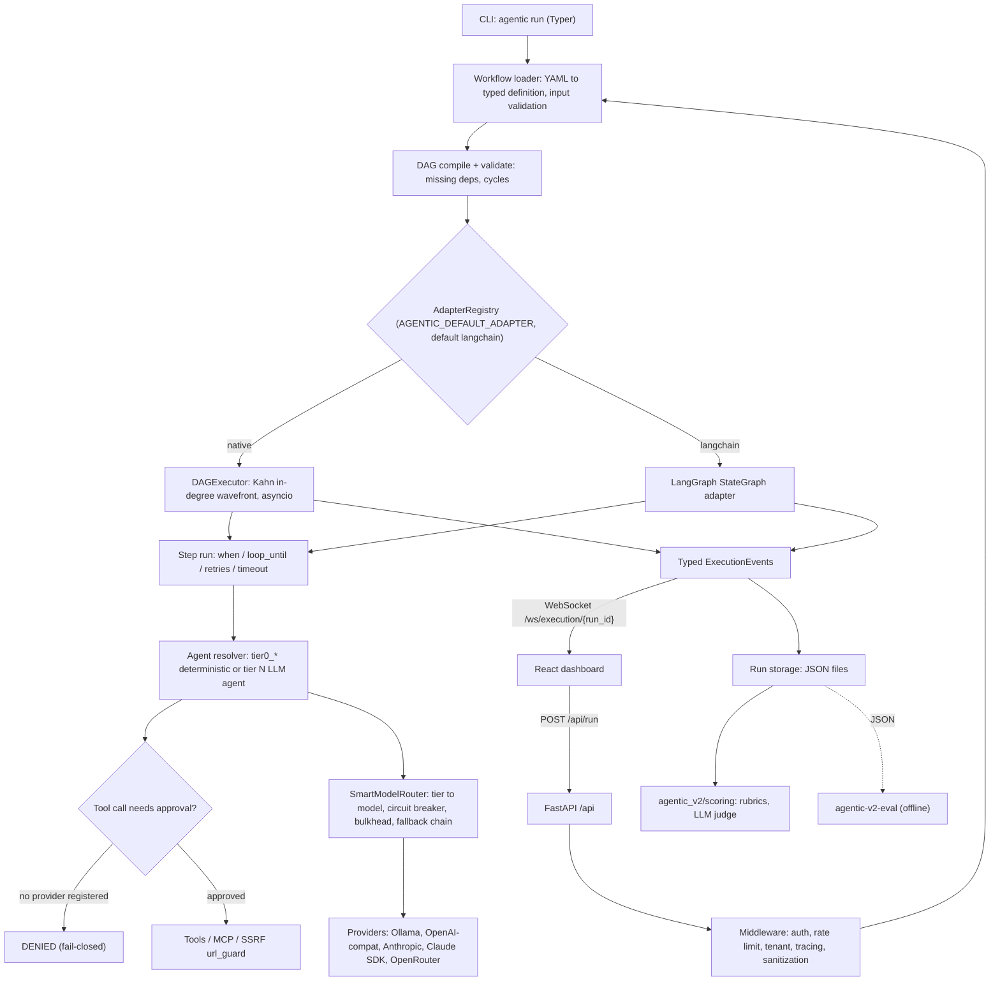
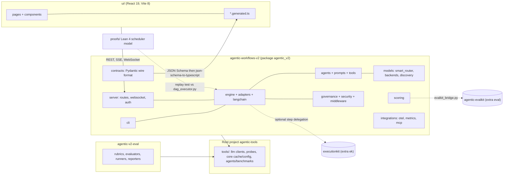
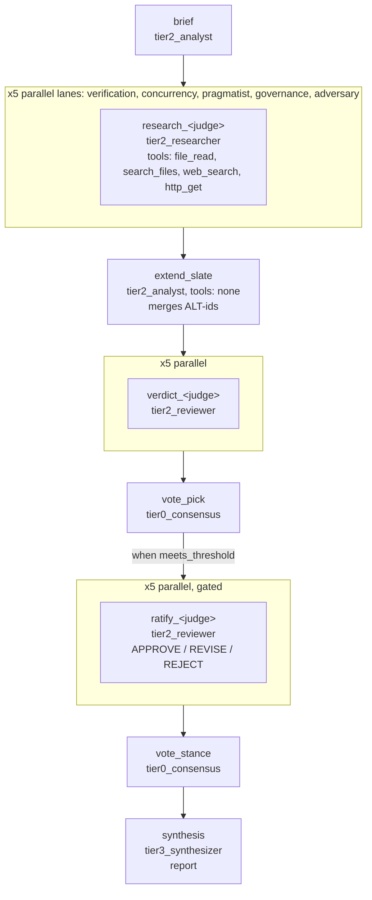
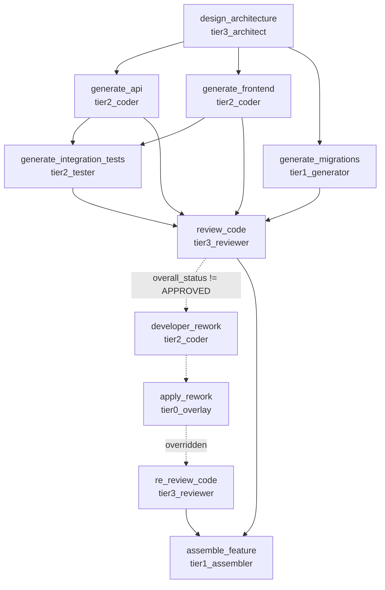

# Agentic Runtime Platform — Repository Inventory

## 0. Executive summary

> **Snapshot:** `origin/main` @ `c3b2d328` (2026-10-12, after tafreeman/agentic-runtime-platform#387), inventoried from a clean detached worktree so in-flight branch work does not skew the counts. In-flight work is reported separately in §9. Git and PR state in this repo moves hourly; re-run the scripts before acting on any count.

### What this repository is

A tier-routed, multi-agent LLM workflow runtime. YAML workflows compile to a DAG. The DAG runs either on a native Kahn's-algorithm asyncio executor or on a LangGraph adapter (the default for named workflows). Each step names a capability tier, never a model. `SmartModelRouter` resolves the tier to a provider through three-state circuit breakers and bulkheads. A FastAPI server streams execution over WebSocket and SSE to a React 19 "ARP Console". A fail-closed governance layer (human-in-the-loop tool approval and an SSRF egress guard) sits in front of tool dispatch. Around the runtime are:

- an offline evaluation harness (`agentic-v2-eval`, being migrated to the external `agentic-evalkit`);
- a shared `tools/` package (model probes, benchmarks);
- Lean 4 proofs of the scheduler.

### Shape at a glance

| Area | Size (main @ c3b2d328) | Health |
|---|---|---|
| Runtime `agentic_v2` | ~244 modules, ~62k LOC, 22 subpackages | Active; 8 modules over 800 LOC; 17% of LOC excluded from the coverage gate |
| Python tests | 287 files, ~4,600 test functions | 80% gate on `agentic_v2`; `tools/tests` runs with 11 deselected tests |
| UI (`agentic-workflows-v2/ui`) | 203 TS/TSX files, 10 routes, 66 unit test files, 13 Playwright specs | Active; Evidence Ledger redesign in flight (#388) |
| HTTP API | 53 `/api` routes and a WebSocket | 7 routes have no UI caller |
| Workflows | 9 YAML definitions | 2 are test fixtures (one duplicates the other) |
| CI | 18 workflow files, 20 jobs in `ci.yml` | One referenced workflow and one bicepparam file are missing |
| Docs | 133 markdown docs, 55 ADRs (5 Proposed) | Many root status docs are stale (HANDOFF, ROADMAP, KNOWN_LIMITATIONS) |

### Top findings (cross-section)

1. **Generated chat contract is checked by CI but never used.** `ui/src/api/chat_request.generated.ts` and `chat_stream_event.generated.ts` pass the `wire-format-drift` gate, but nothing imports them. The UI uses hand-written copies in `ui/src/api/types.ts`. A backend schema change would therefore stay green while the UI types silently drift (§3.5, §4.6).
2. **A silent broken import disables the benchmark LLM-judge.** `tools/agents/benchmarks/evaluation_pipeline.py:34-40` imports reporting helpers from `llm_evaluator`, but they moved to `evaluator_reporting.py`. A `try/except ImportError` swallows the failure, so `HAS_LLM_EVALUATOR` is always False. This is the real cause of the 10 deselected `TestEvaluateTaskOutputLlm` tests (§5.6).
3. **There is no route to submit HITL approval decisions.** `ApprovalRequiredEvent` and `ApprovalDecisionEvent` exist, but no HTTP or WebSocket handler accepts a decision. The WebSocket also ignores every client message, including the `node_config_update` frames the UI sends (§3.1, §4.6).
4. **The two engines aren't interchangeable.** `model_override`, `persona`, `observers` and `model_params` are honoured only by the LangChain adapter. There are two parallel YAML parsers (`workflows/loader.py` and `langchain/config.py`) and two `WorkflowRunner`s. `docs/WORKFLOW_AUTHORING.md` mentions none of this (§2, §5.1).
5. **Dead code is small and well-bounded.** Deletion candidates:
   - Python: `engine/patterns.py` (empty stub), `models/llm.py` (legacy adapter scheduled for deletion by ADR-042), `tools/core/{cache,response_cache,prompt_db}.py` (`cache.py` doesn't even import), `tools/llm/list_gemini.py`.
   - UI: nine unused shadcn primitives (making `react-resizable-panels` a dead dependency), `BBox`, `BSpark`, `useNodeConfigUpdate`, the `NodeConfigOverlay` prototype, `PrototypeLabPage`, and the test-only `SettingsPage` (§2, §4.6, §5.6).
6. **Config and docs have drifted from the code:**
   - `.env.example` documents 5 keys nothing reads and omits about 6 keys the code reads (§3.8).
   - The workspace `CLAUDE.md` §7 and ADR-042 quote the EK and EVK pins as `0.3.x`, but main pins `executionkit>=0.4.0,<0.5.0` and `agentic-evalkit>=0.4.1,<0.5.0` (§1.3).
   - `portfolio-context.md` says 17 CI jobs; there are 20 (§6.1).
   - `docs/deployment-guide.md` still lists the deleted `manifest-temperature-check.yml` (§6.9).
7. **Toolchain versions disagree.** `.nvmrc` says Node 20, CI uses 22, `Dockerfile.ui` uses 26.11. Pre-commit ruff is 0.16.5, but the dev group requires ≥0.16.10. `nginx.conf` proxies neither `/api` nor `/ws` (§4.1, §6.3).
8. **Docs still advertise retired things.**
   - `docs/configuration.md:63` and `docs/getting-started/installation.md:168` still list GitHub Models, which was retired on 2026-07-30 (ADR-016).
   - `docs/deployment-guide.md:13` says CI has "fourteen jobs"; it has 20.
   - ADR-008 says Proposed in its file but Accepted in `ADR-INDEX.md`.
   - `check_docs_refs.py` scans only 19 of about 205 markdown files, so most of `docs/**` is never link-checked (§8).
9. **About 1.2 GB of local-only clutter is on disk.**
   - Safe to delete: caches and build outputs, for example `.mypy_cache/` (620 MB), `.cache/` (134 MB), `proofs/.lake/` (116 MB) and `site/`.
   - Also deletable: the `__pycache__`-only orphan packages `agentic_v2/rag/` and `agentic_v2/memoryctl/`, and `agentic-workflows-v2/New folder (2)/`.
   - Keep: `runs/`, the replay DBs and `.env`, which hold user data (§7).
10. **Some work exists only on this machine.** At extract time:
   - Unpushed or uncommitted: about 2.1k lines of untracked Evidence Ledger components, probe-tooling edits, and a tech-debt plan on the unpushed `docs/tech_debt_plans` branch.
   - `feature/criterion_aggregation`: no PR open.
   - Stalled: #384 (38 dependency bumps, 26 failing checks) (§9).

### How this inventory was produced

All counts come from scripts committed alongside this document. Re-run them against a fresh `origin/main` worktree:

```bash
git worktree add --detach ../arp-main-inventory origin/main
ARP_INVENTORY_REPO=../arp-main-inventory .venv/Scripts/python.exe scripts/inventory/run_all.py
.venv/Scripts/python.exe scripts/inventory/assemble.py
uv run --no-project --with markdown python scripts/inventory/render_html.py
```

| Script | Extracts |
|---|---|
| `scripts/inventory/fs_inventory.py` | Per-directory tracked and untracked counts, sizes, last-commit age, large files, orphan `__pycache__`-only packages |
| `scripts/inventory/py_inventory.py` | AST per module: LOC, classes (Pydantic, Protocol, Enum, …), functions, FastAPI routes, import graph (absolute, relative and lazy), env-var reads, TODO markers, test references, orphan candidates |
| `scripts/inventory/ui_inventory.py` | TS/TSX import graph, exports, `/api` calls, routes, unused and test-only files, external package usage |
| `scripts/inventory/meta_inventory.py` | Workflow YAML steps, CI jobs, ADR statuses, doc staleness and broken links, dependency manifests, git branches, worktrees and PRs |
| `scripts/inventory/assemble.py` / `render_html.py` | Concatenate the section files and render the Superdesign-styled HTML report |

The section narratives (§1–§9) were written by parallel research agents working from that data and the code, each told to verify its claims. Read them with these limitations in mind:

- **Orphan detection is a candidate list, not a verdict.** Registry and string-based wiring evades static import graphs. Every "unused" item in §2, §4 and §5 was re-checked with grep.
- **The env-var extractor misses some reads.** It doesn't catch reads through pydantic `Settings` fields or `get_secret()`; §3.8 corrects for this by hand.
- **File age isn't a reliable staleness signal for the UI.** A broad restyle sweep touched most files within the last week.
- **Items marked "(unverified)" were not confirmed.**

## Contents

- [1. Application overview, architecture, technologies & theory](#1-application-overview-architecture-technologies-theory)
- [2. Runtime backend — components & data structures (agentic_v2)](#2-runtime-backend-components-data-structures-agentic_v2)
- [3. Interfaces — HTTP/WebSocket API, CLI, contracts, configuration](#3-interfaces-httpwebsocket-api-cli-contracts-configuration)
- [4. Frontend — ARP Console (React UI)](#4-frontend-arp-console-react-ui)
- [5. Workflows, prompts, agents, evaluation & shared tools](#5-workflows-prompts-agents-evaluation-shared-tools)
- [6. Build, CI/CD, infrastructure & operations](#6-build-cicd-infrastructure-operations)
- [7. Folder-by-folder inventory](#7-folder-by-folder-inventory)
- [8. Documentation & architecture decision records](#8-documentation-architecture-decision-records)
- [9. Work status — ongoing, stalled, and future](#9-work-status-ongoing-stalled-and-future)

## 1. Application overview, architecture, technologies & theory

Source of truth: clean `origin/main` worktree at revision `c3b2d328` (2026-10-12, "fix(langchain): run each step once, after all its dependencies (#387)"). Paths are repo-relative. Data from `docs/inventory/data/meta_inventory.json` (deps, CI, ADRs) and direct reads of `agentic-workflows-v2/agentic_v2/`.

### 1.1 What the application is

| Item | Finding | Source |
|---|---|---|
| One-line | Python + React monorepo to define, run, observe and evaluate multi-step AI workflows | `README.md` |
| Workflow model | A workflow is a YAML file; steps form a DAG. Independent steps run concurrently, dependents wait, a failure stops downstream steps from running on incomplete data | `README.md`, `docs/ARCHITECTURE.md` |
| Engines | Native asyncio DAG executor, or an optional LangGraph adapter, behind one `ExecutionEngine` Protocol | `agentic-workflows-v2/agentic_v2/core/protocols.py:58`, `agentic_v2/adapters/` |
| Model selection | Steps name a capability **tier**, never a model; `SmartModelRouter` resolves tier to provider/model | `PRODUCT.md`, `agentic_v2/models/smart_router.py` |
| Primary user | A solo developer/operator who authors, runs and debugs workflows via dashboard, CLI and API | `PRODUCT.md` ("Users") |
| Platform | Web (React 19 + Vite dashboard); Python 3.11+ backend (FastAPI) | `PRODUCT.md`, `pyproject.toml` |
| Operating context | Local development and demo; explicitly "not a hosted service" and not a claim that every deployment concern is solved | `README.md`, `PRODUCT.md`, `docs/KNOWN_LIMITATIONS.md` |
| Positioning | "Inspectable runs in one place": live DAG/step streaming, fail-closed approval governance, evaluation evidence, all working with no provider credential (`AGENTIC_NO_LLM=1`) | `PRODUCT.md` |
| Licence | MIT | `README.md`, `LICENSE` |
| Docs site | MkDocs | `mkdocs.yml`, `.github/workflows/docs.yml` |

#### Primary flows

| Flow | Entry point | What happens | Evidence |
|---|---|---|---|
| CLI run | `agentic run <workflow> --input file.json` (Typer; console script `agentic = agentic_v2.cli:main`) | Load + validate workflow, pick adapter (default `langchain`), execute, print `Status: SUCCESS` | `agentic-workflows-v2/pyproject.toml` scripts; `agentic_v2/cli/main.py:218`; `README.md` quick start |
| CLI compare | `agentic compare` | Runs both adapters on the same input | `docs/ARCHITECTURE.md` "Execution engines" (CLI body unverified) |
| API run | `POST /api/run` (workflows router, prefix `/api`) | Validate input against workflow schema, execute, stream events, persist run | `agentic_v2/server/app.py:158-167`, `server/routes/workflows.py`, `docs/flagship.md` |
| Live streaming | WebSocket `/ws/execution/{run_id}` (reconnect/replay) | Typed `ExecutionEvent`s to dashboard | `agentic_v2/server/websocket.py:480` |
| Chat playground | `POST /api/chat` SSE (direct model chat) | Tier or exact-model chat stream | `agentic_v2/server/routes/chat.py`, `docs/adr/ADR-050-chat-playground-sse-and-openrouter-provider.md` |
| Run history | `GET /api/runs`, `/api/runs/summary`, `/api/runs/{filename}` | Saved run JSON for inspection and scoring | `agentic_v2/server/routes/runs.py:74,143,244` |
| Evaluation | evaluation routes, datasets, `agentic_v2/scoring/` | Rubric/judge scoring of saved runs; UI Evaluations + Datasets pages | `server/routes/evaluation_routes.py`, `server/datasets.py`, `ui/src/pages/EvaluationsPage.tsx` |
| Approval-denied run | High-impact tool (`shell`, `file_write`, `build_app`, `http_post`, ...) with no `ApprovalProvider` registered | Call denied before tool body runs, `metadata["approval_decision"] == "denied"` | `README.md`; `agentic_v2/governance/approval.py` (test file `tests/test_approval_gates.py` cited by README, not opened) |
| Offline eval | `agentic-v2-eval` CLI (`agentic_v2_eval.__main__:main`) | Rubrics, evaluators, runners, reporters over structured results | `agentic-v2-eval/pyproject.toml`, `docs/architecture-eval.md` |

#### Shipped workflow definitions (`agentic-workflows-v2/agentic_v2/workflows/definitions/`)

`bug_resolution`, `code_review`, `conditional_branching`, `consensus_review`, `fullstack_generation`, `iterative_review`, `plan_tribunal`, `test_deterministic`, `test_workflow` (9 YAML files on disk; `meta_inventory.json` `workflows` has 12 entries, the extra 3 are from other trees, unverified which).

UI pages (`agentic-workflows-v2/ui/src/pages/`): Dashboard, Workflows, WorkflowDetail, WorkflowEditor, Runs, RunDetail, Live, Evaluations, Datasets, ModelFinder, Settings, PrototypeLab.

### 1.2 Architecture

#### Layers

| Layer | Responsibility | Primary code |
|---|---|---|
| 1. Workflow definition | YAML (inputs, steps, `depends_on`, `when`, `loop_until`/`loop_max`, agent, tools, outputs) | `agentic_v2/workflows/definitions/*.yaml`, `workflows/loader.py` |
| 2. Compile / validate | YAML -> typed definitions -> `DAG`; rejects missing deps (`MissingDependencyError`) and cycles (`CycleDetectedError`) | `agentic_v2/engine/dag.py:19,28,38`, `engine/step.py` |
| 3. Engine seam | `AdapterRegistry` (thread-safe singleton) maps `"native"` / `"langchain"` to engine classes | `agentic_v2/adapters/registry.py`, `adapters/native/engine.py`, `adapters/langchain/engine.py` |
| 4a. Native executor | Kahn in-degree wavefront scheduling on asyncio, cascade skip, top-level timeout, OTel spans | `agentic_v2/engine/dag_executor.py` (718 lines) |
| 4b. LangGraph adapter | Builds a `StateGraph` from the same YAML; join-once edge wiring (ADR-062) | `agentic_v2/langchain/` (graph.py, graph_wiring.py, runner.py, state.py) |
| 5. Agents and steps | `tier{N}_{role}` agent names resolved to functions/agents (`tier0_*` deterministic handlers; others LLM-backed); Markdown persona prompts | `engine/agent_resolver.py:306-310,644-660`, `agentic_v2/agents/`, `agentic_v2/prompts/*.md` |
| 6. Tools and MCP | Tool registry + builtins (file, git, shell, http, code exec, build, memory, search, ...), MCP client stack | `agentic_v2/tools/`, `tools/builtin/`, `integrations/mcp/` |
| 7. Governance and security | Approval gate (fail-closed), SSRF URL guard, sanitization detectors, AST expression sandbox | `governance/approval.py`, `security/url_guard.py`, `middleware/detectors/`, `engine/expressions.py` |
| 8. Model routing | `ModelTier` 0-5, per-tier fallback chains from curated registry, circuit breakers, bulkheads, rate-limit tracker, Redis CAS state | `models/router.py:33`, `models/smart_router.py` (1078 lines), `models/model_registry.py`, `models/redis_state.py` |
| 9. Providers/backends | Ollama, OpenAI-compatible, Anthropic, Claude subscription/SDK, OpenRouter, local discovery (Ollama, LM Studio, Lemonade, Foundry Local, Docker Model Runner) | `models/backends*.py`, `models/*_discovery.py`, `models/client.py` |
| 10. Server | FastAPI app, route groups under `/api`, WebSocket, SSE, auth (API key, JWT/OIDC), rate limit, tenant, audit log, replay store, SPA serving | `agentic_v2/server/` |
| 11. Observability | OpenTelemetry tracer, Prometheus metrics, tracing middleware | `integrations/otel.py`, `integrations/metrics.py`, `server/middleware/{tracing,metrics}.py` |
| 12. Scoring/eval | Runtime scoring of saved runs (rubrics, LLM judge, multidimensional); bridge to `agentic-evalkit` | `agentic_v2/scoring/`, `scoring/evalkit_bridge.py` |
| 13. UI | React 19 console; generated TS wire types | `agentic-workflows-v2/ui/src/` |
| 14. Shared package | Root `agentic-tools` (`tools/`): LLM clients, probes, model inventory, caches, prompt DB, benchmarks | `tools/` |

#### Diagram A - runtime request flow



#### Diagram B - components and packages



#### Doc-versus-code check (verified against `origin/main`)

| Claim (source) | Checked against code | Verdict |
|---|---|---|
| 8 protocols in `agentic_v2/core/protocols.py` (`docs/ARCHITECTURE.md`) | `ExecutionEngine`, `SupportsStreaming`, `SupportsCheckpointing`, `AgentProtocol`, `ToolProtocol`, `DetectorProtocol`, `MiddlewareProtocol`, `VerifierProtocol` at `core/protocols.py:58-238` | Agrees |
| `agentic run` defaults to `langchain`; server validates `AGENTIC_DEFAULT_ADAPTER` at startup | `cli/main.py:218`, `server/lifespan.py:65-83` (default `"langchain"`) | Agrees |
| Six-level tier enum (`docs/architecture-runtime.md:299-310`) | `models/router.py:33-44` TIER_0..TIER_5 | Agrees; `agent_resolver._infer_tier` also parses `tier4_`/`tier5_` (`engine/agent_resolver.py:644-660`) |
| "8 Pydantic models -> 8 JSON Schemas -> 8 `.generated.ts`" (`.claude/rules/portfolio-context.md`) | 8 `*.generated.ts` in `ui/src/api/` (chat_request, chat_stream_event, dag_response, events, runs_summary, step_result, workflow_editor_step, workflow_input_schema) | Agrees |
| `docs/ARCHITECTURE.md`: dashboard "imports generated TypeScript rather than maintaining a separate handwritten copy" | `docs/KNOWN_LIMITATIONS.md` 1.1: only eight shapes generated/gated; other payloads manually mirrored in `ui/src/api/types.ts` | **Docs disagree with each other**; ARCHITECTURE overstates, KNOWN_LIMITATIONS is accurate |
| `.claude/rules/portfolio-context.md`: "`ci.yml` defines 17 blocking jobs" | `meta_inventory.json` lists 20 job ids in `.github/workflows/ci.yml`: python-smoke, frontend-build, frontend-test, lint, suppression-ratchet, typecheck-core-contracts, test-coverage, claude-subscription-tests, ek-delegation-tests, evalkit-bridge-tests, wire-format-drift, e2e-streaming, no-llm-smoke, validate-workflows, check-doc-drift, doc-stats-drift, pydocstyle, lockfile-constraints, dockerfile-constraints, tools-tests | **Stale count** (how many are "blocking" is unverified) |
| Workspace `<workspace>/CLAUDE.md` s.7: EK and EVK pinned `>=0.3.0,<0.4.0` | `agentic-workflows-v2/pyproject.toml`: `ek = executionkit>=0.4.0,<0.5.0`, `eval = agentic-evalkit>=0.4.1,<0.5.0` | **Workspace CLAUDE.md stale** (outside the repo) |
| ADR-031 title "native DAG single engine" | Status Superseded; header says proposal **not adopted**, LangGraph adapter retained | Filename misleading; dual-engine is current (ADR-001, ADR-020, ADR-062) |
| `docs/ARCHITECTURE.md`: runtime scoring and `agentic-v2-eval` need not import each other | `scoring/evalkit_bridge.py` couples runtime scoring to external `agentic-evalkit` (extra `eval`, ADR-042) | Not a contradiction, but ARCHITECTURE omits the evalkit bridge |
| Native engine "dependency-light" | `server/lifespan.py:73-83`: default adapter is `langchain`; without the `langchain` extra the server warns and tells you to set `AGENTIC_DEFAULT_ADAPTER=native` | Matches ADR-020; the default is not the lightweight engine |
| Engines interchangeable "for compatible workflows" | `workflows/definitions/plan_tribunal.yaml` header: native ignores `model_override` and lacks `search_files`/`web_search` | Engines are not behaviourally equivalent; ARCHITECTURE says to check support (agrees) |

### 1.3 Package and workspace structure

| Unit | Path | Name / version | Role | Depends on |
|---|---|---|---|---|
| Workspace root | `pyproject.toml` | `agentic-tools` 0.1.0 (hatchling wheel `packages = ["tools"]`) | Shared utilities (`tools/`); owns `[tool.uv.workspace]` | pyyaml, aiohttp, pydantic, langchain-core, anthropic, openai, numpy |
| Runtime | `agentic-workflows-v2/` | `agentic-workflows-v2` 0.1.0 | Engine, agents, models, CLI (`agentic`), FastAPI server | pydantic, httpx, ollama, jinja2, jmespath, typer, rich, ... + `agentic-tools` |
| Eval | `agentic-v2-eval/` | `agentic-v2-eval` 0.3.0 | Offline rubric/evaluator/runner/reporter package (`src/`: adapters, evaluators, metrics, reporters, rubrics, runners, sandbox); console script `agentic-v2-eval` | pyyaml, `agentic-tools` |
| UI | `agentic-workflows-v2/ui/` | `agentic-workflows-ui` 0.1.0 (private, ESM) | React dashboard | see 1.4 |
| Root npm stub | `package.json` | `agentic-runtime-platform` | Only `@playwright/test`; `npm test` deliberately errors | none |
| Formal proofs | `proofs/` | Lake package, Lean 4.34.0 core only | Scheduler model, proofs, replay executable | no Mathlib/Batteries |
| Other trees | `datasets/`, `examples/`, `infra/`, `load/`, `otel/`, `scripts/`, `tests/e2e`, `.devcontainer/`, `.github/` | - | Data, demos, deploy, k6 load harness, OTel collector config | - |

Relationships:
- uv workspace members are the runtime and eval packages only; the root project (`agentic-tools`) owns `tools/` itself (comment in root `pyproject.toml`). `ci-constraints.txt` is generated from `uv.lock`; every pip install is pinned to it (`.claude/rules/portfolio-context.md`).
- Both Python packages depend on installed `agentic-tools`; `docs/ARCHITECTURE.md` forbids path hacks into `tools/`. `.claude/rules/portfolio-context.md` states there are zero cross-imports between the two workspace packages.
- Pydantic (`agentic_v2/contracts/`, `server/models.py`) -> committed JSON Schemas (`agentic-workflows-v2/tests/schemas/`) -> `ui/src/api/*.generated.ts` via `python -m scripts.generate_ts_types` then `npm run generate:types`; CI job `wire-format-drift` enforces (ADR-014).

#### Cross-repo and optional-backend dependencies

| Dependency | Mechanism | Pin at this revision | Coupling | Source |
|---|---|---|---|---|
| executionkit (EK) | Extra `ek` | `executionkit>=0.4.0,<0.5.0` | Guarded imports, falls back to native loop: `engine/ek_step_delegation.py` (510 lines), `models/ek_provider.py`, `models/ek_adapters.py`. Only CI job `ek-delegation-tests` installs the extra. Workspace notes say it imports the private `executionkit.patterns.base._TrackedProvider` (not re-verified here) | `agentic-workflows-v2/pyproject.toml`; ADR-023; `.claude/rules/portfolio-context.md` |
| agentic-evalkit (EVK) | Extra `eval` | `agentic-evalkit>=0.4.1,<0.5.0` | `scoring/evalkit_bridge.py`; CI job `evalkit-bridge-tests` | `agentic-workflows-v2/pyproject.toml`; ADR-042 |
| Claude backends | Extra `claude` | `anthropic>=0.40,<2`, `claude-agent-sdk>=0.1,<1` | `models/backends_claude.py`, `agents/implementations/claude_*`; CI job `claude-subscription-tests` | ADR-058 |

### 1.4 Technologies

Versions are declared constraints (pyproject / package.json), not installed versions. "Extra" = optional-dependency group in `agentic-workflows-v2/pyproject.toml`.

#### Python backend

| Group | Technology | Constraint | Used for / where |
|---|---|---|---|
| Web | FastAPI (extra `server`) | `>=0.100,<1` | App factory `server/app.py`, routers `server/routes/` |
| Web | uvicorn[standard] | `>=0.23,<1` | ASGI server |
| Web | python-multipart | `>=0.0.31,<1` | Form/upload parsing |
| Web | slowapi | `>=0.1.9,<1` | Rate limiting, `server/middleware/rate_limit.py` (ADR-018) |
| Web/Auth | pyjwt[crypto] | `>=2.13,<3` | JWT/OIDC, `server/auth_oidc.py` (ADR-021) |
| Web | websockets (extra `mcp`) | `>=12.0,<18` | MCP WebSocket transport, `integrations/mcp/transports/` |
| HTTP | httpx | `>=0.25,<1` | Provider/HTTP clients |
| HTTP | aiohttp | `>=3.14.3,<4` | Async HTTP (runtime and root) |
| HTTP | aiofiles | `>=23.0,<26` | Async file IO |
| LLM/providers | ollama | `>=0.5.1,<1` | Ollama SDK backend (ADR-036) |
| LLM/providers | anthropic | `>=1.8.0,<2` (root); `>=0.40,<2` (extra `claude`) | Anthropic client |
| LLM/providers | openai | `>=3.19.2,<4` (root) | OpenAI-compatible clients |
| LLM/providers | claude-agent-sdk | `>=0.1,<1` (extra `claude`) | Claude subscription backend (ADR-058) |
| Orchestration | langchain, langchain-core | `>=1.3.9,<2`, `>=1.3,<2` (root core `>=1.6.5,<2`) | LangGraph adapter, `agentic_v2/langchain/` |
| Orchestration | langgraph | `>=1.2,<2` | `StateGraph` execution |
| Orchestration | langgraph-checkpoint, -sqlite, -postgres | `>=4.0.3,<5`, `>=3.1.1,<4`, `>=3.1.1,<4` | Checkpointing (extras `langchain`, `postgres`) |
| Orchestration | langchain-openai / -anthropic / -google-genai / -mistralai / -ollama | `>=1.2`, `>=1.4.6`, `>=4.2`, `>=1.1`, `>=1.1` | `langchain/model_builders.py` |
| Orchestration | langsmith | `>=0.8.18,<1` | LangChain tracing hooks |
| Orchestration | executionkit | `>=0.4.0,<0.5.0` (extra `ek`) | Step delegation |
| Data/validation | pydantic, pydantic-settings | `>=2.0,<3`, `>=2.14.2,<3` | Contracts, settings (`settings.py`) |
| Data/validation | pyyaml | `>=6.0,<7` | Workflow YAML |
| Data/validation | jinja2, jmespath | `>=3.0,<4`, `>=1.0,<2` | Templating, JSON querying |
| Data/validation | cachetools, filelock | `>=5.0,<8`, `>=3.0,<5` | Caching; file-lock shared breaker state |
| Data/validation | numpy | `>=2.4.6,<3` (root) | Shared tools |
| Data/validation | pandas | `>=3.0.5,<4` (extra `swe-ab`) | SWE A/B evals |
| CLI | typer, rich, python-json-logger | `>=0.9,<1`, `>=13,<16`, `>=3,<5` | `agentic` CLI, display, JSON logs |
| Observability | opentelemetry-sdk + OTLP grpc/http exporters | `>=1.20,<2` (extra `tracing`) | `integrations/otel.py` |
| Observability | opentelemetry-exporter-prometheus, prometheus-client | `>=0.48b0,<1`, `>=0.17,<1` | `integrations/metrics.py` |
| Storage | redis[hiredis] (extra `redis`) | `>=5.0,<9` | Breaker CAS state (`models/redis_state.py`), replay store |
| Storage | aiosqlite (extra `sqlite`) | `>=0.19,<1` | SQLite replay/checkpoints |
| Storage | psycopg[binary] (extra `postgres`) | `>=3.1,<4` | PostgreSQL checkpoints |
| Storage | vector store | none | RAG package removed (ADR-057); no `rag` extra at this revision |
| Dev tooling | psutil (extra `devex`) | `>=6.0` | `agentic_v2/devex/` |
| Testing | pytest, pytest-asyncio, -cov, -mock, -timeout | runtime dev `>=7`, `>=0.21`, `>=4`, `>=3.12`, `>=2.2`; root dev pytest `>=9.1.1`, asyncio `>=1.4.0` | `agentic-workflows-v2/tests`, `agentic-v2-eval/tests`, `tests/e2e`, `tools/tests` |
| Testing | hypothesis, fakeredis[lua], jsonschema | `>=6,<7`, `>=2.21,<3`, `>=4.18` | Property tests; Redis/Lua CAS tests; schema checks |
| Lint/type | ruff | `>=0.16.10` (root dev) | Rules `E,F,W,I,N,UP,S,B,A,C4,SIM,TCH,RUF`, line length 88 (`.claude/rules/ci.md`) |
| Lint/type | black, mypy, pydocstyle, pre-commit | `>=26.5.1`, `>=2.4.0`, `>=6.3`, `>=4.6.2` (root dev) | mypy strict on `engine` + `contracts` + eval src |
| Build | hatchling; uv (`uv.lock`, CI pins `uv==0.11.2`) | - | Wheels, workspace, constraints export |

#### Frontend (`agentic-workflows-v2/ui/package.json`)

| Group | Technology | Constraint | Used for |
|---|---|---|---|
| Framework | react, react-dom | `^19.3.0` | UI |
| Routing/data | react-router-dom, @tanstack/react-query | `^7.18.4`, `^5.104.1` | Routing, server state |
| Graph | @xyflow/react | `^12.12.0` | DAG visualisation/editor |
| UI kit | radix-ui, cmdk, sonner, lucide-react, react-resizable-panels, @dnd-kit/core | `^1.7.0`, `^1.1.1`, `^2.0.8`, `^1.54.0`, `^4.14.3`, `^6.3.1` | Components, command palette, toasts, icons, panes, drag-drop |
| Styling | tailwindcss + @tailwindcss/postcss, postcss, class-variance-authority, clsx, tailwind-merge, @fontsource-variable/geist | `^4.3.3`, `^8.5.29`, `^0.7.1`, `^2.1.1`, `^3.7.0`, `^5.3.0` | Evidence Ledger tokens (`DESIGN.md`, `ui/src/styles/tokens.css`) |
| Telemetry | @opentelemetry/api, sdk-trace-web, exporter-trace-otlp-http, instrumentation-fetch | `^1.9.0`, `^2.12.0`, `^0.223.0` | Browser tracing (`ui/src/telemetry/`) |
| Build | vite, @vitejs/plugin-react, typescript | `^8.3.4`, `^6.1.2`, `^7.0.2` | `tsc -b && vite build` |
| Codegen | json-schema-to-typescript | `^16.0.0` | `ui/scripts/generate-ts-types.mjs` |
| Testing | vitest, @vitest/coverage-v8, jsdom, @testing-library/react + jest-dom, @playwright/test | `^5.0.1`, `^5.0.3`, `^30.1.2`, `^16.3.3`, `^7.0.1`, `^1.64.0` | Unit/coverage (floors in `ui/vitest.config.ts`), E2E streaming |

#### Build, CI, ops, formal methods

| Group | Technology | Where |
|---|---|---|
| Task runner | `just` (PowerShell shell) | `justfile`: `setup`, `test`, `docs`, `relock` |
| Containers | Docker, Compose, devcontainer | `Dockerfile`, `Dockerfile.ui`, `docker-compose.yml`, `.devcontainer/` |
| CI | GitHub Actions, 18 workflow files: ci, codeql, dependabot-auto-merge, dependabot-relock, dependency-audit, dependency-drift-check, dependency-review, deploy, devcontainer-validate, docs, eval-package-ci, infra-deploy, lean-proofs, load-report-pages, nightly, sbom, upstream-compatibility, windows-workflows-ci | `.github/workflows/` (`meta_inventory.json` `ci`) |
| Quality/security | pre-commit (black, isort, ruff, docformatter, detect-secrets), CodeQL, SonarQube, SBOM, dependency review | `.pre-commit-config.yaml`, `.secrets.baseline`, `sonar-project.properties`, `docs/SUPPLY_CHAIN.md` |
| Docs | MkDocs | `mkdocs.yml`, `docs/` |
| Load | k6 + Docker | `load/`, `docs/load-report.md`, `docs/flagship.md` |
| IaC | `infra/` deployed via `infra-deploy.yml` | contents not inspected |
| Formal methods | Lean 4.34.0 + Lake, `leanchecker`, axiom audit | `proofs/`, `.github/workflows/lean-proofs.yml` |
| Toolchain | Python 3.11, Node 20+ | `.python-version`, `.nvmrc` |

### 1.5 Theories, concepts and patterns implemented

| # | Concept | What it is | Where implemented | ADR |
|---|---|---|---|---|
| 1 | Kahn's topological DAG execution | Track per-step in-degree at runtime; launch every zero-in-degree step concurrently (wavefront); unlock dependents on completion | `engine/dag.py` (`DAG`, topological order, validate), `engine/dag_executor.py` (`_schedule_ready_steps`, `_unlock_downstream`, `_scheduling_loop`) | ADR-001/002/003, ADR-019 |
| 2 | Cascade skip / honest status | Failed step's transitive dependents are SKIPPED with a reason; run is SUCCESS only if nothing failed or was dropped | `engine/dag_executor.py` (`_cascade_skip`, `_mark_skipped`), `agents/orchestrator.py` | ADR-060 |
| 3 | Formal verification of the scheduler | Lean 4 model of `DAGExecutor` proves safety, no duplicates / bounded parallelism, completeness, honest status over every legal completion order; a replay test ties model to code on sampled schedules (not a proof of the Python) | `proofs/Scheduler.lean`, `proofs/Scheduler/`, `proofs/Main.lean`, `tests/engine/test_dag_executor_lean_replay.py` (named in `proofs/README.md`, not opened) | ADR-060 |
| 4 | Engine swap behind a Protocol seam | Structural `typing.Protocol` contracts + thread-safe registry | `core/protocols.py`, `adapters/registry.py` | ADR-001, ADR-020; ADR-031 (single-engine, not adopted) |
| 5 | Join-once semantics for superstep engines | Each step runs once after all deps even on LangGraph | `langchain/graph_wiring.py` (`wire_graph_edges`, `wire_dependency_edges`, `build_loop_exit_map`, `add_loop_edge`) | ADR-062 |
| 6 | Capability-tier routing | Steps request tier 0 (deterministic) to 5 (premium cloud); router resolves via per-tier fallback chains from a curated registry | `models/router.py` (`ModelTier`, `register_chain`, `DEFAULT_CHAINS`), `models/smart_router.py`, `models/model_registry.py` | ADR-040, ADR-059, ADR-051 |
| 7 | Three-state circuit breaker | CLOSED / OPEN / HALF_OPEN per provider with single-probe lock; `CircuitResolvedError` when a prior probe already resolved the circuit | `models/smart_router.py` (`execute_with_bulkhead`, ~lines 814-1016), `models/model_stats.py` | ADR-001/002/003 (ADR-002A) |
| 8 | Bulkheads | Per-provider semaphores prevent cascade failure | `models/smart_router.py:190,256` | ADR-002A |
| 9 | Shared breaker state via compare-and-swap | Lua-script atomic CAS in Redis keeps counters exact under concurrent writers; evidence is a k6 run plus an exact-sum worker test | `models/redis_state.py`, `docs/flagship.md`, `load/` | no dedicated ADR found (unverified) |
| 10 | Health, cooldown, rate-limit awareness | Honour retry guidance, cooldowns, HTTP-status error classification | `models/smart_router.py` (`CooldownConfig`), `models/rate_limit_tracker.py`, `models/retry_utils.py` | none |
| 11 | Majority-vote consensus / self-consistency | Same prompt N times, deterministic tier-0 vote, `min_agreement` threshold | `engine/consensus.py` (`majority_vote`, `self_consistency`), `engine/agent_resolver.py:309` (`tier0_consensus`), `workflows/definitions/consensus_review.yaml` | ADR-023 (EK relationship) |
| 12 | Plan tribunal (multi-judge panel) | Five persona judges, two-stage deterministic vote, dissent recorded, split ruling never presented as a decision | `workflows/definitions/plan_tribunal.yaml` | none found |
| 13 | Bounded iterative review loop | `loop_until` + `loop_max` review-rework cycles; verification gate/loop for post-step checks | `workflows/definitions/iterative_review.yaml`, `engine/step.py`, `engine/verification.py` (`VerificationGate`, `VerificationLoop`) | ADR-019 for timeout; loop-specific ADR unverified |
| 14 | Adaptive decomposition / orchestrator | Orchestrator plans subtasks, validates plan as a DAG, runs with `max_parallel`, fallback chains, escalation | `agents/orchestrator.py`, `orchestrator_planning.py`, `orchestrator_models.py`, `governance/escalation.py` | ADR-029, ADR-025, ADR-060 |
| 15 | LLM-as-judge rubric scoring | Rubric criteria scored by a judge model; multidimensional profiles | `scoring/judge.py` (`LLMJudge`, `JudgeResponseProvider`), `scoring/rubrics/`, `scoring/multidimensional_scoring.py`, `prompts/judges/`, `agentic-v2-eval/src/` | ADR-009, ADR-010, ADR-032, ADR-044 |
| 16 | Discriminated-union wire format + codegen | Pydantic `Field(discriminator="type")` unions -> JSON Schema -> generated TS; CI drift gate | `contracts/events.py:181`, `contracts/chat.py:84,262`, `ui/scripts/generate-ts-types.mjs`, `tests/schemas/` | ADR-014, ADR-052 |
| 17 | Fail-closed governance (HITL) | No `ApprovalProvider` registered => tool call denied; gate runs before validation at both dispatch points; timeouts | `governance/approval.py` (`AutoDenyProvider`, `PolicyApprovalProvider`, `tool_requires_approval`), `engine/tool_execution.py` | ADR-041, ADR-045, ADR-047 |
| 18 | SSRF egress guard | Block private/loopback/metadata addresses; resolve-and-pin to limit DNS rebinding; residual risk documented | `security/url_guard.py` (`validate_url`, `validate_url_pinned`, `check_resolved_address`), `tools/builtin/http_ops.py` | ADR-030; KNOWN_LIMITATIONS 4.4 |
| 19 | AST expression sandbox | `when` / `loop_until` parsed via `ast.parse(mode="eval")` and a whitelist interpreter; no `eval()` | `engine/expressions.py:101-132`, `langchain/expressions.py` | ADR-024 |
| 20 | Content sanitization and secret masking | Detector chain (injection, PII, secrets, unicode); entropy-based masking; JSON-safe masks that do not break parsing | `middleware/detectors/`, `middleware/policy.py`, `middleware/response_sanitizer.py`, `contracts/sanitization.py` | ADR-046, ADR-061 |
| 21 | AuthN/AuthZ and tenancy | API key + JWT/OIDC, per-IP auth throttle, client-supplied `X-Tenant-ID` path scoping (spoofable by default) | `server/auth.py`, `server/auth_oidc.py`, `core/tenant.py`, `server/middleware/rate_limit.py` | ADR-018, ADR-021, ADR-022; KNOWN_LIMITATIONS 4.1, 4.2, 4.5 |
| 22 | Process-wide token budget | Global cap on tokens consumed | grep hits in `engine/tool_execution.py`, `contracts/verification.py`, `engine/ek_step_delegation.py` (exact owner unverified) | ADR-048 |
| 23 | OpenTelemetry tracing | Spans per run/step (tracer from `integrations/otel.py`), server tracing middleware, browser OTel, Prometheus metrics | `engine/dag_executor.py:27,610`, `integrations/otel.py`, `server/middleware/tracing.py`, `ui/src/telemetry/`, `otel/` | none |
| 24 | Deterministic no-LLM mode | `AGENTIC_NO_LLM=1` swaps model clients for placeholders; `tier0_*` agents run deterministic handlers; supported credential-free baseline | `langchain/model_builders.py:972` (`PlaceholderChatModel`), `models/backends.py:37`, `models/client.py` (`ERR_NO_LLM_BACKEND`), `settings.py`, `docs/NO_LLM_MODE.md`, `workflows/definitions/test_deterministic.yaml` | none |
| 25 | Tool descriptions as selection mechanism / forced tool choice | Tool selection steered by description quality and `tool_choice` forcing | `tools/base.py`, `tools/registry.py` | ADR-027, ADR-028 |
| 26 | Step-output parsing unification | One parser for LLM output so both engines see the same data | `engine/llm_output_parsing.py` (1015 lines) | ADR unverified |
| 27 | Typed step artifacts / path-first IO | Steps exchange typed artifact contracts; path-first IO is only proposed | `workflows/artifact_extractor.py` | ADR-052 (Accepted), ADR-034 (**Proposed**) |
| 28 | Model discovery and pricing annotation | Live discovery of local/cloud models, curated registry, price labels, weight-integrity checks | `models/*_discovery.py`, `models/price_annotation.py`, `models/weight_integrity.py` | ADR-037, ADR-038, ADR-039, ADR-040 |
| 29 | Prompt versioning registry | Versioned prompts | `prompts/registry.py` | ADR-056 |
| 30 | Guarded delegation to ExecutionKit | Optional step delegation to an external pattern library | `engine/ek_step_delegation.py` | ADR-023 |
| 31 | Evidence-labelled claims | Claims graded SOURCE/TEST/RUNTIME/LIVE-VERIFIED, INFERRED, UNVERIFIED | `AI_EVIDENCE_STANDARD.md`, `docs/PROOF_LEDGER.md` | none |

Removed or superseded concepts (do not expect code): RAG pipeline (ADR-035 Superseded; ADR-057 removed the package); GitHub Models as default E2E LLM (ADR-016 Superseded; service retired upstream 2026-07-30 per `docs/architecture-runtime.md:595`); single-engine native DAG (ADR-031 Superseded, never adopted). Numbering gaps in `docs/adr/` (no files for 004-006, 013, 049, 053) are declared intentional in `docs/adr/ADR-INDEX.md` (the declared list itself was not re-read here).

### 1.6 Design principles and constraints

| Principle / constraint | Statement | Source |
|---|---|---|
| Steps name tiers, not models | Workflow structure separate from model selection; router resolves env pins, saved UI settings, availability, health, fallbacks | `PRODUCT.md`, `docs/ARCHITECTURE.md` |
| Fail closed and show why | Approval-required tools denied without a provider | `PRODUCT.md`, `README.md` |
| Work credential-free | `AGENTIC_NO_LLM=1` is the supported no-key baseline; never imply a provider is required | `PRODUCT.md`, `.claude/rules/ci.md` |
| Legible run state before pretty | Operator must see what ran, what failed, why | `PRODUCT.md` |
| Do not overclaim maturity | Link limitations; no testimonials or hosted-service claims | `PRODUCT.md`, `docs/KNOWN_LIMITATIONS.md` |
| Evidence over assertion | Cite active call path; mock/no-LLM tests are not live-provider evidence; missing evidence is UNVERIFIED not a defect; date live/perf claims; prefer behaviour over test counts | `AI_EVIDENCE_STANDARD.md` (10 rules) |
| Smallest coherent change, reuse infra | One concern per PR; reuse `SmartModelRouter`, `ExecutionContext`, `ConversationMemory`, MCP client stack, error-classification helpers | `CLAUDE.md` |
| Secrets only via env / `.env.example` | Never read/edit/commit `.env` | `CLAUDE.md` |
| Package boundaries intact | Runtime, eval, tools, UI each own their area; no path hacks into `tools/` | `CONTRIBUTING.md`, `docs/ARCHITECTURE.md` |
| Generated files preserved unless contract changed | Contract change => regenerate schemas + TS and commit | `CONTRIBUTING.md`, `.claude/rules/ci.md` |
| Automated-evidence gates (solo, AI-assisted) | AI-generated code is untrusted input; ruff + mypy + tests + docs + pre-commit green | `.claude/rules/ci.md` |
| Coverage gate | 80% over `agentic_v2` configured subset, `precision = 2`; UI vitest floors (branches >=56 ratchet, others >=60) | `.claude/rules/ci.md`, `ui/vitest.config.ts` |
| Suppression ratchet | A new ruff `ignore`, per-file-ignore, or mypy `ignore_errors` fails CI | `.claude/rules/portfolio-context.md` (`scripts/check_suppression_ratchet.py`) |
| Style | Black 88, Ruff, typed public interfaces; snake_case modules, PascalCase classes/components, UPPER_CASE constants | `CONTRIBUTING.md` |
| ADR required for boundary changes | Wire format; engine/provider/storage backend; auth, approval, path containment, egress; new patterns | `CONTRIBUTING.md` "Write an ADR" |
| ADRs immutable | Do not rewrite accepted ADRs; supersede and update `ADR-INDEX.md` | `docs/ARCHITECTURE.md` |
| Conventional commits | `type(scope): subject`; scope = subsystem | `.claude/rules/ci.md`, `CONTRIBUTING.md` |
| Changelog | User-visible changes under `Unreleased` | `CONTRIBUTING.md` |
| UI design system "Evidence Ledger" | Warm paper neutrals, one vermilion accent (`#ef5a36`), hairline borders over shadows, radii 2/4/8px, Georgia display + Geist body + mono for ids; `ui/src/styles/tokens.css` is authoritative over `DESIGN.md` | `DESIGN.md`, ADR-054 |
| Windows supported | cp1252 console gotchas, UTF-8 env vars | `docs/KNOWN_LIMITATIONS.md` 3.2, `.claude/rules/portfolio-context.md` |

#### Known limitations that bound the architecture (`docs/KNOWN_LIMITATIONS.md`)

| Ref | Limitation |
|---|---|
| 1.1 | Wire format generated for 8 shapes only; others manually mirrored |
| 1.2 | 80% coverage gate scopes out optional provider/plugin modules (`[tool.coverage.run] omit`) |
| 2.1 | LangChain adapter needs a separate extras install |
| 3.1 | Blocking CI does not prove live provider behaviour |
| 4.1, 4.2 | Rate limiting and auth throttle are in-process only (multi-replica caveat) |
| 4.3 | Human approval gates are programmatic only; no UI pause/resume yet |
| 4.4 | SSRF guard cannot fully close DNS rebinding without network-layer egress control |
| 4.5 | `X-Tenant-ID` is client-supplied and spoofable by default |
| 4.12-4.14 | Model inventory command fails from repo root; `onnx:` IDs unusable for exact-model chat; strict weight verification not wired into every loader |
| 4.15 | Eleven `tools/tests` cases assert a removed API; `ci.yml` now lists a `tools-tests` job, so whether this is still current is unverified |

## 2. Runtime backend — components & data structures (agentic_v2)

Scope: `agentic-workflows-v2/agentic_v2/` at origin/main `c3b2d328` (clean worktree `../arp-main-inventory`). 244 Python modules, 61,892 LOC (inventory counts, `__init__` files included). Only console script: `[project.scripts] agentic = "agentic_v2.cli:main"` (`agentic-workflows-v2/pyproject.toml:130-131`). Section 3 covers the HTTP/WS API; section 5 covers the YAML workflow definitions; this section covers the Python components behind them.

### 2.0 How to read the tables

- **LOC** — physical lines from `docs/inventory/data/py_inventory.json`.
- **used by** — distinct in-package modules importing the module, recomputed by AST with relative imports resolved. The raw `imported_by` field misses `from .x import y`, which is why `contracts.schemas` and `governance.escalation` looked orphaned there. A `(pkg)` row counts importers of the package itself.
- **tests** — number of test files (`agentic-workflows-v2/tests/**`, repo-root `tests/**`) that contain the module path or one of its public class/function names. A name-match heuristic: `0` is reliable (no reference anywhere); a positive count is an upper bound on real coverage.
- **status** — `Active` = imported by another runtime module; `Test-only` = imported by no runtime module but referenced by tests; `Orphan?` = neither (only `models.llm` after verification; see 2.24). Flags `>800 LOC`, `TODO`, `no tests` are appended. `Active (pkg)` marks `__init__` re-export hubs.
- Purpose is the module docstring first line; where empty, the first public class/function docstring; a few docstring-less modules got a hand-written purpose.

### 2.0.1 Layering at a glance

| layer | subpackages | notes |
|---|---|---|
| Contracts and core | `contracts`, `core`, `artifact_contracts`, `settings`, `ui_settings` | Pydantic wire types, protocols, error hierarchy, tenant scoping, env-driven settings; imported by nearly everything. |
| Execution engine | `engine`, `adapters`, `workflows`, `langchain` | Native DAG executor (`engine/dag_executor.py`) vs LangGraph path (`langchain/`), selected through `adapters/registry.py`. |
| Model plane | `models`, `prompts`, `config/defaults` | Tier routing, backends, discovery, circuit breakers, curated registry (`config/defaults/model_registry.yaml`). |
| Agents and tools | `agents`, `tools`, `integrations` (MCP) | Agent classes, built-in tools, MCP client stack. |
| Safety | `governance`, `middleware`, `security` | Approval gate, escalation sink, prompt/response sanitization chain, SSRF URL guard. |
| Scoring | `scoring`, `evaluation` | Rubric/judge scoring, hard gates, EvalKit bridge. |
| Surfaces | `server`, `cli`, `devex` | FastAPI app (summary only here), Typer CLI, dev tooling. |

### 2.1 Top-level modules

The package `__init__` is a large re-export hub (agents, contracts, engine and model symbols; `__version__ = "0.1.0"`, `agentic-workflows-v2/agentic_v2/__init__.py`). `settings.py` is the single pydantic-settings class reading `AGENTIC_*`/OTEL env vars, including `AGENTIC_NO_LLM` (the supported keyless baseline). `ui_settings.py` is the runtime-mutable, file-persisted store behind the settings UI (providers, tier overrides, versioned model packs; path via `AGENTIC_UI_SETTINGS_PATH`). `artifact_contracts.py` / `artifact_overlay.py` implement typed inter-step artifact contracts and the code-artifact rework overlay (imported by `engine/agent_resolver.py` and `langchain/graph_wiring.py`). `logging_config.py` configures logging.

| module | LOC | purpose | key symbols | used by | tests | status |
|---|---:|---|---|---:|---:|---|
| `__init__` | 210 | Agentic Workflows V2 - Tier-based multi-model orchestration. | - | 1 | 8 | Active (pkg) |
| `settings` | 556 | Centralised application settings. | `Settings`, `is_agentic_no_llm_enabled`, `get_settings` | 26 | 36 | Active |
| `ui_settings` | 370 | Runtime-mutable UI settings store. | `ProviderConfig`, `ModelPackRef`, `ModelPack`, `UiSettings`, `is_valid_api_key_env`, `get_ui_settings_path`, `load_ui_settings` | 7 | 4 | Active |
| `artifact_contracts` | 367 | Typed content contracts for artifacts passed between workflow steps. | `ArtifactContract`, `ContractDiagnostic`, `ArtifactContractError`, `ArtifactContractConfigError`, `parse_artifact_contracts`, `validate_contract_bindings`, `validate_code_artifact` | 5 | 5 | Active |
| `artifact_overlay` | 77 | Lay reworked code artifacts over the originals, file by file. | `overlay_code_artifact`, `overlay_code_artifacts` | 2 | 1 | Active |
| `logging_config` | 82 | Logging configuration for agentic-workflows-v2. | `configure_logging` | 1 | 1 | Active |

### 2.2 `adapters`

Pluggable execution-engine backends behind a thread-safe `AdapterRegistry`. Two adapters: `native` (wraps `engine.DAGExecutor`/`PipelineExecutor`, with a SQLite `CheckpointStore`) and `langchain` (wraps `langchain.WorkflowRunner`). `"langchain"` is the default for named YAML workflows, `"native"` for runtime-generated DAGs. Both satisfy the `core.protocols.ExecutionEngine` Protocol.

| module | LOC | purpose | key symbols | used by | tests | status |
|---|---:|---|---|---:|---:|---|
| `adapters/ (pkg)` | 39 | Adapter layer - pluggable execution engine backends. | - | 4 | 8 | Active (pkg) |
| `adapters.langchain/ (pkg)` | 33 | LangChain execution engine adapter. | - | 1 | 7 | Active (pkg) |
| `adapters.langchain.engine` | 181 | LangChain execution engine - wraps the existing WorkflowRunner. | `LangChainEngine` | 1 | 7 | Active |
| `adapters.native/ (pkg)` | 9 | Native execution engine adapter. | - | 1 | 4 | Active (pkg) |
| `adapters.native._checkpoint_store` | 182 | SQLite-backed checkpoint store for workflow execution persistence. | `CheckpointStore` | 1 | 1 | Active |
| `adapters.native.engine` | 313 | Native execution engine - wraps DAGExecutor and PipelineExecutor. | `NativeEngine` | 1 | 5 | Active |
| `adapters.registry` | 112 | Adapter registry - central lookup for execution engine adapters. | `AdapterRegistry`, `get_registry` | 6 | 17 | Active |
| `adapters.workflows` | 47 | Shared loading and execution for adapter-owned workflow definitions. | `load_workflow`, `execute_workflow` | 3 | 4 | Active |

### 2.3 `agents`

Agent classes on `BaseAgent` (lifecycle state machine, tool loop, memory). Specialised agents (architect, coder, reviewer, test) sit beside a composable capability system and sliding-window `ConversationMemory`. `orchestrator*.py` decompose tasks and delegate; when a fallback chain is exhausted it emits a structured `HandoffSummary` via `governance.escalation` (lazy import, `agents/orchestrator.py:393`). `implementations/` holds SDK-backed agents (Anthropic Messages API, `claude-agent-sdk`) behind the optional `[claude]` extra; the whole directory is coverage-omitted.

| module | LOC | purpose | key symbols | used by | tests | status |
|---|---:|---|---|---:|---:|---|
| `agents/ (pkg)` | 112 | Specialized AI agents for task execution within agentic workflows. | - | 1 | 8 | Active (pkg) |
| `agents.architect` | 309 | Agent specialized for system architecture design. | `ArchitectureInput`, `TechStackChoice`, `ArchitectureOutput`, `ArchitectAgent`, `create_architect_agent` | 1 | 1 | Active |
| `agents.base` | 518 | Base agent implementation with full lifecycle management. | `BaseAgent`, `agent_to_step` | 9 | 8 | Active |
| `agents.capabilities` | 296 | Composable capability system for dynamic agent-to-task matching. | `CapabilityType`, `Capability`, `CapabilitySet`, `CapabilityMixin`, `requires_capabilities`, `get_agent_capabilities` | 6 | 4 | Active |
| `agents.coder` | 297 | Agent specialized for LLM-driven code generation. | `CoderAgent` | 2 | 3 | Active |
| `agents.config` | 108 | Agent configuration, state, and event type definitions. | `AgentState`, `AgentEvent`, `AgentConfig` | 1 | 7 | Active |
| `agents.implementations/ (pkg)` | 35 | Concrete agent implementations backed by external LLM SDKs. | - | 0 | 4 | Active (pkg) |
| `agents.implementations.agent_loader` | 118 | Loader for ``.md`` agent definition files with YAML frontmatter. | `load_agents` | 1 | 0 | Active / no tests |
| `agents.implementations.claude_agent` | 252 | Anthropic Messages API agent backed by the ``anthropic`` SDK. | `SimpleTask`, `SimpleOutput`, `ClaudeAgent` | 1 | 3 | Active |
| `agents.implementations.claude_sdk_agent` | 200 | Standalone agent wrapper around the ``claude-agent-sdk`` package. | `ClaudeSDKAgent` | 1 | 2 | Active |
| `agents.json_extraction` | 131 | Shared JSON extraction and validation for agent response parsing. | `extract_json` | 5 | 3 | Active |
| `agents.memory` | 592 | Conversation memory primitives for agent history management. | `ConversationMessage`, `CaseFacts`, `FieldReductionResult`, `ConversationMemory`, `reduce_tool_result` | 1 | 2 | Active |
| `agents.orchestrator` | 788 | Meta-agent that decomposes tasks and delegates to specialized agents. | `OrchestratorAgent` | 2 | 6 | Active |
| `agents.orchestrator_factories` | 37 | Task-input factories for :mod:`.orchestrator`. | - | 1 | 0 | Active / no tests |
| `agents.orchestrator_models` | 127 | Data structures, I/O schemas, and prompts for :mod:`.orchestrator`. | `SubTask`, `InvestigationFindings`, `AdaptiveDecomposition`, `OrchestratorInput` | 1 | 6 | Active |
| `agents.orchestrator_planning` | 147 | Deterministic planning helpers for :mod:`.orchestrator`. | - | 1 | 0 | Active / no tests |
| `agents.reviewer` | 327 | Agent specialized for structured, severity-ranked code review. | `ReviewerAgent` | 2 | 1 | Active |
| `agents.test_agent` | 455 | Agent specialized for automated test suite generation. | `TestType`, `TestGenerationInput`, `TestFile`, `TestGenerationOutput`, `create_test_agent` | 1 | 2 | Active |

### 2.4 `cli`

Typer CLI exposed as the `agentic` script. Commands in `cli/main.py`: `run`, `compare`, `orchestrate`, `resume`, `list`, `validate`, `serve`, `version`, plus the mounted `devex` sub-app (`app.add_typer(devex_app, name="devex")`, `cli/main.py:86`).

| module | LOC | purpose | key symbols | used by | tests | status |
|---|---:|---|---|---:|---:|---|
| `cli/ (pkg)` | 4 | CLI interface for agentic workflows v2. | - | 0 | 5 | Active (pkg) |
| `cli.display` | 211 | Display and formatting helpers for the agentic CLI. | - | 1 | 0 | Active / no tests |
| `cli.helpers` | 111 | CLI helper functions for adapter comparison. | - | 1 | 2 | Active |
| `cli.main` | 554 | CLI interface for agentic workflows v2. | `run`, `compare`, `orchestrate` | 1 | 4 | Active |

### 2.5 `config`

The Python package is an empty marker (`__all__ = []`, coverage-omitted); the content is data under `config/defaults/`: `agents.yaml`, `evaluation.yaml`, `model_registry.yaml`, `personas.yaml`, `trusted_model_hashes.yaml`. Confirmed consumers: `server/routes/agents.py` (agents.yaml) and `models/model_registry.py` (model_registry.yaml, ADR-040); the rest are inferred from names (unverified).

| module | LOC | purpose | key symbols | used by | tests | status |
|---|---:|---|---|---:|---:|---|
| `config/ (pkg)` | 3 | Configuration management. | - | 0 | 0 | Active (pkg) |

### 2.6 `contracts`

Pydantic v2 wire/message definitions. `chat`, `events` and `messages` feed the committed JSON-schema/TypeScript contract pipeline together with `server/models.py` (see 2.23). `schemas.py` holds structured agent I/O (TaskInput/TaskOutput, code generation, code review, test generation) and is re-exported by the package `__init__`; `verification` and `sanitization` hold policy/result models.

| module | LOC | purpose | key symbols | used by | tests | status |
|---|---:|---|---|---:|---:|---|
| `contracts/ (pkg)` | 144 | Contracts module - Pydantic v2 message and schema definitions. | - | 34 | 8 | Active (pkg) |
| `contracts.chat` | 205 | Typed wire format for the ``POST /api/chat`` model playground endpoint. | `ChatTextPart`, `ChatImagePart`, `ChatMessage`, `ModelChatRequest`, `validate_chat_stream_event` | 2 | 4 | Active |
| `contracts.events` | 153 | Typed wire format for WebSocket/SSE execution events. | `WorkflowStartEvent`, `StepStartEvent`, `StepEndEvent`, `TokenDeltaEvent`, `validate_event` | 2 | 3 | Active |
| `contracts.messages` | 533 | Message contracts for agent communication and step/workflow results. | `MessageType`, `StepStatus`, `ReviewStatus`, `TestGateStatus` | 3 | 48 | Active |
| `contracts.result_conversion` | 165 | Convert external step evidence into the shared result contract. | `as_dict`, `coerce_step_status`, `workflow_status` | 2 | 5 | Active |
| `contracts.sanitization` | 64 | Pydantic result types for the sanitization pipeline (Classification, Severity, Finding, SanitizationResult). | `Classification`, `Severity`, `FindingCategory`, `Finding` | 10 | 13 | Active |
| `contracts.schemas` | 385 | Task schemas for structured agent inputs/outputs. | `Severity`, `IssueCategory`, `TestType`, `TaskInput` | 1 | 11 | Active |
| `contracts.verification` | 66 | Policy governing how verification loops behave for a step. | `VerificationStatus`, `CorrectionOutcome`, `VerificationPolicy`, `CorrectionAttempt` | 3 | 2 | Active |

### 2.7 `core`

Engine-agnostic foundations: Protocols (`ExecutionEngine`, `SupportsStreaming`, `AgentProtocol`, `ToolProtocol`, `DetectorProtocol`, `MiddlewareProtocol`, `VerifierProtocol`), the `AgenticError` hierarchy with `classify_error`/`ErrorCode`, an in-memory store, and `TenantContext` filesystem scoping.

| module | LOC | purpose | key symbols | used by | tests | status |
|---|---:|---|---|---:|---:|---|
| `core/ (pkg)` | 101 | Core module - engine-agnostic protocols, contracts, and context. | - | 0 | 8 | Active (pkg) |
| `core.errors` | 86 | Core error hierarchy for the agentic workflow system. | `AgenticError`, `WorkflowError`, `StepError`, `SchemaValidationError`, `classify_error` | 14 | 16 | Active |
| `core.memory` | 192 | Core memory abstractions -- protocol and in-memory implementation. | `MemoryStoreProtocol`, `InMemoryStore` | 2 | 3 | Active |
| `core.protocols` | 196 | Core protocols - engine-agnostic interfaces for the workflow system. | `ExecutionEngine`, `SupportsStreaming`, `SupportsCheckpointing`, `AgentProtocol` | 2 | 7 | Active |
| `core.tenant` | 190 | Tenant context and filesystem scoping helpers. | `TenantContext`, `sanitize_tenant_id`, `get_tenant_context`, `tenant_dataset_dir` | 8 | 9 | Active |

### 2.8 `devex`

Developer-experience utilities mounted under `agentic devex`: port guard, workspace-wide test runner, structural workflow YAML linter.

| module | LOC | purpose | key symbols | used by | tests | status |
|---|---:|---|---|---:|---:|---|
| `devex/ (pkg)` | 1 | Developer experience (devex) utilities for agentic-workflows-v2. | - | 0 | 3 | Active (pkg) |
| `devex.cli` | 106 | Typer sub-application for developer-experience commands. | `port_guard_cmd`, `workspace_test_runner_cmd`, `workflow_linter_cmd` | 1 | 0 | Active / no tests |
| `devex.port_guard` | 63 | Port availability checker for local development services. | `check_port`, `guard_ports` | 1 | 1 | Active |
| `devex.workflow_linter` | 115 | Structural YAML linter for workflow definition files. | `LintViolation`, `lint_workflow_dict`, `lint_workflow_file`, `lint_workflow_by_name` | 2 | 1 | Active |
| `devex.workspace_test_runner` | 95 | Workspace-wide test runner for all monorepo packages. | `run_package_tests`, `run_all` | 1 | 1 | Active |

### 2.9 `engine`

The native execution core. `StepDefinition`/`StepExecutor` run one step (retry, timeout, `when`/`unless`, loops, verification gate); `DAG` + `DAGExecutor` schedule steps with dynamic parallel scheduling; `Pipeline*` composes ordered/parallel/conditional elements; `WorkflowExecutor` is the facade; `ExecutionContext` carries run state, masking and event hooks; `tool_execution`, `prompt_assembly`, `llm_output_parsing` implement the LLM/tool inner loop; `ek_step_delegation` optionally hands the inner loop to ExecutionKit (guarded import, opt-in).

| module | LOC | purpose | key symbols | used by | tests | status |
|---|---:|---|---|---:|---:|---|
| `engine/ (pkg)` | 122 | Engine module - Workflow execution infrastructure. | - | 4 | 8 | Active (pkg) |
| `engine.agent_resolver` | 609 | Maps YAML agent names to executable step functions (LLM, tool, native agent paths). | `resolve_agent` | 1 | 6 | Active |
| `engine.consensus` | 232 | Consensus / voting primitives -- ensemble and self-consistency patterns. | `ConsensusResult`, `canonical_key`, `coerce_min_agreement`, `majority_vote` | 3 | 1 | Active |
| `engine.context` | 672 | Execution context for workflow state management. | `EventType`, `ServiceContainer`, `ExecutionContext`, `get_context`, `set_context`, `reset_context` | 13 | 30 | Active |
| `engine.dag` | 211 | Directed Acyclic Graph (DAG) workflow definition. | `MissingDependencyError`, `CycleDetectedError`, `DAG` | 6 | 14 | Active |
| `engine.dag_executor` | 627 | DAG executor with dynamic parallel scheduling. | `DAGExecutor` | 4 | 14 | Active |
| `engine.ek_step_delegation` | 441 | ADR-023 Phase 6a/6c: delegate the INNER LLM mechanics of a step to EK patterns. | `BudgetEnforcingProvider`, `complete_turn_via_ek`, `structured_via_ek`, `wrap_runtime_tool` | 2 | 3 | Active |
| `engine.executor` | 506 | Top-level workflow executor with unified orchestration. | `ExecutorEvent`, `ExecutionConfig`, `ExecutionHistory`, `WorkflowExecutor`, `get_executor`, `reset_executor`, `execute` | 2 | 6 | Active |
| `engine.expressions` | 680 | Expression evaluation helpers for conditional execution. | `ExpressionError`, `StepResultView`, `ExpressionEvaluator`, `evaluate_safe_expression` | 6 | 3 | Active |
| `engine.llm_output_parsing` | 826 | LLM output parsing - JSON extraction, normalization, and sentinel artifact parsing. | `extract_json_candidates`, `normalize_expected_structure`, `select_json_dict` | 4 | 3 | Active / >800 LOC |
| `engine.patterns/ (pkg)` | 3 | Execution patterns (sequential, parallel, iterative, etc.). | - | 0 | 0 | Active (pkg) |
| `engine.pipeline` | 393 | Pipeline orchestration for multi-step workflows. | `PipelineStatus`, `ParallelGroup`, `ConditionalBranch`, `Pipeline`, `run_pipeline` | 3 | 5 | Active |
| `engine.prompt_assembly` | 200 | Prompt assembly - system prompt loading, context formatting, and tool descriptions. | `load_agent_system_prompt`, `parameter_spec_to_json_schema`, `build_context_block` | 1 | 3 | Active |
| `engine.protocol` | 14 | Execution engine protocol - backward-compatibility shim. | - | 2 | 2 | Active |
| `engine.runtime` | 317 | Runtime abstractions for isolated task execution. | `RuntimeExecutionResult`, `RuntimeExecutionError`, `IsolatedTaskRuntime`, `SubprocessRuntime`, `create_runtime` | 2 | 1 | Active |
| `engine.step` | 699 | Step definition and execution. | `RetryStrategy`, `RetryConfig`, `StepDefinition`, `StepExecutor`, `step`, `run_step` | 10 | 28 | Active |
| `engine.step_state` | 70 | Step lifecycle state machine. | `StepState`, `StepStateManager` | 2 | 4 | Active |
| `engine.tool_execution` | 553 | Tool execution - tool contract resolution, call normalization, and the tool loop. | `parameter_spec_to_json_schema`, `normalize_tool_choice`, `build_tool_contracts` | 6 | 8 | Active |
| `engine.verification` | 347 | Verification loop engine for bounded self-correction. | `VerificationGate`, `VerificationLoop` | 1 | 0 | Active / no tests |

### 2.10 `evaluation`

Small shared helper: the normalization formula registry used by workflow scoring (`server/normalization.py` is a back-compat re-export of it, test-only).

| module | LOC | purpose | key symbols | used by | tests | status |
|---|---:|---|---|---:|---:|---|
| `evaluation/ (pkg)` | 19 | Evaluation-domain utilities shared across workflow/server layers. | - | 0 | 0 | Active (pkg) |
| `evaluation.normalization` | 99 | Normalization formula registry for workflow scoring. | `NormalizationFormula`, `clamp01`, `list_formula_ids`, `is_registered_formula` | 6 | 1 | Active |

### 2.11 `governance`

Fail-closed human-approval gate on the tool-dispatch hot path (`approval.py`; with no `ApprovalProvider` registered the call is DENIED) and a structured escalation sink for exhausted agent fallback chains (`escalation.py`, default behaviour: log at WARNING and return the handoff).

| module | LOC | purpose | key symbols | used by | tests | status |
|---|---:|---|---|---:|---:|---|
| `governance/ (pkg)` | 54 | Governance primitives for the agentic runtime. | - | 1 | 6 | Active (pkg) |
| `governance.approval` | 268 | Human-approval gates for the tool-execution hot path (P1 #12). | `ApprovalDecision`, `ApprovalRequest`, `ApprovalProvider`, `AutoApproveProvider`, `set_approval_provider`, `get_approval_provider`, `resolve_required_tool_names` | 7 | 5 | Active |
| `governance.escalation` | 137 | Structured human-escalation handoff for exhausted fallback chains. | `FailureType`, `HandoffSummary`, `EscalationSink`, `set_escalation_sink`, `get_escalation_sink`, `route_handoff` | 1 | 1 | Active |

### 2.12 `integrations`

External-framework glue. The bulk is the MCP client stack (`integrations/mcp/`: types, JSON-RPC protocol client, stdio/WebSocket transports, connection manager with backoff, tool/resource/prompt adapters and LRU-cached discovery, context-budget guard, disk-backed oversize storage, error envelope); the whole `mcp/*` tree is coverage-omitted. Also OpenTelemetry tracing/metrics (`otel`, `metrics`, `tracing`), a LangChain bridge (`langchain.py`) and framework-neutral adapter ABCs (`base`).

| module | LOC | purpose | key symbols | used by | tests | status |
|---|---:|---|---|---:|---:|---|
| `integrations/ (pkg)` | 31 | Integrations with external frameworks. | - | 0 | 8 | Active (pkg) |
| `integrations.base` | 151 | Base adapter interfaces for framework-neutral integration. | `CanonicalEvent`, `AgentAdapter`, `ToolAdapter`, `WorkflowAdapter` | 7 | 5 | Active |
| `integrations.langchain` | 219 | LangChain integration for agentic-workflows-v2. | - | 0 | 2 | Test-only |
| `integrations.mcp/ (pkg)` | 40 | Model Context Protocol (MCP) Integration Package. | - | 0 | 7 | Active (pkg) |
| `integrations.mcp.adapters/ (pkg)` | 5 | Adapter layer exports. | - | 0 | 1 | Active (pkg) |
| `integrations.mcp.adapters.prompt_adapter` | 122 | MCP Prompt Adapter - proxies MCP prompts as local context sources. | `McpPromptAdapter` | 1 | 0 | Active / no tests |
| `integrations.mcp.adapters.resource_adapter` | 220 | MCP Resource Adapter - exposes meta-tools for resource discovery and reading. | `McpResourceAdapter` | 1 | 0 | Active / no tests |
| `integrations.mcp.adapters.tool_adapter` | 229 | MCP Tool Adapter - wraps remote MCP tools as local tool instances. | `McpToolAdapter` | 1 | 1 | Active |
| `integrations.mcp.config` | 343 | MCP Configuration Loader. | `McpConfigLoader`, `expand_variables`, `expand_dict_variables`, `parse_server_config` | 1 | 1 | Active |
| `integrations.mcp.discovery/ (pkg)` | 5 | Discovery services exports. | - | 0 | 0 | Active (pkg) |
| `integrations.mcp.discovery.prompts` | 135 | Prompt discovery service with LRU caching. | `PromptDiscovery` | 2 | 0 | Active / no tests |
| `integrations.mcp.discovery.resources` | 131 | Resource discovery service with LRU caching. | `ResourceDiscovery` | 2 | 0 | Active / no tests |
| `integrations.mcp.discovery.tools` | 100 | Tool discovery service with LRU caching. | `ToolDiscovery` | 2 | 0 | Active / no tests |
| `integrations.mcp.error_envelope` | 223 | MCP-standard tool-result error envelope. | `ErrorCategory`, `ToolResultEnvelope`, `classify_tool_error`, `format_model_error_text` | 2 | 2 | Active |
| `integrations.mcp.protocol/ (pkg)` | 4 | Protocol layer exports. | - | 0 | 4 | Active (pkg) |
| `integrations.mcp.protocol.client` | 308 | MCP Protocol Client - JSON-RPC correlation and timeout management. | `McpTimeoutError`, `McpProtocolError`, `McpProtocolClient` | 7 | 4 | Active |
| `integrations.mcp.protocol.messages` | 132 | JSON-RPC message builders and validators. | `MessageBuilder`, `ErrorCode` | 2 | 2 | Active |
| `integrations.mcp.results/ (pkg)` | 4 | Result processing exports. | - | 0 | 1 | Active (pkg) |
| `integrations.mcp.results.budget` | 227 | Context Budget Guard - protects LLM context from oversized MCP outputs. | `ContextBudgetGuard`, `get_max_mcp_output_tokens`, `estimate_token_count`, `estimate_content_blocks_tokens` | 1 | 1 | Active |
| `integrations.mcp.results.storage` | 239 | MCP Output Storage - disk-backed storage for oversized/binary outputs. | `McpOutputStorage` | 1 | 1 | Active |
| `integrations.mcp.runtime/ (pkg)` | 4 | Runtime layer exports. | - | 0 | 1 | Active (pkg) |
| `integrations.mcp.runtime.backoff` | 64 | Exponential backoff with jitter for reconnection attempts. | `ExponentialBackoff` | 2 | 1 | Active |
| `integrations.mcp.runtime.manager` | 342 | MCP Connection Manager - orchestrates server connections and lifecycle. | `ConnectionMetadata`, `McpConnectionManager` | 2 | 1 | Active |
| `integrations.mcp.transports/ (pkg)` | 3 | Transport layer base interfaces and exports. | - | 0 | 1 | Active (pkg) |
| `integrations.mcp.transports.base` | 89 | Abstract base class for MCP transports. | `McpTransport` | 4 | 1 | Active |
| `integrations.mcp.transports.stdio` | 194 | Stdio transport for MCP servers running as subprocesses. | `StdioTransport` | 1 | 1 | Active |
| `integrations.mcp.transports.websocket` | 151 | WebSocket transport for MCP servers. | `WebSocketTransport` | 1 | 0 | Active / no tests |
| `integrations.mcp.types` | 144 | Core type definitions for MCP integration. | `TransportType`, `McpConnectionState`, `McpStdioConfig`, `McpWebSocketConfig` | 13 | 4 | Active |
| `integrations.metrics` | 283 | OpenTelemetry Metrics API with Prometheus scrape endpoint. | `is_metrics_enabled`, `get_service_name`, `normalize_path` | 4 | 2 | Active |
| `integrations.otel` | 173 | OpenTelemetry setup for AI Toolkit tracing. | `is_tracing_enabled`, `is_sensitive_capture_enabled`, `get_otlp_endpoint` | 9 | 6 | Active |
| `integrations.tracing` | 324 | Concrete trace adapter implementations. | `ConsoleTraceAdapter`, `FileTraceAdapter`, `CompositeTraceAdapter`, `NullTraceAdapter` | 5 | 5 | Active |

### 2.13 `langchain`

LangGraph-based engine: YAML `WorkflowConfig` loader (`config.py`), graph compiler (`graph.py`, `graph_wiring.py`), `WorkflowRunner`, provider model registry/builders (`models.py`, `model_builders.py`), personas, standard file tools, `WorkflowState` TypedDict. Optional heavy deps are probed through `dependencies.py` (`MissingLangChainDependencyError`). `agents.py`, `model_builders.py`, `tools.py` are coverage-omitted.

| module | LOC | purpose | key symbols | used by | tests | status |
|---|---:|---|---|---:|---:|---|
| `langchain/ (pkg)` | 38 | LangChain-native agentic workflow engine. | - | 6 | 8 | Active (pkg) |
| `langchain.agents` | 123 | Agent factory - creates LangGraph ReAct agents from config. | `parse_agent_tier`, `create_agent` | 2 | 6 | Active |
| `langchain.config` | 569 | YAML workflow configuration loader. | `ModelParamsConfig`, `StepConfig`, `InputConfig`, `OutputConfig`, `get_workflow_path`, `load_workflow_config`, `list_workflows` | 10 | 28 | Active |
| `langchain.dependencies` | 31 | Helpers for classifying optional LangChain/LangGraph import failures. | `MissingLangChainDependencyError`, `is_missing_langchain_dependency_error`, `to_missing_langchain_dependency_error` | 5 | 2 | Active |
| `langchain.expressions` | 133 | Expression evaluator for YAML conditions. | `ConditionEvaluationError`, `evaluate_condition`, `resolve_expression` | 2 | 3 | Active |
| `langchain.graph` | 184 | Graph compiler - turns YAML WorkflowConfig into a LangGraph StateGraph. | `compile_workflow` | 4 | 14 | Active |
| `langchain.graph_wiring` | 1274 | Graph topology/wiring - node factories and edge assembly for LangGraph. | `resolve_inputs_into_context`, `next_iteration`, `resolve_loop_max` | 2 | 9 | Active / >800 LOC |
| `langchain.model_builders` | 890 | Factory functions that construct LangChain ``BaseChatModel`` instances. | `build_github_model`, `build_openai_model`, `build_nvidia_model` | 1 | 9 | Active / >800 LOC |
| `langchain.model_utils` | 226 | Provider detection utilities and shared helpers for the LangChain model registry. | `provider_prefix`, `is_provider_available`, `probe_available_providers` | 4 | 5 | Active |
| `langchain.models` | 743 | Model provider registry for the LangChain workflow engine. | `DriftReport`, `probe_available_providers`, `probe_and_update_tier_defaults`, `detect_registry_drift` | 7 | 28 | Active |
| `langchain.personas` | 97 | Persona registry - pre-canned agent personas selectable per step. | `Persona`, `list_personas`, `get_persona`, `resolve_persona_prompt` | 2 | 1 | Active |
| `langchain.response_sanitization` | 37 | Response sanitization for the LangGraph engine. | `sanitize_agent_response_text` | 1 | 1 | Active |
| `langchain.result_builder` | 87 | Result construction helpers for the LangChain workflow runner. | `steps_dict_to_list`, `build_workflow_result` | 1 | 1 | Active |
| `langchain.runner` | 971 | Top-level workflow runner. | `WorkflowRunner` | 2 | 17 | Active / >800 LOC |
| `langchain.state` | 55 | Workflow state definition for LangGraph. | `WorkflowState`, `initial_state` | 3 | 9 | Active |
| `langchain.tools` | 593 | Standard LangChain tool definitions. | `file_read`, `file_write`, `file_list` | 3 | 13 | Active |

### 2.14 `middleware`

Prompt/response sanitization pipeline: `MiddlewareChain` runs pluggable detectors (secrets via regex + entropy, PII, prompt-injection markers, Unicode normalization); `ClassificationPolicy` maps findings to a classification; `SanitizationMiddleware` and `ResponseSanitizer` are the entry points used by `models/sanitization_dispatch.py` and the server ASGI wrapper.

| module | LOC | purpose | key symbols | used by | tests | status |
|---|---:|---|---|---:|---:|---|
| `middleware/ (pkg)` | 16 | Prompt sanitization and security middleware pipeline. | - | 0 | 8 | Active (pkg) |
| `middleware.base` | 95 | Base middleware chain that processes content through an ordered detector pipeline. | `SanitizationDetectorError`, `MiddlewareChain` | 2 | 1 | Active |
| `middleware.detectors/ (pkg)` | 11 | Pluggable threat detectors for the sanitization pipeline. | - | 0 | 4 | Active (pkg) |
| `middleware.detectors.base` | 45 | Compiled-pattern dataclasses (SecretPattern, InjectionPattern) shared by detectors. | `SecretPattern`, `InjectionPattern` | 2 | 0 | Active / no tests |
| `middleware.detectors.injection` | 71 | Detects known prompt injection markers and instruction override attempts. | `PromptInjectionDetector` | 2 | 2 | Active |
| `middleware.detectors.pii` | 46 | Detects personally identifiable information (PII) patterns. | `PIIDetector` | 2 | 1 | Active |
| `middleware.detectors.secrets` | 220 | Detects secrets and API keys via regex patterns and entropy analysis. | `SecretDetector` | 3 | 2 | Active |
| `middleware.detectors.unicode` | 93 | Normalizes Unicode and removes dangerous invisible characters. | `UnicodeSanitizer` | 3 | 4 | Active |
| `middleware.policy` | 44 | Classification policy that maps detector findings to sanitization outcomes. | `PolicyConfig`, `ClassificationPolicy` | 3 | 1 | Active |
| `middleware.response_sanitizer` | 114 | Response-path sanitizer for LLM outputs. | `ResponseSanitizationConfig`, `ResponseSanitizer` | 4 | 4 | Active |
| `middleware.sanitization` | 85 | High-level sanitization middleware combining detectors, policy, and chain. | `SanitizationMiddleware` | 5 | 4 | Active |

### 2.15 `models`

The model plane. `ModelTier` + `ModelRouter` (fallback chains) are extended by `SmartModelRouter` (stats, circuit breakers, cooldowns, bulkheads, optional Redis-shared state); `LLMClientWrapper` (`client.py`) is the high-level client with caching, token budget, retries and sanitization; `backends*.py` implement providers (GitHub Models, OpenAI-compatible/NVIDIA, OpenRouter, Ollama, ONNX, Claude subscription); `*_discovery.py` probe live model catalogs; `model_registry.py` loads the curated registry YAML (ADR-040); `ek_provider.py`/`ek_adapters.py` bridge to ExecutionKit (ADR-023).

| module | LOC | purpose | key symbols | used by | tests | status |
|---|---:|---|---|---:|---:|---|
| `models/ (pkg)` | 112 | Models module - Model routing and statistics. | - | 15 | 8 | Active (pkg) |
| `models.backends` | 458 | LLM backend implementations. | `MultiBackend`, `MockBackend`, `get_backend`, `auto_configure_backend` | 3 | 30 | Active |
| `models.backends_base` | 47 | Abstract base class and shared types for LLM backends. | `LLMBackend` | 6 | 12 | Active |
| `models.backends_claude` | 331 | Claude backend authenticated by a Claude subscription sign-in. | `ClaudeSubscriptionError`, `ClaudeSubscriptionBackend`, `subscription_env`, `claude_sdk_available` | 2 | 1 | Active |
| `models.backends_cloud` | 802 | Cloud provider LLM backend implementations. | `GitHubModelsBackend`, `OpenAIBackend`, `NvidiaBackend`, `OpenRouterBackend`, `nvidia_thinking_disabled`, `nim_chat_template_kwargs`, `nim_reasoning_payload` | 2 | 10 | Active / >800 LOC |
| `models.backends_local` | 302 | Local model LLM backend implementations. | `OllamaBackend`, `OnnxBackend` | 1 | 5 | Active |
| `models.cache_budget` | 81 | Token budget and response cache data structures. | `TokenBudget`, `ProcessWideTokenBudget`, `CachedResponse` | 2 | 6 | Active |
| `models.client` | 896 | LLM client wrapper with smart routing integration. | `LLMClientWrapper`, `get_client`, `effective_no_llm_mode`, `reset_client` | 7 | 20 | Active / >800 LOC |
| `models.cloud_discovery` | 659 | Live model discovery for keyed cloud providers (ADR-039). | `CloudModelInfo`, `resolve_openai_base_url`, `discover_openai_models`, `discover_anthropic_models` | 6 | 10 | Active |
| `models.discovery_logging` | 75 | Defense-in-depth redaction of credential-bearing URL query params in logs. | `SecretQueryParamFilter`, `redact_url_secrets`, `install_redaction_filter` | 1 | 1 | Active |
| `models.discovery_snapshot` | 305 | Unified model discovery snapshot across every serving path (ARP-IMPROVEMENTS F2). | `DiscoveredModel`, `discover_all_models` | 0 | 1 | Test-only |
| `models.docker_model_runner_discovery` | 85 | Live model discovery for Docker Model Runner. | `DockerModelRunnerInfo`, `discover_docker_model_runner_models` | 1 | 2 | Active |
| `models.ek_adapters` | 177 | ADR-023 Phase 4: pure adapter between runtime backend dicts and EK contracts. | `dict_to_llm_response`, `llm_response_to_dict`, `map_http_error` | 2 | 2 | Active |
| `models.ek_provider` | 586 | ADR-023 Phase 5a: ExecutionKit ``LLMProvider`` over the runtime router. | `ProviderAttempt`, `SmartRouterProvider`, `get_provider`, `reset_provider_cache` | 2 | 9 | Active |
| `models.fallback_selector` | 98 | Model fallback-selection loop for LLM client calls. | `run_with_fallback` | 1 | 1 | Active |
| `models.foundry_local_discovery` | 96 | Live model discovery for Foundry Local, the on-device ONNX runtime. | `FoundryLocalModelInfo`, `discover_foundry_local_models` | 1 | 2 | Active |
| `models.lemonade_discovery` | 105 | Live model discovery for Lemonade, the Ryzen AI hybrid NPU serving path. | `LemonadeModelInfo`, `discover_lemonade_models` | 1 | 2 | Active |
| `models.llm` | 31 | LLM Client Adapter for Agentic V2. | `LLMClient` | 0 | 0 | Orphan? / no tests |
| `models.local_discovery` | 441 | Discovery for local LM Studio and ONNX model providers (ADR-038). | `LocalModelInfo`, `LmStudioCatalog`, `LmStudioLoadError`, `LmStudioUnavailableError`, `resolve_lmstudio_host`, `discover_lmstudio_catalog`, `discover_lmstudio_models` | 6 | 6 | Active |
| `models.model_registry` | 422 | Curated single source-of-truth model registry (ADR-040). | `RegisteredModel`, `SpecialModels`, `Registry`, `RegistryDriftError`, `load_registry`, `clear_cache`, `tier_chain` | 12 | 13 | Active |
| `models.model_stats` | 322 | Model statistics tracking with advanced metrics. | `CircuitState`, `LatencyPercentiles`, `ModelStats` | 4 | 9 | Active |
| `models.ollama_discovery` | 232 | Live Ollama model discovery via the raw REST API (ADR-037). | `OllamaModelInfo`, `local_model_names`, `name_is_listed`, `is_served_locally` | 5 | 7 | Active |
| `models.price_annotation` | 145 | Annotate model-probe rows with ``price_label`` / ``price_reason``. | `annotate_price_labels` | 1 | 3 | Active |
| `models.price_label` | 173 | Free / paid / local / unknown price labels for model-probe rows. | `Prices`, `PriceFacts`, `rate_prices`, `label_price` | 1 | 2 | Active |
| `models.rate_limit_tracker` | 544 | Rate-limit tracking with provider-aware header parsing (ADR-002E). | `TokenBucket`, `ProviderRateLimits`, `RateLimitTracker` | 3 | 1 | Active |
| `models.redis_state` | 480 | Redis-backed circuit breaker state store for multi-worker deployments. | `RedisCircuitBreakerStore` | 3 | 4 | Active |
| `models.retry_utils` | 126 | Retry-with-jitter utilities for LLM client calls. | `retry_with_jitter`, `compute_retry_delay`, `resolve_rate_limit_delay` | 1 | 3 | Active |
| `models.router` | 331 | Model router with configurable fallback chains. | `ModelTier`, `FallbackChain`, `ChainBuilder`, `ModelRouter`, `get_router`, `reset_router` | 11 | 28 | Active |
| `models.sanitization_dispatch` | 169 | Sanitization dispatch helpers for LLM prompt and response filtering. | `sanitize_prompt`, `sanitize_content_blocks`, `sanitize_messages` | 1 | 1 | Active |
| `models.secrets` | 121 | Secret provider abstractions with environment fallback. | `SecretProvider`, `MappingSecretProvider`, `EnvSecretProvider`, `ChainedSecretProvider`, `get_default_secret_provider`, `set_default_secret_provider`, `reset_default_secret_provider` | 7 | 3 | Active |
| `models.smart_router` | 906 | Production router: per-model stats, 3-state circuit breakers, adaptive cooldowns, bulkheads, rate-limit awareness, Redis-shared state. | `CircuitResolvedError`, `ModelSelection`, `CooldownConfig`, `SmartModelRouter`, `get_smart_router`, `set_smart_router`, `reset_smart_router` | 6 | 24 | Active / >800 LOC |
| `models.weight_integrity` | 330 | Integrity checks for locally loaded model weight files. | `TrustedHashConfigError`, `ModelWeightVerificationError`, `TrustedModelHash`, `VerificationResult`, `verify_model_weights`, `compute_model_sha256`, `load_trusted_hashes` | 0 | 2 | Test-only |

### 2.16 `prompts`

Markdown agent prompts (`architect.md`, `coder.md`, `orchestrator.md`, `planner.md`, `reviewer.md`, `tester.md`, `validator.md`, `judges/plan_judge_*.md`) with `load_prompt`/`list_prompts` and a content-addressed `PromptRegistry` (WP3-A). The entire package is coverage-omitted.

| module | LOC | purpose | key symbols | used by | tests | status |
|---|---:|---|---|---:|---:|---|
| `prompts/ (pkg)` | 87 | Prompt templates for agentic_v2 agents. | `load_prompt`, `list_prompts`, `get_prompt_path` | 0 | 4 | Active (pkg) |
| `prompts.registry` | 189 | Prompt versioning registry (WP3-A). | `PromptRecord`, `PromptRegistry`, `normalize_prompt_text`, `compute_content_hash`, `default_registry` | 3 | 4 | Active |

### 2.17 `scoring`

Workflow-result scoring: hard gates, criterion floors, hybrid objective + LLM-judge + advisory layers (`evaluation_scoring.py`), bias-aware `LLMJudge`, scoring profiles A-E, dataset-to-workflow matching, ADR-042 EvalKit bridge (`evalkit_bridge.py`, runtime-owned `rubrics/`), advisory per-step scoring, and the ADR-007 multidimensional research scorer.

| module | LOC | purpose | key symbols | used by | tests | status |
|---|---:|---|---|---:|---:|---|
| `scoring/ (pkg)` | 7 | Scoring and judge domain logic for workflow evaluation. | - | 1 | 8 | Active (pkg) |
| `scoring.dataset_matching` | 499 | Dataset-to-workflow matching and sample adaptation utilities. | `match_workflow_dataset`, `validate_required_inputs_present`, `adapt_sample_to_workflow_inputs` | 2 | 3 | Active |
| `scoring.eval_config` | 64 | Loader for the evaluation YAML configuration. | - | 3 | 0 | Active / no tests |
| `scoring.evalkit_bridge` | 264 | ARP adapter for the published optional EvalKit dependency (ADR-042). | `rubric_from_yaml_dict`, `score_criteria`, `workflow_callable_target` | 1 | 2 | Active |
| `scoring.evaluation_scoring` | 1029 | Scoring engine for workflow evaluation results. | `JudgeRequiredError`, `HardGateResult`, `CriterionFloorResult`, `pass_threshold`, `judge_required`, `validate_evaluation_payload_schema` | 2 | 5 | Active / >800 LOC |
| `scoring.judge` | 609 | LLM-as-Judge evaluation engine for hybrid workflow scoring. | `JudgeCriterionDefinition`, `JudgeCriterionScore`, `JudgeEvaluationResult`, `JudgeResponseProvider`, `validate_judge_structured_output`, `check_swapped_order_consistency`, `evaluate_calibration_set` | 5 | 7 | Active |
| `scoring.multidimensional_scoring` | 462 | ADR-007: Multidimensional research quality scoring engine. | `ResearchTier`, `DimensionResult`, `MultidimensionalGateResult`, `classify_dimension`, `compute_ci_tiebreaker`, `evaluate_research_round` | 0 | 2 | Test-only |
| `scoring.rubrics/ (pkg)` | 18 | Runtime-owned rubric resources (ADR-042 Slice C). | `load_rubric` | 1 | 1 | Active (pkg) |
| `scoring.scoring_criteria` | 573 | Criterion-level scoring, grading, and hybrid score composition. | `has_content_leaves`, `has_scoring_tokens`, `serialize_output_text` | 2 | 1 | Active |
| `scoring.scoring_profiles` | 121 | Predefined scoring profiles (A--E) for workflow-family evaluation. | `ScoringProfile`, `get_profile` | 1 | 1 | Active |
| `scoring.step_scoring` | 246 | Advisory step scoring: output presence never implies quality or a pass. | `ScoreStatus`, `CriterionEvidence`, `StepScore`, `StepScoringListener`, `exact_match_evidence`, `score_step`, `build_step_scoring_listener` | 1 | 1 | Active |

### 2.18 `security`

Single module: the shared SSRF URL guard (`url_guard.py`: `validate_url`, `validate_url_pinned`, `check_resolved_address`) used by outbound-HTTP paths such as `tools/builtin/http_ops.py`.

| module | LOC | purpose | key symbols | used by | tests | status |
|---|---:|---|---|---:|---:|---|
| `security/ (pkg)` | 4 | Security utilities for the agentic_v2 runtime. | - | 0 | 1 | Active (pkg) |
| `security.url_guard` | 362 | Shared SSRF URL guard for all outbound-HTTP paths. | `check_resolved_address`, `validate_url`, `validate_url_pinned` | 4 | 1 | Active |

### 2.19 `tools`

Tool system: `BaseTool`/`ToolSchema`/`ToolResult`, an auto-discovering `ToolRegistry`, and `tools/builtin/` (tiered: Tier 0 no-LLM file/git/http/shell/memory/transform/build ops, Tier 1 code analysis, Tier 2 search). The repo-root `tools/` package is a separate, out-of-scope package.

| module | LOC | purpose | key symbols | used by | tests | status |
|---|---:|---|---|---:|---:|---|
| `tools/ (pkg)` | 12 | Tool system for agentic workflows v2. | - | 4 | 8 | Active (pkg) |
| `tools.base` | 193 | Base classes for the tool system. | `ToolSchema`, `ToolResult`, `BaseTool` | 19 | 11 | Active |
| `tools.builtin/ (pkg)` | 87 | Built-in tools for Tier 0-2 operations. | - | 1 | 8 | Active (pkg) |
| `tools.builtin.build_ops` | 445 | Tier 0 build verification tools. | `BuildAppTool` | 1 | 2 | Active |
| `tools.builtin.code_analysis` | 240 | Tier 1 code analysis tools - Small model required. | `CodeAnalysisTool`, `AstDumpTool` | 1 | 1 | Active |
| `tools.builtin.code_execution` | 311 | Tier 0 Code execution tool with sandboxing. | `CodeExecutionTool` | 1 | 3 | Active |
| `tools.builtin.context_ops` | 146 | Tier 0 context utilities. | `TokenEstimateTool`, `ContextTrimTool` | 1 | 2 | Active |
| `tools.builtin.file_ops` | 396 | Tier 0 file operation tools - No LLM required. | `FileCopyTool`, `FileMoveTool`, `FileDeleteTool`, `DirectoryCreateTool` | 1 | 4 | Active |
| `tools.builtin.git_ops` | 249 | Tier 0 Git operation tools - No LLM required. | `GitTool`, `GitStatusTool`, `GitDiffTool` | 1 | 4 | Active |
| `tools.builtin.http_ops` | 386 | Tier 0 HTTP request tools - No LLM required. | `GuardedResolver`, `HttpTool`, `HttpGetTool`, `HttpPostTool` | 1 | 4 | Active |
| `tools.builtin.memory_ops` | 391 | Tier 0 persistent memory tools. | `MemoryUpsertTool`, `MemoryGetTool`, `MemoryListTool`, `MemorySearchTool` | 1 | 2 | Active |
| `tools.builtin.search_ops` | 356 | Tier 2 semantic search tools - Medium model required. | `SearchTool`, `GrepTool` | 1 | 3 | Active |
| `tools.builtin.shell_ops` | 344 | Tier 0 Shell execution tools - No LLM required. | `ShellTool`, `ShellExecTool` | 1 | 4 | Active |
| `tools.builtin.transform` | 303 | Tier 0 transformation tools - No LLM required. | `JsonTransformTool`, `TemplateRenderTool`, `ConfigMergeTool`, `YamlLoadTool` | 1 | 1 | Active |
| `tools.builtin.verify_fact` | 190 | Cross-role fact-verification tool (the exam's shared-tool pattern). | `VerifyFactTool` | 1 | 1 | Active |
| `tools.registry` | 126 | Tool registry with auto-discovery. | `ToolRegistry`, `get_registry`, `reset_registry` | 2 | 17 | Active |
| `tools.subprocess_utils` | 30 | Shared subprocess environment utilities for tool modules. | `minimal_subprocess_env` | 3 | 1 | Active |

### 2.20 `utils`

Path-containment helpers (`is_within_base`, `ensure_within_base`) used across tools and server.

| module | LOC | purpose | key symbols | used by | tests | status |
|---|---:|---|---|---:|---:|---|
| `utils/ (pkg)` | 3 | Utility helpers shared across runtime modules. | - | 0 | 2 | Active (pkg) |
| `utils.path_safety` | 49 | Path safety helpers for validating repository-local file paths. | `is_within_base`, `ensure_within_base` | 9 | 2 | Active |

### 2.21 `server (summary; API detail in section 3)`

FastAPI application: factory (`app.py`), lifespan, API-key and OIDC auth, audit log, ASGI middleware (sanitization, metrics, W3C traceparent, rate limit), WebSocket/SSE streaming with durable replay stores, route modules under `routes/`, and the Pydantic request/response models (`models.py`, `models_settings.py`). Route-by-route detail is in section 3; only module facts here.

| module | LOC | purpose |
|---|---:|---|
| `server/ (pkg)` | 4 | Server module for agentic workflows v2. |
| `server._step_events` | 281 | Step event builders and broadcast logic for LangGraph streaming. |
| `server._stream_merge` | 56 | Stream state merging helpers for LangGraph node updates. |
| `server.app` | 157 | FastAPI application factory for the Agentic Workflows V2 server. |
| `server.audit_log` | 437 | Tamper-evident audit logging for server security and workflow events. |
| `server.auth` | 420 | API key authentication middleware for the Agentic server. |
| `server.auth_oidc` | 319 | OIDC JWT authentication middleware for the Agentic server. |
| `server.datasets` | 667 | Dataset loading, listing, and discovery utilities. |
| `server.evaluation` | 137 | Backward-compatible facade for the workflow evaluation subsystem. |
| `server.execution` | 646 | Workflow execution orchestration. |
| `server.lifespan` | 267 | FastAPI lifespan context manager and its startup helper functions. |
| `server.middleware/ (pkg)` | 130 | ASGI middleware wrappers for the Agentic Workflows V2 server. |
| `server.middleware.metrics` | 52 | HTTP metrics middleware for the Agentic Workflows V2 server. |
| `server.middleware.rate_limit` | 80 | Global rate-limiting setup using slowapi. |
| `server.middleware.tracing` | 110 | W3C traceparent propagation middleware for the Agentic Workflows V2 server. |
| `server.models` | 747 | Pydantic request and response models for the Agentic server REST API. |
| `server.models_settings` | 306 | Wire models for catalog, settings and eval-comparison APIs. |
| `server.normalization` | 30 | Backward-compatible re-exports for score normalization helpers. |
| `server.pack_validation` | 165 | Model-pack validation shared by the settings routes and run submission. |
| `server.replay_store` | 682 | Durable replay-buffer backends for per-run WebSocket event history. |
| `server.result_normalization` | 302 | Pure helper functions for normalizing workflow results. |
| `server.routes/ (pkg)` | 16 | API route modules for the Agentic server. |
| `server.routes.agents` | 57 | Agent discovery endpoint for the Agentic server. |
| `server.routes.catalog` | 73 | Catalog routes: personas, tools, and observer channels. |
| `server.routes.chat` | 276 | Direct model chat playground route. |
| `server.routes.evaluation_routes` | 582 | Evaluation dataset listing and preview routes. |
| `server.routes.health` | 126 | Health and readiness endpoints for the Agentic server. |
| `server.routes.model_finder` | 764 | Local model finder routes backed by host hardware profiling. |
| `server.routes.models` | 146 | Model provider discovery and probe endpoint. |
| `server.routes.runs` | 573 | Run history routes for the Agentic Workflows V2 server. |
| `server.routes.settings_routes` | 668 | Runtime settings routes: provider endpoints and model tier configuration. |
| `server.routes.workflows` | 474 | Workflow execution, DAG visualization, and evaluation routes. |
| `server.spa` | 46 | Single-page application (SPA) static file serving helpers. |
| `server.websocket` | 566 | WebSocket and SSE streaming for real-time workflow execution updates. |

### 2.22 `workflows (summary; YAML detail in section 5)`

Python side of YAML workflows: `loader.py` parses `definitions/*.yaml` into `WorkflowDefinition` + DAG; `runner.py` is the unified entry point; `run_logger.py` writes JSON run records; `artifact_extractor.py` writes FILE blocks to disk; `lib/ci_calculator.py` supports multidimensional scoring. Definitions shipped (`workflows/definitions/`): `bug_resolution`, `code_review`, `conditional_branching`, `consensus_review`, `fullstack_generation`, `iterative_review`, `plan_tribunal`, `test_deterministic`, `test_workflow`.

| module | LOC | purpose |
|---|---:|---|
| `workflows/ (pkg)` | 30 | Workflow definitions and orchestration. |
| `workflows.artifact_extractor` | 183 | Artifact extractor - writes FILE blocks from step outputs to disk. |
| `workflows.lib/ (pkg)` | 28 | Shared workflow helper functions. |
| `workflows.lib.ci_calculator` | 178 | Confidence-index helpers for multidimensional research scoring. |
| `workflows.loader` | 639 | Workflow loader - YAML definitions to executable DAG objects. |
| `workflows.run_logger` | 471 | Structured JSON run logger for workflow evaluations. |
| `workflows.runner` | 423 | Workflow runner - unified entry point for YAML workflows. |

### 2.23 Data structures

Counts across `agentic_v2/` (inventory `classes[].kinds`): 132 Pydantic models, 31 Enums, 15 Protocols, 10 ABCs, 6 exception classes, 1 TypedDict (`langchain/state.py`), 1 pydantic-settings class (`settings.py`); a further 119 `@dataclass` classes were found by AST scan (the inventory's `kinds` field does not tag dataclasses). The table below lists the ones that matter; `WIRE` marks the eight wire-format contract models.

#### 2.23.1 The 8 wire-format contract models (Python to JSON Schema to TypeScript)

Pipeline: Pydantic model, then `agentic-workflows-v2/scripts/generate_ts_types.py` writes the aggregate JSON Schema into `agentic-workflows-v2/tests/schemas/`, then `npm run generate:types` (from `ui/`) emits the `*.generated.ts` mirror. CI job `wire-format-drift` fails on any mismatch (`.claude/rules/ci.md`, ADR-014). The generated headers say "AUTO-GENERATED — DO NOT EDIT BY HAND".

| # | Pydantic model | defined in | JSON Schema (`agentic-workflows-v2/tests/schemas/`) | TS mirror (`agentic-workflows-v2/ui/src/api/`) | TS LOC |
|---|---|---|---|---|---:|
| 1 | `ExecutionEvent` (discriminated union) | `agentic_v2/contracts/events.py` | `events.schema.json` | `events.generated.ts` | 182 |
| 2 | `StepResultRecord` | `agentic_v2/contracts/messages.py` | `step_result.schema.json` | `step_result.generated.ts` | 70 |
| 3 | `DAGResponse` | `agentic_v2/server/models.py` | `dag_response.schema.json` | `dag_response.generated.ts` | 93 |
| 4 | `WorkflowInputSchemaResponse` | `agentic_v2/server/models.py` | `workflow_input_schema.schema.json` | `workflow_input_schema.generated.ts` | 96 |
| 5 | `WorkflowEditorStep` | `agentic_v2/server/models.py` | `workflow_editor_step.schema.json` | `workflow_editor_step.generated.ts` | 66 |
| 6 | `RunsSummaryResponse` | `agentic_v2/server/models.py` | `runs_summary.schema.json` | `runs_summary.generated.ts` | 30 |
| 7 | `ChatRequest` (RootModel union) | `agentic_v2/contracts/chat.py` | `chat_request.schema.json` | `chat_request.generated.ts` | 186 |
| 8 | `ChatStreamEvent` (discriminated union) | `agentic_v2/contracts/chat.py` | `chat_stream_event.schema.json` | `chat_stream_event.generated.ts` | 57 |

Source of the mapping: module docstring and constants at `agentic-workflows-v2/scripts/generate_ts_types.py:9-53`. `agentic-workflows-v2/ui/src/api/` also holds hand-written `client.ts`, `types.ts`, `websocket.ts`, `hardware.ts` (not generated).

Separate from the eight: `agentic-workflows-v2/tests/schemas/` holds 24 further per-model snapshots (`AgentMessage.json`, `ChatDoneEvent.json`, `CodeReviewOutput.json`, `ReviewReport.json`, `StepResult.json`, `TaskInput.json`, `WorkflowResult.json`, ...; 32 files total including the 8 aggregates), written by `agentic-workflows-v2/scripts/generate_schemas.py` and checked by `agentic-workflows-v2/tests/test_schema_drift.py`. These have no TS mirror (inferred from absence of matching `*.generated.ts`).

#### 2.23.2 Key structures

| name | kind | file | key fields / members | role |
|---|---|---|---|---|
| `ExecutionEvent` | Annotated union (discriminator `type`) | `agentic-workflows-v2/agentic_v2/contracts/events.py` | - | WIRE: discriminated union (on `type`) of 12 event models: WorkflowStart/End, StepStart/End/Complete/Error, TokenDelta, Error, EvaluationStart/Complete, ApprovalRequired/Decision. Emitted over WS/SSE. |
| `StepResultRecord` | Pydantic | `agentic-workflows-v2/agentic_v2/contracts/messages.py` | step_name, status, agent_role, tier, model_used, duration_ms | WIRE: persisted per-step record (step_name, status, agent_role, tier, model_used, duration_ms, retry_count, tokens_used, ...). |
| `StepResult` | Pydantic | `agentic-workflows-v2/agentic_v2/contracts/messages.py` | step_name, status, agent_role, tier, model_used, input_data | Step outcome contract (input_data/output_data/error) used between agents and engine. |
| `WorkflowResult` | Pydantic | `agentic-workflows-v2/agentic_v2/contracts/messages.py` | workflow_id, workflow_name, steps, overall_status, start_time, end_time | Workflow outcome (steps, overall_status, final_output, metadata). |
| `AgentMessage` | Pydantic | `agentic-workflows-v2/agentic_v2/contracts/messages.py` | message_type, role, content, metadata, timestamp, correlation_id | Inter-agent message envelope (message_type, role, content, correlation_id). |
| `ReviewReport / Finding` | mixed (first: Pydantic) | `agentic-workflows-v2/agentic_v2/contracts/messages.py` | overall_status, quality_score, findings, summary, positive_observations | Structured code-review result (overall_status, quality_score, findings). |
| `StepStatus / MessageType / ReviewStatus / TestGateStatus / FindingSeverity` | mixed (first: Enum) | `agentic-workflows-v2/agentic_v2/contracts/messages.py` | - | Status enums (`str, Enum`). |
| `ChatRequest` | Pydantic RootModel | `agentic-workflows-v2/agentic_v2/contracts/chat.py` | - | WIRE: `RootModel` union of `ModelChatRequest` (model) and `TierChatRequest` (tier) over `messages` + `temperature`; body of `POST /api/chat`. |
| `ChatStreamEvent` | Annotated union (discriminator `type`) | `agentic-workflows-v2/agentic_v2/contracts/chat.py` | - | WIRE: union of ChatTokenEvent / ChatRouteEvent / ChatMediaEvent / ChatDoneEvent / ChatErrorEvent for the chat SSE stream. |
| `VerificationPolicy / CorrectionAttempt / VerificationResult` | mixed (first: Pydantic) | `agentic-workflows-v2/agentic_v2/contracts/verification.py` | enabled, max_retries, token_budget_pct, verification_commands, stop_on_first_failure, escalation_strategy | Self-correction loop policy (max_retries, token_budget_pct, verification_commands, escalation_strategy) and results. |
| `SanitizationResult / Finding` | mixed (first: Pydantic) | `agentic-workflows-v2/agentic_v2/contracts/sanitization.py` | classification, findings, sanitized_text, original_hash, timestamp, detector_versions | Immutable sanitization pipeline output (classification, findings, sanitized_text, original_hash). |
| `TaskInput / TaskOutput (+ CodeGeneration*, CodeReview*, TestGeneration*)` | mixed (first: Pydantic) | `agentic-workflows-v2/agentic_v2/contracts/schemas.py` | task_id, context, constraints | Structured agent I/O base classes and per-task schemas; backing `tests/schemas/TaskInput.json` etc. |
| `DAGResponse` | Pydantic | `agentic-workflows-v2/agentic_v2/server/models.py` | name, description, nodes, edges, inputs | WIRE: workflow DAG for the UI (name, description, nodes: DAGNodeModel, edges: DAGEdgeModel, inputs). |
| `WorkflowInputSchemaResponse` | Pydantic | `agentic-workflows-v2/agentic_v2/server/models.py` | name, description, nodes, edges, inputs | WIRE: workflow input schema (items: name/type/default/required/enum) plus nodes/edges. |
| `WorkflowEditorStep` | Pydantic | `agentic-workflows-v2/agentic_v2/server/models.py` | name, agent, description, tier, depends_on, when | WIRE: editable step (agent, tier, depends_on, when, loop_until, loop_max, model params). |
| `RunsSummaryResponse` | Pydantic | `agentic-workflows-v2/agentic_v2/server/models.py` | total_runs, success, failed, avg_duration_ms, workflows, tokens_30d | WIRE: run-history aggregates (total_runs, success, failed, avg_duration_ms, workflows, tokens_30d). |
| `WorkflowRunRequest` | Pydantic | `agentic-workflows-v2/agentic_v2/server/models.py` | workflow, input_data, run_id, adapter, model_override, model_pack | Run submission (workflow, input_data, adapter, model_override, model_pack, evaluation, execution_profile). |
| `RunEvaluationDetail / ScoreLayersModel / HardGatesModel` | mixed (first: Pydantic) | `agentic-workflows-v2/agentic_v2/server/models.py` | enabled, rubric, rubric_id, rubric_version, criteria, overall_score | Evaluation result payloads exposed to the UI. |
| `ExecutionContext` | dataclass | `agentic-workflows-v2/agentic_v2/engine/context.py` | workflow_id, run_id, _variables, _lock, _masked, _parent | Per-run mutable state: variables (locked, maskable), parent/child scopes, event handlers, service container, start_time. |
| `ServiceContainer` | dataclass | `agentic-workflows-v2/agentic_v2/engine/context.py` | _singletons, _factories | DI container (singletons + factories). |
| `StepDefinition` | dataclass | `agentic-workflows-v2/agentic_v2/engine/step.py` | name, description, func, tier, timeout_seconds, retry | Declarative step: name, func, tier, timeout, retry, when/unless, loop_until, verify policy; fluent builder. |
| `RetryConfig / RetryStrategy` | mixed (first: dataclass) | `agentic-workflows-v2/agentic_v2/engine/step.py` | max_retries, strategy, base_delay_seconds, max_delay_seconds, jitter, retry_on | Retry policy (max_retries, strategy, delays, jitter, retry_on/no_retry_on). |
| `StepState / StepStateManager` | mixed (first: Enum) | `agentic-workflows-v2/agentic_v2/engine/step_state.py` | - | Step lifecycle state machine with validated transitions. |
| `DAG` | dataclass | `agentic-workflows-v2/agentic_v2/engine/dag.py` | name, description, steps | Steps dict + dependency validation; raises MissingDependencyError / CycleDetectedError. |
| `ExecutionConfig / ExecutionHistory` | mixed (first: dataclass) | `agentic-workflows-v2/agentic_v2/engine/executor.py` | global_timeout_seconds, step_default_timeout_seconds, max_global_retries, enable_checkpoints, checkpoint_interval, max_memory_mb | Executor knobs (global timeout, checkpoints, memory cap) and audit trail. |
| `Pipeline / ParallelGroup / ConditionalBranch` | mixed (first: dataclass) | `agentic-workflows-v2/agentic_v2/engine/pipeline.py` | name, description, elements, checkpoint_interval, fail_fast, tags | Composable pipeline elements. |
| `IsolatedTaskRuntime (ABC)` | ABC | `agentic-workflows-v2/agentic_v2/engine/runtime.py` | - | SubprocessRuntime (default) and DockerRuntime (optional, resource-limited). |
| `ConsensusResult` | dataclass | `agentic-workflows-v2/agentic_v2/engine/consensus.py` | winner, votes, total_samples, agreement, tied, meets_threshold | Immutable vote outcome (winner, votes, agreement, meets_threshold). |
| `WorkflowState` | TypedDict | `agentic-workflows-v2/agentic_v2/langchain/state.py` | messages, context, inputs, outputs, steps, current_step | LangGraph state TypedDict (messages, context, inputs, outputs, steps, current_step, errors). |
| `WorkflowConfig / StepConfig / EvaluationConfig` | mixed (first: dataclass) | `agentic-workflows-v2/agentic_v2/langchain/config.py` | name, description, version, experimental, inputs, outputs | YAML-parsed workflow (LangChain path); parallel to `workflows.loader.WorkflowDefinition` (duplicate-model smell, see 2.25). |
| `WorkflowDefinition / WorkflowInput / WorkflowOutput` | mixed (first: dataclass) | `agentic-workflows-v2/agentic_v2/workflows/loader.py` | name, description, version, inputs, outputs, capabilities | YAML-parsed workflow for the native path (plus evaluation + capabilities). |
| `ModelTier (IntEnum) / FallbackChain / ModelRouter` | mixed (first: Enum) | `agentic-workflows-v2/agentic_v2/models/router.py` | - | Tier enum, ordered model chain, availability-aware router. |
| `SmartModelRouter / ModelSelection / CooldownConfig` | mixed (first: dataclass) | `agentic-workflows-v2/agentic_v2/models/smart_router.py` | model_stats, cooldown_config, stats_file, _auto_save, model_costs, rate_limit_tracker | Router state: per-model stats, cooldown config, provider semaphores/probe locks, optional Redis store; `ModelSelection` carries requested vs actual tier and `is_degraded`. |
| `ModelStats / CircuitState / LatencyPercentiles` | mixed (first: dataclass) | `agentic-workflows-v2/agentic_v2/models/model_stats.py` | model_id, success_count, failure_count, rate_limit_count, timeout_count, _ema_latency_ms | Counters, EMA latency, percentile window, 3-state circuit (CLOSED/OPEN/HALF_OPEN). |
| `TokenBucket / ProviderRateLimits / RateLimitTracker` | mixed (first: dataclass) | `agentic-workflows-v2/agentic_v2/models/rate_limit_tracker.py` | capacity, refill_rate, _tokens, _last_refill | Dual RPM/TPM buckets per provider (ADR-002E). |
| `TokenBudget / ProcessWideTokenBudget / CachedResponse` | mixed (first: dataclass) | `agentic-workflows-v2/agentic_v2/models/cache_budget.py` | max_tokens, used_tokens | Per-run and process-wide token caps; response cache entry. |
| `Registry / RegisteredModel / SpecialModels` | mixed (first: Pydantic) | `agentic-workflows-v2/agentic_v2/models/model_registry.py` | version, models, tiers, special | Pydantic model of `config/defaults/model_registry.yaml` (id, provider, tiers, capability, status, cost_lane, price_in/out, context_window). |
| `LLMBackend (ABC)` | ABC | `agentic-workflows-v2/agentic_v2/models/backends_base.py` | - | Provider backend interface. |
| `SecretProvider (Protocol) + Mapping/Env/Chained` | mixed (first: Protocol) | `agentic-workflows-v2/agentic_v2/models/secrets.py` | - | Secret lookup chain with env fallback. |
| `SmartRouterProvider / ProviderAttempt` | mixed (first: class) | `agentic-workflows-v2/agentic_v2/models/ek_provider.py` | - | ExecutionKit LLMProvider over the runtime router (ADR-023). |
| `ExecutionEngine / SupportsStreaming / SupportsCheckpointing / AgentProtocol / ToolProtocol / DetectorProtocol / MiddlewareProtocol / VerifierProtocol` | mixed (first: Protocol) | `agentic-workflows-v2/agentic_v2/core/protocols.py` | - | 8 runtime-checkable Protocol seams. |
| `AgenticError tree + ErrorCode` | mixed (first: Exception) | `agentic-workflows-v2/agentic_v2/core/errors.py` | - | Exception hierarchy (Workflow/Step/SchemaValidation/Adapter/Tool/MemoryStore/Configuration/NoProviderConfigured) and LLM error codes for retry logic. |
| `TenantContext` | dataclass | `agentic-workflows-v2/agentic_v2/core/tenant.py` | tenant_id, source, actor_subject | Resolved tenant scope (tenant_id, source, actor_subject). |
| `ApprovalProvider (Protocol) / ApprovalRequest / ApprovalDecision / ApprovalOutcome` | mixed (first: Protocol) | `agentic-workflows-v2/agentic_v2/governance/approval.py` | - | HITL gate types; providers: AutoApprove, AutoDeny, Callback, Policy (allowlist). |
| `HandoffSummary / FailureType / EscalationSink` | mixed (first: dataclass) | `agentic-workflows-v2/agentic_v2/governance/escalation.py` | subtask_id, failure_type, attempted_agents, partial_results, suggested_next_action | Escalation payload (subtask_id, failure_type, attempted_agents, partial_results, suggested_next_action). |
| `AgentConfig / AgentState / AgentEvent` | mixed (first: dataclass) | `agentic-workflows-v2/agentic_v2/agents/config.py` | name, description, system_prompt, default_tier, max_tier, max_iterations | Agent configuration and lifecycle enums. |
| `ConversationMemory / CaseFacts / ConversationMessage` | mixed (first: dataclass) | `agentic-workflows-v2/agentic_v2/agents/memory.py` | messages, max_messages, max_tokens, summaries, max_summaries, token_counter | Sliding-window history with summaries and durable run facts. |
| `Capability / CapabilitySet / CapabilityType` | mixed (first: dataclass) | `agentic-workflows-v2/agentic_v2/agents/capabilities.py` | type, proficiency, requirements, metadata | Capability declaration and matching. |
| `SubTask / OrchestratorInput / OrchestratorOutput` | mixed (first: dataclass) | `agentic-workflows-v2/agentic_v2/agents/orchestrator_models.py` | id, description, required_capabilities, dependencies, assigned_agent, result | Orchestrator decomposition schemas. |
| `BaseTool (ABC) / ToolSchema / ToolResult` | mixed (first: ABC) | `agentic-workflows-v2/agentic_v2/tools/base.py` | - | Tool contract and standardized result. |
| `McpServerConfig (+ Stdio/WebSocket/SSE configs), McpCapabilities, JsonRpc*` | mixed (first: Pydantic) | `agentic-workflows-v2/agentic_v2/integrations/mcp/types.py` | name, enabled, transport_type, stdio, websocket, sse | MCP configuration and JSON-RPC wire types (14 pydantic models). |
| `CanonicalEvent / AgentAdapter / ToolAdapter / WorkflowAdapter / TraceAdapter` | mixed (first: dataclass) | `agentic-workflows-v2/agentic_v2/integrations/base.py` | type, timestamp, step_name, data | Framework-neutral integration ABCs. |
| `JudgeEvaluationResult / JudgeCriterionScore / JudgeResponseProvider` | mixed (first: dataclass) | `agentic-workflows-v2/agentic_v2/scoring/judge.py` | criteria, normalized_score, model, model_version, prompt_version, temperature | Frozen judge outputs; pluggable judge backend Protocol. |
| `StepScore / ScoreStatus / StepScoringListener` | mixed (first: dataclass) | `agentic-workflows-v2/agentic_v2/scoring/step_scoring.py` | step_name, agent_type, rubric_name, weighted_score, criterion_scores, passed | Advisory step score; unavailable evidence carries null score. |
| `HardGateResult / CriterionFloorResult` | mixed (first: dataclass) | `agentic-workflows-v2/agentic_v2/scoring/evaluation_scoring.py` | required_outputs_present, overall_status_success, no_critical_step_failures, release_build_verified, schema_contract_valid, dataset_workflow_compatible | Binary gate and per-criterion floor results. |
| `ArtifactContract / ContractDiagnostic` | mixed (first: dataclass) | `agentic-workflows-v2/agentic_v2/artifact_contracts.py` | kind, required, aliases | Immutable per-artifact declaration and machine-readable violation. |
| `Settings (pydantic-settings)` | pydantic-settings | `agentic-workflows-v2/agentic_v2/settings.py` | agentic_tracing, agentic_metrics, agentic_trace_sensitive, otel_exporter_otlp_endpoint, otel_exporter_otlp_protocol, otel_service_name | All AGENTIC_*/OTEL env config. |
| `UiSettings / ProviderConfig / ModelPack / ModelPackRef` | mixed (first: Pydantic) | `agentic-workflows-v2/agentic_v2/ui_settings.py` | version, providers, tier_overrides, model_capabilities, model_packs, active_model_pack | Persisted UI settings document with immutable versioned model packs. |
| `PromptRegistry / PromptRecord` | mixed (first: class) | `agentic-workflows-v2/agentic_v2/prompts/registry.py` | - | Content-addressed (SHA-256) prompt versions. |
| `ReplayStore (Protocol)` | Protocol | `agentic-workflows-v2/agentic_v2/server/replay_store.py` | - | In-memory / Redis / SQLite event replay buffers. |
| `PolicyConfig / ClassificationPolicy` | mixed (first: Pydantic) | `agentic-workflows-v2/agentic_v2/middleware/policy.py` | critical_action, high_action, medium_action, low_action, high_entropy_action | Severity-to-classification mapping. |

### 2.24 Orphan / unused candidates

`py_inventory.json` flagged five non-test modules as `orphan_candidate`. Its import graph ignores relative imports and lazy (in-function) imports, so each was re-verified by grep over `agentic-workflows-v2/`, `scripts/`, `tools/`, `.github/`, pyproject files and YAML (searched for dotted paths, `from .x import`, `importlib`/string references, entry points, `__init__` re-exports). Verdicts:

| module | LOC | verdict | evidence |
|---|---:|---|---|
| `agentic_v2.contracts.schemas` | 385 | **Used (false positive)** | Imported relatively by `agentic_v2/contracts/__init__.py:73` (`from .schemas import (...)`), then re-exported to `agentic_v2/__init__.py`, `core/__init__.py` and consumed by `agents/architect.py`, `agents/base.py`, `agents/orchestrator*.py`, `agents/reviewer.py`, `agents/test_agent.py`, `agents/implementations/claude_agent.py` through `agentic_v2.contracts`. Exercised by `agentic-workflows-v2/tests/test_contracts.py` (code-generation/code-review schema classes) and the `tests/schemas/TaskInput.json` family. |
| `agentic_v2.governance.escalation` | 137 | **Used (false positive, lazy import)** | Re-exported by `agentic_v2/governance/__init__.py`; consumed by a function-local import in `agentic_v2/agents/orchestrator.py:393` (`from ..governance import HandoffSummary, route_handoff`) in `_emit_escalation_handoff`; tested by `agentic-workflows-v2/tests/test_escalation_handoff.py` (7 tests) and referenced from `tests/test_orchestrator_behavior.py`. |
| `agentic_v2.agents.implementations.agent_loader` | 118 | **Used dynamically (public API only; untested)** | Imported in `agents/implementations/__init__.py:31-32` inside a `try/except ImportError` guard (optional `[claude]` extra) and re-exported as `AGENTS`/`load_agents`. Runs `load_agents()` at import (`agent_loader.py:155`), reading `.md` agent files from a shipped dir plus `AGENTIC_EXTERNAL_AGENTS_DIR`. No in-repo consumer of `AGENTS`/`load_agents` was found outside that `__init__`, no test exercises it (only `tests/test_env_template_contract.py` mentions the env var), and `pyproject.toml` coverage-omits `agents/implementations/*`. Effectively an external-facing convenience with no internal caller. |
| `agentic_v2.engine.patterns` (package) | 3 | **Truly unused (empty stub)** | `engine/patterns/__init__.py` is a docstring plus `__all__ = []`; no importer, no test, no YAML/string reference. Only mention is the coverage-omit line `agentic-workflows-v2/pyproject.toml:180`. Git history: initial public release `d30379cb`, later touched only by the hygiene commit `7aeaf2d4`. Safe to delete together with the omit entry. |
| `agentic_v2.models.llm` | 31 | **Truly unused (legacy adapter, deletion planned)** | `LLMClient` adapter over the legacy `tools.llm.llm_client.LLMClient` implementing `agentic_v2_eval.interfaces.LLMClientProtocol`. No importer in runtime, scripts, tools or tests. Referenced only by ADR-042 (Slice D1 plans to delete or inline it, `docs/adr/ADR-042-agentic-evalkit-adoption.md:93`), the coverage-omit list (`pyproject.toml:205`), and `docs/integration-architecture.md:121`. It imports the repo-root `tools.llm.llm_client` and `agentic_v2_eval.interfaces`, so deleting it also removes those couplings from the runtime package. |

Additional modules with zero runtime importers but referenced by tests or other repos (not in the flagged five; **Test-only** in the tables above):

| module | LOC | verdict | evidence |
|---|---:|---|---|
| `agentic_v2.models.weight_integrity` | 330 | Used out-of-package | Imported lazily by repo-root `tools/llm/provider_adapters.py:260`; data file `config/defaults/trusted_model_hashes.yaml`; tests `tests/test_weight_integrity.py`. |
| `agentic_v2.models.discovery_snapshot` | 305 | Test-only in package | Referenced by docs in `models/docker_model_runner_discovery.py` and `model_registry.py:307`; `tools/llm/model_bakeoff.py:359` only uses the key name, not the module. Tests: `tests/models/test_discovery_snapshot.py`. No runtime caller found. |
| `agentic_v2.scoring.multidimensional_scoring` | 462 | Test-only (ADR-007 engine) | Referenced in comments (`config/defaults/evaluation.yaml:211`, `workflows/lib/ci_calculator.py:4`); tests `tests/test_multidimensional_scoring.py`, `tests/test_multidimensional_scoring_wiring.py`. No runtime importer. |
| `agentic_v2.server.normalization` | 30 | Test-only back-compat shim | Re-exports `evaluation.normalization`; docstring reference in `scoring/evaluation_scoring.py:14`; tests `tests/test_normalization.py`. |
| `agentic_v2.integrations.langchain` | 219 | Optional public bridge, test-only | `AgenticChatModel` / tool / runnable adapters; guarded `langchain_core` import; listed in mypy overrides (`pyproject.toml:404`); tests `tests/test_integrations_langchain.py`, `tests/test_approval_gates.py`. |

#### 2.24.1 Stale bytecode-only directories in the local checkout

| path (local checkout only) | contents | verdict |
|---|---|---|
| `agentic-workflows-v2/agentic_v2/memoryctl/` | `__pycache__/` only: 14 `.pyc` files (`cli`, `archive`, `budget`, `dedupe`, `index_cmd`, `links`, `report`, `staleness`, `stats`, `validate`, `verify_cmd`, `_shared`, `__init__`, `__main__`) | Stale bytecode; sources are gone from origin/main (0 tracked files under the path; `git status --ignored` shows `!!`). memoryctl lives as a standalone repo (`repos/memoryctl`, no remote, per workspace notes). **`agentic-workflows-v2/docs/REPO_MAP.md:40` still lists `memoryctl/` as a runtime package: stale doc.** |
| `agentic-workflows-v2/agentic_v2/rag/` | `__pycache__/` only: 17 `.pyc` files (`chunking`, `config`, `context_assembly`, `contracts`, ...) | Stale bytecode; package removed by ADR-057 (`docs/adr/ADR-057-remove-rag-package.md`, accepted 2026-08-10, superseded by external `groundkit`). Not present in the clean main worktree. Both directories are git-ignored, harmless, and safe to delete locally; a stray `.pyc` could in principle satisfy `import agentic_v2.rag` from a stale environment (inference, unverified). |

Because the audited tree is origin/main (`c3b2d328`), neither directory appears in any table above.

### 2.25 Needs work

#### 2.25.1 TODO / FIXME / XXX / HACK markers

Only one marker exists in the whole runtime package (inventory `markers` field, all 244 modules):

| file | line | tag | text |
|---|---:|---|---|
| `agentic-workflows-v2/agentic_v2/workflows/runner.py` | 416 | TODO | `(ADR-001): When a custom step_executor is provided we must ...` (comment is truncated in the inventory) |

`workflows/runner.py` is also in the coverage-omit list (below), so the TODO sits in code the 80% gate does not measure.

#### 2.25.2 Modules over 800 LOC (split candidates; standard is ~800)

| module | LOC | notes |
|---|---:|---|
| `agentic_v2/langchain/graph_wiring.py` | 1274 | Largest file; node factories + edge assembly + loop/join logic in one module. Split node factories from edge assembly. |
| `agentic_v2/scoring/evaluation_scoring.py` | 1029 | Hard gates, floors, layered scoring, schema validation. |
| `agentic_v2/langchain/runner.py` | 971 | `WorkflowRunner`. Overlaps in purpose with `workflows/runner.py` (423 LOC) and `adapters/langchain/engine.py`. |
| `agentic_v2/models/smart_router.py` | 906 | Router + stats persistence + Redis sync + probe locks. |
| `agentic_v2/models/client.py` | 896 | Already partly decomposed (`cache_budget`, `fallback_selector`, `retry_utils`, `sanitization_dispatch`); coverage-omitted. |
| `agentic_v2/langchain/model_builders.py` | 890 | Provider factory functions; coverage-omitted. |
| `agentic_v2/engine/llm_output_parsing.py` | 826 | JSON extraction + normalization + sentinel parsing; a parallel simpler parser in `agents/json_extraction.py` (131 LOC) still exists. |
| `agentic_v2/models/backends_cloud.py` | 802 | Four cloud backends plus NIM helpers; coverage-omitted. Just over the line. |

Near the line (700-800): `agents/orchestrator.py` 788, `server/models.py` 747, `langchain/models.py` 743, `server/routes/model_finder.py` 764 (summary scope).

#### 2.25.3 Modules with no test reference at all

Name/path search found zero references in `agentic-workflows-v2/tests/**` or repo-root `tests/**` for these 21 modules (a module may still be exercised indirectly through a caller):

| module | LOC | note |
|---|---:|---|
| `engine/verification.py` | 347 | `VerificationGate`/`VerificationLoop`, called from `engine/step.py:652` (`_run_verification_gate`); also coverage-omitted. Highest-risk gap: bounded self-correction logic with neither direct tests nor measurement. Only incidental mentions in `tests/conftest.py` and `tests/engine/test_consensus_step.py`. |
| `agents/implementations/agent_loader.py` | 118 | see 2.24; omitted. |
| `agents/orchestrator_planning.py` | 147 | Deterministic planning helpers for the orchestrator (indirect coverage via orchestrator tests, unverified). |
| `agents/orchestrator_factories.py` | 37 | |
| `cli/display.py` | 211 | Rich display helpers. |
| `devex/cli.py` | 106 | Typer sub-app; omitted. |
| `integrations/mcp/adapters/prompt_adapter.py` | 122 | MCP tree is omitted wholesale. |
| `integrations/mcp/adapters/resource_adapter.py` | 220 | |
| `integrations/mcp/discovery/{prompts,resources,tools}.py` | 135 / 131 / 100 | |
| `integrations/mcp/transports/websocket.py` | 151 | |
| `middleware/detectors/base.py` | 45 | Pattern dataclasses; exercised through detectors. |
| `scoring/eval_config.py` | 64 | YAML loader. |
| `server/_step_events.py` | 281 | LangGraph streaming event builders. |
| `server/_stream_merge.py` | 56 | |
| `server/middleware/rate_limit.py` | 80 | slowapi setup. |
| `server/models_settings.py` | 306 | Wire models for settings/catalog APIs. |
| `server/pack_validation.py` | 165 | Model-pack validation shared by settings routes and run submission. |
| `server/routes/catalog.py` | 73 | |
| `server/spa.py` | 46 | |

Also zero directly-named tests but exercised through package re-exports: `contracts/schemas.py` and `governance/escalation.py` read as untested in the raw inventory but are covered (see 2.24).

#### 2.25.4 `[tool.coverage.run] omit` (agentic-workflows-v2/pyproject.toml)

The 80% gate (`fail_under = 80`) is measured on `agentic_v2/` minus 21 omit patterns that expand to 49 modules and 10,551 LOC, i.e. 17.0% of the 61,892 runtime LOC. Not "dead": most have dedicated tests but need live providers or optional extras.

| omit pattern | modules / LOC | reason given in pyproject | note |
|---|---|---|---|
| `agents/implementations/*` | 4 / 605 | optional SDK-backed agents | agent_loader untested |
| `cli/helpers.py`, `devex/cli.py`, `config/__init__.py` | 3 / 220 | CLI glue / empty marker | |
| `engine/verification.py` | 347 | no comment | no direct tests; on the step execution path |
| `engine/patterns/__init__.py` | 3 | empty stub | delete with the stub |
| `engine/ek_step_delegation.py`, `models/ek_adapters.py`, `models/ek_provider.py` | 3 / 1,204 | ADR-023 ExecutionKit bridge, optional `executionkit` dep; covered only by the `ek-delegation-tests` job | |
| `models/backends_claude.py` | 331 | optional `claude` extra; `claude-subscription-tests` job | |
| `integrations/mcp/*` | 25 modules / 3,458 | MCP stack | largest omitted block; 6 non-init modules with zero test refs |
| `langchain/agents.py`, `model_builders.py`, `tools.py` | 3 / 1,606 | live-provider/optional deps | |
| `models/backends_base.py`, `backends_cloud.py`, `backends_local.py`, `client.py` | 4 / 2,047 | backend wiring needs live providers | `client.py` is the core LLM client at 896 LOC |
| `models/llm.py` | 31 | legacy adapter | truly unused, see 2.24 |
| `prompts/*` | 2 / 276 | prompt loading | |
| `workflows/runner.py` | 423 | unified YAML entry point | holds the only TODO |

Other observations from this pass:

- **Stale mypy override:** `pyproject.toml` (~line 402) lists `agentic_v2.langchain.nodes`, a module that does not exist in `agentic_v2/langchain/` (no `nodes.py`). Dead config entry (the `[[tool.mypy.overrides]]` block is the per-module type-debt list).
- **Duplicate workflow models:** `langchain/config.py` (`WorkflowConfig`, `StepConfig`, `EvaluationConfig`, 569 LOC) and `workflows/loader.py` (`WorkflowDefinition`, `WorkflowInput`, `WorkflowEvaluation`, 639 LOC) both parse the same YAML into parallel dataclass trees.
- **Two JSON-extraction modules:** `agents/json_extraction.py` (131 LOC) and `engine/llm_output_parsing.py` (826 LOC); whether they overlap functionally was not traced (unverified).
- **Two runners:** `workflows/runner.py` (`WorkflowRunner`, 423 LOC) and `langchain/runner.py` (`WorkflowRunner`, 971 LOC) share a class name across packages.
- **Stale doc:** `agentic-workflows-v2/docs/REPO_MAP.md:40` lists a nonexistent `memoryctl/` package.

## 3. Interfaces — HTTP/WebSocket API, CLI, contracts, configuration

Source of truth: clean `origin/main` worktree at revision `c3b2d328` (`../arp-main-inventory`). All paths are repo-relative. `S/` = `agentic-workflows-v2/agentic_v2/server/`, `R/` = `agentic-workflows-v2/agentic_v2/server/routes/`.

### 3.1 HTTP API surface

The app factory is `create_app()` in `S/app.py`. Every router in `R/` is mounted with `prefix="/api"` (`S/app.py:158-167`) except the WebSocket router (`/ws/...`, no prefix, `S/app.py:168`), the optional Prometheus mount at `/metrics`, and the SPA catch-all. That gives **55 decorated route handlers** (`py_inventory.json`): 53 under `/api`, 1 WebSocket, 1 SPA fallback.

**Auth column legend:** `key` = requires `AGENTIC_API_KEY` bearer/`X-API-Key` *when that env var is set* (otherwise the server is open and `S/lifespan.py:263-266` logs a warning); `public` = exempt in `is_public_path` (`S/auth.py:54-57, 257-269`); `tenant` = also resolves `Depends(get_tenant_context)` (`agentic_v2/core/tenant.py:64`, header-based tenant id).

#### Health, catalog, agents

| Method | Full path | Handler (file:function) | Purpose | Request / response model | Auth |
|---|---|---|---|---|---|
| GET | `/api/health` | `R/health.py:health_check` | Liveness + `no_llm_mode`, provider state | → `HealthResponse` | public (`/api/health` prefix) |
| GET | `/api/health/ready` | `R/health.py:readiness_check` | Readiness probe (dependency checks) | → `ReadinessResponse` | public (prefix match) |
| GET | `/api/agents` | `R/agents.py:list_agents` | List registered agents | → `ListAgentsResponse` | key |
| GET | `/api/personas` | `R/catalog.py:list_personas_route` | Persona catalog (from `config/defaults/personas.yaml`) | → `ListPersonasResponse` | key |
| GET | `/api/tools` | `R/catalog.py:list_tools_route` | Tool catalog | → `ListToolsResponse` | key |
| GET | `/api/observers` | `R/catalog.py:list_observers_route` | Observer catalog | → `ListObserversResponse` | key |

#### Workflows and runs

| Method | Full path | Handler | Purpose | Request / response model | Auth |
|---|---|---|---|---|---|
| GET | `/api/workflows` | `R/workflows.py:list_workflows` | List workflow names | → `ListWorkflowsResponse` | key |
| GET | `/api/adapters` | `R/workflows.py:list_adapters` | List `AdapterRegistry` engines | → untyped dict | key |
| GET | `/api/workflows/{name}/dag` | `R/workflows.py:get_workflow_dag` | DAG + typed inputs for a workflow | → dict shaped as `DAGResponse`/`WorkflowInputSchemaResponse` (handler unannotated) | key |
| GET | `/api/workflows/{name}/capabilities` | `R/workflows.py:get_workflow_capabilities` | Workflow capability summary | → untyped dict | key |
| GET | `/api/workflows/{name}/editor` | `R/workflows.py:get_workflow_editor` | YAML + parsed steps for the editor | → `WorkflowEditorResponse` | key |
| PUT | `/api/workflows/{name}` | `R/workflows.py:save_workflow_editor` | Save edited workflow | body (editor doc, model unverified) → `WorkflowEditorResponse` | key |
| POST | `/api/workflows/validate` | `R/workflows.py:validate_workflow_editor` | Validate/compile an edited workflow | → `WorkflowValidationResponse` | key |
| POST | `/api/run` | `R/workflows.py:run_workflow` | Start a run (BackgroundTasks; streams via WS/SSE) | `WorkflowRunRequest` → `WorkflowRunResponse` | key + tenant |
| GET | `/api/runs` | `R/runs.py:list_runs` | List run logs (`workflow`, `limit` query) | → `list[RunSummaryModel]` | key + tenant |
| GET | `/api/runs/summary` | `R/runs.py:runs_summary` | Aggregate stats (`workflow` query) | → `RunsSummaryResponse` | key + tenant |
| GET | `/api/runs/{filename}` | `R/runs.py:get_run` | One run log (`StepResultRecord` steps) | → untyped dict (404 documented) | key + tenant |
| GET | `/api/runs/{filename}/evaluation` | `R/runs.py:get_run_evaluation` | Stored evaluation detail | → `RunEvaluationDetailResponse` | key + tenant |
| POST | `/api/runs/{filename}/evaluate` | `R/runs.py:evaluate_run` | Re-score a run (mutates the run log in place) | `RunReEvaluationRequest \| None` → `RunEvaluationDetailResponse` | key + tenant |
| POST | `/api/eval/compare` | `R/runs.py:compare_runs` | Head-to-head rubric comparison of two runs | `EvalComparisonRequest` → `EvalComparisonResponse` | key + tenant |
| GET | `/api/runs/{run_id}/stream` | `R/runs.py:stream_run_events` | **SSE** (`text/event-stream`) replay of run events; emits `{"type":"keepalive"}` frames (`R/runs.py:659`) | → event stream | key + tenant |

Route-order dependency: `/runs/summary` is declared before `/runs/{filename}` (`R/runs.py:143` vs `:244`); reordering would shadow it.

#### Evaluation datasets

| Method | Full path | Handler | Purpose | Request / response model | Auth |
|---|---|---|---|---|---|
| GET | `/api/eval/datasets` | `R/evaluation_routes.py:list_evaluation_datasets` | Datasets, optionally filtered by `workflow` | → `ListEvaluationDatasetsResponse` | key + tenant |
| GET | `/api/eval/datasets/sample-list` | `R/evaluation_routes.py:list_dataset_samples` | Sample page, query-param form (`dataset_source`, `dataset_id`, `offset`, `limit`) | → `DatasetSampleListResponse` | key |
| GET | `/api/eval/datasets/sample-detail` | `R/evaluation_routes.py:get_dataset_sample_detail` | One sample, query-param form | → `DatasetSampleDetailResponse` | key |
| GET | `/api/eval/datasets/{source}/{dataset_id:path}/samples` | `R/evaluation_routes.py:list_dataset_samples_path_based` | Sample page, path form (ids may contain `/`) | → `DatasetSampleListResponse` | key + tenant |
| GET | `/api/eval/datasets/{source}/{dataset_id:path}/samples/{sample_index}` | `R/evaluation_routes.py:get_dataset_sample_detail_path_based` | One sample, path form | → `DatasetSampleDetailResponse` | key + tenant |
| GET | `/api/workflows/{workflow_name}/preview-dataset-inputs` | `R/evaluation_routes.py:preview_dataset_inputs` | Map a dataset sample to workflow inputs | → untyped dict | key |

#### Models, chat, model-finder

| Method | Full path | Handler | Purpose | Request / response model | Auth |
|---|---|---|---|---|---|
| GET | `/api/models/probe` | `R/models.py:probe_models` | Re-probe which providers/models are reachable | → `dict[str, Any]` | key |
| POST | `/api/models/lmstudio/load` | `R/models.py:load_lmstudio` | Load a model in LM Studio (404/409/502/503 documented) | `LmStudioLoadRequest` → `LmStudioLoadResponse` | key |
| POST | `/api/chat` | `R/chat.py:chat_stream` | **SSE** model/tier chat playground; always HTTP 200 with in-stream `error` events; 503 if `[langchain]` extra missing | `ChatRequest` (model **or** tier overload) → `StreamingResponse` of `ChatStreamEvent` frames | key + tenant |
| GET | `/api/model-finder/profile` | `R/model_finder.py:profile` | Detected hardware `SystemProfile` | → `SystemProfile` | key |
| GET | `/api/model-finder/profile-override` | `R/model_finder.py:get_profile_override` | Current manual hardware override | → `HardwareOverrideStateResponse` | key |
| PUT | `/api/model-finder/profile-override` | `R/model_finder.py:put_profile_override` | Set override | `HardwareOverrideRequest` → `HardwareOverrideUpdateResponse` | key |
| DELETE | `/api/model-finder/profile-override` | `R/model_finder.py:delete_profile_override` | Clear override | → `HardwareOverrideUpdateResponse` | key |
| GET | `/api/model-finder/recommendations` | `R/model_finder.py:recommendations` | Ranked models (`category`, `sort_by`, `limit` 1–50) | → `RecommendationResponse` | key |

#### Settings (provider, tier, model packs) — persisted in `.agentic_ui_settings.json` (see 3.8)

| Method | Full path | Handler (`R/settings_routes.py:`) | Purpose | Request / response | Auth |
|---|---|---|---|---|---|
| GET | `/api/settings/providers` | `get_provider_settings` | Provider config (key *names* only) | → `ProviderSettingsResponse` | key |
| PUT | `/api/settings/providers` | `put_provider_settings` | Update provider settings | `ProviderSettingsUpdateRequest` → `ProviderSettingsResponse` | key |
| POST | `/api/settings/providers/{provider_id}/probe` | `probe_provider` | Probe one provider | → `ProviderProbeResponse` | key |
| GET | `/api/settings/tiers` | `get_tier_settings` | Tier rankings + capability tags | → `TierSettingsResponse` | key |
| PUT | `/api/settings/tiers` | `put_tier_settings` | Merge-per-key rerank/tag overrides (422/503) | `TierSettingsUpdateRequest` → `TierSettingsResponse` | key |
| GET | `/api/settings/model-packs` | `list_model_packs` | List packs | → `ModelPackListResponse` | key |
| POST | `/api/settings/model-packs` | `create_model_pack` | Create (201; 409 on duplicate id) | `ModelPackCreateRequest` → `ModelPack` | key |
| PUT | `/api/settings/model-packs/{pack_id}` | `version_model_pack` | Append immutable new version | `ModelPackUpdateRequest` → `ModelPack` | key |
| POST | `/api/settings/model-packs/{pack_id}/duplicate` | `duplicate_model_pack` | Copy a pack (`?version=`) | → `ModelPack` | key |
| POST | `/api/settings/model-packs/{pack_id}/validate` | `validate_model_pack` | Validate (`?version=`) | → `ModelPackValidationResponse` | key |
| POST | `/api/settings/model-packs/{pack_id}/activate` | `activate_model_pack` | Make pack the active one | → `ModelPackListResponse` | key |
| DELETE | `/api/settings/model-packs/active` | `deactivate_model_pack` | Deactivate | → `ModelPackListResponse` | key |
| PUT | `/api/settings/model-packs/{pack_id}/bindings/{workflow_name}` | `bind_model_pack` | Bind valid, non-archived pack to a workflow (409 otherwise) | → `ModelPackListResponse` | key |
| DELETE | `/api/settings/model-packs/bindings/{workflow_name}` | `clear_model_pack_binding` | Remove binding | → `ModelPackListResponse` | key |
| GET | `/api/settings/model-packs/{pack_id}/dependencies` | `model_pack_dependencies` | Who references the pack | → `ModelPackDependenciesResponse` | key |
| POST | `/api/settings/model-packs/{pack_id}/archive` | `archive_model_pack` | Archive | → `ModelPack` | key |
| GET | `/api/settings/model-packs/{pack_id}/export` | `export_model_pack` | Export JSON | → `ModelPackExportResponse` | key |
| POST | `/api/settings/model-packs/import` | `import_model_pack` | Import (201; forces `source="imported"`) | `ModelPackImportRequest` → `ModelPack` | key |

#### Non-`/api` endpoints

| Method | Path | Handler | Purpose | Auth |
|---|---|---|---|---|
| WEBSOCKET | `/ws/execution/{run_id}` | `S/websocket.py:websocket_endpoint` (line 480) | Live execution stream (see 3.2) | in-handler: origin check + API key; HTTP middleware skips non-`/api/` paths |
| GET | `/metrics` | mount of `get_metrics_app()` (`S/app.py:170-176`, `agentic_v2/integrations/metrics.py`) | Prometheus scrape; mounted only when `AGENTIC_METRICS=1` **and** `opentelemetry-exporter-prometheus` is installed | public (`_PUBLIC_EXACT_PATHS`, `S/auth.py:57`) |
| GET | `/assets/*` | `StaticFiles` mount (`S/spa.py:_mount_spa`) | Built UI assets from `agentic-workflows-v2/ui/dist/assets` | public (non-`/api`) |
| GET | `/{path:path}` | `S/spa.py:spa_fallback` | Serves real `dist/` files (realpath/`commonpath` traversal guard) else `index.html`; only mounted if `ui/dist` exists | public |

Observations:
- `GET /{path:path}` is registered after API routers, but any **unmatched GET under `/api/...` returns `index.html` (HTTP 200)** instead of a JSON 404 when the UI is built (`S/spa.py:49-66`). Unverified at runtime; derived from the code.
- No HTTP route exists for submitting an approval decision. `ApprovalRequiredEvent`/`ApprovalDecisionEvent` are defined (`agentic_v2/contracts/events.py:137,153`) but a grep of `S/websocket.py` and `R/*.py` for "approv" returns nothing, so the HITL decision channel is in-process only (`agentic_v2/governance/approval.py`).

### 3.2 Streaming: SSE and WebSocket

| Channel | Endpoint | Direction | Event types (`type` field) | Evidence |
|---|---|---|---|---|
| WebSocket | `/ws/execution/{run_id}` | server → client; client frames are read and ignored (`await websocket.receive_text()` loop) | First (only if `AGENTIC_TRACING`): `trace_context` {traceparent, tracestate?}; then replayed buffer; then live `ExecutionEvent` union: `workflow_start`, `step_start`, `step_end`, `token_delta`, `step_complete`, `step_error`, `workflow_end`, `error`, `evaluation_start`, `evaluation_complete`, `approval_required`, `approval_decision` | `S/websocket.py:480-516, 645-655`; `agentic_v2/contracts/events.py:16-156` |
| SSE | `GET /api/runs/{run_id}/stream` | server → client | same run events fanned out from `ConnectionManager._sse_listeners`, plus `keepalive` | `S/websocket.py:89-103, 417`; `R/runs.py:628-659` |
| SSE | `POST /api/chat` | server → client (`data: <json>\n\n`) | `token`, `route`, `media` (png/jpeg/webp/gif), `done`, `error` | `agentic_v2/contracts/chat.py:209-249`; `R/chat.py:269-309` |

WebSocket details:
- **Terminal events** that clear the replay buffer: `workflow_end`, `error` (`S/websocket.py:110, 324`).
- **Replay store** (late joiners): `ReplayStore` Protocol with `InMemoryReplayStore`, `RedisReplayStore`, `SqliteReplayStore` (`S/replay_store.py:124,170,229,442`), chosen by `REPLAY_STORE_BACKEND`.
- **Close codes**: 1008 for disallowed origin, query-string `?token=` (deprecated, rejected), missing/invalid key, or per-IP lockout (`S/websocket.py:520-600`).
- **Per-IP auth throttle** shared with HTTP (`AuthThrottle`, `S/auth.py:79-204`): defaults 5 failures / 60 s window / 300 s lockout via `AGENTIC_AUTH_LOCKOUT_*`.
- **Origin policy** (`S/auth.py:294-320`): no `Origin` header allowed; same-host allowed; any `localhost`/`127.0.0.1` port allowed; otherwise `AGENTIC_CORS_ORIGINS` (or `_DEFAULT_CORS_ORIGINS`).
- **Dead client message**: UI `useNodeConfigUpdate` sends `{type:"node_config_update", step_name, config}` over the same socket (`ui/src/hooks/useNodeConfigUpdate.ts:77-81`), but the server loop discards all inbound text, so that feature has no server effect. The hook is also in `ui_inventory.unused_candidates`.

### 3.3 API ↔ UI cross-check

UI HTTP client is `agentic-workflows-v2/ui/src/api/client.ts` (`BASE = "/api"`, all calls via `fetchJSON`, plus a hand-rolled SSE reader in `sendChat`, `client.ts:498`). WebSocket client is `ui/src/api/websocket.ts:49` (`/ws/${pathPrefix}/${runId}`, default prefix `execution`). `ui_inventory.json` `api_calls` captured only 2 literal paths (`/api/health`, `/api/`), so the matrix below was built by reading `client.ts` directly.

**Server routes with no UI caller (on `main`):**

| Route | Handler | Note |
|---|---|---|
| `GET /api/adapters` | `R/workflows.py:list_adapters` | CLI `agentic list adapters` covers the same data; no `client.ts` function |
| `GET /api/workflows/{name}/capabilities` | `R/workflows.py:get_workflow_capabilities` | No caller anywhere in `ui/src` |
| `GET /api/model-finder/profile` | `R/model_finder.py:profile` | UI uses `/recommendations` and `/profile-override` only |
| `GET /api/health/ready` | `R/health.py:readiness_check` | Infra probe (Docker/K8s style); expected to be UI-less |
| `GET /api/runs/{run_id}/stream` | `R/runs.py:stream_run_events` | UI streams via WebSocket, not SSE |
| `GET /api/eval/datasets/sample-list` | `R/evaluation_routes.py:list_dataset_samples` | UI calls the path-based form (`client.ts:401`) instead |
| `GET /api/eval/datasets/sample-detail` | `R/evaluation_routes.py:get_dataset_sample_detail` | UI calls the path-based form (`client.ts:416`) instead; legacy duplicate pair |
| `GET /metrics`, `/assets/*`, SPA fallback | — | Not API; infra |

All other `/api` routes (46 of 53) have a matching `client.ts` function (workflows list/dag/editor/validate/save, run, runs list/summary/detail/evaluation/evaluate, eval datasets/compare/samples, preview-dataset-inputs, agents, models probe/lmstudio, chat, personas/tools/observers, all `settings/*`, model-finder recommendations/override, health).

**UI calls with no matching server route:** none found. Every `${BASE}/...` path in `client.ts` matches a decorated route above (query-string variants `?version=` on model-pack endpoints match `Query(..., ge=1)` params).

**WebSocket:** UI connects to `/ws/execution/{runId}` in two places (`api/websocket.ts`, `hooks/useNodeConfigUpdate.ts`); `pathPrefix` is parameterised but only the `execution` prefix exists server-side (`S/websocket.py:480`). Dev proxy: `ui/vite.config.ts` proxies `/api` → `VITE_API_PROXY_TARGET` (default `http://localhost:8010`) and `/ws` with `ws: true`.

### 3.4 Auth and middleware chain

`add_middleware` prepends, so the **last-added is outermost**. Effective request order (outermost → innermost), from `S/app.py:100-137` and `create_app` docstring:

| # | Layer | Source | Behavior | Toggle |
|---|---|---|---|---|
| 1 | `CORSMiddleware` | `S/app.py:134` | Origins from `get_allowed_origins()`; credentials on; methods GET/POST/PUT/DELETE/OPTIONS; headers `Authorization, X-API-Key, Content-Type, Accept`; exposes `traceparent, tracestate, Server-Timing` | `AGENTIC_CORS_ORIGINS` |
| 2 | `SlowAPIMiddleware` | `S/middleware/rate_limit.py:configure_rate_limiting` | Global per-IP limit, default `60/minute`; `_public_exempt_key` skips public paths; 429 JSON handler. Startup **fails closed** if `slowapi` is missing unless explicitly accepted (`S/lifespan.py:89-118`) | `AGENTIC_RATE_LIMIT_DEFAULT`, `AGENTIC_RATE_LIMIT_DISABLED` (tests), `AGENTIC_DISABLE_RATE_LIMITING` |
| 3 | `MetricsMiddleware` | `S/middleware/metrics.py` | HTTP duration/count via OTEL metrics; no-op when disabled | `AGENTIC_METRICS` |
| 4 | `TraceparentMiddleware` | `S/middleware/tracing.py` | Adds `traceparent`/`tracestate`/`Server-Timing` response headers from the active span | `AGENTIC_TRACING=1` |
| 5 | `SanitizationASGIMiddleware` | `S/middleware/__init__.py` | Prompt-injection / secret redaction on request bodies using `app.state.sanitization`; **fail-closed (HTTP 500)** if init failed | `AGENTIC_SANITIZER_FAIL_OPEN=1` bypass |
| 6 | `APIKeyMiddleware` **or** `OIDCAuthMiddleware` | `S/auth.py:351`, `S/auth_oidc.py:213` | Selected at app build time by `settings.agentic_oidc_enabled`. Token from `Authorization: Bearer` or `X-API-Key`; constant-time compare (`secrets.compare_digest`); 401 via `build_auth_error_response`; 429 via per-IP throttle on repeated failures | `AGENTIC_API_KEY`; `AGENTIC_OIDC_*` |

Also in the chain (not middleware): exception handler mapping `NoProviderConfiguredError` → HTTP 503 `{detail}` (`S/app.py:146-155`); per-route `Depends(get_tenant_context)` (tenant id from request header `TENANT_HEADER`, `agentic_v2/core/tenant.py:64`).

Auth details:
- **Public paths** (`S/auth.py:54-57,257`): `/metrics` exactly; anything not starting with `/api/`; and `/api/health*`, `/docs`, `/openapi.json`, `/redoc` by prefix. Note `/docs`, `/openapi.json` and `/redoc` do not start with `/api/`, so they are already public via the non-`/api` rule.
- **API-key mode** reads `AGENTIC_API_KEY` through `get_secret()` on every call (rotation without restart, `S/auth.py:241-246`). With no key and OIDC off, all routes are open (warning at `S/lifespan.py:263`).
- **OIDC mode** (`S/auth_oidc.py`): `validate_oidc_settings` fails fast if issuer/audience/JWKS URL are missing (`:81`); `OIDCAuthenticator` verifies JWTs with PyJWT (`_import_pyjwt`, `:375`, lazy), JWKS cached; returns `AuthenticatedActor` {auth_type, subject, issuer, audience, tenant_id, organization_id}; **503** when the identity provider is unreachable (`:298`). `AGENTIC_API_KEY` remains a fallback credential (`S/app.py:104-106` comment).
- **WebSocket auth** is not covered by `BaseHTTPMiddleware`; `_reject_websocket_connection` re-implements origin + key + throttle + audit (`S/websocket.py:520-600`). It checks only the API key; **OIDC bearer tokens are not validated on the WebSocket path** (unverified: no `OIDC` reference in `S/websocket.py`).
- **Audit log**: `AuditLogger` + `AuditStore` Protocol with `NullAuditStore`, `FileAuditStore`, `RedisAuditStore` (`S/audit_log.py:61,77,90,144`); built in lifespan from `AUDIT_LOG_*` settings.

Lifespan (`S/lifespan.py:243-320`): (1) warn if unauthenticated; (2) `_validate_selected_adapter` — `AGENTIC_DEFAULT_ADAPTER` (default `langchain`) must have its extras installed; (3) `_enforce_rate_limiting_available`; (4) `_probe_llm_providers` — error unless a provider key or `AGENTIC_NO_LLM=1`; (5) `_install_smart_router` — Redis-backed circuit-breaker state when `REDIS_URL` set, falling back to in-process on failure; (6) init `ConnectionManager` replay store (Redis/SQLite/memory); (7) `build_audit_logger`; `yield`; shutdown drains router Redis CAS tasks, closes replay store, `shutdown_tracing()`.

SPA serving (`S/spa.py`): `UI_DIST_DIR = agentic-workflows-v2/ui/dist`; mounted only `if UI_DIST_DIR.exists()` (`S/app.py:184`).

### 3.5 CLI and developer entry points

#### `[project.scripts]` entry points

| pyproject | Script | Target |
|---|---|---|
| `agentic-workflows-v2/pyproject.toml` | `agentic` | `agentic_v2.cli:main` (Typer app, `agentic_v2/cli/main.py:655`) |
| `agentic-v2-eval/pyproject.toml` | `agentic-v2-eval` | `agentic_v2_eval.__main__:main` (argparse) |
| `pyproject.toml` (root, `agentic-tools`) | none declared | — |

#### `agentic` commands (`agentic-workflows-v2/agentic_v2/cli/main.py`)

| Command | Line | Purpose | Key options |
|---|---|---|---|
| `agentic run <workflow>` | 188 | Run a named or YAML workflow | `--input-file`, `--output-file`, `--dry-run`, `--verbose`, `--adapter` (`langchain` default / `native`) |
| `agentic compare <workflow>` | 284 | Run the same workflow on several adapters | `--input-file`, `--adapters` (comma list) |
| `agentic orchestrate <task>` | 386 | Natural-language task → dynamic DAG on native engine | `--max-parallel`, `--verbose` |
| `agentic resume <name>` | 420 | Rehydrate a checkpoint, optionally fork | `--checkpoint-dir`, `--fork` |
| `agentic list <type>` | 492 | List workflows / agents / tools / adapters | — |
| `agentic validate <workflow>` | 523 | Validate a workflow definition | `--verbose` |
| `agentic serve` | 602 | Start FastAPI/uvicorn (+ open browser) | `--port/-p` (default **8000**), `--dev`, `--no-open` |
| `agentic version` | 642 | Print version | — |
| `agentic devex port-guard` / `workspace-test-runner` / `workflow-linter` | `agentic_v2/devex/cli.py` | Sub-app `devex` (`cli/main.py:86`) | — |

`agentic-v2-eval` subcommands (`agentic-v2-eval/src/agentic_v2_eval/__main__.py`): `evaluate` ("Evaluate results using a rubric") and `report` ("Generate a report from results").

Port note: `agentic serve` defaults to 8000, while `justfile` and `vite.config.ts` default the dev backend to **8010** (`backend_port := "8010"`), so the two entry points disagree by design (memory notes port 8000 is often the user's own live backend).

#### Root `justfile` recipes (shell = `powershell.exe`, venv = `.venv/Scripts/python.exe`)

| Recipe | What it runs |
|---|---|
| `setup` (→ `venv`) | pip-install root + `agentic-workflows-v2[dev,server,langchain,tracing]` + `agentic-v2-eval[dev]` each with `-c ci-constraints.txt`; `npm install` in `ui/` |
| `update-constraints` | `uv export --locked --no-hashes --no-emit-workspace --all-packages --all-extras -o ci-constraints.txt` |
| `relock` | `uv lock --upgrade` then the same export (Dependabot reconcile) |
| `test` | pytest `agentic-workflows-v2/tests`, `agentic-v2-eval/tests`, `tests/e2e`; then `npm test` in `ui/` |
| `docs` | `check_docs_refs.py`, `scripts/check-doc-drift.py`, `scripts/generate_doc_stats.py --check` |
| `release-check` | build sdist+wheel for 3 packages, `twine check`, `scripts/verify_release_artifacts.py` |
| `ui-check` | `test:coverage`, `build`, optional Impeccable detector when `IMPECCABLE_DETECT` is set |
| `dev`, `dev-reload`, `dev-stop`, `dev-status` | `agentic-workflows-v2/scripts/{start,stop,status}-dev.ps1` |
| `compose-up`, `compose-down`, `compose-logs` | `docker compose` for backend, frontend, otel-collector, jaeger |

Note: the workspace-root CLAUDE.md describes `just docs` as two steps; on `main` it is three (adds `check-doc-drift.py`).

UI npm scripts (`ui/package.json`): `dev`, `build` (`tsc -b && vite build`), `test`, `test:coverage`, `test:watch`, `test:e2e` (Playwright), `test:e2e:5x`, `test:e2e:ui`, `generate:types`, `generate:types:check`.

### 3.6 Wire-format contracts (Pydantic → JSON Schema → TypeScript)

Pipeline (ADR-014, `docs/adr/ADR-014-pydantic-wire-format.md`):

1. Pydantic models are the source of truth in `agentic-workflows-v2/agentic_v2/contracts/` and `server/models.py`.
2. `python -m scripts.generate_ts_types` (`agentic-workflows-v2/scripts/generate_ts_types.py`) dumps 8 schemas with `TypeAdapter(...).json_schema()` into `agentic-workflows-v2/tests/schemas/` (`indent=2, sort_keys=True`).
3. `npm run generate:types` (`ui/scripts/generate-ts-types.mjs`, `json-schema-to-typescript`) compiles each schema to `ui/src/api/*.generated.ts`, stripping property-level titles.
4. CI job `wire-format-drift` (`.github/workflows/ci.yml:347-408`) regenerates both and fails on any diff.

| Python contract | Source file | Committed schema (`agentic-workflows-v2/tests/schemas/`) | Generated TS (`ui/src/api/`) | TS consumer |
|---|---|---|---|---|
| `ExecutionEvent` (discriminated union of 12 events) | `contracts/events.py` | `events.schema.json` | `events.generated.ts` | `api/types.ts:267-269` |
| `StepResultRecord` | `contracts/messages.py` | `step_result.schema.json` | `step_result.generated.ts` | `api/types.ts:11` |
| `DAGResponse` | `server/models.py` | `dag_response.schema.json` | `dag_response.generated.ts` | `api/types.ts:23,46,49` |
| `WorkflowInputSchemaResponse` | `server/models.py` | `workflow_input_schema.schema.json` | `workflow_input_schema.generated.ts` | `api/types.ts:27` |
| `WorkflowEditorStep` | `server/models.py` | `workflow_editor_step.schema.json` | `workflow_editor_step.generated.ts` | `api/types.ts:33` |
| `RunsSummaryResponse` | `server/models.py` | `runs_summary.schema.json` | `runs_summary.generated.ts` | `api/types.ts:37,52` |
| `ChatRequest` (model/tier overloads) | `contracts/chat.py` | `chat_request.schema.json` | `chat_request.generated.ts` | **none** |
| `ChatStreamEvent` (token/route/media/done/error) | `contracts/chat.py` | `chat_stream_event.schema.json` | `chat_stream_event.generated.ts` | **none** |

**Verified unused:** a search of `ui/src`, `ui/tests` and `ui/e2e` for each `*.generated` module name finds importers for the six rows above (all through `api/types.ts`) and **none** for `chat_request.generated.ts` or `chat_stream_event.generated.ts`. Chat types are hand-written in `ui/src/api/types.ts` (sections at lines ~783-835) and consumed by `client.ts:4`. They are therefore generated and drift-checked but not used; the Python↔TS chat contract is enforced only by regeneration, not by the compiler. Both files also appear in `ui_inventory.unused_candidates`.

Other schema artifacts and gates:
- **23 per-class snapshot files** in the same `tests/schemas/` directory (`WorkflowResult.json`, `StepResult.json`, `AgentMessage.json`, `ReviewReport.json`, `CodeReviewInput/Output.json`, `CodeGenerationOutput.json`, `TaskInput/Output.json`, `ChatMessage.json`, `ChatRequest.json`, and the `*Event.json` files) are inputs to `tests/test_schema_drift.py`, which asserts the current `model_json_schema()` is a **superset** of the committed snapshot (additive changes pass, removals fail). They are not produced by `generate_ts_types.py`.
- `ui` `generate:types:check` only diffs `events.generated.ts` (`ui/package.json`), narrower than the CI job, which diffs all generated files.
- Hand-maintained wire types (not generated): `ui/src/api/types.ts` (settings, model packs, eval, datasets, chat), `ui/src/api/hardware.ts`; these mirror `server/models.py`, `server/models_settings.py`, `server/evaluation.py` by convention only.
- Other contract surfaces: `agentic_v2/contracts/` (`TaskInput/Output`, `CodeReview*`, `WorkflowResult`…), `agentic_v2/artifact_contracts.py`, `agentic_v2/artifact_overlay.py`.

### 3.7 Extension seams

`AdapterRegistry` (`agentic_v2/adapters/registry.py:27`): thread-safe singleton (`get_registry()`, `:142`); `register(name, engine_class, **kwargs)` (`:61`, duplicate names rejected), lazy `get_adapter(name)` (`:78`), `list_adapters()` (`:106`), dependency check (`:118-140`). Built-ins self-register on import of `agentic_v2/adapters/__init__.py`: `native` → `NativeEngine` (`adapters/native/__init__.py:11`, `engine.py:33`) and `langchain` → `LangChainEngine` (`adapters/langchain/__init__.py:24`, `engine.py:48`; skipped silently if langchain extras are missing). `AGENTIC_DEFAULT_ADAPTER` picks the server default.

| Seam | Kind | Defined at | Implementers on `main` |
|---|---|---|---|
| `ExecutionEngine` | Protocol (`execute`) | `agentic_v2/core/protocols.py:58` | `NativeEngine`, `LangChainEngine` (structural; no explicit subclass) |
| `SupportsStreaming` | Protocol (`stream`) | `core/protocols.py:103` | engines that stream (structural; not enumerated, unverified) |
| `SupportsCheckpointing` | Protocol (`get_checkpoint_state`, `resume`) | `core/protocols.py:117` | structural; used by `agentic resume` (unverified which engines) |
| `AgentProtocol` | Protocol (`name`, `run`) | `core/protocols.py:143` | structural |
| `ToolProtocol` | Protocol (`name`, `description`, `execute`) | `core/protocols.py:178` | structural; concrete base is `BaseTool` (`agentic_v2/tools/base.py:41`) |
| `DetectorProtocol`, `MiddlewareProtocol`, `VerifierProtocol` | Protocol | `core/protocols.py:208,227,238` | structural (sanitization detectors / middleware / verification) |
| `MemoryStoreProtocol` | Protocol | `core/memory.py:32` | `InMemoryStore` (`core/memory.py:121`), `_FileMemoryStore` (`tools/builtin/memory_ops.py:43`) |
| `ApprovalProvider` | Protocol | `governance/approval.py:104` | `CallbackApprovalProvider` (`:137`), `PolicyApprovalProvider` (`:155`); none registered ⇒ tool calls DENIED (fail-closed) |
| `EscalationSink` | Protocol | `governance/escalation.py:121` | structural (implementers unverified) |
| `SecretProvider` | Protocol | `models/secrets.py:24` | `MappingSecretProvider`, `EnvSecretProvider`, `ChainedSecretProvider` (`:39,52,94`) |
| `ReplayStore` | Protocol | `server/replay_store.py:124` | `InMemoryReplayStore`, `RedisReplayStore`, `SqliteReplayStore` |
| `AuditStore` | Protocol | `server/audit_log.py:61` | `NullAuditStore`, `FileAuditStore`, `RedisAuditStore` |
| `JudgeResponseProvider` | Protocol | `scoring/judge.py:161` | structural (LLM-judge injection point) |
| `LLMBackend` | ABC | `models/backends_base.py:14` | `ClaudeSubscriptionBackend`, `GitHubModelsBackend`, `OpenAIBackend`, `AnthropicBackend`, `GeminiBackend`, `AzureOpenAIBackend`, `AzureFoundryBackend`, `OllamaBackend`, `OnnxBackend`, `MultiBackend`, `MockBackend` |
| `McpTransport` | ABC | `integrations/mcp/transports/base.py:17` | `StdioTransport`, `WebSocketTransport` |
| `TraceAdapter` | ABC | `integrations/base.py:109` | `ConsoleTraceAdapter`, `FileTraceAdapter`, `CompositeTraceAdapter`, `NullTraceAdapter`, `OtelTraceAdapter`, `LangSmithTraceAdapter` (`integrations/tracing.py`) |
| `AgentAdapter`, `ToolAdapter`, `WorkflowAdapter` | ABC | `integrations/base.py:48,67,87` | no subclasses found by `class X(Base)` search (MCP uses its own `McpToolAdapter`/`McpPromptAdapter`/`McpResourceAdapter`, not these ABCs) |
| `BaseAgent` | ABC | `agents/base.py:73` | `ArchitectAgent`, `ReviewerAgent`, `TestAgent`, `ClaudeAgent` |
| `IsolatedTaskRuntime` | ABC | `engine/runtime.py:78` | `SubprocessRuntime`, `DockerRuntime` |
| eval `Sandbox` | ABC | `agentic-v2-eval/src/agentic_v2_eval/sandbox/base.py:40` | `LocalSubprocessSandbox` |
| eval `Evaluator` | ABC + Protocol (two definitions) | `agentic_v2_eval/evaluators/base.py:16`, `agentic_v2_eval/interfaces.py:44` | `LLMEvaluator` (`evaluators/llm.py`); duplicate name is a naming hazard |
| eval `LLMClientProtocol` | Protocol | `agentic_v2_eval/interfaces.py:12` | structural |

Other extension points: YAML workflows (`agentic_v2/workflows/`), external agents via `AGENTIC_EXTERNAL_AGENTS_DIR` (`agents/implementations/agent_loader.py`), `.mcp.json` server configs (3.8 below), `config/defaults/*.yaml` (model registry, personas, agents, evaluation, trusted hashes).

### 3.8 External integrations

| Integration | Location | Mechanism / config | Notes |
|---|---|---|---|
| LLM providers (native path) | `agentic_v2/models/backends_*.py`, `models/client.py`, `models/router.py`, `models/smart_router.py` | `LLMBackend` classes above; `SmartModelRouter` resolves tier → candidate chain with circuit breakers, bulkheads, rate-limit tracker (`rate_limit_tracker.py`), weight-integrity check (`weight_integrity.py`, `AGENTIC_STRICT_MODEL_VERIFY`, `config/defaults/trusted_model_hashes.yaml`) | `AGENTIC_EK_PROVIDER` (default ON per `models/client.py` comment; `=0` selects legacy branch) routes calls through ExecutionKit's `SmartRouterProvider` (`models/ek_provider.py`, `ek_adapters.py`) |
| LLM providers (LangChain path) | `agentic_v2/langchain/model_builders.py`, `langchain/models.py` | Builders per provider; tier envs `AGENTIC_MODEL_TIER_1..4`; `OLLAMA_BASE_URL`, `LOCAL_*`, `NOTEBOOKLM_*` | Used by `/api/chat` and named YAML workflows |
| Provider discovery | `models/{cloud,local,ollama,foundry_local,lemonade,docker_model_runner}_discovery.py`, `discovery_snapshot.py` | Probes `/api/models/probe`; `AIGALLERY_CACHE`, `ONNX_MODEL_DIR` | Feeds `model_registry.py` + price annotation (`price_label.py`, `MISTRAL_FREE_TIER`) |
| Providers keyed in `.env.example` | `.env.example` | `OPENAI_*`, `ANTHROPIC_API_KEY`, `GEMINI_API_KEY`/`GOOGLE_API_KEY`, `MISTRAL_*`, `NVIDIA_*`, `OPENROUTER_*`, `OLLAMA_*`, `LMSTUDIO_HOST`/`LM_API_TOKEN`, `AZURE_OPENAI_*`, `AZURE_FOUNDRY_*`, `GITHUB_TOKEN`/`GH_TOKEN` (GitHub Models), `DIGITALOCEAN_TOKEN`, `PHI_SILICA_*` (Windows AI) | Per memory notes `provider-env-reality`, `openai` is an NVIDIA alias in live tests and `gh:` is dead; live status not re-verified here |
| MCP client stack | `agentic_v2/integrations/mcp/` | `protocol/client.py` + `messages.py`; transports `StdioTransport`, `WebSocketTransport`; `runtime/manager.py` + `backoff.py`; `discovery/{tools,resources,prompts}.py`; `adapters/{tool,resource,prompt}_adapter.py`; `results/{budget,storage}.py` (output budget `MAX_MCP_OUTPUT_TOKENS`); `error_envelope.py` | Config loaded from project `.mcp.json` then `~/.mcp.json`, with `${VAR}` expansion (`mcp/config.py`) |
| OpenTelemetry tracing | `agentic_v2/integrations/otel.py` | Opt-in `AGENTIC_TRACING=1`; OTLP exporter, `OTEL_EXPORTER_OTLP_ENDPOINT` (default `http://localhost:4317`), `OTEL_EXPORTER_OTLP_PROTOCOL` (`grpc` default / `http/protobuf`), `OTEL_SERVICE_NAME`; `AGENTIC_TRACE_SENSITIVE` | `docker-compose.yml` runs `otel-collector` + `jaeger` |
| OTEL metrics / Prometheus | `integrations/metrics.py` | `AGENTIC_METRICS=1` + `opentelemetry-exporter-prometheus` → `/metrics` mount | Needs `[tracing]` extra |
| LangSmith | `integrations/tracing.py:LangSmithTraceAdapter`, `integrations/langchain.py` | Optional `langsmith` import | Env var names not in `.env.example` (unverified) |
| Redis | `models/redis_state.py`, `server/lifespan.py:_install_smart_router`, `server/replay_store.py:RedisReplayStore`, `server/audit_log.py:RedisAuditStore` | `REDIS_URL`, `REDIS_CIRCUIT_BREAKER_PREFIX/TTL`, `REPLAY_STORE_BACKEND=redis`, `AUDIT_LOG_BACKEND=redis` | Breaker state falls back to filelock/in-process if Redis unreachable |
| filelock breaker state | `models/smart_router.py`, `models/model_stats.py` | Local persistence when `REDIS_URL` unset (`lifespan.py:176` comment) | — |
| SQLite replay | `server/replay_store.py:SqliteReplayStore` | `REPLAY_SQLITE_PATH` | — |
| OIDC | `server/auth_oidc.py` | `AGENTIC_OIDC_ENABLED`, `_ISSUER`, `_AUDIENCE`, `_JWKS_URL`, `_ALGORITHMS`, `_JWKS_CACHE_SECONDS`, `_JWKS_TIMEOUT_SECONDS`, `_LEEWAY_SECONDS` | Bearer-JWT only; PyJWT lazy-imported |
| LangGraph checkpointer | `agentic_v2/langchain/runner.py` | `AGENTIC_CHECKPOINTER_URL` (Postgres, `[postgres]` extra); default in-memory `MemorySaver` | — |
| ExecutionKit (EK) | `agentic_v2/engine/ek_step_delegation.py`, `models/ek_*.py` | `ek` extra, guarded imports | Imports private `executionkit.patterns.base._TrackedProvider` (workspace CLAUDE.md §7) |
| EvalKit | `agentic_v2/scoring/evalkit_bridge.py` | `eval` extra | (not re-read here; per workspace CLAUDE.md §7) |
| Docker | `engine/runtime.py:DockerRuntime`, root `Dockerfile`, `docker-compose.yml`, `load/docker-compose.load.yml` | — | — |

### 3.9 Configuration surface

#### Config files

| File | Purpose | Notes |
|---|---|---|
| `.env` / `.env.example` | Environment (99 names extracted into `meta_inventory.json`, of which `provider` is a stray non-key match) | `Settings` loads `.env` (`SettingsConfigDict(env_file=".env")`, `agentic_v2/settings.py:83`); `.env` itself not read here |
| `agentic-workflows-v2/agentic_v2/settings.py` | `Settings(BaseSettings)` with 42 fields, **no env prefix**: field `replay_store_backend` ⇒ env `REPLAY_STORE_BACKEND`; `extra="ignore"` | Groups: tracing/metrics/OTEL, no-LLM, token budget, EK provider, tool approval, sanitization, logging, audit log, OIDC, file base dir, memory path, MCP output tokens, Redis, replay store, checkpointer |
| `agentic-workflows-v2/agentic_v2/ui_settings.py` | Pydantic `UiSettings` persisted as JSON; holds provider options (`api_key_env` = env var **name**, secrets rejected), tier overrides, versioned model packs, workflow bindings | Default `<repo>/.agentic_ui_settings.json` (`parents[2]`), override `AGENTIC_UI_SETTINGS_PATH`; written by `/api/settings/*` |
| `agentic-workflows-v2/agentic_v2/config/defaults/` | `agents.yaml`, `evaluation.yaml`, `model_registry.yaml`, `personas.yaml`, `trusted_model_hashes.yaml` | Loaded by catalog, model registry, scoring, weight integrity |
| `agentic-workflows-v2/agentic_v2/logging_config.py` | Logging setup; `LOG_FORMAT` | — |
| `.mcp.json` (project) / `~/.mcp.json` | MCP server definitions with `${VAR}` expansion | `integrations/mcp/config.py` |
| `ci-constraints.txt`, `uv.lock` | Pinned dependency set (generated from `uv.lock`) | `just update-constraints` / `relock` |
| `agentic-workflows-v2/ui/vite.config.ts` | Dev proxy `/api`, `/ws`; `VITE_API_PROXY_TARGET` | default backend `http://localhost:8010` |

#### Env vars: `.env.example` vs code

Method: `py_inventory.json` `modules[].env_vars` (non-test modules, 62 distinct names) diffed against `meta_inventory.json` `env_example_keys` (99 names), then re-checked by substring search over non-test, non-docs source (`.py/.yml/.toml/.ps1/.ts/.mjs`). The AST extractor **misses** two read paths: (a) `Settings` pydantic fields (env name = upper-cased field name) and (b) `get_secret("NAME")` helper calls (e.g. `AGENTIC_API_KEY`, `AGENTIC_CORS_ORIGINS`). So a naive diff reports 63 "documented but unused" keys; the corrected breakdown is:

**Documented in `.env.example` but never read in non-test source on `main` (6 keys, plus 1 stray):**

| Key | Evidence | Note |
|---|---|---|
| `AZURE_AI_SERVICES_ENDPOINT` | only `.env.example` hits | Dead documentation |
| `AZURE_COGNITIVE_ENDPOINT` | only `.env.example` hits | Dead documentation |
| `AZURE_OPENAI_DEPLOYMENT_0` | only `.env.example` hits | Indexed-suffix variant; code reads unsuffixed `AZURE_OPENAI_DEPLOYMENT` in `tools/llm/` only |
| `LOCAL_MODEL_PATH` | only `.env.example` and prose docs (`docs/architecture-runtime.md`, `docs/architecture-tools.md`, `docs/configuration.md`) | Doc-only |
| `VOYAGE_API_KEY` | only `.env.example` and `docs/adr/ADR-035-rag-pipeline-architecture.md` | RAG embeddings planned/optional; no reader |
| `AGENTIC_MODEL_TIER_3`, `AGENTIC_MODEL_TIER_4` | read only by `agentic-workflows-v2/scripts/run_deep_research.py` / `.ps1`; runtime reads TIER_1/2 (`server/execution.py`, `langchain/models.py`) | Partially used |
| `provider` | parser artifact, not a key | Ignore |

All other `.env.example` keys are consumed, either by direct `os.environ` reads or via `Settings` fields (e.g. all `AUDIT_LOG_*`, `REPLAY_*`, `REDIS_*`, `AGENTIC_OIDC_*`, `AGENTIC_APPROVAL_*`, `AGENTIC_REQUIRE_TOOL_APPROVAL`, `LOG_FORMAT`, `MAX_MCP_OUTPUT_TOKENS`, `AGENTIC_CHECKPOINTER_URL`, `AGENTIC_BLOCK_PRIVATE_IPS`, `AGENTIC_FILE_BASE_DIR`, `AGENTIC_MEMORY_PATH`).

**Read in code but absent from `.env.example` (used-but-undocumented):**

| Variable | Read in | Purpose |
|---|---|---|
| `AGENTIC_JUDGE_MODEL` | `server/execution.py` | Model used by the LLM judge in post-run evaluation |
| `AGENTIC_MAX_COST_LANE` | `models/model_registry.py` | Cost-lane ceiling for registry selection |
| `AGENTIC_UI_SETTINGS_PATH` | `ui_settings.py` | Relocate `.agentic_ui_settings.json` (tests) |
| `HARDWARE_OVERRIDE_PATH` | `server/routes/model_finder.py` | Hardware override file location |
| `OPENAI_API_BASE`, `OPENAI_ORG_ID` | `langchain/model_builders.py`, `models/cloud_discovery.py`, `models/discovery_snapshot.py` | OpenAI-compatible base URL (note `.env.example` documents `OPENAI_BASE_URL`, a different name) / org |
| `LOCAL_AI_API_BASE_URL`, `LOCAL_OPENAI_BASE_URL` | `langchain/model_builders.py`, `tools/llm/*` | Local OpenAI-compatible endpoints |
| `NOTEBOOKLM_MODEL`, `NOTEBOOKLM_GEMINI_MODEL` | `langchain/model_builders.py` | NotebookLM model selection |
| `CLAUDE_API_KEY`, `ANTHROPIC_API_KEY_0`, `AZURE_FOUNDRY_ENDPOINT_2`, `OLLAMA_TIMEOUT_SECONDS`, `PROMPTS_GH_RATE_LIMIT_STRATEGY` | `tools/llm/*` | Root `tools/` package only (provider adapters / limit checks) |
| `PROMPTEVAL_ALLOW_REMOTE`, `PROMPTS_CACHE_ENABLED`, `GEN_MODEL`, `REF_MODEL`, `REV_MODEL`, `PYTHONIOENCODING` | `tools/core/*`, `tools/llm/llm_client.py` | Root `tools/` package only |

Documentation-adjacent gaps among documented keys: `.env.example` documents `OLLAMA_HOST`, `OLLAMA_API_KEY`, `LMSTUDIO_HOST`, `LM_API_TOKEN`, `DIGITALOCEAN_TOKEN`, `GITHUB_TOKEN`; their readers go through provider tables and `get_secret`, not literal `os.environ` calls, so they were not re-verified one by one (unverified). <!-- pragma: allowlist secret -->

Operational toggles worth knowing (all documented): `AGENTIC_API_KEY` (auth on/off), `AGENTIC_NO_LLM=1` (deterministic placeholder model, supported no-key baseline), `AGENTIC_DEFAULT_ADAPTER`, `AGENTIC_RATE_LIMIT_*`, `AGENTIC_SANITIZER_FAIL_OPEN`, `AGENTIC_REGISTRY_STRICT`, `AGENTIC_STRICT_MODEL_VERIFY`, `AGENTIC_SHELL_ALLOWED_COMMANDS`, `AGENTIC_TRUSTED_MODEL_HASHES`.

### 3.10 Findings summary (for the inventory rollup)

| # | Finding | Evidence |
|---|---|---|
| 1 | `chat_request.generated.ts` and `chat_stream_event.generated.ts` are generated and drift-gated but imported by nothing; chat types are hand-written | `ui/src/api/types.ts:783-835`, 3.6 |
| 2 | 7 of 53 `/api` routes have no UI caller, including a duplicated query-param dataset-sample pair and `workflows/{name}/capabilities` | 3.3 |
| 3 | WebSocket ignores all client messages; `useNodeConfigUpdate` sends `node_config_update` frames that go nowhere; no HTTP route accepts approval decisions despite `approval_*` events | `S/websocket.py:508`, 3.1 |
| 4 | Unmatched `GET /api/*` falls through to the SPA `index.html` when `ui/dist` exists; WS auth validates only the API key, not OIDC tokens (unverified) | `S/spa.py`, 3.4 |
| 5 | `.env.example` carries 6 dead keys and omits ~10 runtime-read vars (`AGENTIC_JUDGE_MODEL`, `AGENTIC_MAX_COST_LANE`, `OPENAI_API_BASE`, `HARDWARE_OVERRIDE_PATH`, …); the AST extractor under-reports Settings/`get_secret` reads |  3.9 |

## 4. Frontend — ARP Console (React UI)

Source of truth: `origin/main` @ `c3b2d328` (clean worktree `../arp-main-inventory`). UI root: `agentic-workflows-v2/ui/`. Counts come from `docs/inventory/data/ui_inventory.json` (203 files under `ui/src/`: 135 non-test, 68 test; ~23.4k non-test LOC, ~16.1k test LOC as reported by the extractor; LOC = extractor's count, not `wc -l`). "Prod importers" = distinct non-test files importing the module; "test importers" = distinct test files importing it directly (indirect coverage via a parent render is not counted).

### 4.1 Stack and build

| Concern | Choice (version range from `ui/package.json`) | Evidence |
|---|---|---|
| UI | React `^19.3.0`, react-dom `^19.3.0` | `ui/package.json` |
| Language | TypeScript `^7.0.2`, `strict`, `noUncheckedIndexedAccess`, `noUnusedLocals/Parameters`, target ES2022, `@/*` -> `src/*` | `ui/tsconfig.json` (sets `ignoreDeprecations: "6.0"`) |
| Bundler | Vite `^8.3.4` + `@vitejs/plugin-react ^6.1.2` | `ui/vite.config.ts` |
| Styling | Tailwind CSS `^4.3.3` via `@tailwindcss/postcss` (CSS-first, `@theme` in `globals.css`; **no `tailwind.config.*`**) | `ui/postcss.config.js`, `ui/src/styles/globals.css` |
| Component kit | shadcn/ui style `radix-nova`, base colour neutral, CSS variables, lucide icons; `radix-ui ^1.7.0` meta-package, `class-variance-authority`, `clsx`, `tailwind-merge`, `cmdk`, `sonner` | `ui/components.json`, `ui/src/components/ui/*` |
| Routing | `react-router-dom ^7.18.4` (`BrowserRouter` + `<Routes>`, all pages `React.lazy`) | `ui/src/main.tsx`, `ui/src/App.tsx` |
| Server state | `@tanstack/react-query ^5.104.1` (`QueryClient` defaults: `retry: 1`, `staleTime: 10_000`, `refetchOnWindowFocus: false`) | `ui/src/main.tsx` |
| Graph | `@xyflow/react ^12.12.0` (React Flow) for the DAG | `ui/src/components/dag/WorkflowDAG.tsx`, `StepNode.tsx` |
| Drag and drop | `@dnd-kit/{core,sortable,utilities}` (model pack builder only) | `ui/src/components/models/pack-builder/*` |
| Telemetry | `@opentelemetry/*` web SDK + fetch instrumentation, opt-in via `VITE_OTEL_ENABLED=true` | `ui/src/telemetry/tracing.ts` |
| Fonts | `@fontsource-variable/geist` (bundled via `globals.css`) **and** Google Fonts IBM Plex Mono/Sans/Serif `<link>` in `index.html` | `ui/src/styles/globals.css`, `ui/index.html` |
| Unit tests | Vitest `^5.0.1`, jsdom `^30.1.2`, Testing Library (`react ^16.3.3`, `jest-dom ^7.0.1`), `@vitest/coverage-v8` | `ui/vitest.config.ts` |
| E2E | `@playwright/test ^1.64.0` | `ui/playwright.config.ts` |
| Type generation | `json-schema-to-typescript ^16.0.0` driven by `ui/scripts/generate-ts-types.mjs` | `ui/package.json` |
| Overrides | `nanoid ^3.3.17` (reason not stated in the file; (unverified)) | `ui/package.json` |

#### Scripts (`ui/package.json`)

| Script | Command | Used by CI |
|---|---|---|
| `dev` | `vite` (port 5173, HMR on 5183) | via Playwright `webServer` |
| `build` | `tsc -b && vite build` | `frontend-build` job (`.github/workflows/ci.yml:48`) |
| `test` / `test:watch` | `vitest run` / `vitest` | local |
| `test:coverage` | `vitest run --coverage` | `frontend-test` job (`ci.yml:64`) |
| `test:e2e` / `test:e2e:ui` | `playwright test` / `--ui` | local |
| `test:e2e:5x` | `node scripts/run-e2e-5x.mjs` (repeat-run flake gate) | `e2e-streaming` job (`ci.yml:412`) |
| `generate:types` | `node scripts/generate-ts-types.mjs` | `wire-format-drift` job (`ci.yml:347`) |
| `generate:types:check` | generate then `git diff --exit-code -- src/api/events.generated.ts` | local only; checks **one** of the 8 generated files |

#### Config files

| File | Key facts |
|---|---|
| `ui/vite.config.ts` | Dev proxy `/api` -> `VITE_API_PROXY_TARGET` (default `http://localhost:8010`); `/ws` proxied with `ws: true` but the client bypasses it in dev (see 4.4). Defines compile-time `__AGENTIC_ENABLE_WORKFLOW_BUILDER__`: default `"1"` in `development`, otherwise requires env `VITE_AGENTIC_ENABLE_WORKFLOW_BUILDER`/`AGENTIC_ENABLE_WORKFLOW_BUILDER`. Injects `import.meta.env.VITE_API_PROXY_TARGET` only in dev. |
| `ui/vitest.config.ts` | jsdom, `globals: true`, setup `src/__tests__/setup.ts`, `css: true`, excludes `e2e/**`. Coverage v8, include `src/**/*.{ts,tsx}`, exclude tests/`*.d.ts`/`main.tsx`/`vite-env.d.ts`. |
| `ui/playwright.config.ts` | `testDir: ./e2e`, 90 s test timeout, `workers: 4`, `retries: 0`, `fullyParallel: false`, chromium only, trace/video/screenshot on failure. Spawns **its own** backend (`uvicorn agentic_v2.server.app:app` on `127.0.0.1:8010`, `AGENTIC_NO_LLM=1`, venv python if present else `python`) and frontend (`npm run dev` on `127.0.0.1:5173`), both `reuseExistingServer: false`. |
| `ui/nginx.conf` | Port 8080 SPA server: `/healthz` returns 200 `ok`; `/` uses `try_files $uri $uri/ /index.html`. **No `/api` or `/ws` proxying** — Dockerfile comment says ingress routes those to the backend. |
| `Dockerfile.ui` (repo root) | 3 stages: `frontend-dev` (node:26.11-bookworm-slim, `npm ci`, non-root `node`, `npm run dev` on 5173) -> `frontend-build` (`npm run build`) -> `frontend` (nginxinc/nginx-unprivileged:1.31-alpine, copies `dist/`, port 8080, wget healthcheck on `/healthz`). |
| `ui/components.json` | shadcn config; aliases `@/components`, `@/lib/utils`, `@/components/ui`; css `src/styles/globals.css`. |

Observation: CI builds with Node 22 (`ci.yml:55,74`), `Dockerfile.ui` uses Node 26.11 — different majors for the same `npm ci`/`npm run build` (compatibility between them is (unverified)).

#### Coverage floors (`ui/vitest.config.ts`)

| Metric | Floor | Note |
|---|---|---|
| lines | 60 | ratchet: may only move up |
| statements | 60 | |
| functions | 60 | |
| branches | 56 | set below target 60 because measured 57.9% on 2026-07-06 per the in-file comment; "raise back to 60" when sustained |

Enforced by `npm run test:coverage` in the `frontend-test` CI job. Actual current percentages are not recorded here (not run; read-only research).

### 4.2 Routes -> pages

Router: `ui/src/App.tsx`. All pages are `React.lazy` inside one `<Suspense>` with a skeleton `RouteFallback`. Shell (always mounted): `ConsoleHeader`, `ApiOfflineBanner`, `Sidebar`, `CommandPalette`, `CliStrip`, `Toaster`, skip-to-main link, route-change focus management, `CliProvider`/`useGoNav` (`g`+key navigation).

API endpoint paths below are the `BASE = "/api"` calls in `ui/src/api/client.ts`; "via X" means the page reaches them through that hook/component.

| Path | Page component (LOC) | Purpose | Main child components | API endpoints |
|---|---|---|---|---|
| `/` | `pages/DashboardPage.tsx` (390) | Aggregate health, recent runs, first-run guidance | `GettingStartedCard`, `Scoreline`, `StatusBadge`, `TierMark`, `ConsoleStatus`, `BTopBar` | `GET /api/agents` (direct `useQuery`); via `useRuns`: `GET /api/runs`; via `useWorkflows`: `GET /api/workflows` |
| `/workflows` | `WorkflowsPage.tsx` (201) | Searchable workflow registry | `StatusBadge`, `NoData`, `BTopBar` | via `useWorkflows`, `useRuns` |
| `/workflows/:name` | `WorkflowDetailPage.tsx` (581) | DAG view, input schema, launch a run | `WorkflowDAG`, `RunConfigForm`, `RunList`, `TierMark`, `useCli` | `POST /api/run` (`runWorkflow`, plus a "demo" mutation); via hooks: `GET /api/workflows/{name}/dag`, `/runs` |
| `/workflows/:name/edit` | `WorkflowEditorPage.tsx` (674) | Visual/YAML workflow editor. **Route only registered when `isWorkflowBuilderEnabled()`** (compile-time flag) | `WorkflowDAG`, `NodeInspector`, `EdgeInspector`, `editor/documentModel` | `PUT /api/workflows/{name}`, `POST /api/workflows/validate`, `GET /api/models/probe`, `/api/personas`, `/api/tools`, `/api/observers`; via hook: `GET /api/workflows/{name}/editor` |
| `/datasets` | `DatasetsPage.tsx` (102) | Browse repository/local/eval-set datasets and samples | `DatasetBrowser`, `DatasetDetailPane`, `SampleIndexGrid` | via `useWorkflows`: `GET /api/eval/datasets`; `useDatasets`: `GET /api/eval/datasets/{path}/samples[/{i}]` |
| `/evaluations` | `EvaluationsPage.tsx` (579) | Scores, rubrics, judge truth, replay comparison | `EvaluationRubricAccordion`, `RunComparePanel`, `BAsciiBar`, `StatusBadge` | `POST /api/runs/{file}/evaluate` (mutation); `POST /api/eval/compare` (via `RunComparePanel`); `GET /api/runs/{file}/evaluation` (via `useRuns`) |
| `/models` | `ModelFinderPage.tsx` (546) | "Model Router" workspace; URL-backed tabs (Models, Providers, Tiers, Packs, Playground, Hardware — per `docs/component-inventory-ui.md`) | `ChatPlaygroundPanel`, `HardwareOverrideForm`, `ProviderProbeList`, `ModelPacksPanel`, `ProviderPanel`, `TierBoard` | `GET /api/model-finder/recommendations`, `GET /api/models/probe` (direct); child panels: see 4.4 |
| `/settings` | `<Navigate to="/models?tab=providers" replace />` | Legacy alias; **not** `SettingsPage` | — | — |
| `/runs` | `RunsPage.tsx` (549) | Run ledger, filters, live tail, keyboard-driven inspector | `RunDetailPanel`, `StatusBadge`, `Scoreline`, `DurationDisplay`, `useHotkeys` | via `useRuns`: `GET /api/runs` (5 s `refetchInterval` when live) |
| `/runs/:filename` | `RunDetailPage.tsx` (42) | Thin wrapper for deep-linked run detail | `RunDetailPanel` (563) | `GET /api/runs/{file}`, `GET /api/workflows/{name}/editor` (YAML), `POST /api/run` (replay) |
| `/live` | `<Navigate to="/live/latest" replace />` | Redirect | — | — |
| `/live/:runId` | `LivePage.tsx` (680) | Real-time execution view | `WorkflowDAG`, `LiveStepDetails`, `StepLogPanel`, `TokenCounter`, `Scoreline`, `TierMark` | **WebSocket** `/ws/execution/{runId}` via `useWorkflowStream`; `useRuns`, `useWorkflows` |
| `*` | `components/states/NotFoundPage.tsx` (36) | 404 | — | — |

Not routed anywhere: `pages/PrototypeLabPage.tsx` (no route, no importer), `pages/SettingsPage.tsx` (test-only; see 4.6).

### 4.3 Component inventory by area

Columns: file | LOC | purpose | prod importers | test importers | status. "Status": **active** = imported by production code; **test-only** / **unused** per 4.6. File ages are not a column because 94 of the 135 non-test files carry `age_days = 4` (102 are <= 4; one broad restyle sweep) — see 4.8 for the stale outliers.

#### Entry and shell

| File | LOC | Purpose | Prod | Tests | Status |
|---|---|---|---|---|---|
| `src/main.tsx` | 32 | Bootstrap: `initTracing`, `QueryClientProvider`, `BrowserRouter`, `AppErrorBoundary` | 0 (entry) | 0 (excluded from coverage) | active |
| `src/App.tsx` | 114 | Routes, shell, focus management, feature-flag gate | 1 | 1 | active |
| `src/vite-env.d.ts` | 3 | Vite client types | 0 | 0 | active |

#### `pages/` (12 files, 4,635 LOC)

See 4.2 for per-page detail. Status: 10 active, `SettingsPage.tsx` (22 LOC) test-only, `PrototypeLabPage.tsx` (269 LOC) unused. Every routed page has a dedicated `__tests__/<Page>.test.tsx` (`RunDetailPage`, `Dashboard`, `Datasets`, `Evaluations`, `Live`, `ModelFinder`, `Runs`, `WorkflowDetail`, `WorkflowEditor`, `Workflows`; `NotFoundPage` via `StateComponents.test.tsx`).

#### `components/common/`

| File | LOC | Purpose | Prod | Tests | Status |
|---|---|---|---|---|---|
| `BAsciiBar.tsx` | 54 | ASCII progress/score bar | 3 | 1 | active |
| `BBox.tsx` | 33 | Boxed container (legacy `B*` family) | 0 | 0 | **unused** |
| `BPill.tsx` | 30 | Tone pill | 6 | 1 | active |
| `BSpark.tsx` | 47 | Sparkline | 0 | 0 | **unused** |
| `CommandPalette.tsx` | 312 | cmdk palette (global) | 1 | 1 | active |
| `ConsoleStatus.tsx` | 39 | Backend status line | 1 | 1 | active |
| `CopyId.tsx` | 39 | Copy-to-clipboard id | 1 | 0 | active, no direct test |
| `DurationDisplay.tsx` | 18 | Duration formatter | 6 | 1 | active |
| `JsonViewer.tsx` | 148 | Collapsible JSON | 3 | 1 | active |
| `Scoreline.tsx` | 78 | Score summary row | 4 | 0 | active, no direct test |
| `StatusBadge.tsx` | 103 | Status marker with tone | 14 | 1 | active (most shared) |
| `TierMark.tsx` | 63 | Tier T0-Tn marker | 8 | 1 | active |
| `apiErrorText.ts` | 5 | Error-to-string helper | 7 | 1 | active |

#### `components/layout/`

| File | LOC | Purpose | Prod | Tests | Status |
|---|---|---|---|---|---|
| `BTopBar.tsx` | 33 | Per-page breadcrumb/action band | 9 | 0 | active, no direct test |
| `CliStrip.tsx` | 58 | Dark command/status strip | 1 | 1 | active |
| `ConsoleHeader.tsx` | 87 | Section/path, health, search affordance | 1 | 1 | active |
| `MobileNav.tsx` | 153 | Mobile bottom nav | 1 | 0 | active, no direct test |
| `PaletteShortcut.tsx` | 40 | Palette shortcut hint | 3 | 0 | active, no direct test |
| `Sidebar.tsx` | 223 | Desktop evidence index | 1 | 1 | active |
| `navigation.ts` | 57 | `NAV_ITEMS` | 2 | 1 | active |

#### `components/states/`

| File | LOC | Purpose | Prod | Tests | Status |
|---|---|---|---|---|---|
| `ApiOfflineBanner.tsx` | 37 | Single shell-level API-unreachable notice | 1 | 1 | active |
| `AppErrorBoundary.tsx` | 49 | Last-resort render error boundary | 1 | 1 | active |
| `EmptyState.tsx` | 49 | Empty state (+ with-home variant) | 2 | 1 | active |
| `ErrorBanner.tsx` | 90 | Error banner | 1 | 1 | active |
| `InlineError.tsx` | 93 | Inline error | 7 | 1 | active |
| `NoData.tsx` | 18 | No-data placeholder | 12 | 1 | active |
| `NotFoundPage.tsx` | 36 | 404 route | 1 | 1 | active |

#### `components/dag/`

| File | LOC | Purpose | Prod | Tests | Status |
|---|---|---|---|---|---|
| `WorkflowDAG.tsx` | 352 | React Flow DAG canvas | 4 | 0 | active, no direct test (exercised via page tests) |
| `StepNode.tsx` | 293 | Custom node (has snapshot) | 1 | 1 | active |
| `dagLayout.ts` | 94 | `layoutDAG` | 2 | 1 | active |
| `edgeAppearance.ts` | 59 | Edge styling | 1 | 1 | active |
| `graphTokens.ts` | 39 | `--el-graph-*` token lookup | 3 | 1 | active |
| `BDagMini.tsx` | 151 | SVG DAG thumbnail | 0 | 1 | **test-only** |

#### `components/live/`

| File | LOC | Purpose | Prod | Tests | Status |
|---|---|---|---|---|---|
| `LiveStepDetails.tsx` | 279 | Per-step live detail list | 1 | 1 | active |
| `StepLogPanel.tsx` | 131 | Step log | 1 | 1 | active |
| `TokenCounter.tsx` | 55 | Token counter | 1 | 1 | active |
| `NodeConfigOverlay.tsx` | 399 | Unfinished live node-config editor | 0 | 1 | **test-only** |

#### `components/runs/`

| File | LOC | Purpose | Prod | Tests | Status |
|---|---|---|---|---|---|
| `RunConfigForm.tsx` | 734 | Launch form (inputs, routing, runtime, eval) | 1 | 1 | active, oversized |
| `RunDetailPanel.tsx` | 563 | Run detail (DAG, IO, evaluation, replay) | 2 | 0 | active, oversized, no direct test |
| `RunDetail.tsx` | 134 | `RunDetailSteps` | 1 | 1 | active |
| `RunList.tsx` | 182 | Run list | 1 | 1 | active |
| `RunSummaryCards.tsx` | 103 | Summary KPI cards | 0 | 1 | **test-only** |

#### `components/models/` (+ `pack-builder/`)

| File | LOC | Purpose | Prod | Tests | Status |
|---|---|---|---|---|---|
| `ChatPlaygroundPanel.tsx` | 718 | Abortable SSE chat (text/image) | 1 | 1 | active, oversized |
| `ModelPacksPanel.tsx` | 671 | Model pack lifecycle (create/version/validate/activate/bind/import/export/archive) | 1 | 1 | active, oversized |
| `ProviderProbeList.tsx` | 604 | Provider status + live model catalog, LM Studio load | 1 | 1 | active, oversized |
| `HardwareOverrideForm.tsx` | 308 | Hardware profile override | 1 | 0 | active, no direct test (api client test covers `api/hardware.ts`) |
| `pack-builder/PackBuilder.tsx` | 335 | Pack builder (dnd-kit) | 1 | 1 | active |
| `pack-builder/TierChainBoard.tsx` | 408 | Tier chain droppable board | 1 | 0 | active, oversized, no direct test |
| `pack-builder/ModelPalette.tsx` | 380 | Draggable model palette | 2 | 1 | active |
| `pack-builder/builderParts.tsx` | 301 | Shared builder parts | 4 | 1 | active |
| `pack-builder/packDraft.ts` | 332 | Draft reducer/model | 5 | 2 | active |

#### `components/settings/`

| File | LOC | Purpose | Prod | Tests | Status |
|---|---|---|---|---|---|
| `ProviderPanel.tsx` | 556 | Provider CRUD, env-name credential ref, probe | 2 | 0 | active, oversized, no direct test |
| `TierBoard.tsx` | 401 | Tier chain reorder, dry-run | 2 | 0 | active, oversized, no direct test |

Prod importers = `ModelFinderPage` + test-only `SettingsPage`.

#### `components/editor/`, `evaluations/`, `datasets/`, `dashboard/`

| File | LOC | Purpose | Prod | Tests | Status |
|---|---|---|---|---|---|
| `editor/NodeInspector.tsx` | 415 | Node property editor | 1 | 0 | active, oversized, no direct test |
| `editor/EdgeInspector.tsx` | 108 | Edge inspector | 1 | 0 | active, no direct test |
| `editor/documentModel.ts` | 251 | Raw YAML doc model | 3 | 1 | active |
| `evaluations/RunComparePanel.tsx` | 325 | Run comparison | 1 | 1 | active |
| `evaluations/EvaluationRubricAccordion.tsx` | 233 | Rubric accordion | 2 | 1 | active |
| `evaluations/CriterionRow.tsx` | 48 | Criterion row | 1 | 0 | active, no direct test |
| `evaluations/StepScoreDetails.tsx` | 88 | Step score detail | 1 | 0 | active, no direct test |
| `datasets/DatasetBrowser.tsx` | 173 | Dataset browser | 1 | 0 | active, no direct test |
| `datasets/DatasetDetailPane.tsx` | 212 | Dataset detail | 1 | 1 | active |
| `datasets/SampleIndexGrid.tsx` | 150 | Sample grid | 1 | 1 | active |
| `dashboard/GettingStartedCard.tsx` | 169 | First-run card | 1 | 1 | active |

#### `components/ui/` (shadcn primitives, 24 files)

| File | LOC | Prod | Tests | Status |
|---|---|---|---|---|
| `button.tsx` | 70 | 22 | 1 | active |
| `input.tsx` | 16 | 3 | 1 | active |
| `textarea.tsx` | 15 | 1 | 1 | active |
| `alert-dialog.tsx` | 186 | 1 | 0 | active |
| `command.tsx` | 188 | 1 | 0 | active (CommandPalette) |
| `dialog.tsx` | 158 | 1 | 0 | active |
| `dropdown-menu.tsx` | 253 | 1 | 0 | active |
| `input-group.tsx` | 154 | 1 | 0 | active |
| `popover.tsx` | 81 | 1 | 0 | active |
| `sheet.tsx` | 133 | 1 | 0 | active |
| `sonner.tsx` | 45 | 1 | 0 | active (`App.tsx` Toaster) |
| `badge.tsx` | 45 | 0 | 1 | test-only |
| `checkbox.tsx` | 30 | 0 | 1 | test-only |
| `switch.tsx` | 31 | 0 | 1 | test-only |
| `tabs.tsx` | 81 | 0 | 1 | test-only |
| `accordion.tsx` | 72 | 0 | 0 | unused |
| `collapsible.tsx` | 28 | 0 | 0 | unused |
| `resizable.tsx` | 43 | 0 | 0 | unused |
| `scroll-area.tsx` | 50 | 0 | 0 | unused |
| `select.tsx` | 182 | 0 | 0 | unused |
| `separator.tsx` | 23 | 0 | 0 | unused |
| `skeleton.tsx` | 11 | 0 | 0 | unused |
| `table.tsx` | 105 | 0 | 0 | unused |
| `tooltip.tsx` | 50 | 0 | 0 | unused |

`uiPrimitives.test.tsx` is the only test touching `badge/checkbox/switch/tabs`/`button`/`input`/`textarea` (also asserts focus ring and 2 px badge radius per `.claude/rules/ui-design.md`).

#### `hooks/`

| File | LOC | Purpose | Prod | Tests | Status |
|---|---|---|---|---|---|
| `useApiAvailability.ts` | 29 | API reachability flag | 14 | 1 | active |
| `useAutoPanZoom.ts` | 159 | React Flow auto fit/zoom | 1 | 1 | active |
| `useBackendHealth.ts` | 26 | `GET /api/health`, 15 s poll | 5 | 0 | active, no direct test |
| `useCli.tsx` | 81 | CLI strip context, `cliForPath` | 4 | 3 | active |
| `useDatasets.ts` | 26 | Dataset sample queries | 3 | 0 | active, no direct test |
| `useGoNav.ts` | 71 | `g`+key navigation | 1 | 1 | active |
| `useHotkeys.ts` | 61 | Hotkey map | 2 | 1 | active |
| `usePrefersReducedMotion.ts` | 21 | Media query | 4 | 1 | active |
| `useRuns.ts` | 44 | Run list/detail/summary/evaluation queries | 8 | 1 | active |
| `useTheme.ts` | 33 | `applyTheme` (paper/dark) | 2 | 0 | active, no direct test |
| `useWorkflowStream.ts` | 216 | WebSocket reducer for a run | 2 | 2 | active |
| `useWorkflows.ts` | 34 | Workflow list/DAG/editor/eval datasets | 9 | 1 | active |
| `useNodeConfigUpdate.ts` | 84 | Send `node_config_update` over WS | 0 | 0 | **unused** |

#### `lib/`, `config/`, `telemetry/`

| File | LOC | Purpose | Prod | Tests | Status |
|---|---|---|---|---|---|
| `lib/utils.ts` | 11 | `cn()` | 22 | 1 | active |
| `lib/apiErrors.ts` | 191 | Error classification / start hint | 21 | 2 | active |
| `lib/grades.ts` | 56 | Score -> grade | 5 | 1 | active |
| `lib/modelVerification.ts` | 88 | Model verification status | 2 | 3 | active |
| `lib/platform.ts` | 38 | Apple-platform detection | 1 | 1 | active |
| `config/featureFlags.ts` | 9 | `isWorkflowBuilderEnabled()` | 3 | 1 | active |
| `telemetry/tracing.ts` | 180 | Opt-in OTLP tracing + fetch instrumentation | 1 | 1 | active |

#### `styles/`

| File | LOC (lines) | Purpose |
|---|---|---|
| `styles/globals.css` | 466 | Tailwind v4 entry: imports `tokens.css` + Geist, `@custom-variant dark`, `@theme`, shell classes, frozen `b-*` aliases |
| `styles/tokens.css` | 279 | Evidence Ledger tokens: `:root,[data-theme="paper"]`, `[data-theme="dark"]` overrides, graph tokens |
| `styles/prototype-lab.css` | 144 | Styles for the unrouted `PrototypeLabPage`; exempt from design guards |

### 4.4 State and data layer

| Layer | Implementation | Evidence |
|---|---|---|
| HTTP client | Single module `api/client.ts` (695 LOC, 48 exported functions). `BASE = "/api"`; private `fetchJSON<T>()` wraps `fetch(resolveRequestUrl(url))` and throws on non-OK. No auth header handling visible in the client ((unverified) beyond the grep for `credentials`/`X-` which found none). | `ui/src/api/client.ts:54,67,79` |
| Hardware override | Separate small module `api/hardware.ts` (49 LOC) for the profile-override types; calls live in `client.ts` (`/api/model-finder/profile-override` GET/PUT/DELETE). | `ui/src/api/hardware.ts` |
| Hand-written types | `api/types.ts` (774 LOC, 40 prod importers — the most imported module) re-exports the generated types and defines everything else, including `ChatRequest`/`ChatStreamEvent`. | `ui/src/api/types.ts` |
| Server state | React Query for reads and mutations. Shared read hooks: `useWorkflows` (4 queries), `useRuns` (4 queries; `refetchInterval: 5000` only when `live`), `useDatasets` (2), `useBackendHealth` (15 s poll when enabled). Page/panel-local `useQuery`/`useMutation` in Dashboard, Editor, WorkflowDetail, ModelFinder, ProviderPanel, TierBoard, ModelPacksPanel, HardwareOverrideForm, ProviderProbeList, RunConfigForm, RunDetailPanel, RunComparePanel, Evaluations. Query keys seen: `runs`, `run-evaluation`, `model-packs`, `model-probe`, `model-recommendations`, `hardware-override`. | `ui/src/hooks/*.ts`, grep of `useQuery(` |
| WebSocket | `api/websocket.ts` `connectExecutionStream(runId, onEvent, {maxRetries=5, retryDelayMs=1000, pathPrefix="execution", onRetriesExhausted})` -> `ws(s)://<host>/ws/execution/{runId}`. Exponential backoff 1/2/4/8/16 s (31 s total), retry counter resets on open, malformed frames logged and dropped. In dev it connects directly to `VITE_API_PROXY_TARGET` because Vite's proxy drops WS upgrades. Consumed only by `hooks/useWorkflowStream.ts`. | `ui/src/api/websocket.ts:9-93` |
| Stream reducer | `useWorkflowStream` (216 LOC) accumulates run state; server replays its buffer on reconnect so duplicates are dropped by wire-key (comments at lines ~67-75). E2E `reconnect.spec.ts` covers drop-and-replay. | `ui/src/hooks/useWorkflowStream.ts` |
| SSE | `sendChat()` (`client.ts:498`) does `POST /api/chat` with `fetch` + `res.body.getReader()` (SSE over fetch, abortable); used only by `ChatPlaygroundPanel`. | `ui/src/api/client.ts:447-545` |
| Client-only state | `useCli` context (CLI strip), `useGoNav`, `useHotkeys`, `useTheme` (`data-theme` attribute), `PackBuilder` draft reducer (`packDraft.ts`). No Redux/Zustand. | `ui/src/hooks`, `ui/src/components/models/pack-builder` |
| Feature flag | Compile-time `__AGENTIC_ENABLE_WORKFLOW_BUILDER__` (Vite `define`) read by `parseBooleanFlag`. Production builds hide `/workflows/:name/edit` unless the env flag is set at build time. | `ui/vite.config.ts`, `ui/src/config/featureFlags.ts` |
| Tracing | `initTracing()` first in `main.tsx`; no-op unless `VITE_OTEL_ENABLED=true`. | `ui/src/main.tsx:10`, `ui/src/telemetry/tracing.ts` |

#### Generated types (Python -> JSON Schema -> TS)

`ui/scripts/generate-ts-types.mjs` converts 8 schemas under `agentic-workflows-v2/tests/schemas/` into `ui/src/api/*.generated.ts`:

| Generated file | LOC | Consumed by | Verdict |
|---|---|---|---|
| `events.generated.ts` | 181 | `api/types.ts` | used |
| `step_result.generated.ts` | 70 | `api/types.ts` | used |
| `dag_response.generated.ts` | 93 | `api/types.ts` | used |
| `workflow_input_schema.generated.ts` | 96 | `api/types.ts` | used |
| `workflow_editor_step.generated.ts` | 66 | `api/types.ts` | used |
| `runs_summary.generated.ts` | 30 | `api/types.ts` | used |
| `chat_request.generated.ts` | 185 | **nobody** | emitted + drift-checked, never imported |
| `chat_stream_event.generated.ts` | 56 | **nobody** | emitted + drift-checked, never imported |

CI `wire-format-drift` (`ci.yml:347-411`) regenerates and diffs all 8 files (lines 400-407 list them), but `api/types.ts` hand-defines `ChatRequestBase`, `ModelChatRequest`, `TierChatRequest`, `ChatRequest`, `ChatStreamEvent` instead of importing the generated ones. Consequence: the chat wire contract is guarded in CI yet the UI does not consume it, so a schema change passes CI while the UI types silently diverge.

#### Backend endpoints called by the UI (from `client.ts`)

| Group | Endpoints |
|---|---|
| Workflows | `GET /workflows`, `/workflows/{n}/dag`, `/workflows/{n}/editor`, `/workflows/{n}/preview-dataset-inputs`; `PUT /workflows/{n}`; `POST /workflows/validate` |
| Runs | `GET /runs`, `/runs/{f}`, `/runs/summary`, `/runs/{f}/evaluation`; `POST /run`, `/runs/{f}/evaluate` |
| Eval | `GET /eval/datasets`, `/eval/datasets/{path}/samples[/{i}]`; `POST /eval/compare` |
| Registry | `GET /agents`, `/personas`, `/tools`, `/observers` |
| Models | `GET /models/probe`, `/model-finder/recommendations`; `POST /models/lmstudio/load`; `GET/PUT/DELETE /model-finder/profile-override`; `POST /chat` (SSE) |
| Settings | `GET/PUT /settings/providers`, `POST /settings/providers/{id}/probe`, `GET/PUT /settings/tiers` |
| Model packs | `GET/POST /settings/model-packs`; `PUT /settings/model-packs/{id}`; `POST .../{id}/{duplicate,validate,activate,archive}`; `DELETE /settings/model-packs/active`; `PUT/DELETE` bindings; `GET .../{id}/{dependencies,export}`; `POST /settings/model-packs/import` |
| Health | `GET /health` |
| WS | `/ws/execution/{runId}` |

### 4.5 Design system

| Item | Where | State on main |
|---|---|---|
| Design system doc ("Evidence Ledger") | `DESIGN.md` (repo root, 10.9 KB; sections: Colors, Typography, Layout, Elevation, Shapes, Motion, Components, Do's/Don'ts, Enforcement, Exemptions) | present |
| Product brief | `PRODUCT.md` (repo root; platform web, solo operator persona, "inspectable runs" positioning) | present |
| Machine-readable design | `.impeccable/design.json` (schemaVersion 2, title "Design System: Agentic Runtime Platform Dashboard") | present |
| Tokens | `ui/src/styles/tokens.css` (279 lines): warm-paper default (`:root,[data-theme="paper"]`), `[data-theme="dark"]` override layered on top, `--el-*` and `--el-graph-*`. Palette in `DESIGN.md` frontmatter: canvas `#f2efe8`, ink `#1b1b18`, accent vermilion `#ef5a36` (text uses `accent-strong #b6381e`), plus success/warning/danger/info/plum. Tailwind exposes them as `el-*` utilities via `@theme` in `globals.css`. | present |
| Typography | Geist variable (bundled) with IBM Plex Mono/Sans/Serif loaded from Google Fonts in `index.html`; `font-display` used in headings; type floor `text-micro` 11 px, `text-xs` 12 px | present |
| Component rules doc | `docs/ui/evidence-ledger-design-system.md` (referenced by `.claude/rules/ui-design.md`) | referenced; not opened here |
| Agent rule file | `.claude/rules/ui-design.md` (path-scoped to `agentic-workflows-v2/ui/**`) | present |
| Frozen legacy | `b-*` classes and `--b-*` variables in `globals.css` are frozen aliases; `BAsciiBar/BPill/BTopBar/BDagMini/BBox/BSpark` are the `B*` component family (BBox, BSpark unused) | present |

#### CI enforcement of design rules

There is **no script under `ui/scripts/`** for this (only `generate-ts-types.mjs`, `run-e2e-5x.mjs`); enforcement is vitest tests run by `npm run test:coverage` in the `frontend-test` job:

| Test | What it fails on | Exemptions |
|---|---|---|
| `src/__tests__/designDrift.test.ts` | Scans every non-test `ts/tsx/css` via `import.meta.glob(..., ?raw)`: type below 11 px (`text-[Npx]`, inline `fontSize`, CSS `font-size`, `font:` shorthand incl. `.5px` form), hex/rgb/hsl colour literals in TS/TSX not `var(--el-*)`, `transition-all`, transitions on layout properties; has meta-tests (comments/exempt files ignored; shorthand reads only the size slot) | `__tests__/`, `*.test.*`, `/test/`, `styles/tokens.css`, `styles/prototype-lab.css` |
| `src/__tests__/tokens.contrast.test.ts` | Parses `tokens.css` itself, resolves paper and dark themes, checks WCAG AA (ink tiers >= 4.5:1 on surfaces, status ink on tint, focus >= 3:1) and a dark override for every literal paper colour | — |
| `src/__tests__/uiPrimitives.test.tsx` | Shared primitives keep compliant focus ring and 2 px badge radius | — |

Git history on main shows this was landed by `#371` and hardened by `#372` (per recent commit subjects in the repo status; hashes `2f33a716`, `397a3eef`).

#### In-flight: Evidence Ledger component redesign (ongoing, not on main)

Per the task brief, the full Evidence Ledger port lives on branch `feature/evidence_ledger_port` / PR #388 and is **not** merged into `origin/main`. Main already carries the tokens, guard tests and `el-*` shell (App.tsx uses `bg-el-*`); the in-flight work adds the new component set (the local working tree of the primary checkout shows untracked `components/el/*` and `lib/runSentence.ts`, not part of this inventory). Two main-side items are coupled to that work: `PrototypeLabPage`/`prototype-lab.css` are named in `docs/ui/evidence-ledger-full-rewrite-goal-prompt.md:29-30`, and the `b-*` alias layer is "frozen" pending that migration. Treat counts in 4.3 as pre-port.

### 4.6 Unused and dead code (verified)

Method: for each file, searched `ui/` (excluding `node_modules`, `dist`, `coverage`) for any `import`/`from`/`lazy(`/CSS `@import` line naming it, plus string-route and docs references. `src/**/index.ts` barrels: none exist in the file list, so no re-export hides a consumer. `App.tsx` uses only string-literal `lazy(() => import("./pages/..."))` for 10 pages — neither Prototype nor Settings is among them.

#### Unused candidates (no prod or test importer)

| File | LOC | Verification | Verdict | Action |
|---|---|---|---|---|
| `api/chat_request.generated.ts` | 185 | Zero imports; generated by `generate-ts-types.mjs:327-352`; CI drift-checks it (`ci.yml:406`); `types.ts` redefines the same types by hand | **Generated but unwired** | **Wire up**: re-export from `api/types.ts` (and delete the hand copies). Deleting instead requires removing the generator block and the CI file list |
| `api/chat_stream_event.generated.ts` | 56 | Same as above (`generate-ts-types.mjs:357-384`, `ci.yml:407`) | Generated but unwired | **Wire up** (same change) |
| `components/common/BBox.tsx` | 33 | No importer anywhere | Dead (legacy `B*` family) | **Delete** |
| `components/common/BSpark.tsx` | 47 | No importer anywhere | Dead | **Delete** (check the in-flight redesign first; recreate cost is trivial) |
| `components/ui/accordion.tsx` | 72 | No importer; `EvaluationRubricAccordion` is hand-rolled, not shadcn | Unused shadcn scaffold | Keep-or-delete (low value; see note) |
| `components/ui/collapsible.tsx` | 28 | No importer | Unused scaffold | Same |
| `components/ui/resizable.tsx` | 43 | Only importer of `react-resizable-panels` in the repo | Unused; keeps a runtime dependency alive | **Delete both** file and dependency, unless the redesign needs panels |
| `components/ui/scroll-area.tsx` | 50 | No importer | Unused scaffold | Same |
| `components/ui/select.tsx` | 182 | No importer (grep hits for "select" were comments/test names) | Unused scaffold | Same |
| `components/ui/separator.tsx` | 23 | No importer | Unused scaffold | Same |
| `components/ui/skeleton.tsx` | 11 | No importer; `App.tsx` `RouteFallback` uses inline `animate-pulse` divs | Unused scaffold | Same |
| `components/ui/table.tsx` | 105 | No importer (hits were `dnd-kit/sortable`, comments) | Unused scaffold | Same |
| `components/ui/tooltip.tsx` | 50 | No importer | Unused scaffold | Same |
| `hooks/useNodeConfigUpdate.ts` | 84 | No importer in src or tests. Backend has no `node_config_update` handler (grep of `agentic-workflows-v2/agentic_v2` found 0 files). Documented as unfinished in `agentic-workflows-v2/docs/NODE_CONFIG_OVERLAY.md` | Dead prototype | **Delete with `NodeConfigOverlay` + its test + the doc**, or finish backend + wire into `LivePage` as a deliberate decision |
| `pages/PrototypeLabPage.tsx` | 269 | No route, no import; imports `styles/prototype-lab.css`; `docs/component-inventory-ui.md:44` states it "is not imported by production" | Dead lab page | **Keep until PR #388 lands**, then delete page + `prototype-lab.css` (144 lines) + the exemption entries in `designDrift.test.ts:27`, `DESIGN.md:209`, `.claude/rules/ui-design.md:25` |

Note on the shadcn scaffolds: nine files (~570 LOC) are unused, but `components.json` means they can be regenerated with `npx shadcn add`; they cost bundle nothing (tree-shaken, never imported) but count against LOC/coverage `include`. Recommended: delete the ones the redesign will not need; `resizable.tsx` is the strongest candidate because it also removes `react-resizable-panels` from `dependencies`.

#### Test-only (imported only by tests)

| File | LOC | Evidence | Verdict | Action |
|---|---|---|---|---|
| `components/dag/BDagMini.tsx` | 151 | Only `__tests__/BDagMini.test.tsx`; mentioned in `docs/ROADMAP.md:18` as a Phase-5 deliverable | Orphaned feature, tested in isolation | Delete with its test, or wire into `WorkflowsPage` as thumbnail |
| `components/live/NodeConfigOverlay.tsx` | 399 | Only its test; documented unfinished (above) | Orphaned prototype | Delete (see `useNodeConfigUpdate`) |
| `components/runs/RunSummaryCards.tsx` | 103 | Only its test; `RunsPage`/`DashboardPage` do not render it | Orphaned; `useRunsSummary` (`hooks/useRuns.ts:36`) is consumed by `DashboardPage.tsx:78` and `RunsPage.tsx:90`, which render the data their own way, so this card is a superseded view | Wire up or delete |
| `components/ui/badge.tsx` | 45 | Only `uiPrimitives.test.tsx` | Unused primitive, kept alive by a test that also guards the 2 px radius rule | Keep if the redesign uses `Badge`; else delete + trim test |
| `components/ui/checkbox.tsx` | 30 | Same | Same | Same |
| `components/ui/switch.tsx` | 31 | Same | Same | Same |
| `components/ui/tabs.tsx` | 81 | Same; `/models` tabs are URL-backed custom code, not shadcn `Tabs` | Same | Same |
| `pages/SettingsPage.tsx` | 22 | `/settings` is `<Navigate to="/models?tab=providers">`; page imported only by `SettingsPage.test.tsx`; `App.test.tsx` `vi.doMock`s it. `docs/component-inventory-ui.md:41` calls it "a direct-component compatibility wrapper for tests and embedding" | Intentionally retained compatibility shell, but nothing embeds it | Delete page + test + the mock in `App.test.tsx`; keep the redirect route |

#### `package.json` dependencies never imported

`external_import_counts` was cross-checked against both dependency maps by searching `src/`, `e2e/`, config files and CSS for quoted module specifiers.

| Package | Status | Verdict |
|---|---|---|
| `react-resizable-panels` (dep) | Imported only by unused `components/ui/resizable.tsx` | Effectively dead; remove with `resizable.tsx` |
| `@opentelemetry/api` (dep) | No direct import | Peer dependency of `@opentelemetry/sdk-trace-web`/instrumentation; **keep** (peer requirement is standard; (unverified) against the installed packages' metadata) |
| `@vitest/coverage-v8` (dev) | Referenced only by `provider: "v8"` string | Keep |
| `json-schema-to-typescript` (dev) | Imported in `scripts/generate-ts-types.mjs:3` (outside my src/e2e search scope) | Keep |
| `postcss` (dev) | `postcss.config.js` uses `@tailwindcss/postcss` | Probably redundant direct dep (transitive of Tailwind plugin); low value (unverified) |
| `@types/node`, `@types/react`, `@types/react-dom` (dev) | Ambient types, never imported by name | Keep |
| `@dnd-kit/utilities`, `cmdk`, `sonner`, `radix-ui`, `lucide-react`, `class-variance-authority` | All referenced | Keep |

### 4.7 Tests

#### Unit/component (Vitest)

66 files in `ui/src/__tests__/` plus `setup.ts` and 1 snapshot dir; ~830 `it`/`test` cases (regex count, approximate); ~16.1k test LOC. Single snapshot: `__snapshots__/StepNode.test.tsx.snap`.

| Group | Test files |
|---|---|
| Pages | `App`, `DashboardPage`, `DatasetsPage`, `EvaluationsPage`, `LivePage`, `ModelFinderPage`, `RunDetailPage`, `RunsPage`, `SettingsPage`, `WorkflowDetailPage`, `WorkflowEditorPage`, `WorkflowsPage` |
| Components | `ApiOfflineBanner`, `BDagMini`, `ChatPlaygroundPanel`, `CommandPalette`, `ConsoleHeader`, `ConsoleStatus`, `DatasetDetailPane`, `DurationDisplay`, `EvaluationRubricAccordion`, `InlineError`, `JsonViewer`, `LiveStepDetails`, `ModelPacksPanel`, `NodeConfigOverlay`, `PackBuilder`, `ProviderProbeList`, `RunComparePanel`, `RunConfigForm`, `RunDetail`, `RunList`, `RunSummaryCards`, `SampleIndexGrid`, `Sidebar`, `StateComponents`, `StatusBadge`, `StepLogPanel`, `StepNode`, `TierMark`, `TokenCounter`, `uiPrimitives`, `cliEquivalents` |
| Hooks/lib/api | `apiClient`, `apiErrors`, `apiErrorText`, `hardwareClient`, `sendChat`, `dagLayout`, `documentModel`, `edgeAppearance`, `featureFlags`, `grades`, `modelVerification`, `packDraft`, `platform`, `tracing`, `useAutoPanZoom`, `useHotkeys`, `usePrefersReducedMotion`, `useWorkflowStream`, `utils`, `workflowHooks`, `slo-storage` |
| Guards | `designDrift`, `tokens.contrast` |

#### E2E (Playwright, `ui/e2e/`, 14 spec/helper files)

| Spec | Flow covered |
|---|---|
| `app-shell.spec.ts` | Console loads, reaches backend, sidebar routing |
| `streaming.spec.ts` | `code_review` streams step events; matches server run record (PR gate) |
| `reconnect.spec.ts` | WS drop -> client reconnects and replays missed events |
| `workflow-run.spec.ts` | `fullstack_generation` end-to-end vs server record |
| `workflow-params.spec.ts` | Edited inputs propagate to the server run record |
| `runs-list.spec.ts` | List, status filter, open detail via deep link |
| `run-detail.spec.ts` | Status/step list/drill-down; cold deep link `/runs/:filename` |
| `datasets.spec.ts` | Sidebar route, sections from API or empty state |
| `evaluations.spec.ts` | Surface loads (populated or empty), sidebar route |
| `settings.spec.ts` | Provider-endpoint and tier controls render; settings endpoint shapes |
| `model-probe.spec.ts` | Probe on load, expand provider, rescan |
| `chat-playground.spec.ts` | Streams placeholder reply; backend error event shows `chat-error` |
| `slo-first-span.spec.ts` | Records first-span latency sample; rolling 7-day p95 within budget |
| helpers | `flake-gate.ts`, `slo-storage.ts`, `README.md` |

CI runs them through `npm run test:e2e:5x` in `e2e-streaming` (`ci.yml:412-463`), uploading `test-results/`, `playwright-report/`, `e2e-results.json` on failure.

#### Gaps

Production files with **no direct test importer** (indirect coverage through parent renders is possible but unmeasured here):

| Area | Files |
|---|---|
| Large, risky | `components/runs/RunDetailPanel.tsx` (563), `components/settings/ProviderPanel.tsx` (556), `components/settings/TierBoard.tsx` (401), `components/editor/NodeInspector.tsx` (415), `components/models/pack-builder/TierChainBoard.tsx` (408), `components/dag/WorkflowDAG.tsx` (352), `components/models/HardwareOverrideForm.tsx` (308) |
| Small | `EdgeInspector`, `DatasetBrowser`, `CriterionRow`, `StepScoreDetails`, `Scoreline`, `CopyId`, `BTopBar`, `MobileNav`, `PaletteShortcut`, `api/websocket.ts` (reconnect logic tested only end-to-end and via `useWorkflowStream`), `useBackendHealth`, `useDatasets`, `useTheme` |
| shadcn | `alert-dialog`, `command`, `dialog`, `dropdown-menu`, `input-group`, `popover`, `sheet`, `sonner` |

Observations: `settings.spec.ts` e2e still targets provider/tier controls although `/settings` redirects to `/models?tab=providers` (e2e likely follows the redirect; (unverified)). No e2e for the workflow editor, model packs, dashboard or live page directly (live is covered only through `streaming`/`workflow-run`).

### 4.8 Needs work

#### TODO / FIXME / HACK

`grep` of `ui/src`, `ui/e2e`, `ui/scripts` for `TODO|FIXME|HACK|XXX`: **0 real markers** (one false positive: the string "a todo list with add and complete" in `e2e/workflow-run.spec.ts:44`).

#### Oversized (> 400 non-test LOC; extractor LOC)

| File | LOC | Concern |
|---|---|---|
| `api/types.ts` | 774 | Single type dump with 40 importers; split by domain (runs, models, packs, chat) and re-export generated chat types |
| `components/runs/RunConfigForm.tsx` | 734 | Form + eval config + probe/pack queries in one component |
| `components/models/ChatPlaygroundPanel.tsx` | 718 | Chat UI + SSE state + attachments |
| `api/client.ts` | 695 | 48 endpoint functions; split by domain |
| `pages/LivePage.tsx` | 680 | Page with embedded view logic |
| `pages/WorkflowEditorPage.tsx` | 674 | Editor page; flag-gated |
| `components/models/ModelPacksPanel.tsx` | 671 | 8+ mutations in one panel |
| `components/models/ProviderProbeList.tsx` | 604 | |
| `pages/WorkflowDetailPage.tsx` | 581 | |
| `pages/EvaluationsPage.tsx` | 579 | |
| `components/runs/RunDetailPanel.tsx` | 563 | No direct test |
| `components/settings/ProviderPanel.tsx` | 556 | No direct test |
| `pages/RunsPage.tsx` | 549 | |
| `pages/ModelFinderPage.tsx` | 546 | |
| `components/editor/NodeInspector.tsx` | 415 | No direct test |
| `components/models/pack-builder/TierChainBoard.tsx` | 408 | No direct test |
| `components/settings/TierBoard.tsx` | 401 | No direct test |

17 files exceed 400 LOC; 7 of them lack a direct test. The global style rule is files < ~800 LOC, so none breach that ceiling; `types.ts` (774) is closest.

#### Stale (age_days > 120)

`age_days` is <= 4 for 102 of 135 files (one restyle sweep), so "stale" only isolates files that sweep did not touch:

| File | age_days | Comment |
|---|---|---|
| `api/runs_summary.generated.ts` | 138 | Generated; stable |
| `hooks/useDatasets.ts` | 138 | Untested |
| `main.tsx` | 138 | Entry |
| `hooks/useNodeConfigUpdate.ts` | 127 | Dead (4.6) |
| `components/dag/dagLayout.ts` | 127 | |
| `hooks/useHotkeys.ts` | 127 | |
| `telemetry/tracing.ts` | 126 | |

#### Other findings worth action

| # | Finding | Evidence | Suggested action |
|---|---|---|---|
| 1 | Chat wire types generated and CI-guarded but hand-duplicated in `types.ts` | 4.4 table | Import generated types |
| 2 | `generate:types:check` script diffs only `events.generated.ts` | `ui/package.json` scripts | Extend to all 8 or drop (CI job already covers all) |
| 3 | Node 22 in CI vs 26.11 in `Dockerfile.ui` | `ci.yml:55`, `Dockerfile.ui:3` | Align or document |
| 4 | Fonts double-loaded: bundled Geist plus Google Fonts IBM Plex `<link>` in `index.html`; external font host contradicts a no-network/offline dev-platform posture | `index.html`, `globals.css:2` | Self-host or drop whichever is unused (which families the CSS actually resolves to: (unverified)) |
| 5 | Production builds hide the workflow editor route unless the env flag is baked in at build time; `Dockerfile.ui` sets no such build arg | `vite.config.ts`, `Dockerfile.ui` | Document or add `ARG` |
| 6 | `nginx.conf` does not proxy `/api`/`/ws`; the shipped UI image works only behind an ingress that does | `ui/nginx.conf`, `Dockerfile.ui:28-30` comment | Document in deployment guide / provide a sample ingress |
| 7 | Vite WS proxy is configured but bypassed by the client | `vite.config.ts` comments, `websocket.ts:38-48` | Harmless; note for newcomers |
| 8 | ~570 LOC of unused shadcn scaffolding + 4 test-only primitives | 4.6 | Prune with the redesign |

## 5. Workflows, prompts, agents, evaluation & shared tools

Source of truth: clean `origin/main` worktree at revision `c3b2d328` (`../arp-main-inventory`). All paths are repo-relative. Static-analysis columns (importers, test refs, orphan flags) come from `docs/inventory/data/py_inventory.json`; every orphan/"broken" claim below was re-checked by grep or by an import run against the clean tree (read-only, `PYTHONDONTWRITEBYTECODE=1`). Anything not re-checked is marked "(unverified)".

### 5.0 Section summary

| Area | Size | State on `c3b2d328` |
|---|---|---|
| YAML workflows | 9 files in `agentic-workflows-v2/agentic_v2/workflows/definitions/` (7 production-shaped, 2 deterministic test fixtures) | All load; two independent YAML parsers exist (native + LangChain) with different key support |
| Prompts | 14 files in `agentic-workflows-v2/agentic_v2/prompts/` (7 role `.md`, 5 judge `.md`, `registry.py`, `__init__.py`) | 4 role prompts are reached by shipped workflows; 3 are only reachable via persona/catalog or constants |
| Python agents | 4 task agents + orchestrator + 2 SDK-backed agents + a markdown agent loader in `agentic_v2/agents/` | Not used by any YAML workflow; reached from the package API, LangChain integration and examples |
| Runtime scoring | `agentic_v2/scoring/` (11 files), `agentic_v2/evaluation/normalization.py`, `server/evaluation.py`, `server/datasets.py` | EVK bridge live for step scoring (ADR-042 Slice C); multidimensional engine dormant |
| `agentic-v2-eval/` | 28 modules, 18 test files, 8 rubric YAMLs | Legacy in-tree framework; partly superseded by ADR-042, but 4 live consumers remain |
| `evals/swe_ab/` | 152 files, ~28 MB | Closed campaign (closeout 2026-09-05); frozen record |
| `tools/` | 82 files (17 test files) | CI **does** run `tools/tests` (job `tools-tests`); 2 real defects found |
| `examples/` | 9 files | Imports resolve; the five no-credential examples ran clean |
| `load/` | 15 files | Local Docker/k6 harness; results committed; regression gate runs in `nightly.yml` |

---

### 5.1 Workflow definitions

#### 5.1.1 Inventory

"Tiers" are derived from the `agent:` prefix (`tier{N}_{role}`, see 5.1.3); `tier:` is not a step key in these files. "Test-only" means no non-test source references the name (grep over `agentic_v2/`, `ui/src`, `agentic-v2-eval/src`, `tools/`, `examples/`, `load/`).

| Workflow (file) | Purpose | Steps | Agents / tiers | Branching / loops | Inputs → outputs | Test-only? |
|---|---|---|---|---|---|---|
| `bug_resolution.yaml` (142 ln) | Triage, root cause, fix, verification | 5 | `tier0_parser`, `tier2_reviewer` x2, `tier1_analyzer`, `tier2_summarizer` | `when: resolution_depth != 'quick'` on `regression_check` and `generate_verification` | `bug_report, code_file, resolution_depth` → `root_cause, fix, verification_report?` | No source refs; covered by golden dataset `datasets/default/bug_resolution_output.json` and 2 test files |
| `code_review.yaml` (131 ln) | Tiered code review (parse, lint + complexity in parallel, review, summary) | 5 | `tier0_parser`, `tier1_linter`, `tier1_analyzer`, `tier2_reviewer`, `tier2_summarizer` | Fan-out after `parse_code`, fan-in at `review_code`; `when: review_depth != 'quick'` on summary | `code_file, review_depth` → `review, summary?` | No. Used by 15 source files (CLI help, UI, k6 default `WORKFLOW=code_review`, evaluation config), 28 test files |
| `conditional_branching.yaml` (123 ln) | Demonstrates `when:` gates | 6 | `tier2_coder`, `tier3_architect`, `tier3_reviewer` x2, `tier1_assembler` | 4 gated steps (`quick_review` vs `deep_analysis`/`security_scan`; `deployment_readiness` needs `target_env == 'production'`) | `feature_spec, review_depth, target_env` → `analysis_report` | Pattern/example; 0 source refs, 3 test files |
| `consensus_review.yaml` (87 ln) | Self-consistency: 3 parallel reviewers, tier-0 majority vote, gated summary | 5 | `tier2_reviewer` x3, `tier0_consensus`, `tier2_summarizer` | `summarize` runs only when `vote.meets_threshold` | `code_file, min_agreement` → `verdict, agreement, summary?` | Pattern; 0 source refs, 3 test files, golden dataset |
| `fullstack_generation.yaml` (284 ln) | Architecture then parallel API/frontend/migrations, tests, review, conditional rework | 10 | `tier3_architect`, `tier2_coder` x3, `tier1_generator`, `tier2_tester`, `tier3_reviewer` x2, `tier0_overlay`, `tier1_assembler` | Fan-out/fan-in; rework chain gated on `review_report.overall_status != 'APPROVED'`; `re_review_code` gated on `apply_rework.overridden`; outputs use `coalesce()`; has inline `evaluation:` rubric (profile A) | `feature_spec, tech_stack` → `feature_package?, review_report, all_code` | No. Referenced by `config/defaults/evaluation.yaml`, 15 test files, golden dataset |
| `iterative_review.yaml` (146 ln) | Bounded review-rework loop | 5 | `tier3_architect`, `tier2_coder`, `tier3_reviewer` (looped), `tier1_assembler` x2 | `loop_until` + `loop_max: ${inputs.max_review_rounds}` on `review_rework_loop`; gated `escalation_notice` | `feature_spec, max_review_rounds` → `final_package, review_history` | Pattern; only source ref is a comment in `engine/step.py`; 2 test files |
| `plan_tribunal.yaml` (511 ln) | Five-persona judge panel ranks candidate plans, two tier-0 votes, synthesis | 20 | `tier2_analyst` x2, `tier2_researcher` x5, `tier2_reviewer` x10, `tier0_consensus` x2, `tier3_synthesizer` | 5-way parallel research and verdict lanes; ratify/vote_stance/synthesis gated on `vote_pick.meets_threshold`; per-role `model_override: env:TRIBUNAL_MODEL_<ROLE>\|`; per-step `tools` allowlists | `plan_paths, grounding_paths, focus, min_agreement` → `first_candidate, agreement, approval?, approval_met?, report?` | 0 source refs, 1 test file (`tests/engine/test_plan_tribunal_workflow.py`); domain-coupled (see 5.1.5) |
| `test_deterministic.yaml` (33 ln) | No-LLM smoke fixture | 2 | `tier0_process`, `tier0_counter` | none | `input_text` → `processed_text, step_count` | Fixture, but load-bearing: CI job validates and runs it (`ci.yml`, `agentic validate/run test_deterministic`), UI `GettingStartedCard.tsx` and `WorkflowDetailPage.tsx` reference it |
| `test_workflow.yaml` (34 ln) | Same shape for server/eval tests | 2 | `tier0_process`, `tier0_counter` | none | `input_text` → `processed_text, step_count` | Test-only: 0 source refs, 22 test files. Byte-for-byte the same step graph as `test_deterministic` (duplicate in all but description) |

Loader `list_workflows()` (`workflows/loader.py:176`) returns every `*.yaml`/`*.yml` except those with `experimental: true`; no shipped definition sets that flag, so all 9 are listed.

#### 5.1.2 YAML schema as implemented

Two parsers read the same files; they do not accept the same keys.

| Key | Native loader `workflows/loader.py` (`WorkflowLoader._parse_step`, line 587) | LangChain parser `langchain/config.py` (`StepConfig`, ~line 570) |
|---|---|---|
| `name`, `agent`, `description`, `depends_on`, `inputs`, `outputs` | yes | yes |
| `input_contracts` / `output_contracts` (kind `code_artifact`, ADR-052) | yes (validated via `artifact_contracts`) | yes |
| `when` | compiled to predicate using `engine/expressions.ExpressionEvaluator` | stored as string, evaluated by `langchain/expressions.py` |
| `loop_until`, `loop_max` (int or `${...}` expr; expr stored as sentinel `0` + `loop_max_expr`) | yes | yes |
| `tools` (list; omitted = tier default, `[]` = none) | yes (`metadata["tools"]`) | yes |
| `prompt_file` | yes (`metadata["prompt_file"]`) | yes |
| `model_override` / `model` alias | parsed into `metadata`, **but no code under `engine/` reads it** | yes (`graph_wiring.py:1002`, `agents.py:137`) |
| `persona` | **ignored** | yes (`personas.py`, `graph_wiring.py:1011`) |
| `observers`, `model_params` | **ignored** | yes |

Top-level keys common to both: `name`, `description`, `version`, `capabilities{inputs,outputs}`, `inputs{type,description,required,default,enum}`, `outputs{from,optional}`, `evaluation{rubric_id,scoring_profile,criteria[]}` (loader parses criteria with weight, `critical_floor`, `formula_id`, scale; weights may be derived), `experimental`, `_templates` (YAML anchors, ignored). A JSON Schema, `agentic-workflows-v2/schemas/workflow.schema.json`, is enforced in CI by `scripts/validate-workflows.py` (job `validate-workflows`).

Loader internals: `WorkflowLoader.load(name)` resolves `<definitions_dir>/<name>.yaml|.yml`, caches, builds a `DAG` (`engine/dag.py`), and calls `resolve_agent` (`engine/agent_resolver.py`) per step. `resolve_agent` infers tier from the prefix (`tier0_`..`tier5_`; unknown prefix defaults to tier 2), maps tier-0 names through `TIER0_REGISTRY` (exactly five: `tier0_parser`, `tier0_process`, `tier0_counter`, `tier0_consensus`, `tier0_overlay`), and builds an LLM step for tiers 1-5. Per-tier output caps: T1 4096, T2 8192, T3 16384, T4 16384, T5 32768 tokens (`agent_resolver.py:96-100`); tool loop bounded by `MAX_TOOL_ROUNDS` / `MAX_TOOL_CALLS_PER_ROUND` (`engine/tool_execution.py`).

#### 5.1.3 Runtime pipeline modules

| Module | LOC (inv.) | Role |
|---|---|---|
| `workflows/loader.py` | 639 | YAML to `WorkflowDefinition` (DAG + typed inputs/outputs + capabilities + evaluation); `load_workflow`, `get_dag` helpers |
| `workflows/runner.py` | 423 | `WorkflowRunner.run()` / `run_workflow()`: `validate_workflow_inputs` (required + enum only; `type` is metadata), `seed_workflow_inputs`, executes via `DAGExecutor` or the adapter registry, `resolve_workflow_outputs` (maps `from:` exprs, honours `optional`). One open `TODO(ADR-001)` at line 416 (custom `step_executor` forces direct `DAGExecutor` construction because `NativeEngine` cannot accept per-call injection) |
| `workflows/run_logger.py` | 471 | `RunLogger` writes per-run JSON (`build_run_record`, `build_step_record`, truncation at 10 000 chars) under `runs/` (tenant-scoped via `core.tenant`); `run_record_to_workflow_result` rehydrates records |
| `workflows/artifact_extractor.py` | 183 | Scans step outputs for `FILE: path` / `ENDFILE` blocks and writes `artifacts/<run_id>/<path>` (last writer wins, path-traversal filtered by `_safe_rel_path`) |
| `workflows/lib/ci_calculator.py` | 178 | Pure-compute confidence-index helpers (`compute_ci`, `check_gate`, recency decay); only consumed by the dormant multidimensional scorer |

CLI surface (`agentic_v2/cli/main.py`): `run <workflow|path> [--input/-i json] [--output/-o] [--dry-run]`, `list [workflows|agents|tools|adapters]`, `validate`, plus others. Default engine: `langchain` for named YAML workflows, `native` for runtime-generated DAGs (`.claude/rules/portfolio-context.md`).

#### 5.1.4 Mermaid DAGs

`plan_tribunal` (20 steps; the five judge lanes are identical apart from persona, shown once):



Note the data-flow subtlety: `extend_slate` depends on all five `research_*` steps, so no verdict can start until the slowest researcher finishes (one convoy point). Each verdict/ratify step takes `tools: []`, so only research steps touch the repo or the web.

`fullstack_generation` (10 steps; dashed edges are conditional):



`assemble_feature` declares `depends_on: [re_review_code]` only (YAML-verified). When the rework branch is skipped it must still run; that relies on the executor's skip semantics for gated dependencies (unverified here). The `rc --> af` edge above is only the `coalesce()` data reference, not a `depends_on` entry.

#### 5.1.5 `docs/WORKFLOW_AUTHORING.md` accuracy check

903 lines. Checked against loader, resolver, CLI, CI.

| Claim | Verdict | Evidence |
|---|---|---|
| Top-level keys table, `experimental` hides from `list_workflows()` | Accurate | `loader.py:176-187` |
| Step field table (`name…loop_max`, default `loop_max` 3) | Accurate for the native loader | `loader.py:587-640`, fallback `3` at `_parse_loop_max` |
| Tier table and token limits (0/4096/8192/16384/16384/32768) | Accurate | `agent_resolver.py:96-100` |
| `tier4_`/`tier5_` recognized but unused by shipped workflows | Accurate | no definition uses them |
| Role suffix maps to `prompts/{role}.md`; `default.md` absent so no persona | Accurate, with nuance: lookup goes through the ADR-056 registry first, then a direct read (`prompt_assembly.py:75-120`) | no `prompts/default.md` in tree |
| `agentic run <name> --input params.json`, `agentic validate`, `agentic list workflows` | Accurate | `cli/main.py:188-215, 492-505, 523` |
| `model_override` "pins a model for a step" | **Misleading**: only the LangChain adapter reads it; the native engine ignores it (no read under `engine/`). `plan_tribunal.yaml` header says the same | `langchain/graph_wiring.py:1002`; grep of `engine/` |
| Step keys table | **Incomplete**: omits `persona`, `observers`, `model_params` (LangChain-only), and the `model` alias for `model_override` | `langchain/config.py:570-600` |
| `capabilities` used for dataset matching | Accurate | `scoring/dataset_matching.py` imports it via `server/datasets.py` |
| Checklist "every step has name, agent, description, inputs, outputs" | Accurate: all 9 shipped definitions satisfy it (YAML-checked) | n/a |

Domain coupling to flag: `plan_tribunal` judge prompts (`prompts/judges/plan_judge_*.md`, 24 lines each) hard-code the "formal-methods proposals in the tafreeman portfolio" context, the Lean `proofs/` model (ADR-060) and sibling repos. It is a repo-specific governance workflow, not a general example.

---

### 5.2 Agents, personas and prompts

#### 5.2.1 Two agent systems

| System | Where | Used by |
|---|---|---|
| Declarative tier agents (`tier{N}_{role}`) | `engine/agent_resolver.py` (`_make_llm_step`, `TIER0_REGISTRY`) + persona text from `prompts/` | Every YAML workflow, both engines |
| Python agent classes | `agentic_v2/agents/` | Public API (`agentic_v2/__init__.py` re-exports `CoderAgent`, `ReviewerAgent`, `OrchestratorAgent`, `agent_to_step`), `integrations/langchain.py:227` (`CoderAgent`), examples `03_custom_agent.py`, `sdk_task_orchestrator.py`, tests |

No YAML workflow instantiates the Python agent classes.

| Module (`agentic_v2/agents/`) | LOC | Purpose | Importers (inventory count) | Tests |
|---|---|---|---|---|
| `base.py` | 518 | `BaseAgent`: lifecycle, tool binding by tier, memory, events, `agent_to_step` | 8 | 5 files |
| `config.py` | 108 | `AgentConfig`, `AgentState`, `AgentEvent` | 1 | 4 |
| `capabilities.py` | 296 | Capability model + mixins; `score_match` for orchestrator selection | 5 | 3 |
| `memory.py` | 592 | `ConversationMemory` (sliding window + summarization) | 1 | 1 |
| `json_extraction.py` | 131 | Shared JSON extraction for agent responses | 5 | 2 |
| `coder.py` | 297 | `CoderAgent` | via `orchestrator_factories`, `integrations/langchain.py` | 1 |
| `architect.py` | 309 | `ArchitectAgent` | none (exported only) | 1 (`test_new_agents.py`) |
| `reviewer.py` | 327 | `ReviewerAgent` | via `orchestrator_factories` | covered through `test_agents.py::TestReviewerAgent` |
| `test_agent.py` | 544 raw ln | `TestAgent` (multi-language test generation) | none | covered via `tests/` (unverified path) |
| `orchestrator.py` (+`_models`, `_planning`, `_factories`) | 788 + 127 + 147 + 37 | Meta-agent: decomposes tasks, delegates by capability | 1 | 5 files (`test_agents_orchestrator.py`, `test_orchestrator_adaptive.py`, `test_escalation_handoff.py`) |
| `implementations/claude_agent.py` | 252 | Anthropic Messages API agent | none | 2 |
| `implementations/claude_sdk_agent.py` | 200 | `claude-agent-sdk` wrapper; needs the `claude` extra | none | `test_claude_sdk_agent.py` |
| `implementations/agent_loader.py` | 118 | Loads `.md` agent definitions with YAML frontmatter into SDK `AgentDefinition`s | only re-exported by `implementations/__init__.py`; **orphan candidate, confirmed** (no real consumer) | none |

**Broken default in `agent_loader.py`:** `_DEFAULT_AGENTS_DIR = Path(__file__).parent / "definitions"` (line 58), but `agents/implementations/definitions/` does not exist on `c3b2d328`. The "bundled definitions" promised in the module docstring are absent, so `load_agents()` yields nothing unless `AGENTIC_EXTERNAL_AGENTS_DIR` is set. No test, doc or script exercises the loader.

#### 5.2.2 Persona catalogs

| File | Content | Consumer |
|---|---|---|
| `config/defaults/personas.yaml` (152 ln) | 10 personas: 4 BMAD-style inline (`winston_architect`, `mary_analyst`, `james_developer`, `quinn_qa`) + 6 role personas pointing at `prompt_file` (`architect`, `coder`, `planner`, `reviewer`, `tester`, `validator`) | `langchain/personas.py` (`resolve_persona_prompt`), `server/routes/catalog.py` (`GET …/personas`), UI `StepNode.tsx` |
| `config/defaults/agents.yaml` (95 ln) | 6 active agent descriptors (architect, planner, coder, reviewer, tester, validator) with default/fallback models and tool names; deprecated researcher/writer/reasoner blocks commented out ("prompt files removed in `d921ba0f`") | `server/routes/agents.py` (read-only catalog) |

No shipped workflow YAML sets `persona:`; the feature is reachable only through the LangChain parser and the UI. The tool names in `agents.yaml` (`gantt_generator`, `diagram_generator`, …) are descriptive strings; the real tool set lives in `langchain/tools.py` (`ALL_TOOLS`, `TIER_TOOLS`) (name mismatch unverified end to end).

#### 5.2.3 Prompt files and who references them

Registry: `prompts/registry.py` (ADR-056) registers exactly the 7 role files in `PROMPT_VERSIONS` with content-hash fingerprints; `prompts/__init__.py` exposes `load_prompt`, `list_prompts`, `get_prompt_path` and name constants.

| Prompt file | Lines | Purpose | Referenced by shipped workflows | Other references |
|---|---|---|---|---|
| `architect.md` | 173 | Principal architect persona | `tier3_architect` in `fullstack_generation`, `iterative_review`, `conditional_branching` | `personas.yaml`, `agents.yaml`, `agents/architect.py` (by name) |
| `coder.md` | 348 | Senior engineer persona | `tier2_coder` in 3 workflows (`fullstack_generation`, `iterative_review`, `conditional_branching`) | same |
| `reviewer.md` | 230 | Security/quality reviewer | `tier2_reviewer`/`tier3_reviewer` in 7 workflows | same |
| `tester.md` | 196 | QA engineer | `tier2_tester` (`fullstack_generation`) | same |
| `planner.md` | 79 | Technical program manager | none (no `tier*_planner` step) | `personas.yaml`, `agents.yaml`, `tests/test_langchain_engine.py` |
| `validator.md` | 93 | QA lead | none | `personas.yaml`, `agents.yaml` only |
| `orchestrator.md` | 211 | Multi-agent orchestrator | none | **Only the `ORCHESTRATOR` constant in `prompts/__init__.py:85`** and the registry's `PROMPT_VERSIONS`; `agents/orchestrator.py` defines its own prompts in `orchestrator_models.py`. No non-test caller of `load_prompt` exists |
| `judges/plan_judge_{verification,concurrency,pragmatist,governance,adversary}.md` | 24 each | Plan-tribunal judge lenses + shared domain baseline | `plan_tribunal.yaml` only, via `prompt_file:` | none |

Roles used in YAML but with **no persona prompt** (steps run with only the engine's inline sentinel-output instructions, since `prompts/default.md` is absent): `parser`/`process`/`counter`/`consensus`/`overlay` (tier 0, no LLM), and LLM roles `linter`, `analyzer`, `summarizer`, `assembler`, `generator`, `analyst`, `researcher`, `synthesizer`. Note the LangChain path falls back to a one-line generic prompt (`langchain/agents.py:70-75`) while the native path returns `None`, so the same step behaves differently per engine.

Unused-prompt candidates (grep-verified): `prompts/orchestrator.md` (strongest), then `planner.md` and `validator.md` (only reachable by selecting a persona in the UI/catalog). All three are still exercised by `tests/test_prompt_registry.py` fingerprinting.

---

### 5.3 Scoring and evaluation inside the runtime

| Module | LOC | Purpose | Importers (non-test) | Status |
|---|---|---|---|---|
| `scoring/evalkit_bridge.py` | 264 | ARP adapter for optional `agentic-evalkit` (`rubric_from_yaml_dict`, `score_criteria`, `workflow_callable_target`); guarded import, `RuntimeError` when absent | `scoring/step_scoring.py` | Live; CI job `evalkit-bridge-tests` |
| `scoring/step_scoring.py` | 246 | Advisory per-step scoring. A step is `scored` only with complete trusted criterion evidence, else `unavailable`; the old fixed 0.7 for non-empty output is gone. `StepScoringListener` + `build_step_scoring_listener` | 1 | Live, advisory only (never drives routing/success) |
| `scoring/rubrics/{agent,code,default}.yaml` + `__init__.py` | 18 | Runtime-owned rubrics (ADR-042 Slice C), loaded with `importlib.resources` | 1 | Live; 3 of the 8 rubrics the legacy package ships |
| `scoring/evaluation_scoring.py` | 1029 | Hard gates, per-criterion scoring, hybrid composition, grades; honours `evaluation.scoring.judge_required` | 2 (`server/evaluation.py`, routes) | Live; largest scoring file |
| `scoring/judge.py` | 609 | `LLMJudge`: structured-output validation, swapped-order consistency, calibration set | 5 | Live behind `evaluation_scoring` |
| `scoring/scoring_criteria.py` | 573 | Criterion scoring, grading, hybrid composition | 2 | Live |
| `scoring/scoring_profiles.py` | 121 | Profiles A-E per workflow family (`fullstack_generation` uses `A`) | 1 | Live |
| `scoring/dataset_matching.py` | 499 | Dataset-to-workflow matching + sample adaptation using workflow `capabilities` | `evaluation_scoring`, `server/datasets` | Live; **no direct test** (0 test refs) |
| `scoring/eval_config.py` | 64 | Loads `config/defaults/evaluation.yaml` with project-root resolution (ADR-033) | 3 | Live |
| `scoring/multidimensional_scoring.py` | 462 | ADR-007 research-quality engine (tier classification, CI tiebreak, stop gate) | **0** | **Dormant**: only tests import it; gated by `evaluation.yaml` `scoring_engine: legacy` (line ~214) |
| `evaluation/normalization.py` | 99 | Six normalization formulas (registry) | 5 | Live; deliberately out of ADR-042 scope |
| `server/evaluation.py` | 149 | Back-compat facade over `server/datasets.py` + `scoring/evaluation_scoring.py`; keeps a monkeypatch shim | routes | Live |
| `server/datasets.py` | 806 | Dataset discovery/loading: repository datasets (via `tools.agents.benchmarks`), local JSON (`tests/fixtures/datasets/`, `evaluation/datasets/`, `tools/agents/benchmarks/gold_standards/`), eval sets from `evaluation.yaml` | routes | Live; hard dependency on root `tools/` |
| `server/routes/evaluation_routes.py` | n/a | 6 GET endpoints: `/eval/datasets`, `/workflows/{name}/preview-dataset-inputs`, `/eval/datasets/sample-list`, `/eval/datasets/sample-detail`, `/eval/datasets/{source}/{dataset_id}/samples[/{index}]` (router prefix unverified) | app | Live |

Root `datasets/default/` (6 files): `golden_cases.json` (4 cases) plus four saved workflow results (`code_review`, `bug_resolution`, `consensus_review`, `fullstack_generation`). It feeds `scripts/eval_gate.py` (job `eval-golden-gate`, a required check on `main`) and runs fully offline. Its README claims "four of the six production workflow definitions"; the tree now has seven non-fixture definitions (`plan_tribunal` was added), and the README's "eight-step `fullstack_generation`" refers to a recorded result with 8 steps while the current YAML defines 10 (conditional rework steps may be absent from the capture; unverified).

---

### 5.4 `agentic-v2-eval/` package

Version 0.3.0 (`agentic-v2-eval/pyproject.toml`), depends on `pyyaml` and workspace `agentic-tools`; console script `agentic-v2-eval` -> `agentic_v2_eval.__main__:main` (subcommands `evaluate <results.json> [--rubric] [--fail-under]` and `report <results.json> --format html|md|json`; `--fail-under` exits 2 on a threshold miss).

| Module (`src/agentic_v2_eval/`) | LOC | Purpose | Importers | Tests |
|---|---|---|---|---|
| `scorer.py` | 143 | YAML-rubric weighted `Scorer` / `ScoringResult` | 2 + `scripts/eval_gate.py`, `scripts/score-trace.py`, `examples/05_evaluation.py` | 3 |
| `rubrics/__init__.py` + 8 YAMLs | 76 | `load_rubric`, `list_rubrics`; `agent`, `code`, `default`, `coding_standards`, `pattern`, `prompt_pattern`, `prompt_standard`, `quality` | 4 | 2 |
| `evaluators/{base,llm,pattern,quality,standard}.py` | 66 / 142 / 288 / 125 / 198 | Evaluator registry; LLM-as-judge (choice-anchored); ReAct/CoVe pattern scoring; quality (coherence, fluency, groundedness, relevance, similarity); five-dimension prompt scoring | within package | 7 across files |
| `metrics/{accuracy,performance,quality}.py` | 114 / 172 / 187 | Accuracy, latency/throughput, static code-quality metrics | 0 non-test | 2 / 2 / 1 |
| `runners/{batch,streaming}.py` | 108 / 232 | `BatchRunner`, `StreamingRunner`, `AsyncStreamingRunner` (bounded, default 5) | 0 non-test | 1 each |
| `reporters/{json,markdown,html,_summary}.py` | 118 / 187 / 291 / 29 | Multi-format reports | CLI | 2 |
| `datasets.py` | 206 | Bridge to `tools.agents.benchmarks` datasets | 0 | 1 (`test_datasets_bridge.py`) |
| `adapters/llm_client.py` | 119 | Adapter for `tools.llm.LLMClient` | 0 | 1 |
| `interfaces.py` | 51 | `Evaluator`, `LLMClientProtocol` protocols | 6 | 1 |
| `sandbox/{base,local}.py` | 60 / 272 | Abstract `Sandbox`, `LocalSubprocessSandbox` (timeout 30 s default, `safe_mode` blocked-command list) | `__init__` only | `tests/test_sandbox.py` |
| `__main__.py` | 200 | CLI | n/a | 1 |

**Orphan candidate `agentic_v2_eval.sandbox.local`: refuted as an orphan, true as "unused outside its own tests".** The inventory flagged it because the only import is the relative `from .local import LocalSubprocessSandbox` in `sandbox/__init__.py:14`, which the scanner does not count. `tests/test_sandbox.py` imports and exercises `LocalSubprocessSandbox` extensively (timeouts, `safe_mode`). Nothing outside `agentic-v2-eval/` imports `agentic_v2_eval.sandbox` (grep), and it is documented only in `docs/architecture-eval.md:330` and `docs/deep-dive-agentic-v2-eval.md:280`. Net: tested, documented, no production consumer.

**Stricter CI bar** (`.github/workflows/eval-package-ci.yml`, no `paths:` filter by design): matrix `ubuntu-latest` + `windows-latest` x Python 3.11 + 3.12; own `--cov-fail-under=80`; `ruff check` **and** `ruff format --check` (the runtime package gets formatting from black via pre-commit instead); `mypy --strict` (`[tool.mypy] strict = true`); a `build` job; and the required `eval-golden-gate` (scores `datasets/default/` with the real `Scorer`, threshold 0.80). The runtime package gates 80% coverage but runs strict mypy only on `engine` + `contracts`. Eval tests also run in `ci.yml` for whole-repo coverage (visibility only).

**Relationship to ADR-042** (`docs/adr/ADR-042-agentic-evalkit-adoption.md`, Accepted 2026-07-03; updates 2026-08-09 and 2026-09-10):

| Question | Answer |
|---|---|
| Is the in-tree package partly superseded? | Yes. Slice C removed every `agentic_v2_eval` import from `agentic_v2/scoring/`; step scoring now runs through `evalkit_bridge` with runtime-owned rubrics. The ADR calls the package "being superseded" and plans deletion (Slice D2) |
| What still depends on it on `c3b2d328`? | `agentic_v2/models/llm.py:5` (`LLMClientProtocol`; planned D1 resolution: delete the module, it has no importer), `scripts/eval_gate.py:66-67` (gates a required check; D0), `agentic-workflows-v2/tests/test_evalkit_bridge.py:22-23` (parity tests; D1), `scripts/score-trace.py`, `examples/05_evaluation.py`, `agentic_v2/devex/workspace_test_runner.py:25`, `release-manifest.toml:32-33` |
| Is deletion imminent? | No: the ADR sequences D0 -> D1 -> D2 with no committed date; `eval-golden-gate` must be repointed first |
| Version drift | ADR-042 text and the workspace `CLAUDE.md` §7 say the `eval` extra pins `>=0.3.0,<0.4.0`. On `c3b2d328` it is `>=0.4.1,<0.5.0` (`agentic-workflows-v2/pyproject.toml`, `eval` extra) and `ci-constraints.txt:3` pins `agentic-evalkit==0.4.1`. The ADR's 2026-08-09 update still quotes the old range |
| Unique content not in the runtime/EVK | Five rubrics (`coding_standards`, `pattern`, `prompt_pattern`, `prompt_standard`, `quality`), pattern/standard/quality evaluators, metrics, runners, HTML/MD/JSON reporters, sandbox. ADR-042 says the five rubrics are deleted with the package rather than migrated |

---

### 5.5 `agentic-workflows-v2/evals/swe_ab/` (152 files)

**What it is:** a paired A/B experiment asking whether ARP's multi-step review-loop workflow fixes more SWE-bench defects than a single coder call (`evals/swe_ab/README.md`). Arm A = `workflows/swe_fix_direct.yaml` (parse then patch); Arm B = `workflows/swe_fix_review_loop.yaml` (parse, root cause, draft, regression review, revise, verify). Same model, temperature, seed and rubric (`swe_fix_v1`); paid credentials are stripped from the child environment. It drives ARP as a subprocess through `bridge.py` and imports only `agentic_evalkit` in `run_ab.py` (one-way boundary).

| Part | Files | Notes |
|---|---|---|
| Harness | `run_ab.py` (727 ln), `bridge.py`, `container_harness.py`, `graders.py`, `swebench_graders.py`, `rubric.py`, `judge_free.py`, `analyze.py`, `diff_verdicts.py`, `migrate_reports.py` (1044 ln), `Dockerfile.swebench-runner`, `models.candidate.yaml` | Deterministic grading first (sanity gate, then SWE-bench oracle; unrunnable oracle = UNAVAILABLE, never PASS); judge last |
| Case building | `tools/{mine_cases,build_swebench_cases,drawn_instances,verify_cases,rebuild_index,run_wave}.py`, `dataset/` (22 `cases.*.jsonl` + `CASES.md`) | Waves 1-11, hard slice, NIM/OpenRouter backfills |
| Results | `reports/*.json` (43 files, arm-a / arm-b per wave), `docs/results/` (3 dated writeups) | 28 MB total directory |
| Ledger | `ledger/` (SQLite store, schema, queries, `tests/` with 8 test files, `export/` 23 files) | Replaces per-file reports; row-level arm identity and cost columns |
| Docs | `docs/` (EVIDENCE, WAVE-RUNBOOK, CAMPAIGN-CLOSEOUT-2026-09, PREREGISTRATION-gate-ablation, BEST-PRACTICES, PROVIDERS, MODEL-INVENTORY-2026-08-27, …) | |
| Tests | `test_run_ab.py`, `test_bridge.py`, `tools/test_wave_guards.py`, `ledger/tests/` | **Not collected by CI**: `agentic-workflows-v2/pyproject.toml` has `testpaths = ["tests"]` and no workflow or justfile target mentions `evals` (grep) |

**Active or frozen? Frozen.** `docs/CAMPAIGN-CLOSEOUT-2026-09.md` (written 2026-09-05) states "This campaign is closed. No more waves run under `swe_ab`'s current `CAMPAIGN` pinning." Last commits touching the directory: 2026-08-29, 2026-09-02 (x3), 2026-09-09, 2026-09-25 (x7; the latest is a repo-wide pre-commit cleanup, #345). Final readings per the closeout: Run 1 (n=115) B-A +0.9%, p=1.00; Run 2 (n=33) -12.1%, p=0.125; Run 3 (n=36) -19.4%, p=0.039 (only significant reading, below the ~200-pair power target); OpenRouter minimax track n=204 -4.4%, p=0.29. `docs/PROOF_LEDGER.md` contains no `swe_ab`/SWE-bench entry (grep), and `docs/evaluation/` (5 files: datasets, gating, judge, rubrics, runners) documents the generic eval framework, not this campaign.

Staleness: the closeout itself records that `README.md`'s banner ("47 paired SWE-bench instances, B-A -2.1%, p = 1.00", mtime 2026-08-28) is outdated and that `EVIDENCE.md` and `WAVE-RUNBOOK.md` are authoritative. It was not refreshed on `c3b2d328` (the banner is still present). Open item per workspace notes: served-model digest capture (EVIDENCE §2.21 proposal; unverified here).

---

### 5.6 `tools/` (root shared package `agentic-tools`)

`tools/README.md` describes four areas; `research/` does not exist in the tree (stale README row). Runtime consumers: `agentic_v2/server/datasets.py` (`tools.agents.benchmarks.{datasets,loader}`), `agentic_v2/langchain/model_builders.py` and `agentic_v2/models/llm.py` (`tools.llm.llm_client.LLMClient`), `agentic_v2_eval/{datasets,adapters/llm_client}.py`. Only `tools/` is shared between the two workspace packages.

#### 5.6.1 CI coverage of `tools/tests` (known-issue check: REFUTED on `c3b2d328`)

The claim "no CI job executes `tools/tests/`" is **no longer true**. `.github/workflows/ci.yml` defines job `tools-tests` ("tools/ tests", ubuntu, Python 3.11) running `python -m pytest tools/tests -q --timeout=120` with 11 `--deselect` node ids (1 in `test_errors.py`, 3 in `test_benchmark_pipeline.py`, 7 in `test_evaluation_pipeline.py`). The whole-repo coverage step still collects only runtime and eval tests with `--cov=tools` (visibility). The debt is recorded in `docs/KNOWN_LIMITATIONS.md` §4.15. A stale memory note (`tools-tests-never-run-by-ci`) should be corrected.

Misdiagnosis in §4.15 and the CI comment: they say the 10 `TestEvaluateTaskOutputLlm` cases patch "a symbol the module no longer defines". The real cause is a broken import (5.6.3, defect 1), not just stale tests.

#### 5.6.2 Module table

Importers/tests are from the inventory JSON. "Entry" = runnable as a command.

| Module | LOC | Purpose | Importers | Tests | Status |
|---|---|---|---|---|---|
| `tools/core/config.py` | 60 | Model/path config dataclasses | 1 | 1 | Live |
| `tools/core/errors.py` | 160 | `ErrorCode` enum + heuristic `classify_error` | 9 | 3 | Live (one stale test, deselected) |
| `tools/core/_encoding.py` | 72 | Windows console UTF-8 fix | 1 | 0 | Live (via `tool_init`) |
| `tools/core/tool_init.py` | 403 | `ToolInit` / `init_tool` bootstrap | 1 | 1 | Live |
| `tools/core/model_availability.py` | 44 | Availability checks without importing `tools.llm` | 1 | 0 | Live |
| `tools/core/cache.py` | 168 | Unified LLM cache facade | 0 | 0 | **Broken**: `from response_cache import ...` (line 38) raises `ModuleNotFoundError` on import (reproduced) |
| `tools/core/response_cache.py` | 367 | `ResponseCache` (SHA-256, 24 h TTL, disk) | 0 (only broken `cache.py`) | 0 | Unreferenced outside docs |
| `tools/core/prompt_db.py` | 114 | JSON-file prompt/rubric/evaluation store | 0 | 0 | Unreferenced outside `docs/architecture-tools.md` |
| `tools/core/local_media.py` | 394 | Local image-gen / STT runner | 0 | 0 | No references except ADR-008 table and `docs/architecture-tools.md` (not in the task's list; same status as above) |
| `tools/llm/llm_client.py` | 440 | Multi-provider `LLMClient` dispatch | 12 | 3 | Live; heaviest-used |
| `tools/llm/provider_adapters.py` | 515 | Per-provider call adapters | 1 | 2 | Live |
| `tools/llm/model_registry.py` | 1558 | Provider/model/rate-limit registry | 1 | 1 | Live (largest file in `tools/`) |
| `tools/llm/_redact.py` | 65 | Redacts provider inventory before serialization (CodeQL clear-text fixes) | 4 | 1 | Live |
| `tools/llm/model_probe.py` | 445 | Probe facade + CLI (`python -m tools.llm.model_probe`) | 4 | 1 | Live; used by `start-dev.ps1` |
| `tools/llm/probe_config.py` | 314 | Probe constants, cache, retry logic | 7 | 2 | Live (locally modified in the dev checkout, not in this tree) |
| `tools/llm/probe_discovery.py`, `probe_discovery_providers.py` | 118 / 782 | Discovery across providers | 1 / 3 | 2 / 2 | Live |
| `tools/llm/probe_providers.py`, `_cloud.py`, `_local.py` | 123 / 552 / 467 | Provider probing dispatcher + cloud + local | 2 / 2 / 1 | 1 / 0 / 0 | Live |
| `tools/llm/model_inventory.py` | 522 | Capability inventory | 1 | 1 | **Entry broken**: line 504 `from llm_client import LLMClient` (bare import); `tools/README.md` documents the failure ("No module named 'llm_client'") |
| `tools/llm/local_model.py`, `local_model_cli.py`, `local_model_discovery.py`, `local_models.py` | 574 / 131 / 94 / 41 | Local ONNX runner, CLI, discovery, catalog | 4 / 1 / 2 / 1 | 2 / 0 / 0 / 0 | Live |
| `tools/llm/model_locks.py` | 111 | Model lock helpers | 1 | 0 | Live (import only) |
| `tools/llm/langchain_adapter.py` | 52 | LangChain wrapper for `LLMClient` | 0 | 0 | Unreferenced (static) |
| `tools/llm/windows_ai.py` + `windows_ai_bridge/` (.NET) | 219 | Phi Silica bridge | 0 static; loaded dynamically by `provider_adapters.call_windows_ai` | 0 | Live but test-less; documented in `docs/tools/windows-ai.md` |
| `tools/llm/model_bakeoff.py`, `bakeoff_tasks.py`, `bakeoff_reporting.py` | 342 / 183 / 85 | Cross-model comparison CLI | 0 / 1 / 1 | 0 | Entry (`python -m tools.llm.model_bakeoff`, `docs/tools/benchmarks.md`); untested |
| `tools/llm/check_provider_limits.py` | 197 | Provider rate-limit checker CLI | 0 | 0 | **Live (flag refuted)**: invoked by `agentic-workflows-v2/scripts/start-dev.ps1:117` (`-AutoTierFromProbe`), `tools/README.md:35`, `docs/tools/provider-limits.md`, `docs/tools/index.md` |
| `tools/llm/rank_models.py` | 228 | Ranks models from probe + limits | 0 | 0 | **Live (flag refuted)**: `start-dev.ps1:118,145`, `tools/README.md:34`, `docs/tools/provider-limits.md:66` |
| `tools/llm/run_local_concurrency.py` | 312 | CPU+GPU concurrent inference comparison | 0 | 0 | **Live manual harness (flag refuted)**: wrapper `tools/llm/run_local_concurrency.ps1:21` launches it; documented in `docs/architecture-tools.md:100` |
| `tools/llm/list_gemini.py` | 20 | Prints available Gemini models | 0 | 0 | **Orphan, confirmed**: runs `LLMClient.list_gemini_models()` at import (no `main()` guard); referenced only by `docs/architecture-tools.md:87`. `list_gemini_models` itself is used by `model_inventory.py:533` |
| `tools/agents/benchmarks/{datasets,loader,registry}.py` | 290 / 561 / 221 | Benchmark metadata, loader with disk cache, registry/profiles | 6 / 7 / 5 | 3 / 5 / 1 | Live (also consumed by `server/datasets.py` and `agentic_v2_eval/datasets.py`) |
| `tools/agents/benchmarks/runner.py`, `runner_commands.py`, `runner_ui.py` | 487 / 139 / 305 | Interactive benchmark CLI | 1 / 1 / 2 | 1 / 0 / 1 | Live (`python -m tools.agents.benchmarks.runner`) |
| `tools/agents/benchmarks/evaluator_models.py`, `llm_evaluator.py` | 166 / 305 | LLM-as-judge models + evaluator | 4 / 3 | 2 / 1 | Live, but see defect 1 |
| `tools/agents/benchmarks/evaluator_reporting.py` | 215 | Report printing/saving/batch summary | 0 | 0 | **Orphaned by a broken refactor** (5.6.3) |
| `tools/agents/benchmarks/evaluation_pipeline.py`, `workflow_pipeline.py` | 282 / 395 | Task evaluation / workflow extraction pipelines | 3 / 3 | 2 / 2 | Live, `evaluation_pipeline` degraded |
| `tools/agents/repo_analyzer/{agent,tools}.py` | 387 / 245 | LangGraph ReAct repo-analysis agent | 1 / 2 | 1 / 1 | Live (tests only; no runtime consumer found) |
| `tools/tests/` | 18 files | 17 test files + `conftest.py` | n/a | n/a | Collected by CI job `tools-tests` (11 deselects) |

#### 5.6.3 Defects found (reproduced against the clean tree)

1. **`HAS_LLM_EVALUATOR` is always `False`.** `tools/agents/benchmarks/evaluation_pipeline.py:34-40` does `from tools.agents.benchmarks.llm_evaluator import (…, print_evaluation_report, save_evaluation_report, summarize_batch_results)` inside `try/except ImportError`. Those three functions now live only in `evaluator_reporting.py` (lines 64, 82, 207); `llm_evaluator.py` does not re-export them (its docstring just says they "live in `evaluator_reporting`"). The import fails silently, so the LLM-judge path of the benchmark pipeline is disabled. Confirmed by importing the module: `HAS_LLM_EVALUATOR False`. This is the root cause of the 10 deselected `TestEvaluateTaskOutputLlm` tests and explains why `evaluator_reporting.py` shows zero importers. Fix is a one-line import repoint plus re-enabling the tests.
2. **`tools/core/cache.py` cannot be imported** (bare `from response_cache import …`), reproduced: `ModuleNotFoundError: No module named 'response_cache'`. `tools/core/__init__.py` advertises it. Together with `response_cache.py` and `prompt_db.py` this is a dead cluster (~650 LOC) with no live importer.
3. `python -m tools.llm.model_inventory` fails on bare `from llm_client import` (known and documented in `tools/README.md`).

---

### 5.7 `examples/` and `load/`

#### 5.7.1 `examples/` (9 files: README + 8 scripts)

Numbering skips `02`. A static pass resolved every `agentic_v2`, `agentic_v2_eval` and `tools` import in all 8 scripts against the clean tree (all OK). The five no-credential scripts below were executed with `AGENTIC_NO_LLM=1` and finished normally. No CI job or justfile target runs `examples/`; two tests exercise `sdk_task_orchestrator` constants/example (`tests/test_sdk_task_orchestrator_*.py`).

| File | Lines | Shows | Provider call | Verified |
|---|---|---|---|---|
| `01_hello_workflow.py` | 121 | 3-step pipeline | No | Ran clean |
| `03_custom_agent.py` | 201 | Typed `BaseAgent` lifecycle events | No (mock) | Ran clean |
| `04_model_routing.py` | 242 | Fallback chains, scoped overrides, health tracking | No | Ran clean |
| `05_evaluation.py` | 222 | Scoring with inline + bundled rubrics (uses **legacy** `agentic_v2_eval`) | No | Ran clean; will break when ADR-042 Slice D2 deletes the package |
| `06_adapter_switching.py` | 287 | Sequential pipeline vs DAG engine | No | Ran clean |
| `resume_and_fork.py` | 155 | Checkpoint resume and fork (ADR-026) | No | Imports OK; not run |
| `forced_tool_choice.py` | 157 | Forced/required/auto tool selection (ADR-027) | Only with `--live` | Imports OK; not run |
| `sdk_task_orchestrator.py` | 221 | Claude Agent SDK `Task` delegation (ADR-025) | Yes (`ANTHROPIC_API_KEY`, `claude` extra) | Imports OK; not run |

`examples/README.md` on `c3b2d328` lists no broken file. The workspace `CLAUDE.md` for this repo says the README identifies which examples are "currently broken"; that does not match this revision (the dev checkout's README may differ, unverified).

#### 5.7.2 `load/` (15 files)

Local, $0, no provider keys: Docker Compose stack (Redis, nginx round-robin `lb` on host port 8088, N backend replicas with `AGENTIC_NO_LLM=1`, native adapter, rate limiting off) plus `grafana/k6`.

| File | Purpose |
|---|---|
| `run_load.sh` (140 ln) | Orchestrates: build image, 1-replica run, scale to N (default 3), CAS-pressure scenario, direct Redis probe, readiness capture, teardown (`KEEP_UP=1` keeps it) |
| `k6/scale_throughput.js` | `POST /api/run` acceptance + `GET /api/workflows/{name}/dag` under ramping VUs (default `WORKFLOW=code_review`) |
| `k6/redis_cas_consistency.js` | CAS-pressure HTTP scenario |
| `probe_redis_cas.py` (172 ln) | Direct concurrent exact-sum test through the production Redis compare-and-swap path |
| `compare_to_baseline.py` (181 ln), `baseline.json` | Regression gate: p99 and throughput vs baseline (`p99_latency_ms 127.77`, `throughput_rps 282.68`, derived from `results/scale_3replica.json`, 2026-06-17). Wired to `nightly.yml` lines 140-151 (3-replica blocking, 1-replica informational) |
| `results/*.json|txt` (5) | Committed captures; `load-report-pages.yml` renders `docs/load-report.md` from them via `scripts/build_load_report.py` |
| `docker-compose.load.yml`, `Dockerfile.load`, `nginx.load.conf` | Stack definition |
| `README.md` | States the key caveat: accepted background runs did not reach the model client and created no circuit-breaker keys, so the Redis probe, not the HTTP workload, is the counter-consistency evidence |

Runnable status: not run here (needs Docker + Bash). CI never runs containers or k6; it only re-renders the report and compares committed numbers. The gate therefore compares a stale committed capture to a baseline derived from the same capture (it passes by construction until someone commits a new run).

---

### 5.8 Needs work

TODO/FIXME markers in these areas are nearly absent (one real marker: `workflows/runner.py:416` `TODO(ADR-001)`; matches in `agentic-v2-eval/.../metrics/quality.py` and `claude_sdk_agent.py` are string literals/docstring samples). The debt is in stale references instead.

| # | Item | Evidence | Severity |
|---|---|---|---|
| 1 | `evaluation_pipeline` silently disables LLM-judge evaluation (wrong import source) | 5.6.3 #1; reproduced | High (silent feature loss; mis-documented as stale tests in `KNOWN_LIMITATIONS.md` §4.15 and `ci.yml` comment) |
| 2 | `tools/core/cache.py` unimportable; `response_cache.py`, `prompt_db.py` dead | 5.6.3 #2 | Medium (delete or fix) |
| 3 | `tools.llm.list_gemini` is import-time side-effect script with no entry guard | `tools/llm/list_gemini.py` | Low |
| 4 | `model_inventory` entry point broken (bare import) | `tools/llm/model_inventory.py:504`, `tools/README.md` | Low (self-documented) |
| 5 | `agent_loader.py`: bundled `definitions/` dir missing; module untested and unreferenced | 5.2.1 | Medium |
| 6 | `model_override`/`persona`/`observers`/`model_params` silently ignored by the native engine and undocumented in `WORKFLOW_AUTHORING.md`; same YAML behaves differently per adapter | 5.1.2, 5.1.5 | Medium (authoring trap) |
| 7 | Missing persona prompt falls back to a generic string on LangChain but to nothing on native | `langchain/agents.py:70-75` vs `prompt_assembly.py` | Low |
| 8 | `prompts/orchestrator.md` unused; `planner.md`/`validator.md` reachable only via persona catalog | 5.2.3 | Low |
| 9 | `scoring/multidimensional_scoring.py` (462 LOC) has no production caller; `scoring_engine: legacy` | 5.3 | Low (feature-flagged dormant) |
| 10 | `scoring/dataset_matching.py` (499 LOC) has no direct test | inventory `test_refs` = 0 | Medium |
| 11 | Legacy `agentic_v2_eval` still imported by `models/llm.py`, `scripts/eval_gate.py`, tests, `examples/05_evaluation.py`, `score-trace.py`; ADR-042 slices D0-D2 open | 5.4 | Tracked |
| 12 | ADR-042 and workspace `CLAUDE.md` quote evalkit pin `>=0.3.0,<0.4.0`; actual is `>=0.4.1,<0.5.0` | `pyproject.toml` eval extra, `ci-constraints.txt:3` | Low (doc drift) |
| 13 | `datasets/default/README.md` says "four of six production workflows"; there are seven | 5.3 | Low |
| 14 | `tools/README.md` lists nonexistent `research/` area | `ls tools` | Low |
| 15 | `swe_ab` README banner stale (self-acknowledged in closeout); `swe_ab` tests not collected by CI | 5.5 | Low |
| 16 | `test_workflow.yaml` duplicates `test_deterministic.yaml` | 5.1.1 | Low (consolidation candidate, 22 tests reference it) |
| 17 | `plan_tribunal` judge prompts hard-code tafreeman/Lean context; workflow is not a generic example | 5.1.5 | Low (documentation) |
| 18 | `load/compare_to_baseline.py` nightly gate compares committed capture to a baseline from the same capture | 5.7.2 | Low (gate cannot fail without a new run) |
| 19 | `plan_tribunal` has one convoy point (`extend_slate` waits on all 5 research lanes) | 5.1.4 | Design note |

## 6. Build, CI/CD, infrastructure & operations

Basis: clean worktree `../arp-main-inventory` at `c3b2d328` (origin/main). Workflow metadata cross-checked against `docs/inventory/data/meta_inventory.json`. "Blocks PRs" is inferred from triggers, job wiring and `continue-on-error`. Branch-protection and required-check settings are not stored in the repo, so any claim about them is marked (unverified).

### 6.1 CI workflows

18 files in `.github/workflows/` (paths are repo-relative).

| File | Triggers | Jobs (ids) | Purpose | Blocks PRs? |
|---|---|---|---|---|
| `ci.yml` | push, pull_request (no branch filter) | 20 (see 6.1.1) | Core Python, UI, docs and drift gate | Intended yes; required-check status (unverified) |
| `eval-package-ci.yml` | push (main, agenticv2, paths); pull_request (no paths, so the required golden gate always reports); cron 06:00 daily; dispatch | test, lint, type-check, build, eval-golden-gate, eval-live-gate | `agentic-v2-eval` package CI; golden gate at threshold 0.80 (line 170) | `eval-golden-gate` yes (header comment, lines 23-28, says required on main; live check unverified). `eval-live-gate` runs only on label `run-live-eval` or schedule |
| `windows-workflows-ci.yml` | push/PR on main, agenticv2; path-filtered | verify-workflows | Dry-run of the bundled workflows on Windows (`uv sync --frozen`) | Yes when paths match |
| `codeql.yml` | push/PR (main, agenticv2); cron Sun 02:00 | analyze (python, javascript-typescript) | CodeQL SAST | Unverified |
| `dependency-audit.yml` | push (main); cron Mon 06:00; dispatch | python-audit (pip-audit), npm-audit | Vulnerability scan, Python and npm | Unverified; has a justification-file path (around line 493) |
| `dependency-review.yml` | pull_request (main) | dependency-review | `actions/dependency-review-action@v5`, `fail-on-severity: high` | Yes (fails on high-severity introduced deps) |
| `dependency-drift-check.yml` | cron Mon 06:00; dispatch | ek-delegation-drift, evalkit-bridge-drift | Runs the EK and EVK bridge suites against unpinned extras to detect upstream drift | No (no `continue-on-error`; a failure is the finding) |
| `upstream-compatibility.yml` | cron Mon 08:23; dispatch | latest-stable (matrix) | Advisory run against latest upstream | No (file header: advisory only) |
| `dependabot-auto-merge.yml` | pull_request, actor `dependabot[bot]` | auto-merge | `gh pr merge --auto --squash` on Dependabot PRs | No (enables auto-merge; checks still gate) |
| `dependabot-relock.yml` | dispatch; cron 12:00 daily | discover-relock-candidates, relock, relock-scheduled | Re-locks `uv.lock` and `ci-constraints.txt` on Dependabot pip PRs | No |
| `docs.yml` | push main (docs/**, mkdocs.yml, CHANGELOG, CONTRIBUTING); dispatch | deploy | `mkdocs build --strict`, then `mkdocs gh-deploy --force` | No |
| `load-report-pages.yml` | push main (load/, build script); dispatch | render-and-deploy | `scripts/build_load_report.py`, mkdocs build, Pages deploy | No |
| `deploy.yml` | push tags `v*`; pull_request (path-filtered); dispatch | build-release-assets, attest-release-assets, publish-release | Release bundle: wheels, Docker images, provenance attestation, GitHub release (env `release`) | Publish is tag/env gated; exact PR behaviour (unverified) |
| `infra-deploy.yml` | dispatch only; deploy job runs only if input `confirm == 'DEPLOY'` (line 49) | validate, deploy | Bicep build and lint; gated what-if and deploy via OIDC (`azure/login@v3`). Name says "reference, never run" | No |
| `devcontainer-validate.yml` | pull_request, path-filtered to `.devcontainer/**`, Dockerfile, pyproject, UI package files | validate-devcontainer | Builds the devcontainer target | Path-filtered (step detail not read) |
| `nightly.yml` | cron 07:00 UTC daily; dispatch | streaming-50x, performance-regression | Flake-rate sensor and perf summary. Both steps `continue-on-error: true` (lines 67, 149) | No (comment, lines 61-62: not a release gate) |
| `sbom.yml` | release; cron Mon 06:00; dispatch | generate-sbom | CycloneDX SBOM for the Python env and npm tree | No |
| `lean-proofs.yml` | push/PR (main, agenticv2) with paths on `proofs/**` and scheduler/DAG code; cron 04:17; dispatch | lean-replay | Lean build, Python replay tests, axiom audit (see 6.6) | Path-filtered; yes when triggered (unverified as required) |

Other `.github/` files: `dependabot.yml`, `CODEOWNERS` (`*` and all subtrees owned by `@tafreeman`), `PULL_REQUEST_TEMPLATE.md` (checklist includes `pre-commit run --all-files`), `ISSUE_TEMPLATE/` (`bug_report.md`, `feature_request.md`, `config.yml`). There is no `.github/actions/` directory.

#### 6.1.1 `ci.yml` job map

| Job id | What it does (line refs in `.github/workflows/ci.yml`) |
|---|---|
| `python-smoke` | Python smoke install and checks (14-47) |
| `frontend-build` | UI build, Node 22 (48-63) |
| `frontend-test` | UI tests with coverage (64-85) |
| `lint` | Ruff check on `agentic_v2/` and `tests/` (86-112) |
| `suppression-ratchet` | `agentic-workflows-v2/scripts/check_suppression_ratchet.py` (113-132) |
| `typecheck-core-contracts` | Strict mypy on `agentic_v2/engine` and `contracts` (133-156) |
| `test-coverage` | `pytest tests/ --cov=agentic_v2`, then `coverage report --fail-under=80`; whole-repo visibility report; Codecov upload with `fail_ci_if_error: false` (157-218) |
| `claude-subscription-tests` | Claude backend and SDK tests under `agentic-workflows-v2/tests/` (219-262) |
| `ek-delegation-tests` | Installs the `ek` extra, asserts `executionkit` imports, runs the EK-gated suite (263-302) |
| `evalkit-bridge-tests` | Installs the `eval` extra, runs bridge and boundary tests (303-346) |
| `wire-format-drift` | Regenerates TS types and schema, then fails on `git diff` (347-411) |
| `e2e-streaming` | Streaming end-to-end; uploads UI Playwright artifacts on failure (412-463) |
| `no-llm-smoke` | Unit baseline with `AGENTIC_NO_LLM=1` (464-512) |
| `validate-workflows` | `python scripts/validate-workflows.py` (513-528) |
| `check-doc-drift` | `scripts/check-doc-drift.py` and `agentic-workflows-v2/scripts/check_docs_refs.py` (529-543) |
| `doc-stats-drift` | `python scripts/generate_doc_stats.py --check` (544-561) |
| `pydocstyle` | pydocstyle on core and contracts (562-590) |
| `lockfile-constraints` | Re-exports constraints with `uv==0.11.2`, fails on diff (591-618) |
| `dockerfile-constraints` | Every `pip install` line in `Dockerfile` must contain `-c ci-constraints.txt` (619-648) |
| `tools-tests` | `pytest tools/tests` (649 onward) |

The job count is 20 (observed). `.claude/rules/portfolio-context.md` in ARP says "17 blocking jobs", which is stale.

### 6.2 Quality gates

| Gate | Threshold or rule | Config source | Enforced by |
|---|---|---|---|
| Line coverage | `fail_under = 80`, `precision = 2` | `agentic-workflows-v2/pyproject.toml` 210-215 | `ci.yml` `test-coverage` (`coverage report --fail-under=80`) |
| Coverage omits | Modules that need live providers | `agentic-workflows-v2/pyproject.toml` 172-203 | same |
| Ruff | `E,F,W,I,N,UP,S,B,A,C4,SIM,TCH,RUF` | `agentic-workflows-v2/pyproject.toml` 241; per-file-ignores 365 | `ci.yml` `lint`; pre-commit ruff |
| Mypy | Strict on engine and contracts; overrides relax others | `agentic-workflows-v2/pyproject.toml` 382-412 | `ci.yml` `typecheck-core-contracts` |
| Suppression ratchet | Ruff ignores, per-file-ignores and mypy overrides may shrink, never grow | `agentic-workflows-v2/scripts/check_suppression_ratchet.py` | `ci.yml` `suppression-ratchet` |
| Wire-format drift | Pydantic to JSON schema to TS must regenerate with zero diff | `agentic-workflows-v2/scripts/generate_ts_types.py`, `generate_schemas.py` | `ci.yml` `wire-format-drift` |
| Lock to constraints | `ci-constraints.txt` equals `uv export` of `uv.lock` | `ci-constraints.txt` (636 lines) | `ci.yml` `lockfile-constraints` |
| Docker pins | Every `pip install` pins constraints | `Dockerfile` | `ci.yml` `dockerfile-constraints` |
| Eval golden gate | Threshold 0.80 | `.github/workflows/eval-package-ci.yml` 170 | `eval-golden-gate` |
| Doc drift | Path, retired-surface and stats checks | `scripts/check-doc-drift.py`, `scripts/generate_doc_stats.py`, `agentic-workflows-v2/scripts/check_docs_refs.py` | `ci.yml` `check-doc-drift`, `doc-stats-drift` |
| Pydocstyle | Core and contracts | `ci.yml` `pydocstyle` | `ci.yml` |
| Secrets | detect-secrets baseline v1.5.0: 27 plugins, 40 files, 279 recorded entries (observed) | `.secrets.baseline` | pre-commit `detect-secrets` v1.5.0 |
| Commit hygiene | Strips AI co-author trailers | `.pre-commit-config.yaml` 9-18 (local hook) | pre-commit |

Pre-commit hooks (`.pre-commit-config.yaml`): local `strip-ai-coauthors`; black 26.5.1; ruff v0.16.5; docformatter v1.7.7; detect-secrets v1.5.0; mypy v2.3.1 (lines 65-68). The pydocstyle hook is commented out (lines 79-82), although `ci.yml` runs a pydocstyle job.

Eval package strictness: `agentic-v2-eval` runs strict mypy, `ruff format --check` and its own 80% gate, per `.claude/rules/ci.md` (cited, not re-verified here).

Line length: 88 per `.claude/rules/ci.md`. The value was not confirmed in `pyproject.toml`.

### 6.3 Dependency management

| Item | Fact | Source |
|---|---|---|
| Lock file | Single `uv.lock` at root, `revision = 3`, `requires-python >=3.11`. No `agentic-workflows-v2/uv.lock` | `uv.lock` |
| Workspace | Root is distribution `agentic-tools` 0.1.0 (hatchling, packages `tools`); workspace members `agentic-workflows-v2` and `agentic-v2-eval` | `pyproject.toml` |
| Root deps | pyyaml, aiohttp, pydantic, langchain-core `<2`, anthropic `<2`, openai `<4`, numpy `<3` | `pyproject.toml` |
| Dev group | pytest, pytest-asyncio, pytest-cov, pytest-mock, pytest-timeout, ruff `>=0.16.10`, mypy `>=2.4.0`, pre-commit `>=4.6.2`, black `>=26.5.1` | `pyproject.toml` |
| Optional extras | `ek = executionkit>=0.4.0,<0.5.0` (line 47); eval extra `agentic-evalkit>=0.4.1,<0.5.0` (line 52) | `agentic-workflows-v2/pyproject.toml` |
| Constraints | 636-line export; header `uv export --locked --no-hashes --no-emit-workspace --all-packages --all-extras`; pins `agentic-evalkit==0.4.1` | `ci-constraints.txt` |
| Regeneration | `just update-constraints` (export only); `just relock` (`uv lock --upgrade` then export) | `justfile` 25-35 |
| Dependabot | Weekly for github-actions `/`, pip `/`, pip `/agentic-workflows-v2`, pip `/agentic-v2-eval`, npm `/agentic-workflows-v2/ui`, docker `/` | `.github/dependabot.yml` |
| Dependabot gap | Dependabot does not update `uv.lock`, so relock is manual or via `dependabot-relock.yml` | `.github/dependabot.yml` 14; `dependabot-relock.yml` |
| Node and Python versions | `.python-version` 3.11; `.nvmrc` 20; `ci.yml` `setup-node` 22 (lines 55, 74); `Dockerfile.ui` `node:26.11-bookworm-slim` | See 6.9 |
| Release manifest | `schema_version = 1`; bundle `0.4.0-rc.1`, tag `v0.4.0-rc.1`, channel `github-prerelease`; components `agentic-tools` 0.1.0, `agentic-workflows-v2` 0.1.0 (smoke `agentic version`), `agentic-v2-eval` 0.3.0 | `release-manifest.toml`, validated by `scripts/verify_release_artifacts.py` |

### 6.4 Containers, deploy and infrastructure

#### Dockerfiles and compose

| Image or stage | Base | Port | Notes | Source |
|---|---|---|---|---|
| `backend-dev` | python:3.11-slim | 8010 | `uvicorn --reload`, editable installs with constraints | `Dockerfile` 16-34 |
| `production` | python:3.11-slim | 8010 | Non-root `appuser`, `HEALTHCHECK`, `uvicorn agentic_v2.server.app:create_app --factory` | `Dockerfile` 37-59 |
| `devcontainer` | python:3.11-slim | none | `CMD sleep infinity` | `Dockerfile` 62-85 |
| `frontend-dev` | node:26.11-bookworm-slim | 5173 | Vite dev server | `Dockerfile.ui` 3-18 |
| `frontend` | nginx-unprivileged:1.31-alpine | 8080 | `HEALTHCHECK` | `Dockerfile.ui` 29-39 |

`docker-compose.yml` services: `backend` (8010, `prompts-backend`), `frontend` (5173, `VITE_API_PROXY_TARGET=http://backend:8010`), `otel-collector` (`otel/opentelemetry-collector-contrib:0.102.1`), `jaeger` (`jaegertracing/all-in-one:1.58`), and a `ui_node_modules` volume. `justfile` `compose-up` starts backend, frontend, otel-collector and jaeger. `.dockerignore` is 52 lines.

Devcontainer: `.devcontainer/devcontainer.json` builds target `devcontainer`. `postCreateCommand` runs editable installs and `npm --prefix agentic-workflows-v2/ui install`. Validated by `devcontainer-validate.yml`.

Release images: `deploy.yml` runs `docker/build-push-action@v7` twice (lines 110, 120), then `attest-build-provenance@v4` (line 173). Publish runs in the `release` environment (line 186).

#### Azure reference (`infra/`)

`infra/azure/` holds `README.md`, `main.bicep` and `main.bicepparam.example`. The README says the templates are not deployed by normal CI and do not prove a live environment exists.

Resources in `main.bicep`: Log Analytics workspace (line 82), Application Insights (97), user-assigned identity (114), ACR (123) with `AcrPull` role assignment (142), Azure Cache for Redis (156, shared circuit-breaker state), Container Apps environment (177) and app (198). Defaults: `minReplicas` 2, `maxReplicas` 10, 50 concurrent requests per replica, 0.5 CPU, 1.0Gi memory (lines 43-58). Outputs at lines 293-299.

`infra-deploy.yml` deploy job (around line 68) references `infra/azure/main.bicepparam`. That file is absent; only the `.example` exists. The job is gated by manual dispatch, so the break is latent (see 6.9).

### 6.5 Observability

| Component | Location | Detail |
|---|---|---|
| OTel collector | `otel/otel-collector-config.yaml` | OTLP receivers (grpc, http), `batch` processor, exporters `otlp/jaeger` (`jaeger:4317`, TLS insecure) and `debug`, `health_check` extension. Traces pipeline only, with no metrics or logs pipeline |
| Jaeger | `docker-compose.yml` | `jaegertracing/all-in-one:1.58` |
| Code instrumentation | `agentic-workflows-v2/agentic_v2/` | 7 files reference `opentelemetry` (grep) |
| Prometheus metrics | `agentic-workflows-v2/agentic_v2/server/app.py` 179 | `AGENTIC_METRICS=1` requires `opentelemetry-exporter-prometheus` |
| Azure telemetry | `infra/azure/main.bicep` | Log Analytics and Application Insights (reference only) |
| Coverage upload | `ci.yml` `test-coverage` | Codecov, non-blocking (`fail_ci_if_error: false`) |
| SonarQube | `sonar-project.properties` | Project key `agentic-runtime-platform`; Python `coverage.xml`; UI lcov at `agentic-workflows-v2/ui/coverage/lcov.sonar.info`; SCM disabled. No workflow in `.github/` references Sonar, so scans run outside CI (unverified; the memory notes a self-hosted server) |
| Load evidence | `load/`, `.github/workflows/load-report-pages.yml` | Load report built from `load/results/*.json` and published with the docs site |

### 6.6 Formal methods (`proofs/`)

- Toolchain: `proofs/lean-toolchain` = `leanprover/lean4:v4.34.0`. No Mathlib or Batteries (`proofs/README.md`).
- Files: `Main.lean`, `Scheduler.lean`, `Scheduler/Validate.lean`, `lakefile.toml`, `lake-manifest.json`, `README.md`. About 116 top-level declarations (theorem, lemma, def, axiom, structure, inductive at column 0) across the three `.lean` files (grep count).
- `sorry`: the two grep hits in `Scheduler.lean` (lines 2537-2538) sit in doc comments and are not proof terms (grep-based). `lakefile.toml` sets `warningAsError`, so real `sorry` fails the build.
- Scope (README): the four ADR-060 scheduler guarantees are proved for a Lean model of `dag_executor.py` over every legal completion order. The Python code is not proved. Linkage is seeded replay on sampled schedules only.
- Outstanding (README "Outstanding proof obligations", line 271 onward): `DAG.get_execution_order` (Kahn's algorithm) is not modelled; legality of FIRST_COMPLETED batches is checked per replayed trace (`checkLegal`), not proved for asyncio; timeout cleanup is covered by `timeout_fails_closed`.
- `lean-proofs.yml`: timeout 20 min on PR, 60 otherwise (line 48). Steps: `lake build` in `proofs/`; replay pytest (`tests/engine/test_dag_executor_lean_replay.py`); exhaustive replay of small plans (`test_dag_executor_lean_exhaustive.py`); differential test (`tests/test_orchestrator_dag_differential.py`); a nightly exhaustive run of 4-step plans with 900s timeout (line 90, schedule gating unverified); axiom audit allowing `propext` and `Quot.sound` (lines 61-63).

### 6.7 Scripts

#### Root `scripts/` (12 files)

| Name | Purpose | Used by (grep) | Status |
|---|---|---|---|
| `build_load_report.py` | Builds load report from `load/results` | `load-report-pages.yml`, `load/run_load.sh`, `docs/load-report.md` | Active |
| `check-doc-drift.py` | Doc and ADR governance drift | `ci.yml` `check-doc-drift`, `justfile` `docs` | Active |
| `eval_gate.py` | Eval gate runner (`--cases`, `--threshold 0.80`, `--live`) | `eval-package-ci.yml` | Active |
| `find-dangling-references.py` | Finds references to deleted files | none | Unreferenced |
| `fix-trailing-whitespace.py` | Strips trailing whitespace (`--dry-run`) | none | Unreferenced (manual utility) |
| `generate-sample-trace.py` | Writes `sample-trace.json` for `score-trace.py` | only `score-trace.py` side | Orphan pair |
| `score-trace.py` | Scores a workflow trace by agent type | only `generate-sample-trace.py` | Orphan pair |
| `generate_doc_stats.py` | Derived doc stats; `--check` mode | `ci.yml` `doc-stats-drift`, `justfile` `docs` | Active |
| `setup_env_loading.ps1` | Sets venv `.env` autoload | none | Unreferenced |
| `strip_ai_coauthors.py` | Strips AI co-author trailers | `.pre-commit-config.yaml` local hook | Active |
| `validate-workflows.py` | Validates workflow YAML | `ci.yml` `validate-workflows` | Active |
| `verify_release_artifacts.py` | Validates `release-manifest.toml`, smoke-tests wheels in isolation | `deploy.yml`, `justfile` `release-check` | Active |

#### `agentic-workflows-v2/scripts/` (14 entries)

| Name | Purpose | Used by (grep) | Status |
|---|---|---|---|
| `check_docs_refs.py` | Docs path and retired-surface checks | `ci.yml` `check-doc-drift`, `justfile` `docs` | Active |
| `check_suppression_ratchet.py` | Suppression ratchet | `ci.yml` `suppression-ratchet` | Active |
| `generate_schemas.py` | Pydantic to JSON schema | `agentic-workflows-v2/tests/test_schema_drift.py` | Active |
| `generate_ts_types.py` | Pydantic to TypeScript types | `ci.yml` `wire-format-drift`, `.gitattributes` | Active |
| `run_coverage.sh` | Coverage run (Bash) | `agentic-v2-eval/README.md` only | Doc-only |
| `run_deep_research.py` | Deep research driver | `run-deep-research.ps1` | Manual |
| `run-deep-research.ps1` | Wrapper with `-Topic` | none | Manual |
| `run-bounded-rereview.ps1` | Bounded re-review against `127.0.0.1:8012` | none | Unreferenced |
| `run-tests.ps1` | Test-runner wrapper (`--coverage`, `--package`) | none | Unreferenced |
| `setup-dev.ps1` | Dev environment setup | `windows-workflows-ci.yml`, `docs/getting-started/installation.md` | Active |
| `start-dev.ps1`, `stop-dev.ps1`, `status-dev.ps1` | Local dev servers | `justfile` `dev`, `dev-stop`, `dev-status` | Active |
| `restart-dev.ps1` | Restart wrapper (`-Reload`) | none by name | Unreferenced |
| `test_sentinel_e2e.py` | One-off sentinel check for a coder step | none | Manual, not in `tests/` |
| `fixtures/` | Smoke and other inputs | `windows-workflows-ci.yml` (`scripts/fixtures/smoke-input.json`) and others | Active |

### 6.8 Docs site

- `mkdocs.yml`: `site_url` `https://tafreeman.github.io/agentic-runtime-platform/`. `docs_dir` is the default `docs/`. All 60 `.md` nav entries exist under `docs/` (checked by script). Three extra stylesheets (`tokens.css`, `console.css`, `landing.css`).
- `exclude_docs` removes `OWASP_LLM_THREAT_MODEL.md` because of broken `docs/`-prefixed links (comment in `mkdocs.yml`).
- Two workflows publish to Pages with `gh-deploy --force`: `docs.yml` and `load-report-pages.yml`. Both build the full site, so they overwrite each other's output (observed design, not tested).
- `site/` exists in the user checkout (`<workspace>/agentic-runtime-platform/site/`) but not in the clean worktree. Treat it as a local build output (its `.gitignore` status is unverified).

### 6.9 Stale, dead and inconsistent items

| # | Item | Evidence | Status |
|---|---|---|---|
| 1 | `manifest-temperature-check.yml` | Not among the 18 workflow files. `docs/deployment-guide.md` line 50 still lists it. `scripts/validate_manifest.py` and `run-manifest.yaml` are absent. ARP's `.claude/rules/portfolio-context.md` calls it dead | Stale doc reference |
| 2 | `infra-deploy.yml` to `infra/azure/main.bicepparam` | File absent; only `main.bicepparam.example` present | Broken reference, gated |
| 3 | Job count | `ci.yml` has 20 job ids. `.claude/rules/portfolio-context.md` says 17 | Doc drift |
| 4 | `ci.yml` `tools-tests` comment | Comment (around line 649) says tools tests were never collected; the job now exists | Stale comment |
| 5 | Evalkit pin | `agentic-workflows-v2/pyproject.toml` line 52 is `>=0.4.1,<0.5.0`. Workspace `CLAUDE.md` section 7 says `>=0.3.0,<0.4.0` at that line | Doc drift in workspace root file |
| 6 | Node version | `.nvmrc` 20; `ci.yml` Node 22; `Dockerfile.ui` Node 26.11 | Three-way inconsistency |
| 7 | pydocstyle | Pre-commit hook commented out (`.pre-commit-config.yaml` 79-82); `ci.yml` runs pydocstyle | Intent unverified |
| 8 | Ruff version | Root dev group `ruff>=0.16.10`; pre-commit pins v0.16.5 | Minor drift |
| 9 | `sonar-project.properties` | No `.github/` reference | No CI consumer |
| 10 | `agenticv2` branch | Named in 7+ workflow triggers; no local or remote-tracking branch matched in the user checkout | Remote existence (unverified) |
| 11 | Unreferenced scripts | `find-dangling-references.py`, `fix-trailing-whitespace.py`, `setup_env_loading.ps1`, `run-tests.ps1`, `run-bounded-rereview.ps1`, `restart-dev.ps1`, `test_sentinel_e2e.py` | No caller found by grep |
| 12 | Orphan pair | `generate-sample-trace.py` and `score-trace.py` only reference each other | Orphan |
| 13 | Coverage gate source | `ci.yml` `test-coverage` runs with `--cov=agentic_v2`; whole-repo report is visibility only | By design |
| 14 | Unverified | Required-check settings; devcontainer job steps; `codeql` and `dependency-audit` blocking status; `deploy.yml` PR behaviour; whether the nightly `eval-live-gate`-style schedules run as described | (unverified) |

## 7. Folder-by-folder inventory

**Basis.** Committed facts come from the clean `origin/main` worktree (`../arp-main-inventory`, rev `c3b2d328`) via `data/fs_inventory.json`. Local-only facts come from the live checkout (branch `relock-382`) via `data/fs_local_checkout.json`. Sizes are KB on disk. "Stale" means last commit older than 90 days, and it describes age, not disuse. Nothing under `node_modules/`, `.venv/`, `.git/`, `.mypy_cache/` or `.cache/` was recursed into. Where the JSON reports no size for those, the cell says "not measured".

### 7.1 Top-level map (committed and local-only)

Committed rows show origin/main sizes. Local-only rows show live-checkout sizes. The live `tools/`, `agentic-workflows-v2/`, `docs/` and `proofs/` rows are larger than origin because ignored or untracked subtrees sit inside tracked folders (see 7.3).

| Entry | Tracked files | Size | What it contains | Why it is needed | Status | Recommended action |
|---|---|---|---|---|---|---|
| `agentic-workflows-v2/` | 1,033 (origin) | 35.4 MB origin | The runtime package: `agentic_v2/`, `ui/`, `evals/`, `tests/`, `docs/`, `scripts/`, `examples/` | Core product | Active | Keep |
| `agentic-v2-eval/` | 57 | 273 KB | In-repo evaluation package `agentic_v2_eval` (rubrics, metrics, evaluators) | Scores structured results; ARP's eval harness | Active | Keep. `scripts/` and `tests/` are stale |
| `tools/` | 82 | 791 KB origin | Shared `agentic-tools` package: `core/`, `llm/` (provider probing, bakeoffs), `agents/benchmarks/`, `tests/` | Shared utilities for runtime, eval and maintenance commands | Active | Keep. `core/` and `agents/repo_analyzer/` are stale |
| `docs/` | 143 | 1.8 MB origin | ADRs (56), guides, evaluation and operations docs, mkdocs source | Documentation source; feeds `mkdocs.yml` | Active | Keep. `docs/assets/`, `docs/screenshots/`, `docs/stylesheets/` are stale |
| `scripts/` | 12 | 124 KB | `eval_gate.py`, `check-doc-drift.py`, `build_load_report.py`, `validate-workflows.py`, release verification, trace tools | Repo-level CI and maintenance scripts | Active | Keep |
| `tests/` | 2 | 23 KB | Only `tests/e2e/` (cross-package E2E) | Cross-package integration tests | Active | Keep |
| `examples/` | 9 | 60 KB | Python API demos (01 through 06, resume, tool choice, SDK orchestrator) plus README | Runnable usage examples | Active | Keep. README says not all run without a provider |
| `datasets/` | 6 | 33 KB | `default/` golden evaluation dataset (committed workflow outputs, `golden_cases.json`) | Deterministic eval gate input | Active | Keep |
| `proofs/` | 7 | 168 KB origin | Lean 4 model of the DAG scheduler (ADR-060): `Scheduler.lean`, `Main.lean`, lakefile | Formal model of the scheduler; `lean-proofs.yml` CI | Active | Keep. Live `proofs/.lake/` build cache is local-only |
| `load/` | 15 | 49 KB | k6 scripts, Compose and nginx load harness, `baseline.json`, results | Local load and Redis CAS checks | Active (results stale) | Keep. Results are 120 days old |
| `infra/` | 3 | 13 KB | `infra/azure/` Bicep reference template (not deployed by CI) | Reference for a managed Azure deploy | Unused (reference only) | Keep as reference or move out of tree |
| `otel/` | 1 | 0.4 KB | `otel-collector-config.yaml` | Collector config for OpenTelemetry | Config (stale, 138 days) | Keep if the compose stack uses it; otherwise delete |
| `.github/` | 24 | 135 KB | 18 workflows (`ci.yml`, `eval-package-ci.yml`, `lean-proofs.yml`, `deploy.yml`, ...) and issue templates | CI, CD, Dependabot and security scanning | Active (`ISSUE_TEMPLATE/` stale) | Keep |
| `.devcontainer/` | 1 | 1.3 KB | `devcontainer.json` building `../Dockerfile` | Dev container; CI validates it | Config (stale, 121 days) | Keep |
| `.claude/` | 4 (`rules/*.md`) | 15 KB | Tracked rule files: `ci.md`, `portfolio-context.md`, `testing.md`, `ui-design.md` | Imported by `CLAUDE.md` | Active | Keep. Live `.claude/` also holds ignored local settings (see 7.3) |
| `.impeccable/` | 1 | 9 KB | `design.json` design context | Design-system context for the UI tooling | Active | Keep |
| `.secrets.baseline` | 1 | 78 KB | `detect-secrets` baseline | Pre-commit secret scan baseline | Config | Keep. Re-baseline when findings change |
| `.env.example` | 1 | 8.5 KB | Every env key name, no values | Documents config; required by security rules | Config | Keep in sync with code |
| `.gitattributes`, `.gitignore`, `.mailmap`, `.nvmrc`, `.python-version`, `.pre-commit-config.yaml`, `.dockerignore` | 1 each | under 10 KB each | Git, Docker, pre-commit and toolchain pins | Repo hygiene and toolchain | Config | Keep |
| `Dockerfile`, `Dockerfile.ui`, `docker-compose.yml` | 1 each | 2.9 KB, 1.0 KB, 2.0 KB | Backend image, UI image, compose stack | Container build and local stack | Active | Keep |
| `ci-constraints.txt` | 1 | 13.8 KB | Pins generated from `uv.lock` | Used by `just setup` and CI constraints gate | Generated | Regenerate with `just relock`; never hand-edit |
| `uv.lock` | 1 | 1.1 MB | uv lockfile for the workspace | Reproducible installs | Generated (large) | Keep |
| `pyproject.toml` | 1 | 2.7 KB | Root workspace project config | Build and tool config | Config | Keep |
| `justfile` | 1 | 3.7 KB | Task runner recipes (`setup`, `test`, `docs`) | Canonical local commands | Active | Keep |
| `package.json`, `package-lock.json` | 1 each | under 3 KB | Root npm stub whose `npm test` fails on purpose | Only satisfies the root `node_modules` requirement | Stub | Keep (workspace rule), or document as intentional |
| `mkdocs.yml` | 1 | 5.8 KB | Docs site config | Builds `site/` | Config | Keep |
| `sonar-project.properties` | 1 | 1 KB | SonarQube project config | Static analysis | Config | Keep |
| `release-manifest.toml` | 1 | 1 KB | Release manifest | Read by `verify_release_artifacts.py` | Config | Keep |
| `eval_pipeline.png` | 1 | 27 KB | Image of the eval pipeline | No tracked file references it (`git grep` is empty; only a local Playwright log mentions it) | Unused | Confirm with the owner, then reference it from docs or remove it |
| `CHANGELOG.md`, `CONTRIBUTING.md`, `SECURITY.md`, `README.md`, `LICENSE`, `CLAUDE.md`, `AGENTS.md`, `DESIGN.md`, `PRODUCT.md`, `AI_EVIDENCE_STANDARD.md` | 1 each | 1 KB to 74 KB | Root documentation and agent context | Contributor, security and agent guidance | Active | Keep |
| `.git/` | not tracked | not measured | Git metadata | Repository | Local-only | Keep |
| `.env` | not tracked | 10 KB | Live provider API keys (not read in this inventory) | Runtime secrets for local runs | Local-only (secret) | Keep. Never commit. Rotate if exposed |
| `.venv/` | not tracked | not measured | Python virtualenv for the root workspace | `just` recipes and PowerShell calls use `.venv/Scripts/python.exe` | Local-only cache | Keep while in use. Recreate with `just setup` if needed |
| `node_modules/` | not tracked | not measured | Root stub dependencies | Satisfies root `npm test` | Local-only cache | Regenerable with `npm install` |
| `.mypy_cache/` | not tracked | 620 MB (30,396 files) | mypy incremental cache | Speeds up type checks only | Local-only cache | Safe to delete (largest single item) |
| `.cache/` | not tracked | 134 MB (21,132 files) | `docs-site/` build cache and `doc-command-audit.txt` | Doc build cache | Local-only cache | Safe to delete |
| `.pytest_cache/`, `.ruff_cache/`, `.hypothesis/` | not tracked | 0.5 MB, 0.1 MB, 0.1 MB | Pytest, Ruff and Hypothesis caches | Speed only | Local-only cache | Safe to delete |
| `.playwright-mcp/`, `.playwright-cli/` | not tracked | 0.4 MB, 0.2 MB | Browser console and page snapshot logs from automation runs | Debugging artifacts | Local-only artifact | Safe to delete |
| `.sonar/` | not tracked | 0 KB | Empty SonarQube scanner cache directory | None | Local-only cache | Safe to delete |
| `.vscode/` | not tracked | 0.2 KB | Local editor settings | Personal IDE setup | Local-only config | Keep |
| `.agentic_replay.db` | not tracked | 1.4 MB | SQLite replay store (`replay_store.py`, `REPLAY_DB_FILENAME`). A second copy sits in `agentic-workflows-v2/` (614 KB, Jul 6) | Stores run replays; user data | Local-only data | Keep. Do not delete without asking. Consider archiving |
| `.agentic_ui_settings.json` | not tracked | 5.6 KB | Local dashboard settings | User preferences | Local-only data | Keep |
| `runs/` | not tracked | 23 MB (3,054 files) | Per-run JSON logs in `runs/default/` written by `run_logger.py` (`/runs/` is gitignored) | Run history; `rescoring` mutates these in place | Local-only data | Keep. Ask before deleting. Archive old runs if disk is needed |
| `site/` | not tracked | 16.8 MB (306 files) | `mkdocs build` output (HTML) | Generated docs site | Generated (local) | Safe to delete; rebuild with mkdocs |
| `dist/` | not tracked | 3.4 MB | Built wheel and sdist for `agentic_tools 0.1.0` | Build output for the root `tools` package | Local-only artifact | Safe to delete; rebuild when needed |
| `output/` | not tracked | 1.1 MB | `output/playwright/` UI screenshots (control room, evidence ledger) | Visual check captures | Local-only artifact | Safe to delete after review |
| `artifacts/` | not tracked | 6 KB | `wf-bug_resolution/` (`code_file.py`, `test_clamp_fix.py`) from a workflow run | Workflow output sample | Local-only artifact | Safe to delete |
| `coverage.xml`, `.coverage` | not tracked | 1.1 MB, 52 KB | Coverage outputs (Jun 6 and Jul 28) | Stale; regenerated by test runs | Local-only artifact (stale) | Safe to delete |
| `.adversarial-review/` | not tracked | 0.7 MB | Codex adversarial review run (`code_review_v1.md`, diff, prompt, script) | One-off review record | Local-only artifact | Safe to delete once the review is closed |
| `evidence-ledger-design-system/` | not tracked | 11.3 MB (80 files) | Design-system export: `index.html`, `tokens.css`, `tokens.json`, `components/`, `assets/`, README. Gitignored at root (`/evidence-ledger-design-system/`) | Design reference for the Evidence Ledger UI | Local-only artifact | Keep until the UI design is settled. Then move to `docs/` or remove |
| `_bmad/`, `_bmad-output/` | not tracked | 85 KB, 21 KB | BMAD method scaffolding (`config.toml`, bmm workflows) and BMAD planning output (`deferred-work.md`, specs) | Agent workflow tooling | Local-only tool | Regenerable from the BMAD installer; keep if used |
| `.agents/` | not tracked | 1.3 MB (227 files) | BMAD skill mirror (`skills/bmad-*`) | Agent skill tooling | Local-only tool | Regenerable; safe to delete if unused |
| `agentic-workflows-v2/New folder (2)/` | not tracked | not measured | Contains only `node_modules/` (no source) | Accidental folder | Orphan | Safe to delete |

Note: `_bmad*`, `.agents/`, `.impeccable/live/` and `.claude/*` (except the tracked rules) are gitignored on purpose. They hold tool state, not source.

### 7.2 Second and third level, committed tree (origin/main)

Files are tracked counts. "Last commit" shows date and age in days. "Stale" means older than 90 days. Purposes come from folder names, package docstrings, and READMEs where present.

**Repo root and tooling**

| Dir | Files | Dominant types | Last commit | Stale | Purpose |
|---|---|---|---|---|---|
| `.` (root files) | 32 | md 9, no-ext 9, yml 2, json 2 | 2026-10-12 (0) | No | Root configs and docs |
| `.claude/rules` | 4 | md | 2026-10-09 (3) | No | Rules imported by `CLAUDE.md` |
| `.devcontainer` | 1 | json | 2026-06-13 (121) | Yes | Dev container definition |
| `.github` | 3 | md, yml | 2026-09-23 (18) | No | Top-level GitHub files |
| `.github/ISSUE_TEMPLATE` | 3 | md, yml | 2026-05-27 (138) | Yes | Issue forms |
| `.github/workflows` | 18 | yml | 2026-10-12 (0) | No | CI, CD, Dependabot, CodeQL, SBOM, Lean, docs |
| `.impeccable` | 1 | json | 2026-10-09 (3) | No | Design context (`design.json`) |

**agentic-workflows-v2 (runtime package)**

| Dir | Files | Dominant types | Last commit | Stale | Purpose |
|---|---|---|---|---|---|
| `agentic-workflows-v2` | 10 | md 5, no-ext 2, json, sh | 2026-10-10 (1) | No | Package root: README, pyproject, `dev.sh` |
| `agentic-workflows-v2/.github` | 1 | md | 2026-07-29 (75) | No | Package-level contributor doc |
| `agentic-workflows-v2/.github/ISSUE_TEMPLATE` | 3 | yml | 2026-05-27 (138) | Yes | Issue forms |
| `agentic_v2` | 6 | py | 2026-10-12 (0) | No | Package init and top-level modules |
| `agentic_v2/adapters` | 8 | py | 2026-09-25 (17) | No | Execution-engine adapters and registry |
| `agentic_v2/agents` | 18 | py | 2026-09-24 (18) | No | Specialized agent classes |
| `agentic_v2/cli` | 4 | py | 2026-09-10 (32) | No | `agentic_v2` command-line interface |
| `agentic_v2/config` | 6 | yaml 5, py | 2026-10-12 (0) | No | YAML runtime configuration |
| `agentic_v2/contracts` | 8 | py | 2026-09-25 (17) | No | Pydantic contracts (wire-format source of truth) |
| `agentic_v2/core` | 5 | py | 2026-10-11 (0) | No | Engine-agnostic protocols and context |
| `agentic_v2/devex` | 5 | py | 2026-07-12 (92) | Yes | Developer-experience utilities |
| `agentic_v2/engine` | 19 | py | 2026-10-12 (0) | No | DAG executor, execution context, step runners |
| `agentic_v2/evaluation` | 2 | py | 2026-05-27 (138) | Yes | Evaluation helpers shared by workflow and server |
| `agentic_v2/governance` | 3 | py | 2026-07-12 (92) | Yes | Human-approval gate primitives (HITL) |
| `agentic_v2/integrations` | 32 | py 31, md 1 | 2026-10-11 (0) | No | External framework and provider integrations |
| `agentic_v2/langchain` | 16 | py | 2026-10-12 (0) | No | LangChain and LangGraph engine |
| `agentic_v2/middleware` | 11 | py | 2026-10-12 (0) | No | Prompt sanitization and security pipeline |
| `agentic_v2/models` | 32 | py | 2026-10-12 (0) | No | Model routing (`SmartModelRouter`), circuit breakers |
| `agentic_v2/prompts` | 14 | md 12, py 2 | 2026-10-01 (12) | No | Agent prompt templates |
| `agentic_v2/scoring` | 14 | py 11, yaml 3 | 2026-10-12 (0) | No | Scoring, rubric and judge logic |
| `agentic_v2/security` | 2 | py | 2026-06-18 (116) | Yes | Runtime security helpers |
| `agentic_v2/server` | 34 | py | 2026-10-10 (1) | No | FastAPI app, routes, replay store |
| `agentic_v2/tools` | 17 | py | 2026-07-22 (82) | No | Tool system |
| `agentic_v2/utils` | 2 | py | 2026-08-09 (64) | No | Shared helpers |
| `agentic_v2/workflows` | 16 | yaml 9, py 7 | 2026-10-12 (0) | No | Named YAML workflows and run logger |
| `agentic-workflows-v2/backend/src` | 1 | py | 2026-05-27 (138) | Yes | `main.py` only; no live consumer found in this pass |
| `agentic-workflows-v2/shared/src` | 1 | py | 2026-05-27 (138) | Yes | `utils.py` only; no live consumer found in this pass |
| `agentic-workflows-v2/docs` | 9 | md | 2026-10-12 (0) | No | Package docs (index, guides) |
| `agentic-workflows-v2/docs/adr` | 4 | md | 2026-07-27 (77) | No | Package-level ADRs |
| `agentic-workflows-v2/docs/tutorials` | 3 | md | 2026-07-29 (75) | No | Tutorials |
| `agentic-workflows-v2/evals/swe_ab` | 152 | json 47, jsonl 44, py 37, md 18 | 2026-09-25 (17) | No | SWE-bench A/B harness: runner, graders, reports, ledger |
| `agentic-workflows-v2/examples` | 7 | py 5, md, json | 2026-07-29 (75) | No | Runtime examples (see its README) |
| `agentic-workflows-v2/fixtures` | 3 | json 2, md | 2026-07-29 (75) | No | Committed sample run envelope and inputs |
| `agentic-workflows-v2/schemas` | 2 | json | 2026-05-27 (138) | Yes | Workflow and trusted-model-hash JSON schemas |
| `agentic-workflows-v2/scripts` | 15 | ps1 8, py 6, sh | 2026-09-10 (32) | No | Dev, test, coverage and restart scripts |
| `agentic-workflows-v2/scripts/fixtures` | 1 | json | 2026-05-27 (138) | Yes | Script fixture |
| `agentic-workflows-v2/tests` | 164 | py | 2026-10-12 (0) | No | Unit and integration suite |
| `agentic-workflows-v2/tests/contract` | 2 | py | 2026-08-09 (64) | No | Contract tests |
| `agentic-workflows-v2/tests/devex` | 4 | py | 2026-07-12 (92) | Yes | Devex tests |
| `agentic-workflows-v2/tests/engine` | 11 | py | 2026-10-01 (11) | No | Engine tests |
| `agentic-workflows-v2/tests/fixtures` | 27 | json 21, py 5, md | 2026-10-12 (0) | No | Test fixtures |
| `agentic-workflows-v2/tests/golden` | 2 | json | 2026-07-18 (86) | No | Golden outputs |
| `agentic-workflows-v2/tests/integrations` | 9 | py 8, md | 2026-10-11 (0) | No | Integration tests |
| `agentic-workflows-v2/tests/langchain` | 2 | py | 2026-07-12 (92) | Yes | LangChain tests |
| `agentic-workflows-v2/tests/models` | 31 | py | 2026-10-12 (0) | No | Model routing tests |
| `agentic-workflows-v2/tests/schemas` | 32 | json | 2026-09-10 (32) | No | Generated schemas checked by the drift job |
| `agentic-workflows-v2/tests/server` | 18 | py | 2026-10-11 (0) | No | API tests |
| `agentic-workflows-v2/tests/slo` | 4 | py 2, json 2 | 2026-07-18 (86) | No | SLO checks |
| `agentic-workflows-v2/tests/tools` | 5 | py | 2026-07-22 (82) | No | Tool tests |
| `agentic-workflows-v2/ui` | 11 | json 4, ts 3, md, html | 2026-10-12 (0) | No | Dashboard package config and entry |
| `agentic-workflows-v2/ui/e2e` | 16 | ts 15, md | 2026-10-12 (0) | No | Playwright E2E tests |
| `agentic-workflows-v2/ui/scripts` | 2 | mjs | 2026-09-10 (32) | No | UI build helpers |
| `agentic-workflows-v2/ui/src` | 207 | tsx 141, ts 62, css 3, snap 1 | 2026-10-11 (1) | No | React 19 dashboard source |

**Eval package, shared tools, docs**

| Dir | Files | Dominant types | Last commit | Stale | Purpose |
|---|---|---|---|---|---|
| `agentic-v2-eval` | 3 | md, toml | 2026-07-29 (75) | No | Eval package root |
| `agentic-v2-eval/scripts` | 1 | sh | 2026-05-27 (138) | Yes | Eval helper script |
| `agentic-v2-eval/src/agentic_v2_eval` | 38 | py 29, yaml 8 | 2026-07-29 (75) | No | Evaluators and YAML rubrics |
| `agentic-v2-eval/tests` | 15 | py | 2026-07-12 (92) | Yes | Eval tests |
| `tools` | 2 | md, py | 2026-07-29 (75) | No | `agentic-tools` package root |
| `tools/agents` | 1 | py | 2026-05-27 (138) | Yes | Agent helper |
| `tools/agents/benchmarks` | 14 | py 12, md | 2026-07-29 (75) | No | Benchmark harness |
| `tools/agents/repo_analyzer` | 3 | py | 2026-07-12 (92) | Yes | Repo analysis tool |
| `tools/core` | 10 | py | 2026-07-12 (92) | Yes | Core utilities |
| `tools/llm` | 28 | py 27, ps1 | 2026-10-12 (0) | No | Provider probing, model registry, bakeoff, rankings |
| `tools/llm/windows_ai_bridge` | 6 | ps1 2, md, csproj, cs | 2026-07-29 (75) | No | C# Windows AI bridge (Phi Silica) |
| `tools/tests` | 18 | py | 2026-08-09 (64) | No | Tests for `tools` |
| `docs` | 39 | md | 2026-10-12 (0) | No | Docs top level (ops, getting started, workflows) |
| `docs/adr` | 56 | md | 2026-10-12 (0) | No | Architecture decision records |
| `docs/adr/drafts` | 6 | md | 2026-07-27 (77) | No | Draft ADRs |
| `docs/assets` | 2 | jpg, png | 2026-07-05 (99) | Yes | Doc images |
| `docs/assets/icons` | 8 | svg | 2026-07-05 (99) | Yes | Doc icons |
| `docs/evaluation` | 5 | md | 2026-07-29 (75) | No | Evaluation docs |
| `docs/getting-started` | 4 | md | 2026-10-10 (1) | No | Onboarding docs |
| `docs/operations` | 3 | md | 2026-08-31 (42) | No | Operations runbooks |
| `docs/screenshots` | 2 | html, png | 2026-06-08 (126) | Yes | Screenshots |
| `docs/stylesheets` | 3 | css | 2026-07-05 (99) | Yes | mkdocs stylesheets |
| `docs/superpowers/specs` | 1 | md | 2026-07-27 (77) | No | Spec document |
| `docs/tools` | 7 | md | 2026-07-29 (75) | No | Tooling docs |
| `docs/ui` | 6 | md | 2026-10-09 (3) | No | UI design docs (tracked subset) |
| `docs/workflows` | 1 | md | 2026-10-12 (0) | No | Workflow doc |

**Other top-level areas**

| Dir | Files | Dominant types | Last commit | Stale | Purpose |
|---|---|---|---|---|---|
| `load` | 8 | py 2, load, md, json | 2026-07-29 (75) | No | Load-report generators and baseline |
| `load/k6` | 2 | js | 2026-06-14 (120) | Yes | k6 load scripts |
| `load/results` | 5 | json 4, txt | 2026-06-14 (120) | Yes | Committed load results |
| `scripts` | 12 | py 11, ps1 | 2026-09-25 (17) | No | Repo CI and maintenance scripts |
| `examples` | 9 | py 8, md | 2026-08-29 (44) | No | Python API demos |
| `proofs` | 6 | lean 2, md, json, toml | 2026-09-30 (12) | No | Lean model root and lake config |
| `proofs/Scheduler` | 1 | lean | 2026-09-26 (16) | No | Scheduler validation module |
| `datasets/default` | 6 | json 5, md | 2026-07-29 (75) | No | Golden evaluation dataset |
| `infra/azure` | 3 | md, bicep, example | 2026-07-29 (75) | No | Azure reference template |
| `otel` | 1 | yaml | 2026-05-27 (138) | Yes | OTel collector config |
| `tests/e2e` | 2 | py | 2026-07-18 (86) | No | Cross-package E2E tests |

### 7.3 Local-only clutter summary

Measured totals:

- **Ignored or local-only root entries:** 24 measured entries, about 835,400 KB (about 816 MB). `.venv/`, `node_modules/` and `.git/` are not measured.
- **Local-only subtrees inside tracked folders** (`du` with `node_modules`, `.venv` and caches excluded): `agentic-workflows-v2/` about 198 MB, `proofs/` about 116 MB, `tools/` about 55 MB, `docs/` about 14 MB, `agentic-v2-eval/` about 2 MB, `scripts/` about 0.4 MB. In origin/main the same folders are 35.4 MB (`agentic-workflows-v2/`), 0.17 MB (`proofs/`), 0.79 MB (`tools/`), 1.8 MB (`docs/`), 0.27 MB (`agentic-v2-eval/`) and 0.12 MB (`scripts/`), so most of the gap is local-only.

Biggest local-only offenders, with their safety class:

| Path | Size | Class | Note |
|---|---|---|---|
| `.mypy_cache/` | 620 MB | Safe to delete | Type-check cache; largest item |
| `.cache/` | 134 MB | Safe to delete | `docs-site/` build cache |
| `proofs/.lake/` | about 116 MB | Safe to delete | Lean build output; `lake build` regenerates it |
| `tools/llm/windows_ai_bridge/bin/` | 50 MB (`obj/` 1.4 MB) | Safe to delete | Gitignored .NET build output; rebuild if needed |
| `agentic-workflows-v2/evals/swe_ab/artifacts/` | 63 MB | Ask first | Ignored run outputs of the SWE-AB harness |
| `agentic-workflows-v2/evals/swe_ab/ledger/campaign.db` | about 44 MB (inside `ledger/`) | Hold (data) | Ignored eval ledger database |
| `runs/` | 23 MB (3,054 files) | Hold (data) | Backend run history. Do not delete without asking |
| `site/` | 17 MB | Safe to delete | `mkdocs build` output |
| `evidence-ledger-design-system/` | 11 MB | Hold (work product) | Design export, not a cache |
| `dist/` | 3.4 MB | Safe to delete | Rebuildable wheels |
| `agentic-workflows-v2/ui/coverage/`, `ui/dist/` | 4.1 MB, 1.1 MB | Safe to delete | Vitest and Vite outputs |
| `output/` | 1.1 MB | Safe after review | Playwright screenshots |
| `coverage.xml`, `.coverage` (root, package copies) | about 2.4 MB in total | Safe to delete | Stale coverage outputs |
| `.agentic_replay.db` (root and in `agentic-workflows-v2/`) | 1.4 MB and 0.6 MB | Hold (data) | Replay store. Two copies exist |
| `.agentic_ui_settings.json`, `.claude/settings.local.json`, `.claude/launch.json` | small | Hold (config) | User settings |
| `.env` | 10 KB | Hold (secret) | Live keys. Gitignored. Not read in this inventory |

Safe to delete now: `.mypy_cache/`, `.cache/`, `.pytest_cache/`, `.ruff_cache/`, `.hypothesis/`, `.sonar/` (empty), `.playwright-mcp/`, `.playwright-cli/`, `site/`, `dist/`, `coverage.xml`, `.coverage` files, `proofs/.lake/`, `tools/llm/windows_ai_bridge/bin|obj/`, `ui/dist|coverage|test-results`, and `agentic-workflows-v2/New folder (2)/`. Clear the pytest, ruff and mypy caches in every package, not only the root.

Hold, because they hold user data or work product: `runs/`, both `.agentic_replay.db` files, `evals/swe_ab/ledger/campaign.db`, `.env`, `.agentic_ui_settings.json`, `_bmad-output/` (planning and `deferred-work.md`), `evidence-ledger-design-system/`, and the untracked `docs/ui/` mockups.

### 7.4 Orphans, leftovers and large tracked files

| Item | Tracked? | Finding | Recommendation |
|---|---|---|---|
| `agentic-workflows-v2/agentic_v2/memoryctl/` | No | Contains only `__pycache__/` (about 30 `.pyc` files). No source. | Delete the directory |
| `agentic-workflows-v2/agentic_v2/rag/` | No | Contains only `__pycache__/`. Removed by ADR-057 (CHANGELOG entry). No tracked importers | Delete the directory |
| `agentic-workflows-v2/New folder (2)/` | No | Contains only `node_modules/`, created 2026-06-20 | Delete the folder |
| `agentic-workflows-v2/backend/src/main.py` | Yes (1 file, 0.3 KB, last commit 2026-05-27) | No references anywhere in the repo | Verify, then remove, or mark as a stub |
| `agentic-workflows-v2/shared/src/utils.py` | Yes (1 file, 0.1 KB, last commit 2026-05-27) | No references anywhere in the repo | Verify, then remove, or mark as a stub |
| `agentic-workflows-v2/fixtures/` | Yes (3 files) | Documented as committed examples in its README, used by docs and tests | Keep |
| `agentic-workflows-v2/schemas/` | Yes (2 JSON files, last commit 2026-05-27) | Workflow and trusted-model-hash schemas. Stale but plausibly referenced | Keep. Confirm consumers |
| `agentic-workflows-v2/dev.sh` | Yes (1 file, 1.9 KB) | Dev launcher. No other tracked reference | Keep if used on Git Bash; else remove |
| `agentic-workflows-v2/dist/` | No | Wheel and sdist for `agentic_workflows_v2 0.1.0` (Jul 16) | Safe to delete |
| `dist/` (root) | No | Wheel and sdist for `agentic_tools 0.1.0` | Safe to delete |
| `eval_pipeline.png` (root) | Yes | No tracked references | Reference it or remove it |
| `evidence-ledger-design-system.zip` | Not at repo root | Two copies sit in `<downloads>/` (`evidence-ledger-design-system.zip` and `_1.zip`). The task brief expected a root copy, which does not exist | Keep one copy outside the repo, or delete the duplicates after review |
| `.coverage` duplicates | No | `.coverage` exists at root, `agentic-v2-eval/`, and `agentic-workflows-v2/` | Delete stale copies |

Large tracked files (origin/main, over 1 MB, 11 files, about 18.4 MB total):

- Ten of the eleven are in `agentic-workflows-v2/evals/swe_ab/` (reports and `ledger/export/trial.jsonl`, each 1.0 to 2.4 MB).
- `uv.lock` is 1.1 MB and generated.

There are no LFS filters in `.gitattributes`. Moving the eval reports out of the repo, or to Git LFS, would cut clone size. This is a recommendation only and needs owner review.

### 7.5 Untracked work in the live checkout

The live checkout has 372 untracked entries in `fs_local_checkout.json`. None are in origin/main.

| Folder | Untracked files | What they are | Examples |
|---|---|---|---|
| `docs/ui/` | 353 | Design exports and working files, about 10 MB. Mostly HTML mockups plus `design-system/`, `superdesign-local/`, `_impeccable/` and `_design-system.tgz` | `Run Inspector*.html` (6 variants), `Live execution*.html`, `Dispatch - Tier board.html`, `Dossier - Run record.html`, `designd.html` to `designg.html`, `.impeccable/critique/*.md` |
| `agentic-workflows-v2/ui/src/components/el/` and `lib/` | 9 | Evidence Ledger components, the in-progress UI work (relates to committed commits `13e5101f`, `1f0140a5`, `3dbfae10`) | `ApprovalGate.tsx`, `EventLog.tsx`, `LiveSteps.tsx`, `ModelChain.tsx`, `ReRunSheet.tsx`, `TierLanes.tsx`, `Waterfall.tsx`, `timeScale.ts`, `lib/runSentence.ts` |
| `scripts/inventory/` | 6 | Generators for this inventory (`_common.py`, `fs_inventory.py`, `meta_inventory.py`, and siblings) | `fs_inventory.py` |
| `docs/inventory/` | 4 plus this `sections/` directory | Inventory JSON data and the section drafts | `data/fs_inventory.json`, `data/fs_local_checkout.json` |

Ignored-but-present items inside tracked folders are covered in 7.3. The git status snapshot also lists four modified tracked files (`.env.example`, `.gitignore`, `tools/llm/probe_config.py`, `tools/llm/probe_discovery_providers.py`). Those are edits, not untracked work.

## 8. Documentation & architecture decision records

Source of truth: clean `origin/main` worktree at `../arp-main-inventory`, revision `c3b2d328`. Ages are days since last commit, measured against 2026-10-12. Line counts are from `docs/inventory/data/meta_inventory.json`. Read-only audit; nothing in the worktree was modified.

Status legend: **Current** (no contrary evidence found), **Aging** (75-90 days, fast-moving area), **Stale >90d** (age over 90 days), **Stale content** (text contradicts code, CI or an ADR regardless of age), **Duplicate** (copy or mirror of another doc), **Stub** (redirect or pointer only), **Broken link**, **Working note** (agent or process artifact, not reference material), **Orphan** (builds under mkdocs but is not in `nav`).

### 8.1 Documentation map

Counts: 205 markdown files are in the tree (excluding `node_modules`, `.venv`, `_audit`). Excluded from this map: `agentic_v2/prompts/*.md` (LLM prompt payloads, not docs), `.claude/rules/*.md` (agent rules, listed under process), and `docs/adr/` (covered in 8.5).

#### Getting started

| File | Lines | Last commit | Purpose | Status |
|---|---:|---|---|---|
| `README.md` | 332 | 2026-10-10 | Root landing: product summary, quick start, providers, docs index | Current; provider list is accurate for code paths reviewed |
| `agentic-workflows-v2/README.md` | 220 | 2026-10-01 | Package README: install, first workflow, package scope | Current |
| `docs/index.md` | 185 | 2026-10-12 | MkDocs home page | Current |
| `docs/getting-started/index.md` | 89 | 2026-07-29 | Getting-started overview | Aging |
| `docs/getting-started/installation.md` | 252 | 2026-10-10 | Install steps and env var table | Stale content: line 168 lists GitHub Models (`GITHUB_TOKEN`) as a provider; GitHub Models retired upstream 2026-07-30 (ADR-016, `agentic-workflows-v2/docs/MODEL_LAYER.md:64`) |
| `docs/getting-started/quickstart.md` | 185 | 2026-07-29 | Quick start | Aging |
| `docs/getting-started/first-workflow.md` | 233 | 2026-07-29 | First YAML workflow walkthrough | Aging; overlaps `agentic-workflows-v2/docs/tutorials/getting_started.md` |
| `docs/DEMO.md` | 113 | 2026-07-29 | Five-minute local demo | Aging |
| `docs/NO_LLM_MODE.md` | 137 | 2026-09-03 | `AGENTIC_NO_LLM=1` deterministic mode | Current |
| `docs/ONBOARDING.md` | 272 | 2026-08-31 | Contributor onboarding, clean checkout to verified workflow | Current |
| `docs/development-guide.md` | 281 | 2026-08-31 | Edit, run, test loop | Current |
| `agentic-workflows-v2/docs/DEVELOPMENT.md` | 118 | 2026-07-29 | Package development notes; defers to `docs/development-guide.md` | Aging; overlaps |
| `agentic-workflows-v2/docs/tutorials/getting_started.md` | 63 | 2026-07-29 | "First native DAG" tutorial | Aging; overlaps `docs/getting-started/first-workflow.md` |
| `agentic-workflows-v2/docs/tutorials/building_workflow.md` | 57 | 2026-07-29 | Two-step deterministic workflow | Aging |
| `agentic-workflows-v2/docs/tutorials/creating_agent.md` | 121 | 2026-07-29 | Creating a `BaseAgent` | Aging |
| `examples/README.md` | 98 | 2026-08-29 | Python API examples | Current |
| `agentic-workflows-v2/examples/README.md` | 71 | 2026-07-29 | Runtime examples (second examples README) | Aging; overlaps root `examples/README.md` |

#### Architecture

| File | Lines | Last commit | Purpose | Status |
|---|---:|---|---|---|
| `docs/ARCHITECTURE.md` | 189 | 2026-08-31 | Repo-level architecture overview; links to deep dives | Current (drift-checked: all 8 protocols documented, see 8.4) |
| `docs/architecture-runtime.md` | 711 | 2026-10-12 | Runtime engine deep dive | Current |
| `agentic-workflows-v2/docs/ARCHITECTURE.md` | 98 | 2026-09-04 | Package-level architecture | Current; second architecture overview, see 8.2 |
| `agentic-workflows-v2/docs/REPO_MAP.md` | 63 | 2026-09-04 | Which owner to edit for a change | Current |
| `agentic-workflows-v2/docs/MODEL_LAYER.md` | 212 | 2026-10-12 | Model routing, discovery, retired providers | Current |
| `agentic-workflows-v2/docs/NODE_CONFIG_OVERLAY.md` | 90 | 2026-07-29 | Per-step config overlay; describes an "unfinished UI prototype" | Aging; status of the prototype unverified |
| `docs/architecture-ui.md` | 163 | 2026-07-29 | UI architecture (Evidence Ledger) | Aging; UI moves fast |
| `docs/architecture-eval.md` | 453 | 2026-09-10 | `agentic-v2-eval` architecture | Current |
| `docs/architecture-tools.md` | 400 | 2026-08-31 | `agentic-tools` architecture | Stale content: line 65 says GitHub Models requires `GITHUB_TOKEN` via `gh` subprocess |
| `docs/integration-architecture.md` | 317 | 2026-08-31 | Cross-package boundaries, ports, contracts | Current |
| `docs/project-overview.md` | 139 | 2026-08-31 | Monorepo purpose and packages | Current; overlaps `README.md` and `docs/index.md` |
| `docs/project-context.md` | 163 | 2026-08-31 | Compact repo map for tool users | Current; overlaps `agentic-workflows-v2/docs/REPO_MAP.md` |
| `docs/PATTERN_CATALOG.md` | 181 | 2026-08-31 | Pattern to implementation pointers | Current |
| `docs/WORKFLOW_AUTHORING.md` | 903 | 2026-10-12 | How to write, validate and run YAML workflows | Current; largest doc |
| `docs/workflows/index.md` | 219 | 2026-10-12 | Built-in workflow reference | Current |
| `agentic-workflows-v2/docs/WORKFLOWS.md` | 48 | 2026-10-01 | Built-in workflow loading | Current |
| `docs/deep-dive-server.md` | 597 | 2026-07-29 | FastAPI server internals | Aging |
| `docs/deep-dive-agents.md` | 221 | 2026-07-29 | Agent classes | Aging |
| `docs/deep-dive-agentic-v2-eval.md` | 410 | 2026-07-29 | Eval package deep dive | Aging; overlaps `docs/architecture-eval.md` |
| `docs/api-contracts-runtime.md` | 811 | 2026-07-29 | REST and WebSocket route reference | Aging; fast-moving (routes changed by ADR-050, ADR-043) |
| `docs/data-models-runtime.md` | 191 | 2026-08-31 | Pydantic contracts and wire models | Current |
| `docs/cli-reference.md` | 250 | 2026-08-31 | CLI commands | Current |
| `docs/configuration.md` | 379 | 2026-10-10 | Env vars and settings | Stale content: line 63 lists GitHub Models (`GITHUB_TOKEN` or `GH_TOKEN`) as a provider |
| `docs/component-inventory-ui.md` | 136 | 2026-09-27 | UI component boundaries | Current |
| `agentic-workflows-v2/docs/API_REFERENCE.md` | 98 | 2026-09-04 | Map of public Python, CLI and server interfaces | Current |
| `agentic-workflows-v2/docs/DOCS_BEST_PRACTICES.md` | 88 | 2026-07-29 | Documentation rules for the package | Aging |
| `proofs/README.md` | 334 | 2026-09-30 | Lean model of `DAGExecutor` (ADR-060) | Current |

#### Operations

| File | Lines | Last commit | Purpose | Status |
|---|---:|---|---|---|
| `docs/operations/index.md` | 47 | 2026-08-31 | Operations landing | Current |
| `docs/operations/troubleshooting.md` | 332 | 2026-08-31 | Symptom-first troubleshooting | Current |
| `docs/operations/security-hardening.md` | 302 | 2026-07-29 | Server security controls | Aging |
| `docs/deployment-guide.md` | 257 | 2026-07-29 | CI/CD, Docker, prod env vars | Stale content: line 13 says `ci.yml` "contains fourteen jobs"; `.github/workflows/ci.yml` on main defines 20 jobs |
| `docs/SUPPLY_CHAIN.md` | 116 | 2026-07-29 | Local model SHA-256 verifier | Aging |
| `docs/load-report.md` | 73 | 2026-07-18 | Load proof, generated from `load/results/` | Aging (86d); regenerate from source |
| `docs/flagship.md` | 23 | 2026-07-29 | Load and shared-state evidence summary | Aging |
| `load/README.md` | 112 | 2026-07-29 | Local k6 load harness | Aging |
| `infra/azure/README.md` | 52 | 2026-07-29 | Azure Bicep reference (described as a possible deployment) | Aging |

#### Reference

| File | Lines | Last commit | Purpose | Status |
|---|---:|---|---|---|
| `docs/GLOSSARY.md` | 244 | 2026-08-31 | Term definitions | Current |
| `docs/CODING_STANDARDS.md` | 137 | 2026-07-29 | Coding rules and enforcement sources | Aging |
| `docs/KNOWN_LIMITATIONS.md` | 283 | 2026-09-04 | Confirmed limitations | Current; checked by `check_docs_refs.py` (workspace list) |
| `docs/MIGRATIONS.md` | 165 | 2026-07-29 | Breaking changes since v0.3.0 | Aging; likely missing post-v0.3.0 breaks (unverified) |
| `docs/AI_RISK_MANAGEMENT.md` | 231 | 2026-08-31 | NIST AI RMF mapping | Current |
| `docs/tools/index.md` | 78 | 2026-07-29 | `agentic-tools` package overview | Aging |
| `docs/tools/llm-client.md` | 174 | 2026-07-29 | Shared LLM client; documents `gh:` prefix | Aging; stale content (GitHub Models section) |
| `docs/tools/local-models.md` | 167 | 2026-07-29 | Local ONNX models | Aging |
| `docs/tools/windows-ai.md` | 135 | 2026-07-29 | Phi Silica bridge | Aging |
| `docs/tools/model-probing.md` | 170 | 2026-07-29 | Model probing; examples use `gh:openai/gpt-4o-mini` | Stale content (retired provider in examples) |
| `docs/tools/provider-limits.md` | 143 | 2026-07-29 | Provider quota checks; table row "GitHub Models 70" | Stale content (retired provider) |
| `docs/tools/benchmarks.md` | 164 | 2026-07-29 | Model and agent benchmarks | Aging |
| `agentic-workflows-v2/tests/fixtures/backend_responses/README.md` | 63 | 2026-06-22 | Synthetic regression oracles for backend responses | Stale >90d (112d) |
| `docs/404.md` | 31 | 2026-07-29 | Site 404 page | Current (site asset) |

#### Evaluation

| File | Lines | Last commit | Purpose | Status |
|---|---:|---|---|---|
| `docs/evaluation/rubrics.md` | 165 | 2026-07-29 | Rubric definitions | Aging |
| `docs/evaluation/judge.md` | 182 | 2026-07-29 | Model-backed judges | Aging; stale content: example at line 151 uses `model="gh:gpt-4o"` |
| `docs/evaluation/gating.md` | 182 | 2026-07-29 | Runtime evaluation gates | Aging |
| `docs/evaluation/runners.md` | 174 | 2026-07-29 | Evaluation runners | Aging |
| `docs/evaluation/datasets.md` | 151 | 2026-07-29 | Dataset format | Aging |
| `agentic-v2-eval/README.md` | 197 | 2026-07-29 | Package README for `agentic-v2-eval` | Aging; package is being replaced per ADR-042 |
| `agentic-v2-eval/src/agentic_v2_eval/README.md` | 37 | 2026-07-29 | Package internals | Broken link: `../../../docs/evaluation/index.md` (no such file) |
| `datasets/default/README.md` | 120 | 2026-07-29 | Committed golden dataset | Aging |
| `docs/superpowers/specs/2026-07-02-evaluation-framework-design.md` | 714 | 2026-07-02 | Design analysis (HF discovery, benchmarks, provenance) | Stale >90d (77d, not >90); self-declared "Superseded as decision-of-record by ADR-042"; in site build but not in `nav` (Orphan) |

#### Governance & security

| File | Lines | Last commit | Purpose | Status |
|---|---:|---|---|---|
| `AI_EVIDENCE_STANDARD.md` | 259 | 2026-09-04 | Evidence standard for describing the repo | Current; checked by `check_docs_refs.py` (workspace list) |
| `SECURITY.md` | 53 | 2026-09-23 | Root vulnerability reporting policy | Current |
| `agentic-workflows-v2/SECURITY.md` | 8 | 2026-09-23 | Pointer to root `SECURITY.md` | Stub (duplicate pointer) |
| `docs/OWASP_LLM_THREAT_MODEL.md` | 145 | 2026-08-31 | OWASP LLM threat mapping | Current; excluded from mkdocs build (`mkdocs.yml` `exclude_docs`) |
| `docs/operations/security-hardening.md` | 302 | 2026-07-29 | Server security controls | Aging |
| `docs/SUPPLY_CHAIN.md` | 116 | 2026-07-29 | Model file integrity | Aging |
| `agentic-workflows-v2/CODE_OF_CONDUCT.md` | 39 | 2026-05-27 | Code of conduct (package) | Stale >90d (138d); no root equivalent |

#### UI & design

| File | Lines | Last commit | Purpose | Status |
|---|---:|---|---|---|
| `DESIGN.md` | 210 | 2026-10-09 | Dashboard design system (Impeccable context) | Current |
| `PRODUCT.md` | 34 | 2026-10-09 | Product context for design work | Current |
| `docs/ui/evidence-ledger-design-system.md` | 769 | 2026-10-08 | Evidence Ledger design system rules | Current; overlaps `DESIGN.md` (rules vs context) |
| `docs/ui/impeccable-context-changes.md` | 13 | 2026-10-09 | Records move of design context to root | Current; not in `nav` (Orphan) |
| `docs/ui/pages.md` | 150 | 2026-07-29 | Page-by-page UI guide, "as of 2026-07-28" | Aging; UI churn high |
| `docs/ui/api-integration.md` | 143 | 2026-07-29 | Browser to `/api` contract | Aging |
| `docs/ui/evidence-ledger-migration.md` | 108 | 2026-07-18 | Capability-preservation and migration map | Aging (86d); completed migration record |
| `docs/ui/evidence-ledger-full-rewrite-goal-prompt.md` | 859 | 2026-07-27 | Copy-paste prompt for an external Codex/GPT task | Working note (prompt artifact, not reference); not in `nav` (Orphan) |
| `agentic-workflows-v2/ui/README.md` | 112 | 2026-07-29 | React 19 dashboard README | Aging |
| `agentic-workflows-v2/ui/e2e/README.md` | 73 | 2026-07-29 | Playwright E2E for the dashboard | Aging |
| `.claude/rules/ui-design.md` | 51 | 2026-10-09 (age 3) | Agent rules for UI work | Current |

#### Process, contribution & planning

| File | Lines | Last commit | Purpose | Status |
|---|---:|---|---|---|
| `CONTRIBUTING.md` | 309 | 2026-09-04 | Root contributor guide (source for `docs/CONTRIBUTING.md`) | Current; see 8.2 |
| `docs/CONTRIBUTING.md` | 313 | 2026-08-31 | Published mirror of root guide with rewritten links | Duplicate (see 8.2) |
| `agentic-workflows-v2/CONTRIBUTING.md` | 117 | 2026-09-04 | Package-specific addendum | Current; addendum, not a duplicate |
| `CHANGELOG.md` | 712 | 2026-10-12 | Canonical changelog | Current |
| `docs/CHANGELOG.md` | 30 | 2026-07-05 | Published summary pointing to root changelog | Stale >90d content (99d); "Unreleased highlights" lags root; see 8.2 |
| `docs/ROADMAP.md` | 162 | 2026-09-23 | In-repo multi-week backlog | Current |
| `docs/MIGRATIONS.md` | 165 | 2026-07-29 | Breaking-change log | Aging |
| `docs/HANDOFF.md` | 66 | 2026-09-26 | "Proof handoff 2026-09-26", scope lock for Lean work | Working note; not in `nav`; not reference material |
| `docs/PROOF_LEDGER.md` | 97 | 2026-09-26 | Scope lock and ledger for proof work | Working note; not in `nav` |
| `AGENTS.md` | 32 | 2026-09-02 | Repo guidelines for agents | Current |
| `CLAUDE.md` | 57 | 2026-08-02 | Claude Code guidance for the repo | Current |
| `.claude/rules/ci.md` | 84 | 2026-08-02 | CI gates and local validation | Current (not in `nav`; agent rule) |
| `.claude/rules/portfolio-context.md` | 51 | 2026-08-02 | Portfolio context and CI gotchas | Current; states ci.yml has "17 blocking jobs" in portfolio notes, but the file defines 20 (see 8.6) |
| `.claude/rules/testing.md` | 68 | 2026-08-02 | Test conventions | Current |
| `agentic-workflows-v2/SUPPORT.md` | 36 | 2026-07-29 | Support channels | Aging |
| `.github/PULL_REQUEST_TEMPLATE.md` | 25 | 2026-05-27 | PR template | Stale >90d (138d) |
| `.github/ISSUE_TEMPLATE/bug_report.md` | 34 | 2026-05-27 | Bug template | Stale >90d (138d) |
| `.github/ISSUE_TEMPLATE/feature_request.md` | 32 | 2026-05-27 | Feature template | Stale >90d (138d) |
| `agentic-workflows-v2/.github/PULL_REQUEST_TEMPLATE.md` | 46 | 2026-07-29 | Package PR template | Aging; second PR template (see 8.2) |
| `proofs/README.md` | 334 | 2026-09-30 | Lean proofs scope and status (ADR-060) | Current |

#### Package & subtree READMEs

| File | Lines | Last commit | Purpose | Status |
|---|---:|---|---|---|
| `agentic-workflows-v2/agentic_v2/integrations/mcp/README.md` | 173 | 2026-07-29 | MCP client library | Aging |
| `agentic-workflows-v2/tests/integrations/mcp/README.md` | 45 | 2026-07-29 | MCP test layout | Aging |
| `agentic-workflows-v2/fixtures/README.md` | 32 | 2026-07-29 | Committed fixtures | Aging |
| `agentic-workflows-v2/tests/fixtures/backend_responses/README.md` | 63 | 2026-06-22 | Backend response oracles | Stale >90d (112d) |
| `tools/README.md` | 53 | 2026-07-29 | `agentic-tools` package README | Aging; overlaps `docs/tools/index.md` |
| `tools/agents/benchmarks/README.md` | 97 | 2026-07-29 | Agent benchmark runner | Aging |
| `tools/llm/windows_ai_bridge/PHI_SILICA_STATUS.md` | 122 | 2026-07-29 | Phi Silica bridge status | Aging; status document, may be dated |

#### Subtree docs not covered above (counted, not itemised)

- `agentic-workflows-v2/evals/swe_ab/docs/*.md` and `agentic-workflows-v2/evals/swe_ab/README.md` (campaign evidence, results, provider notes). Several mention GitHub Models or `gh:` ids; not audited line by line (unverified). Note the tree also contains `docs/results/*` with dated campaign outputs.
- `agentic-workflows-v2/ui/src` and `ui/public` docs: none beyond the README above.

### 8.2 Duplicates & overlaps

| Pair | Relationship | Verdict |
|---|---|---|
| `CHANGELOG.md` (712 lines, 2026-10-12) vs `docs/CHANGELOG.md` (30 lines, 2026-07-05) | Root is canonical and carries an `Unreleased` entry (ADR-061). `docs/CHANGELOG.md` is a pointer plus an "Unreleased highlights" summary "since v0.3.0", 99 days old. `mkdocs.yml` nav "Changelog" points at the docs copy, so the site shows the stale summary. | Stub with diverged content |
| `CONTRIBUTING.md` (root, 309) vs `docs/CONTRIBUTING.md` (313) | `docs/CONTRIBUTING.md` is a committed copy regenerated at deploy by `.github/workflows/docs.yml` step "Sync CONTRIBUTING.md into docs/ (rewrite repo-root paths)". The diff is link rewriting only. The committed copy is not checked for sync in PRs (unverified: no sync check found in `ci.yml`). | Generated mirror, identical apart from links |
| `agentic-workflows-v2/CONTRIBUTING.md` (117) vs root `CONTRIBUTING.md` | Package addendum. Defers branch, commit, PR and validation policy to the root guide. | Not a duplicate |
| `SECURITY.md` (root, 53) vs `agentic-workflows-v2/SECURITY.md` (8) | Package file is a pointer to root. | Stub redirect |
| `docs/ARCHITECTURE.md` (189) vs `agentic-workflows-v2/docs/ARCHITECTURE.md` (98) | Different scope: repo boundaries and request flow vs package layout. Same filename and role. `scripts/check-doc-drift.py` checks only the `docs/ARCHITECTURE.md` copy. | Diverged by design, easy to confuse |
| `docs/architecture-runtime.md` (711), `docs/ARCHITECTURE.md` (189), `docs/integration-architecture.md` (317) | Three overlapping architecture overviews plus deep dives. | Overlap |
| `README.md` (332), `docs/index.md` (185), `docs/project-overview.md` (139), `agentic-workflows-v2/README.md` (220) | Four landing-level overviews of the same product. | Overlap |
| `docs/getting-started/first-workflow.md` (233) vs `agentic-workflows-v2/docs/tutorials/getting_started.md` (63) and `building_workflow.md` (57) | Three first-workflow tutorials. | Overlap |
| `examples/README.md` (98) vs `agentic-workflows-v2/examples/README.md` (71) | Two examples READMEs for overlapping example sets. | Overlap |
| `docs/development-guide.md` (281) vs `agentic-workflows-v2/docs/DEVELOPMENT.md` (118) | Package doc defers to the repo guide. | Partial pointer |
| `.github/PULL_REQUEST_TEMPLATE.md` (25, 138d) vs `agentic-workflows-v2/.github/PULL_REQUEST_TEMPLATE.md` (46, 75d) | GitHub reads PR templates from the repository root `.github/` (GitHub convention, not verified in this session), so the package copy is likely inert. | Duplicate; package copy likely dead |
| `agentic-workflows-v2/docs/adr/0001, 0002, 0003, 0007` vs `docs/adr/` | Legacy, separate ADR numbering: four files, all `Status: Accepted`. `0007-extract-scoring-package.md` records the same decision as `docs/adr/ADR-032-extract-scoring-package.md` (both Accepted). Not listed in `ADR-INDEX.md`. | Duplicate decision record, orphaned numbering |
| `docs/adr/ADR-001-002-003-architecture-decisions.md` vs `RAG-pipeline-blueprint.md` vs `ADR-035` | One file holds three ADRs; the file has no `**Status:**` line and its ADR-003 section is marked superseded by ADR-007. `RAG-pipeline-blueprint.md` is the research basis for ADR-035, itself superseded by ADR-057. | Retained by design |
| `docs/adr/drafts/ADR-023-*.md` (5 notes) and `drafts/README.md` | Superseded working notes for ADR-023. The README says not to cite them as authoritative. | Intentional archive |
| `docs/superpowers/specs/2026-07-02-evaluation-framework-design.md` vs `docs/adr/ADR-042-agentic-evalkit-adoption.md` | The spec declares itself superseded as decision-of-record by ADR-042. | Superseded, kept for analysis |
| `DESIGN.md` + `PRODUCT.md` (root) vs `docs/ui/evidence-ledger-design-system.md` (769) | Root files are design context; the Evidence Ledger doc holds the rules. `docs/ui/impeccable-context-changes.md` says `tokens.css` wins on conflict. | Complementary |
| `docs/ui/evidence-ledger-full-rewrite-goal-prompt.md` (859) vs `docs/ui/evidence-ledger-migration.md` (108) | Prompt for an external rewrite task vs completed migration record. | Working artifacts |
| `docs/tools/index.md` (78) vs `tools/README.md` (53) | Same package described twice. | Overlap |
| `docs/architecture-eval.md` (453), `docs/deep-dive-agentic-v2-eval.md` (410), `agentic-v2-eval/README.md` (197), `docs/evaluation/*.md` | Four overlapping descriptions of one package that ADR-042 is replacing. | Overlap; will age with the migration |

### 8.3 Broken relative links

A scan of 205 markdown files (relative links only, fenced code excluded) found 2 broken targets. Both match `meta_inventory.json`.

| Source file | Link | Problem |
|---|---|---|
| `agentic-v2-eval/src/agentic_v2_eval/README.md` | `../../../docs/evaluation/index.md` | No `docs/evaluation/index.md`. The evaluation folder has `datasets`, `gating`, `judge`, `rubrics` and `runners` only. Intended target unverified. |
| `agentic-workflows-v2/docs/README.md` | `../DEVELOPMENT.md` | Resolves to `agentic-workflows-v2/DEVELOPMENT.md`, which does not exist. The file is `agentic-workflows-v2/docs/DEVELOPMENT.md`, so the link should be `./DEVELOPMENT.md`. |

Not checked: absolute GitHub URLs, anchors, and reference-style links.

### 8.4 Docs checker coverage and mkdocs gaps

**Checkers wired into `just docs` and CI.** The justfile `docs` recipe runs three scripts. In `.github/workflows/ci.yml`, job `check-doc-drift` (line 529) runs `scripts/check-doc-drift.py` and `agentic-workflows-v2/scripts/check_docs_refs.py`, and job `doc-stats-drift` (line 560) runs `generate_doc_stats.py --check`. The mkdocs build runs separately in `.github/workflows/docs.yml`.

| Script | Scope | Result on c3b2d328 |
|---|---|---|
| `agentic-workflows-v2/scripts/check_docs_refs.py` | Fixed `TARGET_FILES` (15 entries, relative to `agentic-workflows-v2/`) plus `WORKSPACE_TARGET_FILES` (4 entries, relative to ARP root). Note: the script lives in `agentic-workflows-v2/scripts/`, not root `scripts/`. | OK: no broken local paths, no retired RAG references |
| `scripts/check-doc-drift.py` | `docs/ARCHITECTURE.md` vs `agentic_v2/core/protocols.py`; ADR `**Status:**` body lines vs `ADR-INDEX.md` | OK: 8 protocols documented; 46 explicit ADR statuses match the index; ADR-042 pinned Accepted; no claimed number reclaimed |
| `scripts/generate_doc_stats.py --check` | Generated doc statistics | Not run (unverified) |

**Files NOT covered by `check_docs_refs.py` (link and path checks):**

- Of `agentic-workflows-v2/docs/`, only `README`, `ARCHITECTURE`, `WORKFLOWS`, `DEVELOPMENT`, `REPO_MAP`, `DOCS_BEST_PRACTICES`, `API_REFERENCE` and `MODEL_LAYER` are listed. Not covered: `NODE_CONFIG_OVERLAY.md`, `tutorials/*`, `adr/*`.
- `docs/reports/ACTIVE_VS_LEGACY_TOOLING_MAP.md` is in `TARGET_FILES` but `agentic-workflows-v2/docs/reports/` does not exist. The `.exists()` guard skips it silently, so the entry is dead.
- Root `docs/**` (128 markdown files in total, of which most are unscanned): only `docs/KNOWN_LIMITATIONS.md` and `docs/ROADMAP.md` are scanned, via the workspace list.
- Root `README.md`, `docs/api-contracts-runtime.md`, `docs/configuration.md`, `docs/deployment-guide.md`, `docs/tools/*`, `docs/evaluation/*`, `docs/ui/*`, and all ADRs are not scanned. That is why the two broken links in 8.3 survived.
- The retired-RAG pattern check runs over the same lists. No checker matches the stale GitHub Models or "fourteen jobs" claims in 8.1.
- `check-doc-drift.py` ADR check uses `^\*\*Status:\*\*` only. ADRs 007-012 and 054 use a table `| **Status** |` and are not governed (see 8.5).

**mkdocs (`mkdocs.yml`, built `--strict` in `.github/workflows/docs.yml`):**

- Nav entries: 60. Every nav target exists under `docs/`. No nav entry points at a missing file.
- `Changelog` nav entry resolves to `docs/CHANGELOG.md`, the stale stub, not the root changelog.
- `OWASP_LLM_THREAT_MODEL.md` is in `exclude_docs`. The comment says its `docs/`-prefixed links break strict builds.
- `exclude_docs` names `archive/`, `analysis/`, `reports/` and `pr-checklists/`. None exist under `docs/` in this revision, so those entries are dead config.
- Built but not in nav (orphan pages): 62 files, namely 54 ADR files (all except `ADR-INDEX.md`), `adr/RAG-pipeline-blueprint.md`, `HANDOFF.md`, `PROOF_LEDGER.md`, `404.md` (site asset, expected), and four `docs/ui/` files. Also built but not excluded: 6 `adr/drafts/*` files and `superpowers/specs/2026-07-02-evaluation-framework-design.md`. Total orphan pages: 69.
- Fix options: add the working notes (`HANDOFF.md`, `PROOF_LEDGER.md`, `adr/drafts/`, `superpowers/`) to `exclude_docs`, and add ADRs deliberately (for example one nav entry per ADR, or leave them as orphans with the index as entry point).

### 8.5 Architecture decision records

Files: 54 ADR files in `docs/adr/` (numbers 001-062 with gaps 004-006, 013, 049, 053). `ADR-INDEX.md` is the index. The "Status" column is the **file** status, checked by reading each file. "Index" is the quick-access deck in `ADR-INDEX.md`. Last commit is from `meta_inventory.json`.

| ADR | Title (short) | Status (file) | Index agrees? | Last commit |
|---|---|---|---|---|
| 001 (in combined file) | Dual execution engine (LangGraph vs native Kahn's DAG) | No Status line; decision record in combined file | Index: Accepted | 2026-09-10 |
| 002 (in combined file) | SmartModelRouter circuit-breaker hardening | No Status line; in combined file | Index: Accepted | 2026-09-10 |
| 003 (in combined file) | Deep research supervisor state machine and CI gating | Superseded by ADR-007 (blockquote) | Yes | 2026-09-10 |
| 007 | Multidimensional classification matrix and stop policy | Proposed | Yes | 2026-05-27 |
| 008 | Testing approach overhaul (value taxonomy) | **Proposed** (table Status, 2026-03-02 history) | **No: index says Accepted** | 2026-07-27 |
| 009 | Scoring enhancements (decay, lexicographic) | Accepted | Yes | 2026-07-27 |
| 010 | Commit-driven A/B eval harness methodology | Proposed | Yes | 2026-07-27 |
| 011 | Eval harness API and interface | Proposed | Yes | 2026-07-27 |
| 012 | UI evaluation hub and A/B comparison | Proposed | Yes | 2026-05-27 |
| 014 | Pydantic discriminated union as event wire format | Accepted | Yes | 2026-07-27 |
| 015 | SLO rolling window stored in git | Accepted | Yes | 2026-05-27 |
| 016 | GitHub Models via GITHUB_TOKEN as default E2E LLM | Superseded (upstream retirement 2026-07-30; no successor ADR) | Yes | 2026-10-12 |
| 017 | Dataset identifiers as query parameters | Accepted | Yes | 2026-07-27 |
| 018 | API rate limiting and per-IP auth throttle | Accepted | Yes | 2026-05-27 |
| 019 | DAG executor top-level timeout watchdog | Accepted | Yes | 2026-07-27 |
| 020 | LangChain adapter eager validation at startup | Accepted | Yes | 2026-05-27 |
| 021 | JWT OIDC authentication for API routes | Accepted | Yes | 2026-07-27 |
| 022 | Tenant-scoped run and dataset isolation | Accepted | Yes | 2026-05-27 |
| 023 | ExecutionKit runtime contract relationship (Option A') | Accepted | Yes | 2026-07-27 |
| 024 | Expression evaluation via AST interpreter | Accepted | Yes | 2026-06-14 |
| 025 | SDK-native `Task` orchestration | Accepted | Yes | 2026-07-27 |
| 026 | `--resume` and `fork_session` tradeoff | Accepted | Yes | 2026-07-27 |
| 027 | Forced / any / auto `tool_choice` | Accepted | Yes | 2026-06-14 |
| 028 | Tool descriptions as selection mechanism | Accepted | Yes | 2026-06-14 |
| 029 | Adaptive decomposition | Accepted | Yes | 2026-06-14 |
| 030 | SSRF guard pins connection target | Accepted | Yes | 2026-06-16 |
| 031 | Native DAG as single engine | Superseded; not adopted (no successor ADR) | Yes | 2026-06-16 |
| 032 | Extract scoring/judge domain | Accepted | Yes | 2026-06-24 |
| 033 | Import-time project-root resolution | Accepted | Yes | 2026-07-27 |
| 034 | Path-first file I/O contracts | Proposed | Yes | 2026-07-27 |
| 035 | RAG pipeline architecture (LanceDB + Voyage) | Superseded by ADR-057 | Yes | 2026-08-29 |
| 036 | OllamaBackend uses official client | Accepted | Yes | 2026-06-22 |
| 037 | Live Ollama model discovery | Accepted | Yes | 2026-06-22 |
| 038 | LM Studio and ONNX discovery | Accepted | Yes | 2026-07-18 |
| 039 | Cloud model discovery | Accepted | Yes | 2026-07-27 |
| 040 | Curated single-source model registry | Accepted | Yes | 2026-10-12 |
| 041 | Bounded approval gate timeout | Accepted | Yes | 2026-06-30 |
| 042 | Adopt agentic-evalkit (sliced migration) | Accepted | Yes | 2026-09-10 |
| 043 | Configurable workflow UI | Accepted | Yes | 2026-07-27 |
| 044 | Evaluation scoring visibility | Accepted | Yes | 2026-07-08 |
| 045 | BuildAppTool requires approval | Accepted | Yes | 2026-07-08 |
| 046 | Response-path entropy masking | Accepted | Yes | 2026-07-08 |
| 047 | Structural tool approval gate | Accepted | Yes | 2026-07-27 |
| 048 | Process-wide token budget | Accepted | Yes | 2026-07-09 |
| 050 | SSE chat playground and OpenRouter | Accepted | Yes | 2026-07-27 |
| 051 | Local-first Ollama cloud routing | Accepted | Yes | 2026-07-27 |
| 052 | Typed step artifact contracts | Accepted | Yes | 2026-07-16 |
| 054 | Evidence Ledger UI and versioned model packs | Accepted (table Status) | Yes | 2026-07-18 |
| 055 | File-size exception register | Accepted | Yes | 2026-07-18 |
| 056 | Prompt-versioning registry | Accepted | Yes | 2026-07-18 |
| 057 | Remove `agentic_v2.rag` package | Accepted | Yes | 2026-08-29 |
| 058 | Claude subscription backend | Accepted | Yes | 2026-08-20 |
| 059 | Curated cost lane and failover ceiling | Accepted | Yes | 2026-08-28 |
| 060 | Scheduler rules proved in Lean 4 | Accepted | Yes | 2026-09-30 |
| 061 | JSON-safe secret masks | Accepted | Yes | 2026-10-12 |
| 062 | LangGraph adapter join-once semantics | Accepted | Yes | 2026-10-12 |

"Index agrees?" compares the file status with the quick-access deck in `ADR-INDEX.md`. Every ADR except 008 appears in the deck with the same status. The index's "Implementation status" table covers only 001-024, 032-038 and 042 by design, so 025-031 and 039-041 have no audit entry.

**Index status mismatches and index gaps:**

- **ADR-008 mismatch (only one).** File status Proposed (`docs/adr/ADR-008-testing-approach-overhaul.md`, table at line 8, history 2026-03-02 "Proposed"). Index says Accepted. `check-doc-drift.py` cannot see it because the file uses a table, not `**Status:**`.
- **"?" status count.** `meta_inventory.json` reports 9 "?" statuses. These are `ADR-001-002-003`, `007`, `008`, `009`, `010`, `011`, `012`, `054` and `ADR-INDEX.md`. Real statuses from the files: 001-002-003 has no Status field (decisions are in sections, with 003 marked superseded); 007, 008, 010, 011, 012 are Proposed (008 contradicts the index); 009 is Accepted; 054 is Accepted; the index file has no status and is not an ADR.
- Index deck has 56 rows with 002 and 003 pointing into the combined file. The file list has 54 ADR files; 002 and 003 are not separate files, so the count is consistent.
- Intentional gaps: 004, 005, 006 and 013 (index says never created or withdrawn). Also 049 and 053, claimed by parked or in-flight work. The drift check enforces that no claimed number is marked Accepted.
- Next free number: index says the next free is not stated explicitly. Highest assigned is 062, so **063** is the next unclaimed number (unverified against open branches). 049 and 053 are reserved.
- Legacy `agentic-workflows-v2/docs/adr/0001-0003, 0007` are outside this index and use a separate numbering (see 8.2).

**Proposed ADRs (not accepted):** 007 (Multidimensional classification matrix; supersedes ADR-003 in intent, but ADR-003 is marked superseded by a Proposed record), 008 (testing overhaul; file says Proposed, index says Accepted), 010, 011, 012 (eval harness methodology, API, UI hub; the index notes only ~10-15% implementation at 2026-03-17), 034 (path-first I/O contracts; 0% implemented, pilot pending).

**Superseded ADRs and their successors:**

| ADR | Superseded by | Note |
|---|---|---|
| 003 (combined file) | ADR-007 | Composite CI gate replaced by classification matrix; CI scalar kept as tiebreaker |
| 016 | None (upstream retirement) | GitHub Models retired 2026-07-30; judge default moved to `nvidia:` per index lineage note. Code still has GITHUB_TOKEN wiring |
| 031 | None | Single-engine proposal not adopted; LangGraph adapter retained (ADR-001 engine stands) |
| 035 | ADR-057 | `agentic_v2/rag/` removed 2026-08-10; RAG moved to standalone groundkit repo |

Also superseded in content but still Accepted: `docs/superpowers/specs/2026-07-02-evaluation-framework-design.md` (declared superseded by ADR-042; not an ADR).

**Other ADR-level findings:**

- `ADR-INDEX.md` lineage chain and quick deck both show ADR-035 as superseded by 057 and ADR-042 as superseding `agentic-v2-eval`. ADR-042 text says in-tree package removal (slices D/E) is still pending, so "supersedes" is a decision, not yet executed (unverified against code).
- Implementation status table in `ADR-INDEX.md` lists "Last Audit" dates from 2026-03-17 to 2026-09-10. Entries for 001, 002, 010, 011, 012 cite these early dates and are not refreshed.
- ADR-016 index row and ADR file both say Superseded. The file's last commit is 2026-10-12, so the record was edited recently even though it describes a 2026-07-30 retirement.

### 8.6 Stale-content risk list (refresh first)

Ranked by the cost of a wrong answer for a reader. Ages from `meta_inventory.json`. Items 1-8 are provider or CI facts that have changed in code. Items 9-10 are fast-moving UI and changelog content.

| # | File | Age (days) | Why refresh |
|---|---|---:|---|
| 1 | `docs/configuration.md` | 1 | Env var table lists GitHub Models with `GITHUB_TOKEN`/`GH_TOKEN` (line 63). GitHub Models retired upstream 2026-07-30 (ADR-016; `agentic-workflows-v2/docs/MODEL_LAYER.md:64`). Fresh date hides the stale row. |
| 2 | `docs/getting-started/installation.md` | 1 | Same retired-provider row at line 168. New users will try to set a token for a dead provider. |
| 3 | `docs/deployment-guide.md` | 75 | Says `ci.yml` has "fourteen jobs" (line 13). `.github/workflows/ci.yml` on main defines 20 jobs, none `continue-on-error`. |
| 4 | `docs/tools/model-probing.md` | 75 | Examples use `gh:openai/gpt-4o-mini` (lines 11, 20, 73) and list GitHub Models (line 110). |
| 5 | `docs/tools/provider-limits.md` | 75 | Quota table row "GitHub Models 70" (line 86) and quota prose (line 58). |
| 6 | `docs/tools/llm-client.md` | 75 | Documents the `gh:<model>` subprocess provider (lines 33, 66-78). |
| 7 | `docs/evaluation/judge.md` | 75 | Example judge uses `model="gh:gpt-4o"` (line 151). ADR-016 says judge default moved to `nvidia:`. |
| 8 | `docs/architecture-tools.md` | 42 | Provider table row "GitHub Models ... `GITHUB_TOKEN` required" (line 65). Fresh age, stale row. |
| 9 | `docs/ui/pages.md` | 75 | "As of 2026-07-28" page guide. Evidence Ledger design-system doc changed 2026-10-08 (`docs/ui/evidence-ledger-design-system.md`), so the page guide likely lags the UI (unverified page by page). |
| 10 | `docs/CHANGELOG.md` | 99 | Published site changelog stub with an "Unreleased highlights" section from v0.3.0. Root `CHANGELOG.md` has moved on (ADR-061 entry). |

Also worth refreshing, below the top 10:

- `.claude/rules/portfolio-context.md` (age 71): says `ci.yml` defines **17** blocking jobs. The file on main defines 20 jobs. Agents read this rule every session, so the stale count propagates.
- `docs/api-contracts-runtime.md` (811 lines, age 75): REST and WebSocket reference predates ADR-050 (`POST /api/chat` SSE) and ADR-043 (`POST /api/eval/compare`) as far as the ADR dates show. Route list not checked against `server/` (unverified).
- `docs/WORKFLOW_AUTHORING.md` (903) and `docs/MODEL_LAYER.md` (212) are current (age 0) and are the best source for model routing and workflow authoring. Use them to correct items 1-8.

**Stale >90 days (not fast-moving, but flagged):** `agentic-workflows-v2/CODE_OF_CONDUCT.md` (138), `.github/PULL_REQUEST_TEMPLATE.md` (138), `.github/ISSUE_TEMPLATE/bug_report.md` (138), `.github/ISSUE_TEMPLATE/feature_request.md` (138), `agentic-workflows-v2/docs/adr/0002-evaluation-package.md` (138), `0003-server-optional.md` (138), `0007-extract-scoring-package.md` (118), `agentic-workflows-v2/tests/fixtures/backend_responses/README.md` (112), `docs/CHANGELOG.md` (99). The four legacy `agentic-workflows-v2/docs/adr/*` files are Accepted but outside `ADR-INDEX.md`; they should be retired into `docs/adr/` or removed.

**Top findings:**

1. Two live provider docs (`docs/configuration.md`, `docs/getting-started/installation.md`) still advertise GitHub Models, retired 2026-07-30, and no checker catches it.
2. The CI job count is wrong in `docs/deployment-guide.md` (14 vs 20). `.claude/rules/portfolio-context.md` says 17.
3. ADR-008 status conflict: file Proposed, index Accepted. The drift checker cannot see it because the file uses a table status line; ADRs 007-012 and 054 are ungoverned for the same reason.
4. The docs checker covers about 15 package files and 4 workspace files out of 205 markdown files. Two broken links were found and are not caught by CI.
5. The published site's "Changelog" and "Contributing" entries are generated or stale copies, and the site builds 69 orphan pages (54 ADRs included) that are not in nav.

## 9. Work status — ongoing, stalled, and future

> Snapshot taken 2026-10-12/13 against `origin/main` = `c3b2d328` (tafreeman/agentic-runtime-platform#387, ADR-062). Git/PR state moves hourly in this repo (several concurrent sessions); counts below were re-read from `git`/`gh` at write time and several differ from the pre-extracted JSON. Where they differ, the live value is used and the difference is called out.

### 9.0 Headline numbers

| Metric | Value | Source |
|---|---|---|
| Open PRs | 6 (#382, #383, #384, #388, #389, #390) | `gh pr list -R tafreeman/agentic-runtime-platform` |
| Of which feature/UI work | 3 (#388, #389, #390) | same |
| Of which Dependabot | 3 (#382, #383, #384) | same |
| Open GitHub issues | 0 | `meta_inventory.json` `git.open_issues` |
| Pushed feature branches with no PR | 2 (`feature/criterion_aggregation`, `feature/el_screen_restyle`) | `git ls-remote --heads origin` vs open PRs |
| Local worktrees (incl. this inventory's) | 9 | `git worktree list` |
| Stashes | 3 | `git stash list` |
| Real code-level TODO/FIXME/HACK/XXX markers | 1 (`TODO(ADR-001)`) | grep over main worktree, §9.4 |
| Open-ended "Proposed" ADRs | 5 (007, 010, 011, 012, 034) | `docs/adr/ADR-INDEX.md` |
| Merged PRs since 2026-09-25 | 33 commits on main | `git log origin/main --since=2026-09-25` |

---

### 9.1 Ongoing work

| Item | Branch / PR | Size | State | Next step |
|---|---|---|---|---|
| Evidence Ledger UI redesign — tokens, primitives, DataTable, FilterBar (ADR-054 follow-on) | `feature/evidence_ledger_port` / tafreeman/agentic-runtime-platform#388 | +3,152 / -123, 17 files | OPEN, `mergeable: MERGEABLE`, `mergeStateStatus: BLOCKED`, 0 failing checks, 1 pending, no review decision. Local checkout is `ahead 3, behind 14` of `origin/main` (head `3dbfae10`, 2026-10-10); origin copy `74123cb4` already merged main | Wait for checks, get the single review (global rule: one approval, PRs <~400 lines — this one is ~8x over), then merge. Consider splitting tokens vs components if review stalls |
| Evidence Ledger screen restyle (existing screens re-themed) | `feature/el_screen_restyle` @ `1d28dce3`, no PR | +466 / -551, 36 files; 15 commits behind main | Pushed, worktree `<codex-home>/worktrees/evidence-ledger-ui/agentic-runtime-platform`. Stacked on #388 (carries its commits `a9ba66a3`, `9ad6bca3`, `1572d32a`) | Hold until #388 merges, rebase, open PR |
| Local ignore rules for design-tool scratch under `docs/ui/` | `chore/ignore_docs_ui_scratch` / #389 | +18, 1 file | OPEN, BLOCKED (1 check pending) | Merge as soon as checks go green; it is what stops the ~350 untracked `docs/ui` files from polluting `git status` |
| `app_improvement_review` workflow (evidence-based app review) | `feature/app_improvement_review` / #390 | +639 / -2, 8 files; 3 commits (`65890f36`, `57a8c879`, `adddb23f`) | OPEN, BLOCKED; branch is 0 behind main. Worktree `<tmp>/arp-appreview` | Review + merge; confirm shipped-workflow gate registration (commit `57a8c879`) |
| Criterion aggregation + independent eval gate (G1 of tech-debt plan) | `feature/criterion_aggregation` (no PR) | local `a6ee2520`: +854 / -141, 12 files; origin copy `32180ede`: +1,373 / -201, 16 files | Local branch was **rebased onto main during this session** (0 behind main) but is `ahead 63, behind 1` of its own origin copy — push needed (force-with-lease, owner's call) | See §9.2: effectively stalled until pushed and a PR opened |
| Dependabot `pip-root-llm` (15 updates) | `dependabot/pip/pip-root-llm-06dfaa602f` / #382 | +18 / -18, 3 files | OPEN, `reviewDecision: APPROVED`, 0 failing, 1 pending, BLOCKED on pending check. Relocked in `eba4f777` (local branch `relock-382`) | Merge when the last check lands (needs explicit authorization per global rule) |
| Tech-debt delivery plan G0–G7 | `docs/tech_debt_plans` @ `8e61318c` in `<tmp>/arp-plans`, 1 commit ahead of main, unpushed, no PR | +460, 4 docs (`docs/plans/2026-09-10-tech-debt-workflow.md` + 3 addenda) | Planning docs only; the plan itself says "does not assert that the planned changes ... have completed" | Push + PR the docs (small), then start G0 baseline reconciliation |
| Probe-tooling edits (uncommitted) | live checkout, no branch of its own | +47 / -1: `tools/llm/probe_config.py` (+28), `tools/llm/probe_discovery_providers.py` (+13), `.env.example`, `.gitignore` | Uncommitted tracked modifications on `feature/evidence_ledger_port` — unrelated to the UI branch they sit on | Move to a `chore/` branch or stash before the next `git checkout`; do not let them ride into #388 |
| Untracked Evidence Ledger components (live checkout) | live checkout, untracked | `agentic-workflows-v2/ui/src/components/el/{ApprovalGate,EventLog,LiveSteps,ModelChain,ReRunSheet,TierLanes,Waterfall}.tsx`, `el/timeScale.ts`, `ui/src/lib/runSentence.ts` (~2.1k lines per brief) | Not committed anywhere; exists only on this machine | Commit to a branch (follow-up to #388) or it is one `git clean` from loss |
| Model-pack builder follow-ups (ADR-054) | merged #373, #374 | — | Shipped 2026-10-10/11; no open follow-up PR found | None open |

---

### 9.2 Stalled work

| Item | Why stalled | Age | Recommended action |
|---|---|---|---|
| Dependabot `pip-root-rest` (38 updates) — #384 | 26 failing checks (every `test (os, py)` leg, `lint`, `type-check`, `Mypy (strict engine + contracts)`, `wire-format-drift`, `e2e-streaming`, `eval-golden-gate`, `no-llm-smoke`, `python-smoke`, `EK step-delegation`, `EvalKit bridge`, `Claude subscription backend tests`, `tools/ tests`, `test-coverage`, `Build release assets`, `Build and test devcontainer`, `ci-constraints.txt in sync`) — real breakage from the bulk bump, not just a stale lock | Opened 2026-10-12 16:32Z | **Close and let Dependabot regroup**, or relock then bisect: apply the 38 bumps in 3-4 batches (memory: `deps-land-via-manual-batches`). Do not rebase it blind |
| Dependabot `pip-root-tooling` (4 updates) — #383 | Exactly one failure: `ci-constraints.txt in sync with uv.lock` (GITHUB_TOKEN-pushed relocks start no CI; Dependabot does not touch `uv.lock`) | 2026-10-12 16:24Z | **Relock** with `uvx uv@0.11.2` (CI pins 0.11.2), export constraints, push from a user account (audit lesson: `remediation-progress-2026-09-23.md` §Lessons). Then merge |
| `feature/criterion_aggregation` (F5/F6 → G1) | No PR; origin copy `32180ede` is 62 commits behind `origin/main`; the rebased local copy `a6ee2520` is unpushed. Touches `scripts/eval_gate.py`, `scoring/evalkit_bridge.py`, `.github/workflows/{ci,eval-package-ci}.yml`, ADR-042 — high conflict surface with the 62 main commits it missed | Origin copy: 2026-10-12 (commit date) but based on a main from before 2026-09-25 | **Rebase (already done locally), push, open PR.** Required gate must be proven green with neither legacy eval nor EvalKit installed (plan G1 done-when) before touching G2 (legacy removal) |
| ADR-042 cutover (`step_scoring.py` still imports in-tree `agentic_v2_eval`) | Accepted/partially implemented since 2026-07; only the additive `evalkit_bridge` landed (docs/ROADMAP.md §3c) | ~3 months | Same PR as above (G1/G2). Land or explicitly re-scope |
| `docs/HANDOFF.md` (proof handoff 2026-09-26) | Stale: names PR #354 and #353 as open/in-flight; both merged 2026-09-26 (#353 `fix(engine): make DAG.validate's cycle check iterative`, #354 `feat(proofs): prove timeout cleanup always fails closed`). Its Scope-lock says "SOLID queue is empty" | 17 days | Rewrite or delete; it also tells future sessions to ignore other work |
| `docs/ROADMAP.md` / `docs/KNOWN_LIMITATIONS.md` | "Last verified" 2026-07-28; no entry for the Sept–Oct 2026 work (Lean proofs ADR-060, plan_tribunal, Evidence Ledger, model packs, NIM/GH-Models retirements) | 76 days | Refresh next time `just docs` scope is touched; note memory `docs-refs-check-scope` — `check_docs_refs.py` only scans a fixed file list, so these rot silently |
| 3 git stashes | `stash@{0}` `On feature/study-telemetry: epitaxy: pre-switch ...`; `stash@{1}` `On wip_sweep: uncommitted uv.lock + band_cases.py + build_rebench_cases.py ...`; `stash@{2}` `On adr_016: WIP adr_016: bug fixes, tier-0 steps, websocket compat, new tests (Aug 3)` | stash@{2} dated Aug 3 (~70 days) | Owner triage only; memory `user-keeps-wip-in-git-stash` says never `git stash` during validation. Inspect with `git stash show -p`; ADR-016 work may now be on main |

---

### 9.3 Cleanup backlog

#### Branches

Local branches (9) and remote heads (11). Origin `gh-pages` and `slo-data` are bot-owned.

| Branch | Where | State | Verdict |
|---|---|---|---|
| `main` | local | `behind 1` of origin (local `d0c07a13`, origin `c3b2d328`) | fast-forward |
| `fix/langgraph_fanin_join` | local + origin + worktree `<tmp>/arp-fanin` | content merged as #387 (squash; branch still shows `ahead 1` of main by SHA) | **delete** branch + worktree |
| `relock-382` | local | tracks `origin/dependabot/pip/pip-root-llm-06dfaa602f` (relock `eba4f777`) | keep until #382 merges, then delete |
| `chore/ignore_docs_ui_scratch` | local + origin + worktree `<tmp>/arp-chore` | #389 open | keep until merged |
| `feature/app_improvement_review` | local + origin + worktree `<tmp>/arp-appreview` | #390 open | keep until merged |
| `feature/el_screen_restyle` | local + origin + codex worktree | no PR | keep, open PR after #388 |
| `feature/criterion_aggregation` | local + origin + worktree `<workspace>/agentic-runtime-platform-f5-f6` | see §9.2 | keep |
| `docs/tech_debt_plans` | local + worktree `<tmp>/arp-plans` | unpushed | push or discard |
| `feature/evidence_ledger_port` | local (checked out in live checkout) + origin | #388 open | keep |
| `origin/dependabot/pip/pip-root-{llm,rest,tooling}-*` | origin | #382/#383/#384 | closed by merge/close of PRs |
| `origin/gh-pages` | origin | 94 commits; mkdocs deploy | leave |
| `origin/slo-data` | origin | nightly bot commits `[skip ci]` | leave |

Already cleaned during this session (listed in the brief, no longer present): local branches and worktrees for `fix/secret_mask_json` (#380), `fix/review_report_extraction` (#377), `fix/fullstack_rework` (#379), `fix/retire-github-models` (#378), `fix/nvidia-deepseek-v4-eol` (#376), `fix/nvidia-llama-31-8b-eol` (#375), and `.claude/worktrees/{deepseek-v4-eol,epic-yonath-0c6f8e}`, `<workspace>/arp-model-pack-builder`, copilot worktrees — `git worktree list` at write time shows none of them. Verified with `git branch --list` (empty for the three `fix/*` names checked).

#### Worktrees (9 live)

| Path | Branch | Disposition |
|---|---|---|
| `<workspace>/agentic-runtime-platform` | `feature/evidence_ledger_port` | primary checkout; dirty (see below) |
| `<tmp>/arp-appreview` | `feature/app_improvement_review` | keep until #390 merges |
| `<tmp>/arp-chore` | `chore/ignore_docs_ui_scratch` | keep until #389 merges |
| `<tmp>/arp-el-port` | detached `74123cb4` (merge of main into #388 head) | **remove** — redundant with the live checkout |
| `<tmp>/arp-fanin` | `fix/langgraph_fanin_join` | **remove** — #387 merged |
| `../arp-main-inventory` | detached `c3b2d328` | remove after the inventory is finished |
| `<tmp>/arp-plans` | `docs/tech_debt_plans` | keep (unpushed work) |
| `<codex-home>/worktrees/evidence-ledger-ui/agentic-runtime-platform` | `feature/el_screen_restyle` | keep; owned by Codex |
| `<workspace>/agentic-runtime-platform-f5-f6` | `feature/criterion_aggregation` | keep |

Note (memory `nested-worktree-loads-real-env`): none of these is under `.claude/worktrees` any more, so the live-`.env`-at-import hazard does not apply to the current set.

#### Local-only artifacts (uncommitted, in the live checkout)

| Artifact | Size / count | Risk | Action |
|---|---|---|---|
| Modified tracked: `.env.example`, `.gitignore`, `tools/llm/probe_config.py`, `tools/llm/probe_discovery_providers.py` | +47 / -1 | Mixed into the #388 branch checkout | Commit to a `chore/` branch |
| Untracked `agentic-workflows-v2/ui/src/components/el/*` (8 files) + `ui/src/lib/runSentence.ts` | ~2.1k lines | Lost on `git clean` | Commit |
| `docs/ui/` untracked design HTML (Dispatch, Dossier, Rewind, Run Inspector 1–7, Live execution x3, `designd`–`designg`, `superdesign-local/`, `_impeccable/`, `design-system/`, `_design-system.tgz`) | 353 entries by `git status --short -uall docs/ui`; 9.8 MB on disk (`du`); only 6 files under `docs/ui/` are tracked on main | Pollutes status; #389 ignores them but does not archive them | Merge #389; move the winning mockups under `docs/ui/` tracked or into `_archive/` |
| `evidence-ledger-design-system/` directory at repo root (also a `.zip` per the brief; none matched `*.zip` at repo root at write time) | n/a | Exported bundle | Covered by #389 ignore rule |
| `docs/inventory/`, `scripts/inventory/` | this inventory | Untracked | Commit when the inventory lands |

#### Stashes: 3 (see §9.2).

---

### 9.4 Code-level debt markers

Method: `grep -rnE "\b(TODO|FIXME|XXX|HACK|DEPRECATED)\b"` over `py/ts/tsx/yaml/yml/lean` in `../arp-main-inventory` (excluding `node_modules`, `.venv`, `docs/`, `*.generated.*`). `py_inventory.json` `modules[].markers` reports only the one TODO; the grep widened the scope to YAML, TSX and string literals and found the rest — all but one are not actionable debt.

#### Summary

| Package | TODO | FIXME | HACK | XXX | DEPRECATED | Actionable |
|---|---|---|---|---|---|---|
| `agentic-workflows-v2/agentic_v2` | 1 | 0 | 0 | 0 | 3 | 1 TODO + 2 route deprecations |
| `agentic-v2-eval` | 0 | 0 | 0 | 0 | 0 | 0 (1 regex literal) |
| `agentic-workflows-v2/ui` (TS/TSX) | 0 | 0 | 0 | 0 | 0 | 0 |
| `tools/`, `scripts/`, `proofs/` | 0 | 0 | 0 | 0 | 0 | 0 (`sorry`/`admit` hits in `proofs/Scheduler.lean:2537-2538` are prose; `warningAsError` rejects real `sorry`) |
| **Total** | **1** | **0** | **0** | **0** | **3** | **3** |

#### agentic-workflows-v2 (runtime)

| file:line | Tag | Text | Class |
|---|---|---|---|
| `agentic-workflows-v2/agentic_v2/workflows/runner.py:416` | TODO(ADR-001) | "When a custom step_executor is provided we must construct DAGExecutor directly because NativeEngine does not accept a step_executor parameter and the registry returns a shared singleton. Full unification requires NativeEngine to support per-call step_executor injection or a factory pattern." | **Real debt** (engine-unification, tied to ADR-031 single-engine direction; plan goal G3) |
| `agentic-workflows-v2/agentic_v2/server/routes/evaluation_routes.py:411` | DEPRECATED | "(Sprint B SB-1): Use path-based URL instead" (route docstring) | Real: deprecated route still served |
| `agentic-workflows-v2/agentic_v2/server/routes/evaluation_routes.py:438` | DEPRECATED | same, second route | Real: remove after confirming UI uses path-based URL |
| `agentic-workflows-v2/agentic_v2/config/defaults/agents.yaml:62` | DEPRECATED | "prompt files removed in d921ba0f" (commented-out researcher/writer agents) | Dead commented YAML — delete |
| `agentic-workflows-v2/agentic_v2/engine/prompt_assembly.py:63` | TODO | "no TODO stubs" | Prompt text, not debt |
| `agentic-workflows-v2/agentic_v2/agents/implementations/claude_sdk_agent.py:37` | TODO | docstring example | Not debt |
| `agentic-workflows-v2/agentic_v2/tools/builtin/search_ops.py:376` | TODO | tool help example | Not debt |

#### agentic-v2-eval

| file:line | Tag | Text | Class |
|---|---|---|---|
| `agentic-v2-eval/src/agentic_v2_eval/metrics/quality.py:92-94` | TODO/FIXME/XXX/HACK | regex that *detects* markers in scored code | Not debt |

Inference: a repo this size carrying one real TODO means debt is tracked elsewhere (KNOWN_LIMITATIONS, ADRs, the plan in §9.1), not in-code.

Skips/xfail: 15 test files under `agentic-workflows-v2/tests`, `agentic-v2-eval/tests`, `tests/` contain `pytest.mark.skip` or `xfail` (count of files, not cases); the 11 deselected `tools/tests` cases are enumerated in `.github/workflows/ci.yml:655-687`.

---

### 9.5 Documented future work

Each row is verified against main (`c3b2d328`) unless noted.

| Item | Source | Status on main |
|---|---|---|
| Epic 9 — Multi-Run Comparison (candidate) | `docs/ROADMAP.md` §4 | **Open.** Only "Proposed" roadmap entry; depends on ADR-012 (Proposed) |
| ADR-042 slices: switch `step_scoring.py` to EvalKit, remove `agentic_v2_eval` | `docs/ROADMAP.md` §3c; `docs/adr/ADR-042-agentic-evalkit-adoption.md` | **Partial.** `evalkit_bridge` present, pin `agentic-evalkit>=0.4.1,<0.5.0` (`agentic-workflows-v2/pyproject.toml:52`); cutover is in `feature/criterion_aggregation` (unmerged) |
| ADR-034 path-first workflow I/O contracts | `docs/adr/ADR-INDEX.md` L172: "Proposed, 0% (pilot on fullstack_generation pending)" | **Open**, though ADR-052 typed step artifact contracts and #379 fullstack rework landed adjacent work; index row not updated |
| ADR-007 classification matrix & stop policy | ADR-INDEX L24 "Proposed" | Open, no implementation |
| ADR-010 commit-driven A/B eval harness | ADR-INDEX L27, L156: Proposed, ~10% (primitives) | Open |
| ADR-011 eval harness API & interface | ADR-INDEX L28, L157: Proposed, ~15% | Open |
| ADR-012 UI evaluation hub & A/B comparison | ADR-INDEX L29, L158: Proposed, ~10% | Open; UI hub partially advanced by #388 line of work but not this ADR |
| ADR-031 native DAG single engine | ADR file: Superseded, not adopted in this repo | Closed (non-goal); contradicts the tech-debt plan's "retain both engines" — consistent |
| Parked ADR numbers 049 (noncompensatory gates draft in a stash) and 053 (memoryctl, PR #205) | `docs/adr/ADR-INDEX.md` L77 | **Contradicted:** `CHANGELOG.md` 2026-09-03 entry says "removed accepted ADR-054 and ADR-057 from the parked-number note"; 049/053 still reserved. Verify before reusing |
| Next free ADR number | ADR-062 is the last file (`docs/adr/ADR-062-langgraph-join-once-semantics.md`) | ADR-063 free unless INDEX says otherwise |
| Wire-format gate covers 8 shapes; remaining endpoints hand-mirrored | `docs/KNOWN_LIMITATIONS.md` §1.1 (Status L34-35) | Open: "future sprint" |
| Optional provider surfaces outside the 80% coverage gate | KNOWN_LIMITATIONS §1.2 | Intentional |
| CLI `--adapter langchain` pre-flight check | KNOWN_LIMITATIONS §2.1 (L68) | Open (server path done by S1-6) |
| Redis backend for `slowapi` rate limit and `AuthThrottle` | KNOWN_LIMITATIONS §4.1/§4.2, ADR-018 | **Open** — Redis exists only for the circuit breaker (T1-2) |
| Human approval gate UI pause/resume + server approval queue | KNOWN_LIMITATIONS §4.3 | Open. Note untracked `ApprovalGate.tsx` in `ui/src/components/el/` is the likely UI half |
| SSRF DNS rebinding needs network-layer egress | KNOWN_LIMITATIONS §4.4 | Accepted, no app fix planned |
| `X-Tenant-ID` spoofable without OIDC | KNOWN_LIMITATIONS §4.5 | Accepted |
| `python -m tools.llm.model_inventory` fails from repo root | KNOWN_LIMITATIONS §4.12 | **Still open on main**: `tools/llm/model_inventory.py:504` `from llm_client import LLMClient` |
| `onnx:` IDs exposed in catalog but unusable by exact-model chat | KNOWN_LIMITATIONS §4.13 | Open (no change found) |
| Strict ONNX weight verification not in every loader | KNOWN_LIMITATIONS §4.14; ROADMAP E8-4 | Open |
| 11 stale `tools/tests` cases | KNOWN_LIMITATIONS §4.15 | **Partly superseded:** CI now has a `tools/ tests` job that runs `tools/tests` with 11 `--deselect`s (`ci.yml:655-687`); memory `tools-tests-never-run-by-ci` is out of date. The 11 cases themselves remain stale |
| Live-provider behavior not proven by blocking CI | KNOWN_LIMITATIONS §3.1 | Intentional; opt-in live lanes |
| Multi-tenant billing/quotas; polyglot workers | ROADMAP §5 | Explicitly out of scope for v0.3.x |
| v0.4.0-rc.1 release engineering | CHANGELOG "Release engineering for v0.4.0-rc.1 (2026-07-14)" | Manifest `release-manifest.toml` present; no `rc.1` tag verification done here — mark UNVERIFIED |
| Tech-debt goals G0–G7 | `docs/plans/2026-09-10-tech-debt-workflow.md` (branch `docs/tech_debt_plans`, unmerged) | Not started on main except F5/F6 (#315, #316) and scoring Slice C |
| Native-lane NIM reasoning-model empty content | CHANGELOG 2026-08-29 "Not fixed here" (`NvidiaBackend` inherits `OpenAIBackend.complete_chat`) | Open |
| DigitalOcean provider has no native backend/discovery/registry entry | CHANGELOG 2026-09-01 | Open by design |
| Expression-interpreter dispatch changes | tech-debt plan: "deferred until a real grammar change" | Deferred |
| Proof ledger: whole-trace consumed-timeout statement, fairness/cancellation assumptions | `docs/HANDOFF.md` "UNCLEAR" list | Open research; handoff itself stale |
| `AI_EVIDENCE_STANDARD.md` gaps | `AI_EVIDENCE_STANDARD.md` L244 defers to KNOWN_LIMITATIONS; L21/L34/L259 mandate **UNVERIFIED** labels rather than listing gaps | No separate gap list exists; limitations of record are KNOWN_LIMITATIONS above |

#### CHANGELOG "Unreleased" state

`CHANGELOG.md` has **seven consecutive `## Unreleased - ...` headings** (L3-L176): secret masks (#380), GitHub Models retirement (#378), DeepSeek V4 retirement (#376), reviewer reports (#377), fullstack rework (#379), NIM tier-1 retirement (#375), Mistral provider, UI design guardrails. There is no `[Unreleased]` section header; the file's 0.3.0 → 0.4.0-rc.1 cut has not been made since 2026-07-14. A release-cut task is implicit: collapse these into a version heading.

---

### 9.6 Cross-repo follow-ups (open items touching ARP)

Sources: `<workspace>/_audit/remediation-progress-2026-09-23.md` (newest remediation file; `remediation-progress-2026-08-04.md` and `-07-25.md` older), `net-new-triage-revalidation-2026-08-09.md`, `net-new-sweep-2026-07-25.md`. The newest net-new file is the 2026-08-09 revalidation; no newer dated file exists.

| Item | Source | Status at 2026-10-12 |
|---|---|---|
| T05: add `ci-constraints.txt in sync with uv.lock` to ARP's **classic** branch protection (ruleset `base` is disabled; 12 required checks live in classic protection) | remediation-progress-2026-09-23 §3 item 2 | Owner action; not verifiable by this inventory (no admin API read). #383 failing only that check suggests it is still not blocking merge ordering |
| T19: restart CI on Dependabot PRs by close/reopen because a `GITHUB_TOKEN` push starts no CI (#323, #311, #301, #322 at that date) | same, §3 item 4 & §Lessons | Those PRs are now merged/closed (#367, #366, #357). Hazard persists: #382/#383 need user-account pushes |
| T11 verification: 2026-09-24 12:00 UTC scheduled relock run should pass | same | **UNVERIFIED** here; #382's relock (`eba4f777`) was done by hand this session, suggesting the workflow may still not cover the case |
| T51: root `CLAUDE.md` §7 documents `_TrackedProvider` coupling | same §3 item 5 | Done (§7 present in workspace root file) |
| T50: stale worktrees back merged PRs | same | Superseded by §9.3 |
| M8 EK `_TrackedProvider` coupling — consumer canary (`ek-delegation-tests`, ARP#329) | same §2 | Closed; remaining hazard: EK 0.4.x range and blanket-`ImportError`-skip lesson |
| M7/N2 ARP caps EK/EVK below 0.4 | same §2 | Closed by ARP#330: constraints resolve `executionkit==0.4.0`, `agentic-evalkit==0.4.1` |
| H5 LangChain path unredacted | ARP#326 | Closed |
| Net-new triage (2026-08-09): 2 confirmed HIGHs on ARP (both size S) | net-new-triage-revalidation-2026-08-09.md "The two confirmed HIGHs on ARP" | Likely addressed by later work (#325-#330); **UNVERIFIED** item-by-item |
| `agentic-workflows-v2` dependency pins for `ek` extra range | workspace `CLAUDE.md` §7 | Hazard stands: EK 0.5/0.4 major outside range silently stops exercising path |
| Releasing EK/EVK requires hub bump | workspace `CLAUDE.md` §7 | Not ARP-owned; no ARP action |

---

### 9.7 Recent velocity (last ~40 merged PRs, newest first)

| Theme | PRs | Dates (UTC) | Notes |
|---|---|---|---|
| **Engine / middleware fixes** | #387 LangGraph run-once join (ADR-062); #380 JSON-safe secret masks (ADR-061); #377 keep `review_report` when reviewer JSON damaged; #379 fullstack rework ships and re-reviews; #353 iterative DAG cycle check; #348 cancellation survives observer masking; #340 observer failures kept out of scheduling | 2026-09-25 → 2026-10-13 | Highest-value 3 days: #375-#380 + #387 landed 2026-10-11/13 |
| **Models / providers churn** | #375 retired NIM tier-1 model + 410 as retired; #376 retired NIM DeepSeek V4 rungs; #378 drop retired GitHub Models rungs; #373 drag-and-drop model-pack builder; #374 typed model ids in pack builder | 2026-10-10 → 2026-10-12 | Three EOL fixes in 24h — provider volatility (memory `provider-env-reality`); consider a retirement-detection CI probe |
| **UI / design** | #370 critique/audit remediation; #371 design rules enforced in CI; #372 font shorthand / transition guard; open #388, #389 | 2026-10-08 → 2026-10-10 | Pivot to Evidence Ledger design system (ADR-054) |
| **Lean proofs / scheduler** | #347 land ADR-060 stack; #351, #352, #354, #361 proofs; #362/#364 differential test; #341, #343 | 2026-09-25 → 2026-10-01 | Burst on scheduler verification |
| **New workflows / features** | #363 `plan_tribunal` multi-judge; #365 follow-up; #349/#350 study telemetry + SWE-AB ledger | 2026-09-25 → 2026-10-01 | `plan_tribunal.yaml` present on main; `app_improvement_review` (#390) next |
| **Dependencies** | #386 node 26.11; #385 ui-npm (14); #381 setup-uv 10.3.0; #369, #368, #367 (24 pip-root-rest), #366, #359, #360, #357 (14 pip-root-llm) | 2026-09-28 → 2026-10-12 | Pip-group PRs routinely land days late via manual relock; npm/docker/actions auto-merge |
| **Docs / chores** | #355 derived test count; #345 pre-commit `--all-files` green | 2026-09-25 → 2026-09-27 | — |

Pace: 33 commits to main in 18 days, 20 of them in the final 5 (`git log origin/main --since=2026-09-25`). 0 open issues means work is tracked in PRs and docs only.

---

### 9.8 Prioritized next actions

| # | Action | Rationale |
|---|---|---|
| 1 | **Commit the untracked `el/*` components and `runSentence.ts` and the probe-tooling edits to their own branches** | ~2.1k lines + 47 lines exist only in the live checkout on a branch they do not belong to; the cheapest and most irreversible-if-lost item |
| 2 | **Land #388 (Evidence Ledger), then rebase and PR `feature/el_screen_restyle`** | 3,152-line PR is the long pole; `el_screen_restyle` and the untracked components stack on it; MERGEABLE, 0 failing checks |
| 3 | **Merge #389 (docs/ui ignore) and archive or track the 353 design files** | 18-line PR; removes noise that hides real untracked work in `git status` |
| 4 | **Push the rebased `feature/criterion_aggregation` (a6ee2520) and open the PR** | Rebase work is done locally; origin copy is 62 commits stale; gates ADR-042 cutover and plan G2 |
| 5 | **Relock and merge #383; finish #382 (approved, awaiting last check)** | Both are mechanical; #383 fails only on `uv.lock` sync; use `uvx uv@0.11.2` and push as a user |
| 6 | **Close #384 and re-stage the 38 bumps in batches** | 26 failing checks = real breakage; a blind rebase wastes CI minutes; unblocks Dependabot's group |
| 7 | **Review/merge #390 (`app_improvement_review`)** | 0 behind main, 639 lines, small review surface; ships a new workflow |
| 8 | **Remove stale worktrees and branches (`arp-fanin`, `arp-el-port`, `fix/langgraph_fanin_join`) and fast-forward `main`** | Worktrees pin branches and caused the multi-session collisions recorded in memory (`concurrent-sessions-same-branch`) |
| 9 | **Refresh docs: delete/rewrite `docs/HANDOFF.md`, update ROADMAP/KNOWN_LIMITATIONS "last verified", fold seven `Unreleased` CHANGELOG headings, update ADR-INDEX for ADR-034 and the tools-tests CI job** | Docs are 17-76 days stale, include false claims (PR #354 "open"), and `just docs` does not scan them (memory `docs-refs-check-scope`) |
| 10 | **Fix `tools/llm/model_inventory.py:504` import and push/PR the tech-debt plan (`8e61318c`)** | One-line known defect with a documented fix (KNOWN_LIMITATIONS §4.12); the plan commit is the only record of G0-G7 and is unpushed |

Authorization reminder (global rule): merging any of these PRs, creating releases/tags, and force-pushing the rebased `feature/criterion_aggregation` each need explicit, separate user approval.
