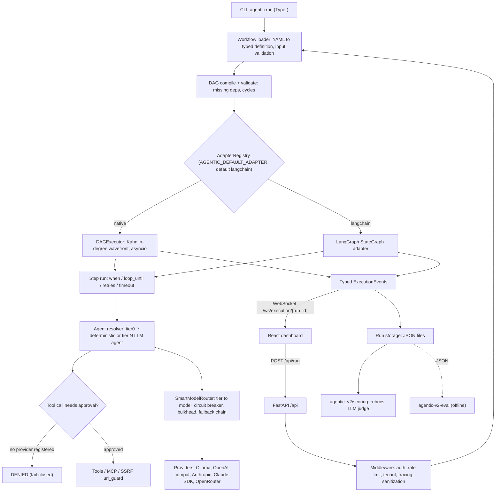
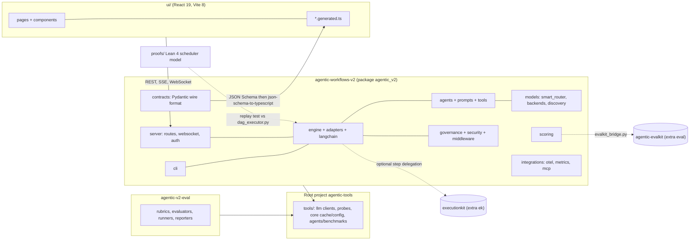

## 1. Application overview, architecture, technologies & theory

Source of truth: clean `origin/main` worktree at revision `c3b2d328` (2026-10-12, "fix(langchain): run each step once, after all its dependencies (#387)"). Paths are repo-relative. Data from `docs/inventory/data/meta_inventory.json` (deps, CI, ADRs) and direct reads of `agentic-workflows-v2/agentic_v2/`.

### 1.1 What the application is

| Item | Finding | Source |
|---|---|---|
| One-line | Python + React monorepo to define, run, observe and evaluate multi-step AI workflows | `README.md` |
| Workflow model | A workflow is a YAML file; steps form a DAG. Independent steps run concurrently, dependents wait, a failure stops downstream steps from running on incomplete data | `README.md`, `docs/ARCHITECTURE.md` |
| Engines | Native asyncio DAG executor, or an optional LangGraph adapter, behind one `ExecutionEngine` Protocol | `agentic-workflows-v2/agentic_v2/core/protocols.py:58`, `agentic_v2/adapters/` |
| Model selection | Steps name a capability **tier**, never a model; `SmartModelRouter` resolves tier to provider/model | `PRODUCT.md`, `agentic_v2/models/smart_router.py` |
| Primary user | A solo developer/operator who authors, runs and debugs workflows via dashboard, CLI and API | `PRODUCT.md` ("Users") |
| Platform | Web (React 19 + Vite dashboard); Python 3.11+ backend (FastAPI) | `PRODUCT.md`, `pyproject.toml` |
| Operating context | Local development and demo; explicitly "not a hosted service" and not a claim that every deployment concern is solved | `README.md`, `PRODUCT.md`, `docs/KNOWN_LIMITATIONS.md` |
| Positioning | "Inspectable runs in one place": live DAG/step streaming, fail-closed approval governance, evaluation evidence, all working with no provider credential (`AGENTIC_NO_LLM=1`) | `PRODUCT.md` |
| Licence | MIT | `README.md`, `LICENSE` |
| Docs site | MkDocs | `mkdocs.yml`, `.github/workflows/docs.yml` |

#### Primary flows

| Flow | Entry point | What happens | Evidence |
|---|---|---|---|
| CLI run | `agentic run <workflow> --input file.json` (Typer; console script `agentic = agentic_v2.cli:main`) | Load + validate workflow, pick adapter (default `langchain`), execute, print `Status: SUCCESS` | `agentic-workflows-v2/pyproject.toml` scripts; `agentic_v2/cli/main.py:218`; `README.md` quick start |
| CLI compare | `agentic compare` | Runs both adapters on the same input | `docs/ARCHITECTURE.md` "Execution engines" (CLI body unverified) |
| API run | `POST /api/run` (workflows router, prefix `/api`) | Validate input against workflow schema, execute, stream events, persist run | `agentic_v2/server/app.py:158-167`, `server/routes/workflows.py`, `docs/flagship.md` |
| Live streaming | WebSocket `/ws/execution/{run_id}` (reconnect/replay) | Typed `ExecutionEvent`s to dashboard | `agentic_v2/server/websocket.py:480` |
| Chat playground | `POST /api/chat` SSE (direct model chat) | Tier or exact-model chat stream | `agentic_v2/server/routes/chat.py`, `docs/adr/ADR-050-chat-playground-sse-and-openrouter-provider.md` |
| Run history | `GET /api/runs`, `/api/runs/summary`, `/api/runs/{filename}` | Saved run JSON for inspection and scoring | `agentic_v2/server/routes/runs.py:74,143,244` |
| Evaluation | evaluation routes, datasets, `agentic_v2/scoring/` | Rubric/judge scoring of saved runs; UI Evaluations + Datasets pages | `server/routes/evaluation_routes.py`, `server/datasets.py`, `ui/src/pages/EvaluationsPage.tsx` |
| Approval-denied run | High-impact tool (`shell`, `file_write`, `build_app`, `http_post`, ...) with no `ApprovalProvider` registered | Call denied before tool body runs, `metadata["approval_decision"] == "denied"` | `README.md`; `agentic_v2/governance/approval.py` (test file `tests/test_approval_gates.py` cited by README, not opened) |
| Offline eval | `agentic-v2-eval` CLI (`agentic_v2_eval.__main__:main`) | Rubrics, evaluators, runners, reporters over structured results | `agentic-v2-eval/pyproject.toml`, `docs/architecture-eval.md` |

#### Shipped workflow definitions (`agentic-workflows-v2/agentic_v2/workflows/definitions/`)

`bug_resolution`, `code_review`, `conditional_branching`, `consensus_review`, `fullstack_generation`, `iterative_review`, `plan_tribunal`, `test_deterministic`, `test_workflow` (9 YAML files on disk; `meta_inventory.json` `workflows` has 12 entries, the extra 3 are from other trees, unverified which).

UI pages (`agentic-workflows-v2/ui/src/pages/`): Dashboard, Workflows, WorkflowDetail, WorkflowEditor, Runs, RunDetail, Live, Evaluations, Datasets, ModelFinder, Settings, PrototypeLab.

### 1.2 Architecture

#### Layers

| Layer | Responsibility | Primary code |
|---|---|---|
| 1. Workflow definition | YAML (inputs, steps, `depends_on`, `when`, `loop_until`/`loop_max`, agent, tools, outputs) | `agentic_v2/workflows/definitions/*.yaml`, `workflows/loader.py` |
| 2. Compile / validate | YAML -> typed definitions -> `DAG`; rejects missing deps (`MissingDependencyError`) and cycles (`CycleDetectedError`) | `agentic_v2/engine/dag.py:19,28,38`, `engine/step.py` |
| 3. Engine seam | `AdapterRegistry` (thread-safe singleton) maps `"native"` / `"langchain"` to engine classes | `agentic_v2/adapters/registry.py`, `adapters/native/engine.py`, `adapters/langchain/engine.py` |
| 4a. Native executor | Kahn in-degree wavefront scheduling on asyncio, cascade skip, top-level timeout, OTel spans | `agentic_v2/engine/dag_executor.py` (718 lines) |
| 4b. LangGraph adapter | Builds a `StateGraph` from the same YAML; join-once edge wiring (ADR-062) | `agentic_v2/langchain/` (graph.py, graph_wiring.py, runner.py, state.py) |
| 5. Agents and steps | `tier{N}_{role}` agent names resolved to functions/agents (`tier0_*` deterministic handlers; others LLM-backed); Markdown persona prompts | `engine/agent_resolver.py:306-310,644-660`, `agentic_v2/agents/`, `agentic_v2/prompts/*.md` |
| 6. Tools and MCP | Tool registry + builtins (file, git, shell, http, code exec, build, memory, search, ...), MCP client stack | `agentic_v2/tools/`, `tools/builtin/`, `integrations/mcp/` |
| 7. Governance and security | Approval gate (fail-closed), SSRF URL guard, sanitization detectors, AST expression sandbox | `governance/approval.py`, `security/url_guard.py`, `middleware/detectors/`, `engine/expressions.py` |
| 8. Model routing | `ModelTier` 0-5, per-tier fallback chains from curated registry, circuit breakers, bulkheads, rate-limit tracker, Redis CAS state | `models/router.py:33`, `models/smart_router.py` (1078 lines), `models/model_registry.py`, `models/redis_state.py` |
| 9. Providers/backends | Ollama, OpenAI-compatible, Anthropic, Claude subscription/SDK, OpenRouter, local discovery (Ollama, LM Studio, Lemonade, Foundry Local, Docker Model Runner) | `models/backends*.py`, `models/*_discovery.py`, `models/client.py` |
| 10. Server | FastAPI app, route groups under `/api`, WebSocket, SSE, auth (API key, JWT/OIDC), rate limit, tenant, audit log, replay store, SPA serving | `agentic_v2/server/` |
| 11. Observability | OpenTelemetry tracer, Prometheus metrics, tracing middleware | `integrations/otel.py`, `integrations/metrics.py`, `server/middleware/{tracing,metrics}.py` |
| 12. Scoring/eval | Runtime scoring of saved runs (rubrics, LLM judge, multidimensional); bridge to `agentic-evalkit` | `agentic_v2/scoring/`, `scoring/evalkit_bridge.py` |
| 13. UI | React 19 console; generated TS wire types | `agentic-workflows-v2/ui/src/` |
| 14. Shared package | Root `agentic-tools` (`tools/`): LLM clients, probes, model inventory, caches, prompt DB, benchmarks | `tools/` |

#### Diagram A - runtime request flow

#### Diagram B - components and packages

#### Doc-versus-code check (verified against `origin/main`)

| Claim (source) | Checked against code | Verdict |
|---|---|---|
| 8 protocols in `agentic_v2/core/protocols.py` (`docs/ARCHITECTURE.md`) | `ExecutionEngine`, `SupportsStreaming`, `SupportsCheckpointing`, `AgentProtocol`, `ToolProtocol`, `DetectorProtocol`, `MiddlewareProtocol`, `VerifierProtocol` at `core/protocols.py:58-238` | Agrees |
| `agentic run` defaults to `langchain`; server validates `AGENTIC_DEFAULT_ADAPTER` at startup | `cli/main.py:218`, `server/lifespan.py:65-83` (default `"langchain"`) | Agrees |
| Six-level tier enum (`docs/architecture-runtime.md:299-310`) | `models/router.py:33-44` TIER_0..TIER_5 | Agrees; `agent_resolver._infer_tier` also parses `tier4_`/`tier5_` (`engine/agent_resolver.py:644-660`) |
| "8 Pydantic models -> 8 JSON Schemas -> 8 `.generated.ts`" (`.claude/rules/portfolio-context.md`) | 8 `*.generated.ts` in `ui/src/api/` (chat_request, chat_stream_event, dag_response, events, runs_summary, step_result, workflow_editor_step, workflow_input_schema) | Agrees |
| `docs/ARCHITECTURE.md`: dashboard "imports generated TypeScript rather than maintaining a separate handwritten copy" | `docs/KNOWN_LIMITATIONS.md` 1.1: only eight shapes generated/gated; other payloads manually mirrored in `ui/src/api/types.ts` | **Docs disagree with each other**; ARCHITECTURE overstates, KNOWN_LIMITATIONS is accurate |
| `.claude/rules/portfolio-context.md`: "`ci.yml` defines 17 blocking jobs" | `meta_inventory.json` lists 20 job ids in `.github/workflows/ci.yml`: python-smoke, frontend-build, frontend-test, lint, suppression-ratchet, typecheck-core-contracts, test-coverage, claude-subscription-tests, ek-delegation-tests, evalkit-bridge-tests, wire-format-drift, e2e-streaming, no-llm-smoke, validate-workflows, check-doc-drift, doc-stats-drift, pydocstyle, lockfile-constraints, dockerfile-constraints, tools-tests | **Stale count** (how many are "blocking" is unverified) |
| Workspace `<workspace>/CLAUDE.md` s.7: EK and EVK pinned `>=0.3.0,<0.4.0` | `agentic-workflows-v2/pyproject.toml`: `ek = executionkit>=0.4.0,<0.5.0`, `eval = agentic-evalkit>=0.4.1,<0.5.0` | **Workspace CLAUDE.md stale** (outside the repo) |
| ADR-031 title "native DAG single engine" | Status Superseded; header says proposal **not adopted**, LangGraph adapter retained | Filename misleading; dual-engine is current (ADR-001, ADR-020, ADR-062) |
| `docs/ARCHITECTURE.md`: runtime scoring and `agentic-v2-eval` need not import each other | `scoring/evalkit_bridge.py` couples runtime scoring to external `agentic-evalkit` (extra `eval`, ADR-042) | Not a contradiction, but ARCHITECTURE omits the evalkit bridge |
| Native engine "dependency-light" | `server/lifespan.py:73-83`: default adapter is `langchain`; without the `langchain` extra the server warns and tells you to set `AGENTIC_DEFAULT_ADAPTER=native` | Matches ADR-020; the default is not the lightweight engine |
| Engines interchangeable "for compatible workflows" | `workflows/definitions/plan_tribunal.yaml` header: native ignores `model_override` and lacks `search_files`/`web_search` | Engines are not behaviourally equivalent; ARCHITECTURE says to check support (agrees) |

### 1.3 Package and workspace structure

| Unit | Path | Name / version | Role | Depends on |
|---|---|---|---|---|
| Workspace root | `pyproject.toml` | `agentic-tools` 0.1.0 (hatchling wheel `packages = ["tools"]`) | Shared utilities (`tools/`); owns `[tool.uv.workspace]` | pyyaml, aiohttp, pydantic, langchain-core, anthropic, openai, numpy |
| Runtime | `agentic-workflows-v2/` | `agentic-workflows-v2` 0.1.0 | Engine, agents, models, CLI (`agentic`), FastAPI server | pydantic, httpx, ollama, jinja2, jmespath, typer, rich, ... + `agentic-tools` |
| Eval | `agentic-v2-eval/` | `agentic-v2-eval` 0.3.0 | Offline rubric/evaluator/runner/reporter package (`src/`: adapters, evaluators, metrics, reporters, rubrics, runners, sandbox); console script `agentic-v2-eval` | pyyaml, `agentic-tools` |
| UI | `agentic-workflows-v2/ui/` | `agentic-workflows-ui` 0.1.0 (private, ESM) | React dashboard | see 1.4 |
| Root npm stub | `package.json` | `agentic-runtime-platform` | Only `@playwright/test`; `npm test` deliberately errors | none |
| Formal proofs | `proofs/` | Lake package, Lean 4.34.0 core only | Scheduler model, proofs, replay executable | no Mathlib/Batteries |
| Other trees | `datasets/`, `examples/`, `infra/`, `load/`, `otel/`, `scripts/`, `tests/e2e`, `.devcontainer/`, `.github/` | - | Data, demos, deploy, k6 load harness, OTel collector config | - |

Relationships:
- uv workspace members are the runtime and eval packages only; the root project (`agentic-tools`) owns `tools/` itself (comment in root `pyproject.toml`). `ci-constraints.txt` is generated from `uv.lock`; every pip install is pinned to it (`.claude/rules/portfolio-context.md`).
- Both Python packages depend on installed `agentic-tools`; `docs/ARCHITECTURE.md` forbids path hacks into `tools/`. `.claude/rules/portfolio-context.md` states there are zero cross-imports between the two workspace packages.
- Pydantic (`agentic_v2/contracts/`, `server/models.py`) -> committed JSON Schemas (`agentic-workflows-v2/tests/schemas/`) -> `ui/src/api/*.generated.ts` via `python -m scripts.generate_ts_types` then `npm run generate:types`; CI job `wire-format-drift` enforces (ADR-014).

#### Cross-repo and optional-backend dependencies

| Dependency | Mechanism | Pin at this revision | Coupling | Source |
|---|---|---|---|---|
| executionkit (EK) | Extra `ek` | `executionkit>=0.4.0,<0.5.0` | Guarded imports, falls back to native loop: `engine/ek_step_delegation.py` (510 lines), `models/ek_provider.py`, `models/ek_adapters.py`. Only CI job `ek-delegation-tests` installs the extra. Workspace notes say it imports the private `executionkit.patterns.base._TrackedProvider` (not re-verified here) | `agentic-workflows-v2/pyproject.toml`; ADR-023; `.claude/rules/portfolio-context.md` |
| agentic-evalkit (EVK) | Extra `eval` | `agentic-evalkit>=0.4.1,<0.5.0` | `scoring/evalkit_bridge.py`; CI job `evalkit-bridge-tests` | `agentic-workflows-v2/pyproject.toml`; ADR-042 |
| Claude backends | Extra `claude` | `anthropic>=0.40,<2`, `claude-agent-sdk>=0.1,<1` | `models/backends_claude.py`, `agents/implementations/claude_*`; CI job `claude-subscription-tests` | ADR-058 |

### 1.4 Technologies

Versions are declared constraints (pyproject / package.json), not installed versions. "Extra" = optional-dependency group in `agentic-workflows-v2/pyproject.toml`.

#### Python backend

| Group | Technology | Constraint | Used for / where |
|---|---|---|---|
| Web | FastAPI (extra `server`) | `>=0.100,<1` | App factory `server/app.py`, routers `server/routes/` |
| Web | uvicorn[standard] | `>=0.23,<1` | ASGI server |
| Web | python-multipart | `>=0.0.31,<1` | Form/upload parsing |
| Web | slowapi | `>=0.1.9,<1` | Rate limiting, `server/middleware/rate_limit.py` (ADR-018) |
| Web/Auth | pyjwt[crypto] | `>=2.13,<3` | JWT/OIDC, `server/auth_oidc.py` (ADR-021) |
| Web | websockets (extra `mcp`) | `>=12.0,<18` | MCP WebSocket transport, `integrations/mcp/transports/` |
| HTTP | httpx | `>=0.25,<1` | Provider/HTTP clients |
| HTTP | aiohttp | `>=3.14.3,<4` | Async HTTP (runtime and root) |
| HTTP | aiofiles | `>=23.0,<26` | Async file IO |
| LLM/providers | ollama | `>=0.5.1,<1` | Ollama SDK backend (ADR-036) |
| LLM/providers | anthropic | `>=1.8.0,<2` (root); `>=0.40,<2` (extra `claude`) | Anthropic client |
| LLM/providers | openai | `>=3.19.2,<4` (root) | OpenAI-compatible clients |
| LLM/providers | claude-agent-sdk | `>=0.1,<1` (extra `claude`) | Claude subscription backend (ADR-058) |
| Orchestration | langchain, langchain-core | `>=1.3.9,<2`, `>=1.3,<2` (root core `>=1.6.5,<2`) | LangGraph adapter, `agentic_v2/langchain/` |
| Orchestration | langgraph | `>=1.2,<2` | `StateGraph` execution |
| Orchestration | langgraph-checkpoint, -sqlite, -postgres | `>=4.0.3,<5`, `>=3.1.1,<4`, `>=3.1.1,<4` | Checkpointing (extras `langchain`, `postgres`) |
| Orchestration | langchain-openai / -anthropic / -google-genai / -mistralai / -ollama | `>=1.2`, `>=1.4.6`, `>=4.2`, `>=1.1`, `>=1.1` | `langchain/model_builders.py` |
| Orchestration | langsmith | `>=0.8.18,<1` | LangChain tracing hooks |
| Orchestration | executionkit | `>=0.4.0,<0.5.0` (extra `ek`) | Step delegation |
| Data/validation | pydantic, pydantic-settings | `>=2.0,<3`, `>=2.14.2,<3` | Contracts, settings (`settings.py`) |
| Data/validation | pyyaml | `>=6.0,<7` | Workflow YAML |
| Data/validation | jinja2, jmespath | `>=3.0,<4`, `>=1.0,<2` | Templating, JSON querying |
| Data/validation | cachetools, filelock | `>=5.0,<8`, `>=3.0,<5` | Caching; file-lock shared breaker state |
| Data/validation | numpy | `>=2.4.6,<3` (root) | Shared tools |
| Data/validation | pandas | `>=3.0.5,<4` (extra `swe-ab`) | SWE A/B evals |
| CLI | typer, rich, python-json-logger | `>=0.9,<1`, `>=13,<16`, `>=3,<5` | `agentic` CLI, display, JSON logs |
| Observability | opentelemetry-sdk + OTLP grpc/http exporters | `>=1.20,<2` (extra `tracing`) | `integrations/otel.py` |
| Observability | opentelemetry-exporter-prometheus, prometheus-client | `>=0.48b0,<1`, `>=0.17,<1` | `integrations/metrics.py` |
| Storage | redis[hiredis] (extra `redis`) | `>=5.0,<9` | Breaker CAS state (`models/redis_state.py`), replay store |
| Storage | aiosqlite (extra `sqlite`) | `>=0.19,<1` | SQLite replay/checkpoints |
| Storage | psycopg[binary] (extra `postgres`) | `>=3.1,<4` | PostgreSQL checkpoints |
| Storage | vector store | none | RAG package removed (ADR-057); no `rag` extra at this revision |
| Dev tooling | psutil (extra `devex`) | `>=6.0` | `agentic_v2/devex/` |
| Testing | pytest, pytest-asyncio, -cov, -mock, -timeout | runtime dev `>=7`, `>=0.21`, `>=4`, `>=3.12`, `>=2.2`; root dev pytest `>=9.1.1`, asyncio `>=1.4.0` | `agentic-workflows-v2/tests`, `agentic-v2-eval/tests`, `tests/e2e`, `tools/tests` |
| Testing | hypothesis, fakeredis[lua], jsonschema | `>=6,<7`, `>=2.21,<3`, `>=4.18` | Property tests; Redis/Lua CAS tests; schema checks |
| Lint/type | ruff | `>=0.16.10` (root dev) | Rules `E,F,W,I,N,UP,S,B,A,C4,SIM,TCH,RUF`, line length 88 (`.claude/rules/ci.md`) |
| Lint/type | black, mypy, pydocstyle, pre-commit | `>=26.5.1`, `>=2.4.0`, `>=6.3`, `>=4.6.2` (root dev) | mypy strict on `engine` + `contracts` + eval src |
| Build | hatchling; uv (`uv.lock`, CI pins `uv==0.11.2`) | - | Wheels, workspace, constraints export |

#### Frontend (`agentic-workflows-v2/ui/package.json`)

| Group | Technology | Constraint | Used for |
|---|---|---|---|
| Framework | react, react-dom | `^19.3.0` | UI |
| Routing/data | react-router-dom, @tanstack/react-query | `^7.18.4`, `^5.104.1` | Routing, server state |
| Graph | @xyflow/react | `^12.12.0` | DAG visualisation/editor |
| UI kit | radix-ui, cmdk, sonner, lucide-react, react-resizable-panels, @dnd-kit/core | `^1.7.0`, `^1.1.1`, `^2.0.8`, `^1.54.0`, `^4.14.3`, `^6.3.1` | Components, command palette, toasts, icons, panes, drag-drop |
| Styling | tailwindcss + @tailwindcss/postcss, postcss, class-variance-authority, clsx, tailwind-merge, @fontsource-variable/geist | `^4.3.3`, `^8.5.29`, `^0.7.1`, `^2.1.1`, `^3.7.0`, `^5.3.0` | Evidence Ledger tokens (`DESIGN.md`, `ui/src/styles/tokens.css`) |
| Telemetry | @opentelemetry/api, sdk-trace-web, exporter-trace-otlp-http, instrumentation-fetch | `^1.9.0`, `^2.12.0`, `^0.223.0` | Browser tracing (`ui/src/telemetry/`) |
| Build | vite, @vitejs/plugin-react, typescript | `^8.3.4`, `^6.1.2`, `^7.0.2` | `tsc -b && vite build` |
| Codegen | json-schema-to-typescript | `^16.0.0` | `ui/scripts/generate-ts-types.mjs` |
| Testing | vitest, @vitest/coverage-v8, jsdom, @testing-library/react + jest-dom, @playwright/test | `^5.0.1`, `^5.0.3`, `^30.1.2`, `^16.3.3`, `^7.0.1`, `^1.64.0` | Unit/coverage (floors in `ui/vitest.config.ts`), E2E streaming |

#### Build, CI, ops, formal methods

| Group | Technology | Where |
|---|---|---|
| Task runner | `just` (PowerShell shell) | `justfile`: `setup`, `test`, `docs`, `relock` |
| Containers | Docker, Compose, devcontainer | `Dockerfile`, `Dockerfile.ui`, `docker-compose.yml`, `.devcontainer/` |
| CI | GitHub Actions, 18 workflow files: ci, codeql, dependabot-auto-merge, dependabot-relock, dependency-audit, dependency-drift-check, dependency-review, deploy, devcontainer-validate, docs, eval-package-ci, infra-deploy, lean-proofs, load-report-pages, nightly, sbom, upstream-compatibility, windows-workflows-ci | `.github/workflows/` (`meta_inventory.json` `ci`) |
| Quality/security | pre-commit (black, isort, ruff, docformatter, detect-secrets), CodeQL, SonarQube, SBOM, dependency review | `.pre-commit-config.yaml`, `.secrets.baseline`, `sonar-project.properties`, `docs/SUPPLY_CHAIN.md` |
| Docs | MkDocs | `mkdocs.yml`, `docs/` |
| Load | k6 + Docker | `load/`, `docs/load-report.md`, `docs/flagship.md` |
| IaC | `infra/` deployed via `infra-deploy.yml` | contents not inspected |
| Formal methods | Lean 4.34.0 + Lake, `leanchecker`, axiom audit | `proofs/`, `.github/workflows/lean-proofs.yml` |
| Toolchain | Python 3.11, Node 20+ | `.python-version`, `.nvmrc` |

### 1.5 Theories, concepts and patterns implemented

| # | Concept | What it is | Where implemented | ADR |
|---|---|---|---|---|
| 1 | Kahn's topological DAG execution | Track per-step in-degree at runtime; launch every zero-in-degree step concurrently (wavefront); unlock dependents on completion | `engine/dag.py` (`DAG`, topological order, validate), `engine/dag_executor.py` (`_schedule_ready_steps`, `_unlock_downstream`, `_scheduling_loop`) | ADR-001/002/003, ADR-019 |
| 2 | Cascade skip / honest status | Failed step's transitive dependents are SKIPPED with a reason; run is SUCCESS only if nothing failed or was dropped | `engine/dag_executor.py` (`_cascade_skip`, `_mark_skipped`), `agents/orchestrator.py` | ADR-060 |
| 3 | Formal verification of the scheduler | Lean 4 model of `DAGExecutor` proves safety, no duplicates / bounded parallelism, completeness, honest status over every legal completion order; a replay test ties model to code on sampled schedules (not a proof of the Python) | `proofs/Scheduler.lean`, `proofs/Scheduler/`, `proofs/Main.lean`, `tests/engine/test_dag_executor_lean_replay.py` (named in `proofs/README.md`, not opened) | ADR-060 |
| 4 | Engine swap behind a Protocol seam | Structural `typing.Protocol` contracts + thread-safe registry | `core/protocols.py`, `adapters/registry.py` | ADR-001, ADR-020; ADR-031 (single-engine, not adopted) |
| 5 | Join-once semantics for superstep engines | Each step runs once after all deps even on LangGraph | `langchain/graph_wiring.py` (`wire_graph_edges`, `wire_dependency_edges`, `build_loop_exit_map`, `add_loop_edge`) | ADR-062 |
| 6 | Capability-tier routing | Steps request tier 0 (deterministic) to 5 (premium cloud); router resolves via per-tier fallback chains from a curated registry | `models/router.py` (`ModelTier`, `register_chain`, `DEFAULT_CHAINS`), `models/smart_router.py`, `models/model_registry.py` | ADR-040, ADR-059, ADR-051 |
| 7 | Three-state circuit breaker | CLOSED / OPEN / HALF_OPEN per provider with single-probe lock; `CircuitResolvedError` when a prior probe already resolved the circuit | `models/smart_router.py` (`execute_with_bulkhead`, ~lines 814-1016), `models/model_stats.py` | ADR-001/002/003 (ADR-002A) |
| 8 | Bulkheads | Per-provider semaphores prevent cascade failure | `models/smart_router.py:190,256` | ADR-002A |
| 9 | Shared breaker state via compare-and-swap | Lua-script atomic CAS in Redis keeps counters exact under concurrent writers; evidence is a k6 run plus an exact-sum worker test | `models/redis_state.py`, `docs/flagship.md`, `load/` | no dedicated ADR found (unverified) |
| 10 | Health, cooldown, rate-limit awareness | Honour retry guidance, cooldowns, HTTP-status error classification | `models/smart_router.py` (`CooldownConfig`), `models/rate_limit_tracker.py`, `models/retry_utils.py` | none |
| 11 | Majority-vote consensus / self-consistency | Same prompt N times, deterministic tier-0 vote, `min_agreement` threshold | `engine/consensus.py` (`majority_vote`, `self_consistency`), `engine/agent_resolver.py:309` (`tier0_consensus`), `workflows/definitions/consensus_review.yaml` | ADR-023 (EK relationship) |
| 12 | Plan tribunal (multi-judge panel) | Five persona judges, two-stage deterministic vote, dissent recorded, split ruling never presented as a decision | `workflows/definitions/plan_tribunal.yaml` | none found |
| 13 | Bounded iterative review loop | `loop_until` + `loop_max` review-rework cycles; verification gate/loop for post-step checks | `workflows/definitions/iterative_review.yaml`, `engine/step.py`, `engine/verification.py` (`VerificationGate`, `VerificationLoop`) | ADR-019 for timeout; loop-specific ADR unverified |
| 14 | Adaptive decomposition / orchestrator | Orchestrator plans subtasks, validates plan as a DAG, runs with `max_parallel`, fallback chains, escalation | `agents/orchestrator.py`, `orchestrator_planning.py`, `orchestrator_models.py`, `governance/escalation.py` | ADR-029, ADR-025, ADR-060 |
| 15 | LLM-as-judge rubric scoring | Rubric criteria scored by a judge model; multidimensional profiles | `scoring/judge.py` (`LLMJudge`, `JudgeResponseProvider`), `scoring/rubrics/`, `scoring/multidimensional_scoring.py`, `prompts/judges/`, `agentic-v2-eval/src/` | ADR-009, ADR-010, ADR-032, ADR-044 |
| 16 | Discriminated-union wire format + codegen | Pydantic `Field(discriminator="type")` unions -> JSON Schema -> generated TS; CI drift gate | `contracts/events.py:181`, `contracts/chat.py:84,262`, `ui/scripts/generate-ts-types.mjs`, `tests/schemas/` | ADR-014, ADR-052 |
| 17 | Fail-closed governance (HITL) | No `ApprovalProvider` registered => tool call denied; gate runs before validation at both dispatch points; timeouts | `governance/approval.py` (`AutoDenyProvider`, `PolicyApprovalProvider`, `tool_requires_approval`), `engine/tool_execution.py` | ADR-041, ADR-045, ADR-047 |
| 18 | SSRF egress guard | Block private/loopback/metadata addresses; resolve-and-pin to limit DNS rebinding; residual risk documented | `security/url_guard.py` (`validate_url`, `validate_url_pinned`, `check_resolved_address`), `tools/builtin/http_ops.py` | ADR-030; KNOWN_LIMITATIONS 4.4 |
| 19 | AST expression sandbox | `when` / `loop_until` parsed via `ast.parse(mode="eval")` and a whitelist interpreter; no `eval()` | `engine/expressions.py:101-132`, `langchain/expressions.py` | ADR-024 |
| 20 | Content sanitization and secret masking | Detector chain (injection, PII, secrets, unicode); entropy-based masking; JSON-safe masks that do not break parsing | `middleware/detectors/`, `middleware/policy.py`, `middleware/response_sanitizer.py`, `contracts/sanitization.py` | ADR-046, ADR-061 |
| 21 | AuthN/AuthZ and tenancy | API key + JWT/OIDC, per-IP auth throttle, client-supplied `X-Tenant-ID` path scoping (spoofable by default) | `server/auth.py`, `server/auth_oidc.py`, `core/tenant.py`, `server/middleware/rate_limit.py` | ADR-018, ADR-021, ADR-022; KNOWN_LIMITATIONS 4.1, 4.2, 4.5 |
| 22 | Process-wide token budget | Global cap on tokens consumed | grep hits in `engine/tool_execution.py`, `contracts/verification.py`, `engine/ek_step_delegation.py` (exact owner unverified) | ADR-048 |
| 23 | OpenTelemetry tracing | Spans per run/step (tracer from `integrations/otel.py`), server tracing middleware, browser OTel, Prometheus metrics | `engine/dag_executor.py:27,610`, `integrations/otel.py`, `server/middleware/tracing.py`, `ui/src/telemetry/`, `otel/` | none |
| 24 | Deterministic no-LLM mode | `AGENTIC_NO_LLM=1` swaps model clients for placeholders; `tier0_*` agents run deterministic handlers; supported credential-free baseline | `langchain/model_builders.py:972` (`PlaceholderChatModel`), `models/backends.py:37`, `models/client.py` (`ERR_NO_LLM_BACKEND`), `settings.py`, `docs/NO_LLM_MODE.md`, `workflows/definitions/test_deterministic.yaml` | none |
| 25 | Tool descriptions as selection mechanism / forced tool choice | Tool selection steered by description quality and `tool_choice` forcing | `tools/base.py`, `tools/registry.py` | ADR-027, ADR-028 |
| 26 | Step-output parsing unification | One parser for LLM output so both engines see the same data | `engine/llm_output_parsing.py` (1015 lines) | ADR unverified |
| 27 | Typed step artifacts / path-first IO | Steps exchange typed artifact contracts; path-first IO is only proposed | `workflows/artifact_extractor.py` | ADR-052 (Accepted), ADR-034 (**Proposed**) |
| 28 | Model discovery and pricing annotation | Live discovery of local/cloud models, curated registry, price labels, weight-integrity checks | `models/*_discovery.py`, `models/price_annotation.py`, `models/weight_integrity.py` | ADR-037, ADR-038, ADR-039, ADR-040 |
| 29 | Prompt versioning registry | Versioned prompts | `prompts/registry.py` | ADR-056 |
| 30 | Guarded delegation to ExecutionKit | Optional step delegation to an external pattern library | `engine/ek_step_delegation.py` | ADR-023 |
| 31 | Evidence-labelled claims | Claims graded SOURCE/TEST/RUNTIME/LIVE-VERIFIED, INFERRED, UNVERIFIED | `AI_EVIDENCE_STANDARD.md`, `docs/PROOF_LEDGER.md` | none |

Removed or superseded concepts (do not expect code): RAG pipeline (ADR-035 Superseded; ADR-057 removed the package); GitHub Models as default E2E LLM (ADR-016 Superseded; service retired upstream 2026-07-30 per `docs/architecture-runtime.md:595`); single-engine native DAG (ADR-031 Superseded, never adopted). Numbering gaps in `docs/adr/` (no files for 004-006, 013, 049, 053) are declared intentional in `docs/adr/ADR-INDEX.md` (the declared list itself was not re-read here).

### 1.6 Design principles and constraints

| Principle / constraint | Statement | Source |
|---|---|---|
| Steps name tiers, not models | Workflow structure separate from model selection; router resolves env pins, saved UI settings, availability, health, fallbacks | `PRODUCT.md`, `docs/ARCHITECTURE.md` |
| Fail closed and show why | Approval-required tools denied without a provider | `PRODUCT.md`, `README.md` |
| Work credential-free | `AGENTIC_NO_LLM=1` is the supported no-key baseline; never imply a provider is required | `PRODUCT.md`, `.claude/rules/ci.md` |
| Legible run state before pretty | Operator must see what ran, what failed, why | `PRODUCT.md` |
| Do not overclaim maturity | Link limitations; no testimonials or hosted-service claims | `PRODUCT.md`, `docs/KNOWN_LIMITATIONS.md` |
| Evidence over assertion | Cite active call path; mock/no-LLM tests are not live-provider evidence; missing evidence is UNVERIFIED not a defect; date live/perf claims; prefer behaviour over test counts | `AI_EVIDENCE_STANDARD.md` (10 rules) |
| Smallest coherent change, reuse infra | One concern per PR; reuse `SmartModelRouter`, `ExecutionContext`, `ConversationMemory`, MCP client stack, error-classification helpers | `CLAUDE.md` |
| Secrets only via env / `.env.example` | Never read/edit/commit `.env` | `CLAUDE.md` |
| Package boundaries intact | Runtime, eval, tools, UI each own their area; no path hacks into `tools/` | `CONTRIBUTING.md`, `docs/ARCHITECTURE.md` |
| Generated files preserved unless contract changed | Contract change => regenerate schemas + TS and commit | `CONTRIBUTING.md`, `.claude/rules/ci.md` |
| Automated-evidence gates (solo, AI-assisted) | AI-generated code is untrusted input; ruff + mypy + tests + docs + pre-commit green | `.claude/rules/ci.md` |
| Coverage gate | 80% over `agentic_v2` configured subset, `precision = 2`; UI vitest floors (branches >=56 ratchet, others >=60) | `.claude/rules/ci.md`, `ui/vitest.config.ts` |
| Suppression ratchet | A new ruff `ignore`, per-file-ignore, or mypy `ignore_errors` fails CI | `.claude/rules/portfolio-context.md` (`scripts/check_suppression_ratchet.py`) |
| Style | Black 88, Ruff, typed public interfaces; snake_case modules, PascalCase classes/components, UPPER_CASE constants | `CONTRIBUTING.md` |
| ADR required for boundary changes | Wire format; engine/provider/storage backend; auth, approval, path containment, egress; new patterns | `CONTRIBUTING.md` "Write an ADR" |
| ADRs immutable | Do not rewrite accepted ADRs; supersede and update `ADR-INDEX.md` | `docs/ARCHITECTURE.md` |
| Conventional commits | `type(scope): subject`; scope = subsystem | `.claude/rules/ci.md`, `CONTRIBUTING.md` |
| Changelog | User-visible changes under `Unreleased` | `CONTRIBUTING.md` |
| UI design system "Evidence Ledger" | Warm paper neutrals, one vermilion accent (`#ef5a36`), hairline borders over shadows, radii 2/4/8px, Georgia display + Geist body + mono for ids; `ui/src/styles/tokens.css` is authoritative over `DESIGN.md` | `DESIGN.md`, ADR-054 |
| Windows supported | cp1252 console gotchas, UTF-8 env vars | `docs/KNOWN_LIMITATIONS.md` 3.2, `.claude/rules/portfolio-context.md` |

#### Known limitations that bound the architecture (`docs/KNOWN_LIMITATIONS.md`)

| Ref | Limitation |
|---|---|
| 1.1 | Wire format generated for 8 shapes only; others manually mirrored |
| 1.2 | 80% coverage gate scopes out optional provider/plugin modules (`[tool.coverage.run] omit`) |
| 2.1 | LangChain adapter needs a separate extras install |
| 3.1 | Blocking CI does not prove live provider behaviour |
| 4.1, 4.2 | Rate limiting and auth throttle are in-process only (multi-replica caveat) |
| 4.3 | Human approval gates are programmatic only; no UI pause/resume yet |
| 4.4 | SSRF guard cannot fully close DNS rebinding without network-layer egress control |
| 4.5 | `X-Tenant-ID` is client-supplied and spoofable by default |
| 4.12-4.14 | Model inventory command fails from repo root; `onnx:` IDs unusable for exact-model chat; strict weight verification not wired into every loader |
| 4.15 | Eleven `tools/tests` cases assert a removed API; `ci.yml` now lists a `tools-tests` job, so whether this is still current is unverified |
