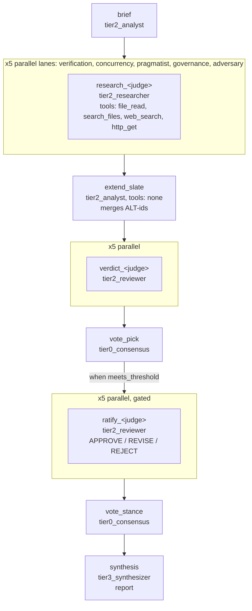
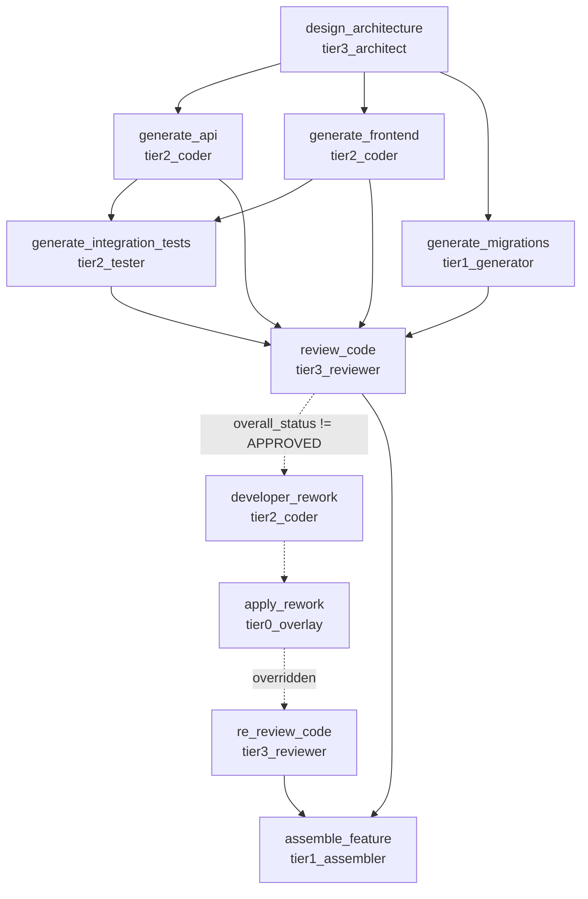

## 5. Workflows, prompts, agents, evaluation & shared tools

Source of truth: clean `origin/main` worktree at revision `c3b2d328` (`C:/tmp/arp-main-inventory`). All paths are repo-relative. Static-analysis columns (importers, test refs, orphan flags) come from `docs/inventory/data/py_inventory.json`; every orphan/"broken" claim below was re-checked by grep or by an import run against the clean tree (read-only, `PYTHONDONTWRITEBYTECODE=1`). Anything not re-checked is marked "(unverified)".

### 5.0 Section summary

| Area | Size | State on `c3b2d328` |
|---|---|---|
| YAML workflows | 9 files in `agentic-workflows-v2/agentic_v2/workflows/definitions/` (7 production-shaped, 2 deterministic test fixtures) | All load; two independent YAML parsers exist (native + LangChain) with different key support |
| Prompts | 14 files in `agentic-workflows-v2/agentic_v2/prompts/` (7 role `.md`, 5 judge `.md`, `registry.py`, `__init__.py`) | 4 role prompts are reached by shipped workflows; 3 are only reachable via persona/catalog or constants |
| Python agents | 4 task agents + orchestrator + 2 SDK-backed agents + a markdown agent loader in `agentic_v2/agents/` | Not used by any YAML workflow; reached from the package API, LangChain integration and examples |
| Runtime scoring | `agentic_v2/scoring/` (11 files), `agentic_v2/evaluation/normalization.py`, `server/evaluation.py`, `server/datasets.py` | EVK bridge live for step scoring (ADR-042 Slice C); multidimensional engine dormant |
| `agentic-v2-eval/` | 28 modules, 18 test files, 8 rubric YAMLs | Legacy in-tree framework; partly superseded by ADR-042, but 4 live consumers remain |
| `evals/swe_ab/` | 152 files, ~28 MB | Closed campaign (closeout 2026-09-05); frozen record |
| `tools/` | 82 files (17 test files) | CI **does** run `tools/tests` (job `tools-tests`); 2 real defects found |
| `examples/` | 9 files | Imports resolve; the five no-credential examples ran clean |
| `load/` | 15 files | Local Docker/k6 harness; results committed; regression gate runs in `nightly.yml` |

---

### 5.1 Workflow definitions

#### 5.1.1 Inventory

"Tiers" are derived from the `agent:` prefix (`tier{N}_{role}`, see 5.1.3); `tier:` is not a step key in these files. "Test-only" means no non-test source references the name (grep over `agentic_v2/`, `ui/src`, `agentic-v2-eval/src`, `tools/`, `examples/`, `load/`).

| Workflow (file) | Purpose | Steps | Agents / tiers | Branching / loops | Inputs → outputs | Test-only? |
|---|---|---|---|---|---|---|
| `bug_resolution.yaml` (142 ln) | Triage, root cause, fix, verification | 5 | `tier0_parser`, `tier2_reviewer` x2, `tier1_analyzer`, `tier2_summarizer` | `when: resolution_depth != 'quick'` on `regression_check` and `generate_verification` | `bug_report, code_file, resolution_depth` → `root_cause, fix, verification_report?` | No source refs; covered by golden dataset `datasets/default/bug_resolution_output.json` and 2 test files |
| `code_review.yaml` (131 ln) | Tiered code review (parse, lint + complexity in parallel, review, summary) | 5 | `tier0_parser`, `tier1_linter`, `tier1_analyzer`, `tier2_reviewer`, `tier2_summarizer` | Fan-out after `parse_code`, fan-in at `review_code`; `when: review_depth != 'quick'` on summary | `code_file, review_depth` → `review, summary?` | No. Used by 15 source files (CLI help, UI, k6 default `WORKFLOW=code_review`, evaluation config), 28 test files |
| `conditional_branching.yaml` (123 ln) | Demonstrates `when:` gates | 6 | `tier2_coder`, `tier3_architect`, `tier3_reviewer` x2, `tier1_assembler` | 4 gated steps (`quick_review` vs `deep_analysis`/`security_scan`; `deployment_readiness` needs `target_env == 'production'`) | `feature_spec, review_depth, target_env` → `analysis_report` | Pattern/example; 0 source refs, 3 test files |
| `consensus_review.yaml` (87 ln) | Self-consistency: 3 parallel reviewers, tier-0 majority vote, gated summary | 5 | `tier2_reviewer` x3, `tier0_consensus`, `tier2_summarizer` | `summarize` runs only when `vote.meets_threshold` | `code_file, min_agreement` → `verdict, agreement, summary?` | Pattern; 0 source refs, 3 test files, golden dataset |
| `fullstack_generation.yaml` (284 ln) | Architecture then parallel API/frontend/migrations, tests, review, conditional rework | 10 | `tier3_architect`, `tier2_coder` x3, `tier1_generator`, `tier2_tester`, `tier3_reviewer` x2, `tier0_overlay`, `tier1_assembler` | Fan-out/fan-in; rework chain gated on `review_report.overall_status != 'APPROVED'`; `re_review_code` gated on `apply_rework.overridden`; outputs use `coalesce()`; has inline `evaluation:` rubric (profile A) | `feature_spec, tech_stack` → `feature_package?, review_report, all_code` | No. Referenced by `config/defaults/evaluation.yaml`, 15 test files, golden dataset |
| `iterative_review.yaml` (146 ln) | Bounded review-rework loop | 5 | `tier3_architect`, `tier2_coder`, `tier3_reviewer` (looped), `tier1_assembler` x2 | `loop_until` + `loop_max: ${inputs.max_review_rounds}` on `review_rework_loop`; gated `escalation_notice` | `feature_spec, max_review_rounds` → `final_package, review_history` | Pattern; only source ref is a comment in `engine/step.py`; 2 test files |
| `plan_tribunal.yaml` (511 ln) | Five-persona judge panel ranks candidate plans, two tier-0 votes, synthesis | 20 | `tier2_analyst` x2, `tier2_researcher` x5, `tier2_reviewer` x10, `tier0_consensus` x2, `tier3_synthesizer` | 5-way parallel research and verdict lanes; ratify/vote_stance/synthesis gated on `vote_pick.meets_threshold`; per-role `model_override: env:TRIBUNAL_MODEL_<ROLE>\|`; per-step `tools` allowlists | `plan_paths, grounding_paths, focus, min_agreement` → `first_candidate, agreement, approval?, approval_met?, report?` | 0 source refs, 1 test file (`tests/engine/test_plan_tribunal_workflow.py`); domain-coupled (see 5.1.5) |
| `test_deterministic.yaml` (33 ln) | No-LLM smoke fixture | 2 | `tier0_process`, `tier0_counter` | none | `input_text` → `processed_text, step_count` | Fixture, but load-bearing: CI job validates and runs it (`ci.yml`, `agentic validate/run test_deterministic`), UI `GettingStartedCard.tsx` and `WorkflowDetailPage.tsx` reference it |
| `test_workflow.yaml` (34 ln) | Same shape for server/eval tests | 2 | `tier0_process`, `tier0_counter` | none | `input_text` → `processed_text, step_count` | Test-only: 0 source refs, 22 test files. Byte-for-byte the same step graph as `test_deterministic` (duplicate in all but description) |

Loader `list_workflows()` (`workflows/loader.py:176`) returns every `*.yaml`/`*.yml` except those with `experimental: true`; no shipped definition sets that flag, so all 9 are listed.

#### 5.1.2 YAML schema as implemented

Two parsers read the same files; they do not accept the same keys.

| Key | Native loader `workflows/loader.py` (`WorkflowLoader._parse_step`, line 587) | LangChain parser `langchain/config.py` (`StepConfig`, ~line 570) |
|---|---|---|
| `name`, `agent`, `description`, `depends_on`, `inputs`, `outputs` | yes | yes |
| `input_contracts` / `output_contracts` (kind `code_artifact`, ADR-052) | yes (validated via `artifact_contracts`) | yes |
| `when` | compiled to predicate using `engine/expressions.ExpressionEvaluator` | stored as string, evaluated by `langchain/expressions.py` |
| `loop_until`, `loop_max` (int or `${...}` expr; expr stored as sentinel `0` + `loop_max_expr`) | yes | yes |
| `tools` (list; omitted = tier default, `[]` = none) | yes (`metadata["tools"]`) | yes |
| `prompt_file` | yes (`metadata["prompt_file"]`) | yes |
| `model_override` / `model` alias | parsed into `metadata`, **but no code under `engine/` reads it** | yes (`graph_wiring.py:1002`, `agents.py:137`) |
| `persona` | **ignored** | yes (`personas.py`, `graph_wiring.py:1011`) |
| `observers`, `model_params` | **ignored** | yes |

Top-level keys common to both: `name`, `description`, `version`, `capabilities{inputs,outputs}`, `inputs{type,description,required,default,enum}`, `outputs{from,optional}`, `evaluation{rubric_id,scoring_profile,criteria[]}` (loader parses criteria with weight, `critical_floor`, `formula_id`, scale; weights may be derived), `experimental`, `_templates` (YAML anchors, ignored). A JSON Schema, `agentic-workflows-v2/schemas/workflow.schema.json`, is enforced in CI by `scripts/validate-workflows.py` (job `validate-workflows`).

Loader internals: `WorkflowLoader.load(name)` resolves `<definitions_dir>/<name>.yaml|.yml`, caches, builds a `DAG` (`engine/dag.py`), and calls `resolve_agent` (`engine/agent_resolver.py`) per step. `resolve_agent` infers tier from the prefix (`tier0_`..`tier5_`; unknown prefix defaults to tier 2), maps tier-0 names through `TIER0_REGISTRY` (exactly five: `tier0_parser`, `tier0_process`, `tier0_counter`, `tier0_consensus`, `tier0_overlay`), and builds an LLM step for tiers 1-5. Per-tier output caps: T1 4096, T2 8192, T3 16384, T4 16384, T5 32768 tokens (`agent_resolver.py:96-100`); tool loop bounded by `MAX_TOOL_ROUNDS` / `MAX_TOOL_CALLS_PER_ROUND` (`engine/tool_execution.py`).

#### 5.1.3 Runtime pipeline modules

| Module | LOC (inv.) | Role |
|---|---|---|
| `workflows/loader.py` | 639 | YAML to `WorkflowDefinition` (DAG + typed inputs/outputs + capabilities + evaluation); `load_workflow`, `get_dag` helpers |
| `workflows/runner.py` | 423 | `WorkflowRunner.run()` / `run_workflow()`: `validate_workflow_inputs` (required + enum only; `type` is metadata), `seed_workflow_inputs`, executes via `DAGExecutor` or the adapter registry, `resolve_workflow_outputs` (maps `from:` exprs, honours `optional`). One open `TODO(ADR-001)` at line 416 (custom `step_executor` forces direct `DAGExecutor` construction because `NativeEngine` cannot accept per-call injection) |
| `workflows/run_logger.py` | 471 | `RunLogger` writes per-run JSON (`build_run_record`, `build_step_record`, truncation at 10 000 chars) under `runs/` (tenant-scoped via `core.tenant`); `run_record_to_workflow_result` rehydrates records |
| `workflows/artifact_extractor.py` | 183 | Scans step outputs for `FILE: path` / `ENDFILE` blocks and writes `artifacts/<run_id>/<path>` (last writer wins, path-traversal filtered by `_safe_rel_path`) |
| `workflows/lib/ci_calculator.py` | 178 | Pure-compute confidence-index helpers (`compute_ci`, `check_gate`, recency decay); only consumed by the dormant multidimensional scorer |

CLI surface (`agentic_v2/cli/main.py`): `run <workflow|path> [--input/-i json] [--output/-o] [--dry-run]`, `list [workflows|agents|tools|adapters]`, `validate`, plus others. Default engine: `langchain` for named YAML workflows, `native` for runtime-generated DAGs (`.claude/rules/portfolio-context.md`).

#### 5.1.4 Mermaid DAGs

`plan_tribunal` (20 steps; the five judge lanes are identical apart from persona, shown once):

Note the data-flow subtlety: `extend_slate` depends on all five `research_*` steps, so no verdict can start until the slowest researcher finishes (one convoy point). Each verdict/ratify step takes `tools: []`, so only research steps touch the repo or the web.

`fullstack_generation` (10 steps; dashed edges are conditional):

`assemble_feature` declares `depends_on: [re_review_code]` only (YAML-verified). When the rework branch is skipped it must still run; that relies on the executor's skip semantics for gated dependencies (unverified here). The `rc --> af` edge above is only the `coalesce()` data reference, not a `depends_on` entry.

#### 5.1.5 `docs/WORKFLOW_AUTHORING.md` accuracy check

903 lines. Checked against loader, resolver, CLI, CI.

| Claim | Verdict | Evidence |
|---|---|---|
| Top-level keys table, `experimental` hides from `list_workflows()` | Accurate | `loader.py:176-187` |
| Step field table (`name…loop_max`, default `loop_max` 3) | Accurate for the native loader | `loader.py:587-640`, fallback `3` at `_parse_loop_max` |
| Tier table and token limits (0/4096/8192/16384/16384/32768) | Accurate | `agent_resolver.py:96-100` |
| `tier4_`/`tier5_` recognized but unused by shipped workflows | Accurate | no definition uses them |
| Role suffix maps to `prompts/{role}.md`; `default.md` absent so no persona | Accurate, with nuance: lookup goes through the ADR-056 registry first, then a direct read (`prompt_assembly.py:75-120`) | no `prompts/default.md` in tree |
| `agentic run <name> --input params.json`, `agentic validate`, `agentic list workflows` | Accurate | `cli/main.py:188-215, 492-505, 523` |
| `model_override` "pins a model for a step" | **Misleading**: only the LangChain adapter reads it; the native engine ignores it (no read under `engine/`). `plan_tribunal.yaml` header says the same | `langchain/graph_wiring.py:1002`; grep of `engine/` |
| Step keys table | **Incomplete**: omits `persona`, `observers`, `model_params` (LangChain-only), and the `model` alias for `model_override` | `langchain/config.py:570-600` |
| `capabilities` used for dataset matching | Accurate | `scoring/dataset_matching.py` imports it via `server/datasets.py` |
| Checklist "every step has name, agent, description, inputs, outputs" | Accurate: all 9 shipped definitions satisfy it (YAML-checked) | n/a |

Domain coupling to flag: `plan_tribunal` judge prompts (`prompts/judges/plan_judge_*.md`, 24 lines each) hard-code the "formal-methods proposals in the tafreeman portfolio" context, the Lean `proofs/` model (ADR-060) and sibling repos. It is a repo-specific governance workflow, not a general example.

---

### 5.2 Agents, personas and prompts

#### 5.2.1 Two agent systems

| System | Where | Used by |
|---|---|---|
| Declarative tier agents (`tier{N}_{role}`) | `engine/agent_resolver.py` (`_make_llm_step`, `TIER0_REGISTRY`) + persona text from `prompts/` | Every YAML workflow, both engines |
| Python agent classes | `agentic_v2/agents/` | Public API (`agentic_v2/__init__.py` re-exports `CoderAgent`, `ReviewerAgent`, `OrchestratorAgent`, `agent_to_step`), `integrations/langchain.py:227` (`CoderAgent`), examples `03_custom_agent.py`, `sdk_task_orchestrator.py`, tests |

No YAML workflow instantiates the Python agent classes.

| Module (`agentic_v2/agents/`) | LOC | Purpose | Importers (inventory count) | Tests |
|---|---|---|---|---|
| `base.py` | 518 | `BaseAgent`: lifecycle, tool binding by tier, memory, events, `agent_to_step` | 8 | 5 files |
| `config.py` | 108 | `AgentConfig`, `AgentState`, `AgentEvent` | 1 | 4 |
| `capabilities.py` | 296 | Capability model + mixins; `score_match` for orchestrator selection | 5 | 3 |
| `memory.py` | 592 | `ConversationMemory` (sliding window + summarization) | 1 | 1 |
| `json_extraction.py` | 131 | Shared JSON extraction for agent responses | 5 | 2 |
| `coder.py` | 297 | `CoderAgent` | via `orchestrator_factories`, `integrations/langchain.py` | 1 |
| `architect.py` | 309 | `ArchitectAgent` | none (exported only) | 1 (`test_new_agents.py`) |
| `reviewer.py` | 327 | `ReviewerAgent` | via `orchestrator_factories` | covered through `test_agents.py::TestReviewerAgent` |
| `test_agent.py` | 544 raw ln | `TestAgent` (multi-language test generation) | none | covered via `tests/` (unverified path) |
| `orchestrator.py` (+`_models`, `_planning`, `_factories`) | 788 + 127 + 147 + 37 | Meta-agent: decomposes tasks, delegates by capability | 1 | 5 files (`test_agents_orchestrator.py`, `test_orchestrator_adaptive.py`, `test_escalation_handoff.py`) |
| `implementations/claude_agent.py` | 252 | Anthropic Messages API agent | none | 2 |
| `implementations/claude_sdk_agent.py` | 200 | `claude-agent-sdk` wrapper; needs the `claude` extra | none | `test_claude_sdk_agent.py` |
| `implementations/agent_loader.py` | 118 | Loads `.md` agent definitions with YAML frontmatter into SDK `AgentDefinition`s | only re-exported by `implementations/__init__.py`; **orphan candidate, confirmed** (no real consumer) | none |

**Broken default in `agent_loader.py`:** `_DEFAULT_AGENTS_DIR = Path(__file__).parent / "definitions"` (line 58), but `agents/implementations/definitions/` does not exist on `c3b2d328`. The "bundled definitions" promised in the module docstring are absent, so `load_agents()` yields nothing unless `AGENTIC_EXTERNAL_AGENTS_DIR` is set. No test, doc or script exercises the loader.

#### 5.2.2 Persona catalogs

| File | Content | Consumer |
|---|---|---|
| `config/defaults/personas.yaml` (152 ln) | 10 personas: 4 BMAD-style inline (`winston_architect`, `mary_analyst`, `james_developer`, `quinn_qa`) + 6 role personas pointing at `prompt_file` (`architect`, `coder`, `planner`, `reviewer`, `tester`, `validator`) | `langchain/personas.py` (`resolve_persona_prompt`), `server/routes/catalog.py` (`GET …/personas`), UI `StepNode.tsx` |
| `config/defaults/agents.yaml` (95 ln) | 6 active agent descriptors (architect, planner, coder, reviewer, tester, validator) with default/fallback models and tool names; deprecated researcher/writer/reasoner blocks commented out ("prompt files removed in `d921ba0f`") | `server/routes/agents.py` (read-only catalog) |

No shipped workflow YAML sets `persona:`; the feature is reachable only through the LangChain parser and the UI. The tool names in `agents.yaml` (`gantt_generator`, `diagram_generator`, …) are descriptive strings; the real tool set lives in `langchain/tools.py` (`ALL_TOOLS`, `TIER_TOOLS`) (name mismatch unverified end to end).

#### 5.2.3 Prompt files and who references them

Registry: `prompts/registry.py` (ADR-056) registers exactly the 7 role files in `PROMPT_VERSIONS` with content-hash fingerprints; `prompts/__init__.py` exposes `load_prompt`, `list_prompts`, `get_prompt_path` and name constants.

| Prompt file | Lines | Purpose | Referenced by shipped workflows | Other references |
|---|---|---|---|---|
| `architect.md` | 173 | Principal architect persona | `tier3_architect` in `fullstack_generation`, `iterative_review`, `conditional_branching` | `personas.yaml`, `agents.yaml`, `agents/architect.py` (by name) |
| `coder.md` | 348 | Senior engineer persona | `tier2_coder` in 3 workflows (`fullstack_generation`, `iterative_review`, `conditional_branching`) | same |
| `reviewer.md` | 230 | Security/quality reviewer | `tier2_reviewer`/`tier3_reviewer` in 7 workflows | same |
| `tester.md` | 196 | QA engineer | `tier2_tester` (`fullstack_generation`) | same |
| `planner.md` | 79 | Technical program manager | none (no `tier*_planner` step) | `personas.yaml`, `agents.yaml`, `tests/test_langchain_engine.py` |
| `validator.md` | 93 | QA lead | none | `personas.yaml`, `agents.yaml` only |
| `orchestrator.md` | 211 | Multi-agent orchestrator | none | **Only the `ORCHESTRATOR` constant in `prompts/__init__.py:85`** and the registry's `PROMPT_VERSIONS`; `agents/orchestrator.py` defines its own prompts in `orchestrator_models.py`. No non-test caller of `load_prompt` exists |
| `judges/plan_judge_{verification,concurrency,pragmatist,governance,adversary}.md` | 24 each | Plan-tribunal judge lenses + shared domain baseline | `plan_tribunal.yaml` only, via `prompt_file:` | none |

Roles used in YAML but with **no persona prompt** (steps run with only the engine's inline sentinel-output instructions, since `prompts/default.md` is absent): `parser`/`process`/`counter`/`consensus`/`overlay` (tier 0, no LLM), and LLM roles `linter`, `analyzer`, `summarizer`, `assembler`, `generator`, `analyst`, `researcher`, `synthesizer`. Note the LangChain path falls back to a one-line generic prompt (`langchain/agents.py:70-75`) while the native path returns `None`, so the same step behaves differently per engine.

Unused-prompt candidates (grep-verified): `prompts/orchestrator.md` (strongest), then `planner.md` and `validator.md` (only reachable by selecting a persona in the UI/catalog). All three are still exercised by `tests/test_prompt_registry.py` fingerprinting.

---

### 5.3 Scoring and evaluation inside the runtime

| Module | LOC | Purpose | Importers (non-test) | Status |
|---|---|---|---|---|
| `scoring/evalkit_bridge.py` | 264 | ARP adapter for optional `agentic-evalkit` (`rubric_from_yaml_dict`, `score_criteria`, `workflow_callable_target`); guarded import, `RuntimeError` when absent | `scoring/step_scoring.py` | Live; CI job `evalkit-bridge-tests` |
| `scoring/step_scoring.py` | 246 | Advisory per-step scoring. A step is `scored` only with complete trusted criterion evidence, else `unavailable`; the old fixed 0.7 for non-empty output is gone. `StepScoringListener` + `build_step_scoring_listener` | 1 | Live, advisory only (never drives routing/success) |
| `scoring/rubrics/{agent,code,default}.yaml` + `__init__.py` | 18 | Runtime-owned rubrics (ADR-042 Slice C), loaded with `importlib.resources` | 1 | Live; 3 of the 8 rubrics the legacy package ships |
| `scoring/evaluation_scoring.py` | 1029 | Hard gates, per-criterion scoring, hybrid composition, grades; honours `evaluation.scoring.judge_required` | 2 (`server/evaluation.py`, routes) | Live; largest scoring file |
| `scoring/judge.py` | 609 | `LLMJudge`: structured-output validation, swapped-order consistency, calibration set | 5 | Live behind `evaluation_scoring` |
| `scoring/scoring_criteria.py` | 573 | Criterion scoring, grading, hybrid composition | 2 | Live |
| `scoring/scoring_profiles.py` | 121 | Profiles A-E per workflow family (`fullstack_generation` uses `A`) | 1 | Live |
| `scoring/dataset_matching.py` | 499 | Dataset-to-workflow matching + sample adaptation using workflow `capabilities` | `evaluation_scoring`, `server/datasets` | Live; **no direct test** (0 test refs) |
| `scoring/eval_config.py` | 64 | Loads `config/defaults/evaluation.yaml` with project-root resolution (ADR-033) | 3 | Live |
| `scoring/multidimensional_scoring.py` | 462 | ADR-007 research-quality engine (tier classification, CI tiebreak, stop gate) | **0** | **Dormant**: only tests import it; gated by `evaluation.yaml` `scoring_engine: legacy` (line ~214) |
| `evaluation/normalization.py` | 99 | Six normalization formulas (registry) | 5 | Live; deliberately out of ADR-042 scope |
| `server/evaluation.py` | 149 | Back-compat facade over `server/datasets.py` + `scoring/evaluation_scoring.py`; keeps a monkeypatch shim | routes | Live |
| `server/datasets.py` | 806 | Dataset discovery/loading: repository datasets (via `tools.agents.benchmarks`), local JSON (`tests/fixtures/datasets/`, `evaluation/datasets/`, `tools/agents/benchmarks/gold_standards/`), eval sets from `evaluation.yaml` | routes | Live; hard dependency on root `tools/` |
| `server/routes/evaluation_routes.py` | n/a | 6 GET endpoints: `/eval/datasets`, `/workflows/{name}/preview-dataset-inputs`, `/eval/datasets/sample-list`, `/eval/datasets/sample-detail`, `/eval/datasets/{source}/{dataset_id}/samples[/{index}]` (router prefix unverified) | app | Live |

Root `datasets/default/` (6 files): `golden_cases.json` (4 cases) plus four saved workflow results (`code_review`, `bug_resolution`, `consensus_review`, `fullstack_generation`). It feeds `scripts/eval_gate.py` (job `eval-golden-gate`, a required check on `main`) and runs fully offline. Its README claims "four of the six production workflow definitions"; the tree now has seven non-fixture definitions (`plan_tribunal` was added), and the README's "eight-step `fullstack_generation`" refers to a recorded result with 8 steps while the current YAML defines 10 (conditional rework steps may be absent from the capture; unverified).

---

### 5.4 `agentic-v2-eval/` package

Version 0.3.0 (`agentic-v2-eval/pyproject.toml`), depends on `pyyaml` and workspace `agentic-tools`; console script `agentic-v2-eval` -> `agentic_v2_eval.__main__:main` (subcommands `evaluate <results.json> [--rubric] [--fail-under]` and `report <results.json> --format html|md|json`; `--fail-under` exits 2 on a threshold miss).

| Module (`src/agentic_v2_eval/`) | LOC | Purpose | Importers | Tests |
|---|---|---|---|---|
| `scorer.py` | 143 | YAML-rubric weighted `Scorer` / `ScoringResult` | 2 + `scripts/eval_gate.py`, `scripts/score-trace.py`, `examples/05_evaluation.py` | 3 |
| `rubrics/__init__.py` + 8 YAMLs | 76 | `load_rubric`, `list_rubrics`; `agent`, `code`, `default`, `coding_standards`, `pattern`, `prompt_pattern`, `prompt_standard`, `quality` | 4 | 2 |
| `evaluators/{base,llm,pattern,quality,standard}.py` | 66 / 142 / 288 / 125 / 198 | Evaluator registry; LLM-as-judge (choice-anchored); ReAct/CoVe pattern scoring; quality (coherence, fluency, groundedness, relevance, similarity); five-dimension prompt scoring | within package | 7 across files |
| `metrics/{accuracy,performance,quality}.py` | 114 / 172 / 187 | Accuracy, latency/throughput, static code-quality metrics | 0 non-test | 2 / 2 / 1 |
| `runners/{batch,streaming}.py` | 108 / 232 | `BatchRunner`, `StreamingRunner`, `AsyncStreamingRunner` (bounded, default 5) | 0 non-test | 1 each |
| `reporters/{json,markdown,html,_summary}.py` | 118 / 187 / 291 / 29 | Multi-format reports | CLI | 2 |
| `datasets.py` | 206 | Bridge to `tools.agents.benchmarks` datasets | 0 | 1 (`test_datasets_bridge.py`) |
| `adapters/llm_client.py` | 119 | Adapter for `tools.llm.LLMClient` | 0 | 1 |
| `interfaces.py` | 51 | `Evaluator`, `LLMClientProtocol` protocols | 6 | 1 |
| `sandbox/{base,local}.py` | 60 / 272 | Abstract `Sandbox`, `LocalSubprocessSandbox` (timeout 30 s default, `safe_mode` blocked-command list) | `__init__` only | `tests/test_sandbox.py` |
| `__main__.py` | 200 | CLI | n/a | 1 |

**Orphan candidate `agentic_v2_eval.sandbox.local`: refuted as an orphan, true as "unused outside its own tests".** The inventory flagged it because the only import is the relative `from .local import LocalSubprocessSandbox` in `sandbox/__init__.py:14`, which the scanner does not count. `tests/test_sandbox.py` imports and exercises `LocalSubprocessSandbox` extensively (timeouts, `safe_mode`). Nothing outside `agentic-v2-eval/` imports `agentic_v2_eval.sandbox` (grep), and it is documented only in `docs/architecture-eval.md:330` and `docs/deep-dive-agentic-v2-eval.md:280`. Net: tested, documented, no production consumer.

**Stricter CI bar** (`.github/workflows/eval-package-ci.yml`, no `paths:` filter by design): matrix `ubuntu-latest` + `windows-latest` x Python 3.11 + 3.12; own `--cov-fail-under=80`; `ruff check` **and** `ruff format --check` (the runtime package gets formatting from black via pre-commit instead); `mypy --strict` (`[tool.mypy] strict = true`); a `build` job; and the required `eval-golden-gate` (scores `datasets/default/` with the real `Scorer`, threshold 0.80). The runtime package gates 80% coverage but runs strict mypy only on `engine` + `contracts`. Eval tests also run in `ci.yml` for whole-repo coverage (visibility only).

**Relationship to ADR-042** (`docs/adr/ADR-042-agentic-evalkit-adoption.md`, Accepted 2026-07-03; updates 2026-08-09 and 2026-09-10):

| Question | Answer |
|---|---|
| Is the in-tree package partly superseded? | Yes. Slice C removed every `agentic_v2_eval` import from `agentic_v2/scoring/`; step scoring now runs through `evalkit_bridge` with runtime-owned rubrics. The ADR calls the package "being superseded" and plans deletion (Slice D2) |
| What still depends on it on `c3b2d328`? | `agentic_v2/models/llm.py:5` (`LLMClientProtocol`; planned D1 resolution: delete the module, it has no importer), `scripts/eval_gate.py:66-67` (gates a required check; D0), `agentic-workflows-v2/tests/test_evalkit_bridge.py:22-23` (parity tests; D1), `scripts/score-trace.py`, `examples/05_evaluation.py`, `agentic_v2/devex/workspace_test_runner.py:25`, `release-manifest.toml:32-33` |
| Is deletion imminent? | No: the ADR sequences D0 -> D1 -> D2 with no committed date; `eval-golden-gate` must be repointed first |
| Version drift | ADR-042 text and the workspace `CLAUDE.md` §7 say the `eval` extra pins `>=0.3.0,<0.4.0`. On `c3b2d328` it is `>=0.4.1,<0.5.0` (`agentic-workflows-v2/pyproject.toml`, `eval` extra) and `ci-constraints.txt:3` pins `agentic-evalkit==0.4.1`. The ADR's 2026-08-09 update still quotes the old range |
| Unique content not in the runtime/EVK | Five rubrics (`coding_standards`, `pattern`, `prompt_pattern`, `prompt_standard`, `quality`), pattern/standard/quality evaluators, metrics, runners, HTML/MD/JSON reporters, sandbox. ADR-042 says the five rubrics are deleted with the package rather than migrated |

---

### 5.5 `agentic-workflows-v2/evals/swe_ab/` (152 files)

**What it is:** a paired A/B experiment asking whether ARP's multi-step review-loop workflow fixes more SWE-bench defects than a single coder call (`evals/swe_ab/README.md`). Arm A = `workflows/swe_fix_direct.yaml` (parse then patch); Arm B = `workflows/swe_fix_review_loop.yaml` (parse, root cause, draft, regression review, revise, verify). Same model, temperature, seed and rubric (`swe_fix_v1`); paid credentials are stripped from the child environment. It drives ARP as a subprocess through `bridge.py` and imports only `agentic_evalkit` in `run_ab.py` (one-way boundary).

| Part | Files | Notes |
|---|---|---|
| Harness | `run_ab.py` (727 ln), `bridge.py`, `container_harness.py`, `graders.py`, `swebench_graders.py`, `rubric.py`, `judge_free.py`, `analyze.py`, `diff_verdicts.py`, `migrate_reports.py` (1044 ln), `Dockerfile.swebench-runner`, `models.candidate.yaml` | Deterministic grading first (sanity gate, then SWE-bench oracle; unrunnable oracle = UNAVAILABLE, never PASS); judge last |
| Case building | `tools/{mine_cases,build_swebench_cases,drawn_instances,verify_cases,rebuild_index,run_wave}.py`, `dataset/` (22 `cases.*.jsonl` + `CASES.md`) | Waves 1-11, hard slice, NIM/OpenRouter backfills |
| Results | `reports/*.json` (43 files, arm-a / arm-b per wave), `docs/results/` (3 dated writeups) | 28 MB total directory |
| Ledger | `ledger/` (SQLite store, schema, queries, `tests/` with 8 test files, `export/` 23 files) | Replaces per-file reports; row-level arm identity and cost columns |
| Docs | `docs/` (EVIDENCE, WAVE-RUNBOOK, CAMPAIGN-CLOSEOUT-2026-09, PREREGISTRATION-gate-ablation, BEST-PRACTICES, PROVIDERS, MODEL-INVENTORY-2026-08-27, …) | |
| Tests | `test_run_ab.py`, `test_bridge.py`, `tools/test_wave_guards.py`, `ledger/tests/` | **Not collected by CI**: `agentic-workflows-v2/pyproject.toml` has `testpaths = ["tests"]` and no workflow or justfile target mentions `evals` (grep) |

**Active or frozen? Frozen.** `docs/CAMPAIGN-CLOSEOUT-2026-09.md` (written 2026-09-05) states "This campaign is closed. No more waves run under `swe_ab`'s current `CAMPAIGN` pinning." Last commits touching the directory: 2026-08-29, 2026-09-02 (x3), 2026-09-09, 2026-09-25 (x7; the latest is a repo-wide pre-commit cleanup, #345). Final readings per the closeout: Run 1 (n=115) B-A +0.9%, p=1.00; Run 2 (n=33) -12.1%, p=0.125; Run 3 (n=36) -19.4%, p=0.039 (only significant reading, below the ~200-pair power target); OpenRouter minimax track n=204 -4.4%, p=0.29. `docs/PROOF_LEDGER.md` contains no `swe_ab`/SWE-bench entry (grep), and `docs/evaluation/` (5 files: datasets, gating, judge, rubrics, runners) documents the generic eval framework, not this campaign.

Staleness: the closeout itself records that `README.md`'s banner ("47 paired SWE-bench instances, B-A -2.1%, p = 1.00", mtime 2026-08-28) is outdated and that `EVIDENCE.md` and `WAVE-RUNBOOK.md` are authoritative. It was not refreshed on `c3b2d328` (the banner is still present). Open item per workspace notes: served-model digest capture (EVIDENCE §2.21 proposal; unverified here).

---

### 5.6 `tools/` (root shared package `agentic-tools`)

`tools/README.md` describes four areas; `research/` does not exist in the tree (stale README row). Runtime consumers: `agentic_v2/server/datasets.py` (`tools.agents.benchmarks.{datasets,loader}`), `agentic_v2/langchain/model_builders.py` and `agentic_v2/models/llm.py` (`tools.llm.llm_client.LLMClient`), `agentic_v2_eval/{datasets,adapters/llm_client}.py`. Only `tools/` is shared between the two workspace packages.

#### 5.6.1 CI coverage of `tools/tests` (known-issue check: REFUTED on `c3b2d328`)

The claim "no CI job executes `tools/tests/`" is **no longer true**. `.github/workflows/ci.yml` defines job `tools-tests` ("tools/ tests", ubuntu, Python 3.11) running `python -m pytest tools/tests -q --timeout=120` with 11 `--deselect` node ids (1 in `test_errors.py`, 3 in `test_benchmark_pipeline.py`, 7 in `test_evaluation_pipeline.py`). The whole-repo coverage step still collects only runtime and eval tests with `--cov=tools` (visibility). The debt is recorded in `docs/KNOWN_LIMITATIONS.md` §4.15. A stale memory note (`tools-tests-never-run-by-ci`) should be corrected.

Misdiagnosis in §4.15 and the CI comment: they say the 10 `TestEvaluateTaskOutputLlm` cases patch "a symbol the module no longer defines". The real cause is a broken import (5.6.3, defect 1), not just stale tests.

#### 5.6.2 Module table

Importers/tests are from the inventory JSON. "Entry" = runnable as a command.

| Module | LOC | Purpose | Importers | Tests | Status |
|---|---|---|---|---|---|
| `tools/core/config.py` | 60 | Model/path config dataclasses | 1 | 1 | Live |
| `tools/core/errors.py` | 160 | `ErrorCode` enum + heuristic `classify_error` | 9 | 3 | Live (one stale test, deselected) |
| `tools/core/_encoding.py` | 72 | Windows console UTF-8 fix | 1 | 0 | Live (via `tool_init`) |
| `tools/core/tool_init.py` | 403 | `ToolInit` / `init_tool` bootstrap | 1 | 1 | Live |
| `tools/core/model_availability.py` | 44 | Availability checks without importing `tools.llm` | 1 | 0 | Live |
| `tools/core/cache.py` | 168 | Unified LLM cache facade | 0 | 0 | **Broken**: `from response_cache import ...` (line 38) raises `ModuleNotFoundError` on import (reproduced) |
| `tools/core/response_cache.py` | 367 | `ResponseCache` (SHA-256, 24 h TTL, disk) | 0 (only broken `cache.py`) | 0 | Unreferenced outside docs |
| `tools/core/prompt_db.py` | 114 | JSON-file prompt/rubric/evaluation store | 0 | 0 | Unreferenced outside `docs/architecture-tools.md` |
| `tools/core/local_media.py` | 394 | Local image-gen / STT runner | 0 | 0 | No references except ADR-008 table and `docs/architecture-tools.md` (not in the task's list; same status as above) |
| `tools/llm/llm_client.py` | 440 | Multi-provider `LLMClient` dispatch | 12 | 3 | Live; heaviest-used |
| `tools/llm/provider_adapters.py` | 515 | Per-provider call adapters | 1 | 2 | Live |
| `tools/llm/model_registry.py` | 1558 | Provider/model/rate-limit registry | 1 | 1 | Live (largest file in `tools/`) |
| `tools/llm/_redact.py` | 65 | Redacts provider inventory before serialization (CodeQL clear-text fixes) | 4 | 1 | Live |
| `tools/llm/model_probe.py` | 445 | Probe facade + CLI (`python -m tools.llm.model_probe`) | 4 | 1 | Live; used by `start-dev.ps1` |
| `tools/llm/probe_config.py` | 314 | Probe constants, cache, retry logic | 7 | 2 | Live (locally modified in the dev checkout, not in this tree) |
| `tools/llm/probe_discovery.py`, `probe_discovery_providers.py` | 118 / 782 | Discovery across providers | 1 / 3 | 2 / 2 | Live |
| `tools/llm/probe_providers.py`, `_cloud.py`, `_local.py` | 123 / 552 / 467 | Provider probing dispatcher + cloud + local | 2 / 2 / 1 | 1 / 0 / 0 | Live |
| `tools/llm/model_inventory.py` | 522 | Capability inventory | 1 | 1 | **Entry broken**: line 504 `from llm_client import LLMClient` (bare import); `tools/README.md` documents the failure ("No module named 'llm_client'") |
| `tools/llm/local_model.py`, `local_model_cli.py`, `local_model_discovery.py`, `local_models.py` | 574 / 131 / 94 / 41 | Local ONNX runner, CLI, discovery, catalog | 4 / 1 / 2 / 1 | 2 / 0 / 0 / 0 | Live |
| `tools/llm/model_locks.py` | 111 | Model lock helpers | 1 | 0 | Live (import only) |
| `tools/llm/langchain_adapter.py` | 52 | LangChain wrapper for `LLMClient` | 0 | 0 | Unreferenced (static) |
| `tools/llm/windows_ai.py` + `windows_ai_bridge/` (.NET) | 219 | Phi Silica bridge | 0 static; loaded dynamically by `provider_adapters.call_windows_ai` | 0 | Live but test-less; documented in `docs/tools/windows-ai.md` |
| `tools/llm/model_bakeoff.py`, `bakeoff_tasks.py`, `bakeoff_reporting.py` | 342 / 183 / 85 | Cross-model comparison CLI | 0 / 1 / 1 | 0 | Entry (`python -m tools.llm.model_bakeoff`, `docs/tools/benchmarks.md`); untested |
| `tools/llm/check_provider_limits.py` | 197 | Provider rate-limit checker CLI | 0 | 0 | **Live (flag refuted)**: invoked by `agentic-workflows-v2/scripts/start-dev.ps1:117` (`-AutoTierFromProbe`), `tools/README.md:35`, `docs/tools/provider-limits.md`, `docs/tools/index.md` |
| `tools/llm/rank_models.py` | 228 | Ranks models from probe + limits | 0 | 0 | **Live (flag refuted)**: `start-dev.ps1:118,145`, `tools/README.md:34`, `docs/tools/provider-limits.md:66` |
| `tools/llm/run_local_concurrency.py` | 312 | CPU+GPU concurrent inference comparison | 0 | 0 | **Live manual harness (flag refuted)**: wrapper `tools/llm/run_local_concurrency.ps1:21` launches it; documented in `docs/architecture-tools.md:100` |
| `tools/llm/list_gemini.py` | 20 | Prints available Gemini models | 0 | 0 | **Orphan, confirmed**: runs `LLMClient.list_gemini_models()` at import (no `main()` guard); referenced only by `docs/architecture-tools.md:87`. `list_gemini_models` itself is used by `model_inventory.py:533` |
| `tools/agents/benchmarks/{datasets,loader,registry}.py` | 290 / 561 / 221 | Benchmark metadata, loader with disk cache, registry/profiles | 6 / 7 / 5 | 3 / 5 / 1 | Live (also consumed by `server/datasets.py` and `agentic_v2_eval/datasets.py`) |
| `tools/agents/benchmarks/runner.py`, `runner_commands.py`, `runner_ui.py` | 487 / 139 / 305 | Interactive benchmark CLI | 1 / 1 / 2 | 1 / 0 / 1 | Live (`python -m tools.agents.benchmarks.runner`) |
| `tools/agents/benchmarks/evaluator_models.py`, `llm_evaluator.py` | 166 / 305 | LLM-as-judge models + evaluator | 4 / 3 | 2 / 1 | Live, but see defect 1 |
| `tools/agents/benchmarks/evaluator_reporting.py` | 215 | Report printing/saving/batch summary | 0 | 0 | **Orphaned by a broken refactor** (5.6.3) |
| `tools/agents/benchmarks/evaluation_pipeline.py`, `workflow_pipeline.py` | 282 / 395 | Task evaluation / workflow extraction pipelines | 3 / 3 | 2 / 2 | Live, `evaluation_pipeline` degraded |
| `tools/agents/repo_analyzer/{agent,tools}.py` | 387 / 245 | LangGraph ReAct repo-analysis agent | 1 / 2 | 1 / 1 | Live (tests only; no runtime consumer found) |
| `tools/tests/` | 18 files | 17 test files + `conftest.py` | n/a | n/a | Collected by CI job `tools-tests` (11 deselects) |

#### 5.6.3 Defects found (reproduced against the clean tree)

1. **`HAS_LLM_EVALUATOR` is always `False`.** `tools/agents/benchmarks/evaluation_pipeline.py:34-40` does `from tools.agents.benchmarks.llm_evaluator import (…, print_evaluation_report, save_evaluation_report, summarize_batch_results)` inside `try/except ImportError`. Those three functions now live only in `evaluator_reporting.py` (lines 64, 82, 207); `llm_evaluator.py` does not re-export them (its docstring just says they "live in `evaluator_reporting`"). The import fails silently, so the LLM-judge path of the benchmark pipeline is disabled. Confirmed by importing the module: `HAS_LLM_EVALUATOR False`. This is the root cause of the 10 deselected `TestEvaluateTaskOutputLlm` tests and explains why `evaluator_reporting.py` shows zero importers. Fix is a one-line import repoint plus re-enabling the tests.
2. **`tools/core/cache.py` cannot be imported** (bare `from response_cache import …`), reproduced: `ModuleNotFoundError: No module named 'response_cache'`. `tools/core/__init__.py` advertises it. Together with `response_cache.py` and `prompt_db.py` this is a dead cluster (~650 LOC) with no live importer.
3. `python -m tools.llm.model_inventory` fails on bare `from llm_client import` (known and documented in `tools/README.md`).

---

### 5.7 `examples/` and `load/`

#### 5.7.1 `examples/` (9 files: README + 8 scripts)

Numbering skips `02`. A static pass resolved every `agentic_v2`, `agentic_v2_eval` and `tools` import in all 8 scripts against the clean tree (all OK). The five no-credential scripts below were executed with `AGENTIC_NO_LLM=1` and finished normally. No CI job or justfile target runs `examples/`; two tests exercise `sdk_task_orchestrator` constants/example (`tests/test_sdk_task_orchestrator_*.py`).

| File | Lines | Shows | Provider call | Verified |
|---|---|---|---|---|
| `01_hello_workflow.py` | 121 | 3-step pipeline | No | Ran clean |
| `03_custom_agent.py` | 201 | Typed `BaseAgent` lifecycle events | No (mock) | Ran clean |
| `04_model_routing.py` | 242 | Fallback chains, scoped overrides, health tracking | No | Ran clean |
| `05_evaluation.py` | 222 | Scoring with inline + bundled rubrics (uses **legacy** `agentic_v2_eval`) | No | Ran clean; will break when ADR-042 Slice D2 deletes the package |
| `06_adapter_switching.py` | 287 | Sequential pipeline vs DAG engine | No | Ran clean |
| `resume_and_fork.py` | 155 | Checkpoint resume and fork (ADR-026) | No | Imports OK; not run |
| `forced_tool_choice.py` | 157 | Forced/required/auto tool selection (ADR-027) | Only with `--live` | Imports OK; not run |
| `sdk_task_orchestrator.py` | 221 | Claude Agent SDK `Task` delegation (ADR-025) | Yes (`ANTHROPIC_API_KEY`, `claude` extra) | Imports OK; not run |

`examples/README.md` on `c3b2d328` lists no broken file. The workspace `CLAUDE.md` for this repo says the README identifies which examples are "currently broken"; that does not match this revision (the dev checkout's README may differ, unverified).

#### 5.7.2 `load/` (15 files)

Local, $0, no provider keys: Docker Compose stack (Redis, nginx round-robin `lb` on host port 8088, N backend replicas with `AGENTIC_NO_LLM=1`, native adapter, rate limiting off) plus `grafana/k6`.

| File | Purpose |
|---|---|
| `run_load.sh` (140 ln) | Orchestrates: build image, 1-replica run, scale to N (default 3), CAS-pressure scenario, direct Redis probe, readiness capture, teardown (`KEEP_UP=1` keeps it) |
| `k6/scale_throughput.js` | `POST /api/run` acceptance + `GET /api/workflows/{name}/dag` under ramping VUs (default `WORKFLOW=code_review`) |
| `k6/redis_cas_consistency.js` | CAS-pressure HTTP scenario |
| `probe_redis_cas.py` (172 ln) | Direct concurrent exact-sum test through the production Redis compare-and-swap path |
| `compare_to_baseline.py` (181 ln), `baseline.json` | Regression gate: p99 and throughput vs baseline (`p99_latency_ms 127.77`, `throughput_rps 282.68`, derived from `results/scale_3replica.json`, 2026-06-17). Wired to `nightly.yml` lines 140-151 (3-replica blocking, 1-replica informational) |
| `results/*.json|txt` (5) | Committed captures; `load-report-pages.yml` renders `docs/load-report.md` from them via `scripts/build_load_report.py` |
| `docker-compose.load.yml`, `Dockerfile.load`, `nginx.load.conf` | Stack definition |
| `README.md` | States the key caveat: accepted background runs did not reach the model client and created no circuit-breaker keys, so the Redis probe, not the HTTP workload, is the counter-consistency evidence |

Runnable status: not run here (needs Docker + Bash). CI never runs containers or k6; it only re-renders the report and compares committed numbers. The gate therefore compares a stale committed capture to a baseline derived from the same capture (it passes by construction until someone commits a new run).

---

### 5.8 Needs work

TODO/FIXME markers in these areas are nearly absent (one real marker: `workflows/runner.py:416` `TODO(ADR-001)`; matches in `agentic-v2-eval/.../metrics/quality.py` and `claude_sdk_agent.py` are string literals/docstring samples). The debt is in stale references instead.

| # | Item | Evidence | Severity |
|---|---|---|---|
| 1 | `evaluation_pipeline` silently disables LLM-judge evaluation (wrong import source) | 5.6.3 #1; reproduced | High (silent feature loss; mis-documented as stale tests in `KNOWN_LIMITATIONS.md` §4.15 and `ci.yml` comment) |
| 2 | `tools/core/cache.py` unimportable; `response_cache.py`, `prompt_db.py` dead | 5.6.3 #2 | Medium (delete or fix) |
| 3 | `tools.llm.list_gemini` is import-time side-effect script with no entry guard | `tools/llm/list_gemini.py` | Low |
| 4 | `model_inventory` entry point broken (bare import) | `tools/llm/model_inventory.py:504`, `tools/README.md` | Low (self-documented) |
| 5 | `agent_loader.py`: bundled `definitions/` dir missing; module untested and unreferenced | 5.2.1 | Medium |
| 6 | `model_override`/`persona`/`observers`/`model_params` silently ignored by the native engine and undocumented in `WORKFLOW_AUTHORING.md`; same YAML behaves differently per adapter | 5.1.2, 5.1.5 | Medium (authoring trap) |
| 7 | Missing persona prompt falls back to a generic string on LangChain but to nothing on native | `langchain/agents.py:70-75` vs `prompt_assembly.py` | Low |
| 8 | `prompts/orchestrator.md` unused; `planner.md`/`validator.md` reachable only via persona catalog | 5.2.3 | Low |
| 9 | `scoring/multidimensional_scoring.py` (462 LOC) has no production caller; `scoring_engine: legacy` | 5.3 | Low (feature-flagged dormant) |
| 10 | `scoring/dataset_matching.py` (499 LOC) has no direct test | inventory `test_refs` = 0 | Medium |
| 11 | Legacy `agentic_v2_eval` still imported by `models/llm.py`, `scripts/eval_gate.py`, tests, `examples/05_evaluation.py`, `score-trace.py`; ADR-042 slices D0-D2 open | 5.4 | Tracked |
| 12 | ADR-042 and workspace `CLAUDE.md` quote evalkit pin `>=0.3.0,<0.4.0`; actual is `>=0.4.1,<0.5.0` | `pyproject.toml` eval extra, `ci-constraints.txt:3` | Low (doc drift) |
| 13 | `datasets/default/README.md` says "four of six production workflows"; there are seven | 5.3 | Low |
| 14 | `tools/README.md` lists nonexistent `research/` area | `ls tools` | Low |
| 15 | `swe_ab` README banner stale (self-acknowledged in closeout); `swe_ab` tests not collected by CI | 5.5 | Low |
| 16 | `test_workflow.yaml` duplicates `test_deterministic.yaml` | 5.1.1 | Low (consolidation candidate, 22 tests reference it) |
| 17 | `plan_tribunal` judge prompts hard-code tafreeman/Lean context; workflow is not a generic example | 5.1.5 | Low (documentation) |
| 18 | `load/compare_to_baseline.py` nightly gate compares committed capture to a baseline from the same capture | 5.7.2 | Low (gate cannot fail without a new run) |
| 19 | `plan_tribunal` has one convoy point (`extend_slate` waits on all 5 research lanes) | 5.1.4 | Design note |
